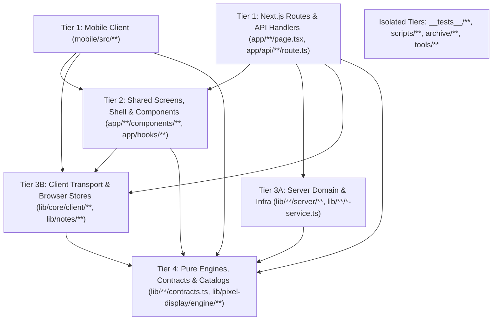

# Sylf — Proposed Long-Term Repository Architecture

**Date:** 2 November 2026  
**Scope:** Independent evaluation of architectural paradigms, target directory structure, module ownership boundaries, dependency rules, and AI-agent navigation design.  
**Phase:** Phase 1 (Research, Analysis & Architecture Blueprint)

---

## 1. Independent Architectural Evaluation & Core Decision

Before proposing any file moves, we objectively evaluated **three realistic repository architectures** against Sylf's actual codebase, build pipelines, runtime boundaries, and AI-agent workflows:

### Option 1: Multi-Package Monorepo (`apps/web`, `apps/mobile`, `apps/worker`, `packages/ui`, `packages/db`, `packages/core`)
- **How it works:** Splits the repository into npm/pnpm workspaces or Turborepo packages.
- **Why it is WRONG for Sylf:**
  1. **Shared Screen Architecture:** `mobile/src/components/MobileRouteOutlet.tsx` lazy-loads 26 full screen trees directly from `app/<feature>/components/<Feature>Screen.tsx`, and `mobile/src/MobileApp.tsx` mounts `app/components/{ThemeProvider,AuthProvider,GlobalSystemWrapper,SylfAppShell}`. Extracting those into `packages/ui` would either hollow out `apps/web/app/` into empty wrappers or require complex cross-package CSS Module, Tailwind v4, and Next.js shim compilation.
  2. **Mechanical Boundary Tests:** **65 files** across `__tests__/`, `scripts/`, and `config/` (including `__tests__/pixel-display/boundaries.test.ts` and `__tests__/planner/client-boundary.test.ts`) assert paths relative to a single root (`app/`, `lib/`, `prisma/`, `mobile/`).
  3. **Build & Deployment Friction:** Vercel, Prisma CLI (`prisma.config.ts`), Capacitor (`capacitor.config.ts`), and the prebuild scripts (`build-calendar-recognition.mjs`, `build-notes-notices.mjs`) are all engineered for a single root `package.json` and `public/` folder.
- **Verdict:** **Rejected.** High migration blast radius, zero product benefit, and significant build/tooling overhead.

### Option 2: `/src` Directory Migration (`src/app/`, `src/lib/`, `src/proxy.ts`)
- **How it works:** Moves `app/`, `lib/`, and `proxy.ts` under `src/` while keeping `mobile/`, `prisma/`, `public/`, `scripts/`, and `__tests__/` at the root.
- **Why it is UNNECESSARY for Sylf:**
  1. The 19 October 2026 repository reorganization already reduced the repository root to **12 clean top-level directories** (`app`, `lib`, `__tests__`, `prisma`, `public`, `assets`, `scripts`, `config`, `documentation`, `mobile`, `android`, `tools`, `archive`).
  2. Moving `app/` and `lib/` into `src/` would break all 65 path-asserting scripts/tests and require rebasing `tsconfig.json`, `mobile/vite.config.ts`, `vitest.config.ts`, and `config/*.json` without solving the actual internal congestion inside `lib/` (72 loose files) and `app/components/` (40 loose files).
- **Verdict:** **Rejected.** Aesthetic churn that invalidates recent documentation and script path repairs without improving internal modularity.

### Option 3: Targeted Modular Monolith Refinement (Preserving Root `app/`, `lib/`, `mobile/`, `prisma/`, `__tests__/`) — **RECOMMENDED**
- **How it works:**
  - **Preserves the established top-level layout** (`app/`, `lib/`, `__tests__/`, `prisma/`, `public/`, `assets/`, `scripts/`, `config/`, `documentation/`, `mobile/`, `android/`, `tools/`, `archive/`) and the `@/*` root path alias.
  - **Eliminates cross-boundary leaks** (`app <-> mobile`, `lib -> __tests__`, `lib -> archive`), enforces `import "server-only"` on all 21 unguarded database/server modules in `lib/`, and breaks the 28 circular dependency chains in `lib/calendar/`, `lib/planner/`, and `lib/ai/`.
  - **Establishes clear internal domain packages inside `lib/` and `app/components/`**, while maintaining **thin backward-compatible barrel re-exports** at high-traffic `lib/<module>.ts` and `app/components/<Component>.tsx` paths where needed during transition (or moving low-fan-out files cleanly in scoped phases).
  - **Prepares dedicated, first-class domain boundaries for upcoming roadmap systems** (such as `lib/workspaces/` and `app/workspaces/` for the October 2026 Study Workspaces master plan, and `lib/planner/v2/` consolidation).
- **Verdict:** **Selected.** Delivers 100% of the modularity, safety, and AI-agent navigability benefits with near-zero regression risk and full compatibility with ongoing Calendar, Notes, and Planner V2 work.

---

## 2. Complete Proposed Directory Tree

Directories marked **`[UNCHANGED]`** remain exactly as they are today. Directories marked **`[REFINED]`** or **`[NEW]`** show the target internal organization.

```text
sylf/
├── app/                                  [REFINED] Next.js 16 App Router + shared Web/Mobile screens
│   ├── (marketing & auth routes)
│   │   ├── page.tsx                      Public landing page (JourneyLanding)
│   │   ├── login/page.tsx                Authentication login route
│   │   ├── register/page.tsx             Authentication registration route
│   │   └── onboarding/                   Multi-step scholar onboarding flow
│   ├── (core study & progression routes)
│   │   ├── dashboard/                    Canonical dashboard route & PixelCompanionCard adapter
│   │   ├── focus/                        Focus timer session screen, layouts, tools, hooks
│   │   ├── focus-party/[id]/             Multiplayer Focus Party lobby & live session routes
│   │   ├── timer/                        Subject timer overview & subject CRUD modals
│   │   ├── goals/                        Objectives & quests dual-tab workspace
│   │   ├── quests/                       Standalone quests screen
│   │   ├── calendar/                     Personal, shared & connected calendar + ink notebooks
│   │   ├── notes/                        Local-first encrypted rich-text & ink Notes app
│   │   ├── workspaces/                   [NEW - Future Stage 3] Study Workspaces & Resource Shelf
│   │   ├── system/                       Sylvie AI workspace & Planner tab
│   │   ├── locker/                       Character identity, Pixel Studio, skills, acoustics
│   │   ├── shop/ & inventory/            Sylph coin store & inventory routes
│   │   ├── social/                       Friends, direct/group chat, Focus Party context
│   │   ├── profile/[username]/           Public scholar profile dossier
│   │   └── settings/                     System Hub (account, appearance, stats, rankings, modes, etc.)
│   ├── (admin & dev-gated routes)
│   │   ├── admin/background-studio/      Admin Focus Background catalog & focal-point studio
│   │   └── dev/                          Development-only surfaces (404 in production via proxy.ts)
│   │       ├── pixel-display/            Pixel Display dev redirect/workbench
│   │       ├── dashboard-design/         [MOVED from app/dashboard-design] Experimental design lab
│   │       └── sylv-preview/             [MOVED from app/sylv-preview] Legacy SVG rig workbench
│   ├── api/                              [UNCHANGED] 81 authenticated REST Route Handlers
│   ├── components/                       [REFINED] Organized into clear functional subdirectories
│   │   ├── shell/                        [NEW group] GlobalSystemWrapper, SylfAppShell, Sidebar,
│   │   │                                 SidebarWrapper, TopRightBar, RouteLoading, TimerSyncWorker,
│   │   │                                 ImmersiveModeContext, ImmersiveModeButton
│   │   ├── providers/                    [NEW group] AuthProvider, ThemeProvider, LevelUpProvider,
│   │   │                                 AcousticsContext, CustomAudioContext, SettingsContext,
│   │   │                                 ProfileModalContext
│   │   ├── ui/                           [NEW group] ConfirmationModal, CustomDatePicker,
│   │   │                                 MarkdownRenderer, PasswordStrengthMeter, ToggleSwitch,
│   │   │                                 UserAvatar
│   │   ├── modals/                       [NEW group] AddFriendModal, FriendRequestsModal,
│   │   │                                 PublicProfileModal, SessionEndToast, SessionInviteToast,
│   │   │                                 LevelUpOverlay, AcousticsDynamicIsland
│   │   ├── settings-primitives/          [NEW group] BackToSettings, SettingsPanel, SettingsRow,
│   │   │                                 SettingsRowGroup, SettingsSectionCard
│   │   ├── auth/                         [UNCHANGED] Split layout, celestial island, OAuthButtons
│   │   ├── calendar/                     [RENAMED from Calendar/] StudyCalendar.tsx entry wrapper
│   │   ├── companion/                    [UNCHANGED] PixelCompanion, TargetPixelCompanion, HexColorPicker
│   │   ├── icons/                        [UNCHANGED] SylvieIcon, SystemIcons
│   │   ├── landing/                      [UNCHANGED] Landing sections, companion/, journey/
│   │   ├── planner/                      [REFINED] PlannerWorkspace, QuickPlan, Copilot, plus
│   │   │                                 AiPlannerModal & AiPlannerPanel (moved from root)
│   │   └── system/                       [UNCHANGED] SystemOverlay, SystemFab, Sylvie chat/
│   ├── hooks/                            [UNCHANGED] Shared client hooks (useDashboardData, etc.)
│   ├── globals.css                       [UNCHANGED] Semantic theme & appearance CSS tokens
│   ├── layout.tsx                        [UNCHANGED] Root web layout
│   └── manifest.ts                       [UNCHANGED] Web App Manifest
│
├── lib/                                  [REFINED] Domain-grouped shared & server modules
│   ├── core/                             [NEW group for foundational infrastructure]
│   │   ├── server/                       prisma.ts, redis.ts, supabase-storage.ts, email.ts,
│   │   │                                 rate-limit.ts, upload-security.ts, execution-coordination.ts,
│   │   │                                 cache-service.ts, timezone-server.ts (all with `server-only`)
│   │   ├── client/                       api-transport.ts, client-data-cache.ts, supabase-browser.ts,
│   │   │                                 realtime-status.ts, scroll-lock.ts, motion.ts,
│   │   │                                 immersive-mode.ts, image-dimensions.ts
│   │   └── shared/                       color-utils.ts, markdown-math.ts, timezone-service.ts,
│   │                                     prelaunch.ts
│   ├── auth/                             [NEW group for authentication & account security]
│   │   ├── token.ts                      (was lib/auth.ts — Edge/JWT verification)
│   │   ├── server.ts                     (was lib/auth-server.ts — getSession & revocation)
│   │   ├── admin.ts                      (was lib/auth-admin.ts — admin guard)
│   │   ├── service.ts                    (was lib/auth-service.ts — login/register logic)
│   │   ├── oauth.ts                      (was lib/oauth.ts)
│   │   └── account-capability.ts         [EXTRACTED contract] Pure AccountCapability interface & registry
│   ├── progression/                      [NEW group for RPG progression, economy & catalogs]
│   │   ├── game-engine.ts                XP curves, ranks, level-up calculations
│   │   ├── difficulty-engine.ts          Quest difficulty & reward scaling
│   │   ├── session-math.ts               Study duration & focus rate math
│   │   ├── cognitive-stats.ts            5-attribute matrix (END, TEN, VEL, SYN, DIS)
│   │   ├── skill-tree.ts                 Skill tree validation & perks (+ skeleton & theme)
│   │   ├── achievements-catalog.ts       Achievement definitions, progress & server facts
│   │   ├── cosmetics-catalog.ts          Themes, frames, titles, character traits, shop-items
│   │   ├── archive-catalog.ts            System Archive lore & documentation catalog
│   │   ├── system-collection.ts          Collection aggregation logic
│   │   ├── concept-forge.ts              Apex synthesis logic
│   │   └── hp-penalty-service.ts         Server-only daily goal HP penalty evaluator
│   ├── study/                            [NEW group for subjects, schedule, timer & focus]
│   │   ├── timer-engine.ts               Pure epoch timer state machine
│   │   ├── timer-leader.ts               Cross-tab BroadcastChannel/storage leadership
│   │   ├── timer-sync.ts                 Durable localStorage journal & background delivery
│   │   ├── session-service.ts            Session queries & helpers
│   │   ├── subject-service.ts            Server-only active subject lifecycle & filtering
│   │   ├── study-schedule-service.ts     Server-only schedule & floating rest day authority
│   │   ├── study-schedule-types.ts       Pure client-safe calendar/schedule contracts
│   │   ├── study-systems.ts              7 study mode configurations
│   │   ├── goal-theme.ts                 Objective color tokens
│   │   ├── focus-backgrounds/            focus-background-{types,preference,client}.ts
│   │   └── focus-party/                  focus-party-{types,service}.ts
│   ├── social/                           [NEW group for profile, privacy, friends & notifications]
│   │   ├── profile-service.ts            Server-only public profile dossier builder
│   │   ├── block-service.ts              Server-only user blocking authority
│   │   ├── privacy.ts & privacy-types.ts Privacy evaluation & contracts
│   │   ├── scholar-id.ts                 Scholar ID formatting
│   │   └── notifications/                notification-preferences.ts, db-notification-preferences.ts
│   ├── workspaces/                       [NEW - Future Stage 3] Unified Resource Shelf & Workspace contracts
│   │   └── resources.ts                  (was lib/resources.ts)
│   ├── ai/                               [REFINED] AI routing, providers, Sylvie & classic planner
│   ├── calendar/                         [REFINED] Cycle-free contracts, services & external/
│   ├── notes/                            [UNCHANGED] Local-first CRDT/Dexie engine, ink & server/
│   ├── pixel-display/                    [REFINED] Engine, renderers, react, content + pixel services
│   ├── planner/                          [REFINED] Organized v1 subdomains + v2/ durable core
│   ├── acoustics/                        [UNCHANGED] Web Audio synth & custom audio IndexedDB store
│   ├── calculator/                       [UNCHANGED] Focus calculator math engine
│   └── emails/                           [UNCHANGED] Transactional email templates
│
├── mobile/                               [REFINED] Unidirectional Capacitor client (`mobile -> app -> lib`)
│   ├── index.html
│   ├── vite.config.ts
│   └── src/
│       ├── main.tsx                      Registers mobile AccountCapability & API transport at boot
│       ├── MobileApp.tsx
│       ├── adapters/                     navigation/, api/, account/
│       └── components/                   MobileRouteOutlet.tsx, Phase1ATimerProof.tsx
│
├── prisma/                               [UNCHANGED] schema.prisma, seed.ts, migrations/ (69 migrations)
├── __tests__/                            [REFINED] All 424 tests grouped into domain subdirectories
├── scripts/                              [UNCHANGED] assets/, build/, db/, dev/, qa/, security/, test/, verify/
├── config/                               [REFINED] Auxiliary TS, Vitest, SVGO configs (fixed worker paths)
├── public/                               [UNCHANGED] Runtime static assets
├── assets/                               [REFINED] Source artwork (absorbs root `sylvs/` -> `assets/sylvs/`)
├── documentation/                        [REFINED] Canonical contracts, indexes, reports & this blueprint
├── tools/                                [UNCHANGED] Independent `tools/ai-agent/` package
├── archive/                              [UNCHANGED] Dormant source & historical sprites
└── android/                              [UNCHANGED] Native Android Gradle project
```

---

## 3. Strict Module Ownership & Dependency Rules

To prevent architectural drift and give AI coding agents deterministic guardrails, Sylf enforces a **five-tier Directed Acyclic Graph (DAG)** of module dependencies:



### Mandatory Boundary Invariants

1. **No Reverse Platform Imports (`app/` and `lib/` MUST NEVER import `mobile/`):**
   - `app/` and `lib/` define platform-neutral interfaces (such as `AccountCapability` and `ApiTransportConfig`).
   - `mobile/src/main.tsx` injects mobile implementations at boot via `setAccountCapability(...)` and `configureApiTransport(...)`.
2. **No Production Imports from `__tests__/` or `archive/`:**
   - Shared synthetic fixtures used by production quality evaluators (`lib/planner/quality/corpus.ts`) or legacy catalog data used at runtime (`lib/shop-items.ts`) belong in `lib/` (e.g., `lib/planner/quality/fixtures/` and `lib/progression/legacy-shop-items.ts`), never in `__tests__/` or `archive/`.
3. **Mandatory `import "server-only"` on Every Server Module:**
   - Every file in `lib/` that imports `lib/prisma.ts`, `@prisma/client`, `lib/auth-server.ts`, `lib/supabase-storage.ts`, `node:crypto`, or provider SDKs MUST begin with `import "server-only";`.
   - Client/shared components in `app/**/components/**` may only import client-safe contracts (`*-types.ts`, `contracts.ts`), client fetchers (`*-client.ts`), and pure engines.
4. **Contract Purity (Breaking the 28 Circular Dependencies):**
   - `contracts.ts` / `*-types.ts` files are **leaf nodes** (Tier 4): they may import `zod` and primitive types, but they MUST NOT import policy engines, recurrence calculators, or database services.
   - Service hubs (such as `lib/calendar/personal-service.ts`) must extract shared row mappers and query primitives into a lower-level internal module (`lib/calendar/internal/event-mapper.ts`) rather than having `shared-service.ts`, `notebook-service.ts`, and `external/service.ts` import back from `personal-service.ts`.
5. **Preservation of Existing Mechanical Contracts:**
   - `lib/pixel-display/engine/**` remains 100% DOM-free, React-free, and product-free (`npm run typecheck:engine`).
   - `prisma/migrations/**` directory names and SQL files remain immutable.

---

## 4. How AI Coding Agents Navigate This Architecture Efficiently

A primary goal of this modernization is enabling AI coding agents to locate owners, understand dependencies, and make safe changes with minimal context-window overhead:

1. **Self-Documenting Path Semantics in `lib/`:**
   - Instead of scanning 72 flat files in `lib/`, an agent working on study timers looks in `lib/study/`, an agent working on XP/levels looks in `lib/progression/`, an agent working on authentication looks in `lib/auth/`, and an agent working on infrastructure looks in `lib/core/server/` or `lib/core/client/`.
   - Any file inside a `server/` folder or ending in `-service.ts` / `-server.ts` is immediately recognizable as **server-only** (`import "server-only"`).
   - Any file ending in `-types.ts`, `-contract.ts`, `contracts.ts`, or `-catalog.ts` is immediately recognizable as **pure, client-safe, and mobile-safe**.
2. **Scoped Component Discovery in `app/components/`:**
   - Global app shell changes -> `app/components/shell/`
   - React Context providers -> `app/components/providers/`
   - Generic UI primitives -> `app/components/ui/`
   - Cross-app modals/toasts -> `app/components/modals/`
3. **Zero-Breakage Re-Export Shims During Transition:**
   - High-fan-out modules (`lib/prisma.ts` with 232 importers, `lib/auth-server.ts` with 117 importers, `app/components/AuthProvider.tsx` with 73 importers) can either remain as canonical entrypoints or re-export from their domain homes so existing imports, worktrees, and tests never break unexpectedly.
4. **Domain-Aligned Test Execution:**
   - Moving the 14 loose root test files in `__tests__/` into their matching domain folders (`__tests__/focus/`, `__tests__/progression/`, `__tests__/ui/`) ensures that running `npm run test -- --run __tests__/focus` executes **all** focus and focus-background suites without missing root-level stragglers.
