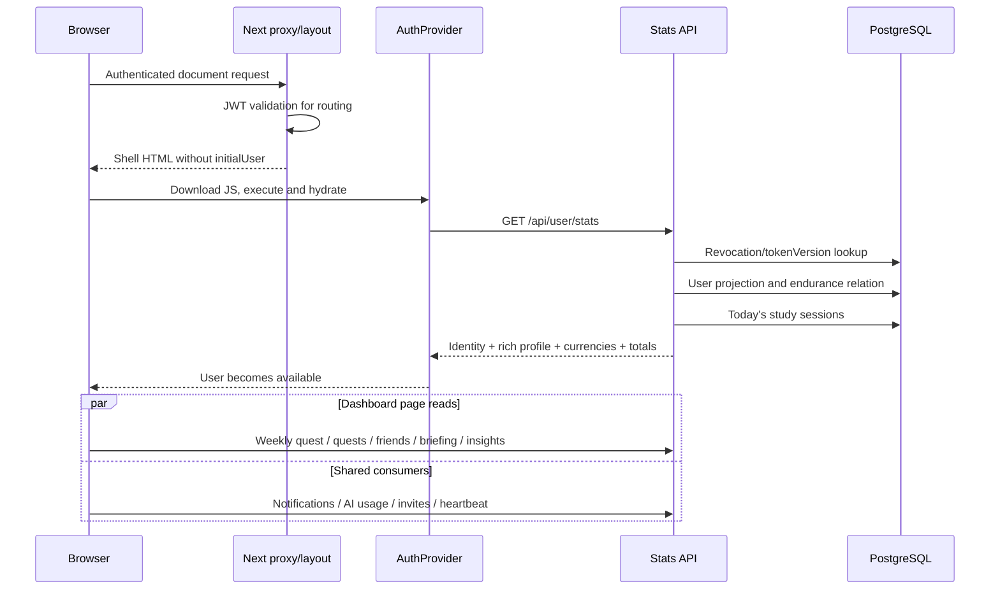

# Sylf: Phase 0 performance audit and modernization plan

**Status:** audit and architecture deliverable; no roadmap implementation. **Measurement dates:** 11 and 14 September 2026. **Source anchor:** Sep 14 production build plus source inventory at 13:45:57 UTC. This report covers the web application. The recently added shared mobile screens and API transport are considered integration constraints; native Android performance was not profiled.

**Concurrent work:** application files continued changing after that inventory. A new `lib/motion.ts`, root `MotionConfig reducedMotion="user"`, planner exit changes and settings migration were observed afterward. They belong to other work, have not been benchmarked here, and must be reconciled before implementing this roadmap. The motion inventory below describes the measured build and explicitly notes these newer developments. See the [source drift record](/Users/aliumair/Desktop/sylf/documentation/performance/phase-0/artifacts/source-drift-20260914.json). Source links open the live files, which may now differ from the recorded hashes.

## 1. Findings and evidence quality

Sylf's delays have several independent causes. The authenticated shell waits for a client request before it knows the user. That request returns considerably more data than a shell needs. Pages then start their own requests. A partially shared cache cannot reliably coalesce requests with custom keys or publish background updates. Globally imported interactive features add JavaScript before they are opened. Social and party subscriptions have correctness problems that also increase latency and traffic.

The evidence supports improving these paths within the existing Next.js, React, Prisma, Redis and Supabase architecture. It does not support replacing the stack, removing authorization checks, or adding a distributed job system everywhere.

Evidence labels used below:

- **Measured:** an actual local production build, browser request, Lighthouse run or PostgreSQL query. These are local observations, not production percentiles.
- **Reproduced:** an isolated test against the actual cache/provider/hook with synthetic I/O. This establishes behavior, not browser FPS or production load capacity.
- **Source:** an inspected code path; its production frequency or cost still needs tracing.
- **Proposed:** a future architecture or acceptance threshold, not an achieved result.

### Ranked bottlenecks

| Rank | Finding and affected experience | Evidence | Priority / intended treatment |
|---|---|---|---|
| 1 | User identity waits for client hydration and a large stats response; child features start afterward | Root does not seed `initialUser`; authenticated stats median **552 ms**, first sample **2,248 ms**, **142,780 decoded bytes** | Phase 1: small server-authenticated shell snapshot, one owner for stats, separately loaded rich profile data |
| 2 | Landing page performs substantial media and JS work before useful interaction | Lighthouse LCP **7.74 s**, TBT **2.93 s**, **12.81 MiB** transferred; four large videos dominate transfer | Phase 6: prioritize visible media, defer offscreen videos, split global features |
| 3 | Cache misses deduplication and does not deliver background changes to mounted readers | Six isolated cache cases, including custom-key duplicate requests and late writes after logout | Phase 2: consistent keys, subscriptions, session generations, explicit persistence policy |
| 4 | Social payloads are large even in a small account; polling repeatedly pays for them | Friends **199,772 B**, conversation list **492,043 B**, DM detail **334,570 B**; medians **899/744/935 ms** | Phases 2/5/7: compact projections, media references, bounded lists and delta reconciliation |
| 5 | Chat/social subscription status can indicate connectivity without delivering intended table changes | Configured DB publication on Sep 11 lacks Message, Conversation, ConversationParticipant, Friendship and FriendRequest | Phase 5: verify publication and authorization together; distinguish joined from healthy delivery |
| 6 | Focus Party subscription lifecycle depends on unstable callback identity and incomplete effect dependencies | Five parent rerenders produced five additional subscriptions and five unsubscriptions; stable callback alone produced zero subscriptions after data loaded | Phases 5/6: correct gate dependencies, stable callback refs, explicit lifecycle |
| 7 | Audio visualization updates all audio context consumers at frame frequency | 60 synthetic frames produced 60 renders of a volume-only consumer; unrelated consumer rendered zero times | Phase 6: isolate high-frequency visual data; retain persistent audio engine |
| 8 | Frequent endpoints incur several serial database round trips | Local DB round trip median **125 ms**, sampled SQL execution **0.020–0.054 ms**; many API medians **388–935 ms** | Phase 7: request-scoped auth reuse, compact queries and region alignment; preserve revocation |
| 9 | Overlay implementations vary in the measured build | Different springs, independent backdrop/ESC/focus code, ineffective exit in AI planner at baseline; subsequent motion work is unmeasured | Phases 3/4: reconcile the new motion foundation, then shared overlay primitives |
| 10 | Chat progress and timeline work amplify perceived latency | AI overlay reveals only after full JSON; message arrays and Markdown rerender together; safety refresh replaces history | Phase 5: real progress/streaming, message identity, cursor history, stable scroll anchoring |

These priorities combine reach, observed cost and correctness. They are not a claim that every ranked issue has an independently measured contribution to LCP.

## 2. Measurement baseline

### Environment and reproducibility

The production build uses Next **16.2.9**, React **19.2.4**, the PostgreSQL Prisma adapter, Supabase JS and Framer Motion. The host is an **Apple M1, 8 logical CPUs, 8 GiB RAM, Darwin 25.5.0, Node v26.7.0**. The working tree already contained extensive user changes. No existing application source was edited for this audit.

The Sep 11 build ID was `7xfElTWvtZVw5OL25iENY`; the Sep 14 build is `kIH7mNXA892mZ3ArJmyNR`. Both production builds completed. Sep 11 compilation took 24.8 s; Sep 14 took 12.5 s. These are build diagnostics, not runtime measurements. The source inventory records file hashes. Shared mobile screens and transport changed between snapshots, so Sep 11 browser results are explicitly dated and are not presented as a before/after improvement experiment.

The authenticated API run used the user's existing Opera session against `http://localhost:3001`, with cookies retained in the browser. It made sequential, unthrottled, `no-store` requests; five samples per endpoint. No response bodies or credentials were exported. Conversation detail used `?refresh=1`, avoiding the route's normal read-receipt write. The normal stats GET retains its existing conditional admin-bootstrap behavior; no audit code changed account privileges. There was no load test, message send, paid AI generation or timer mutation.

### Cold public load: one Lighthouse mobile run, Sep 11

| Metric | Observed |
|---|---:|
| FCP | 2,570 ms |
| LCP | 7,737 ms |
| Total blocking time | 2,933 ms |
| CLS | 0 |
| Speed Index | 3,999 ms |
| Document response metric | 242 ms |
| Total resource transfer | 13,431,553 B / 12.81 MiB |
| Long tasks | 20; longest approximately 549 ms |
| JS startup diagnostic | 9,303 ms |
| Main-thread work diagnostic | 13,328 ms |

Lighthouse 13.4.1 used a 412 × 823 mobile viewport, DPR 1.75, simulated 4× CPU slowdown, 150 ms RTT and approximately 1.64 Mbps throughput. Headless Chrome ran with GPU disabled. Rendering/compositing results therefore cannot establish real-device frame performance. JS startup and main-thread work are Lighthouse diagnostics, not hydration duration. TBT is not INP. One navigation cannot establish p75 field vitals.

Four landing videos transferred roughly 12 MB: meditation 3,628,912 B, standing 3,029,119 B, wave 2,683,917 B and walk 2,666,187 B. This is stronger evidence for controlling initial video loading than asset-directory size alone. Lighthouse also estimated approximately 181 KiB of unused JavaScript.

### Authenticated API timings, Sep 14

Times measure browser fetch through full response-body receipt. Sizes are decoded JSON bytes, not compressed wire bytes. First samples can include initialization and cold caches. Five samples provide a median and range; they cannot support meaningful p95/p99 estimates.

| Endpoint / flow | n | First ms | Median ms | Min–max ms | Response bytes, first sample |
|---|---:|---:|---:|---:|---:|
| User stats / bootstrap | 5 | 2,248 | 552 | 520–2,248 | 142,780 |
| Goals | 5 | 416 | 388 | 387–416 | 2 |
| Quests | 5 | 1,057 | 524 | 516–1,057 | 2 |
| Friends | 5 | 946 | 899 | 771–946 | 199,772 |
| Notifications | 5 | 413 | 401 | 388–422 | 685 |
| AI usage | 5 | 545 | 534 | 530–741 | 392 |
| Cosmetics owned | 5 | 415 | 412 | 391–658 | 528 |
| Subjects | 5 | 774 | 579 | 533–774 | 702 |
| Conversation roster | 5 | 838 | 744 | 684–897 | 492,043 |
| Existing DM detail, refresh read | 5 | 1,039 | 935 | 891–1,039 | 334,570 |
| Existing group detail, refresh read | 5 | 783 | 779 | 770–1,081 | 175,191 |

All 55 requests returned HTTP 200. Goals and quests were empty for this session: those timings do not establish populated-list performance. Browser-to-server is local while server-to-DB crosses the network. Production colocation, compression, caches and cardinality will change results. Repeated decoding of large account/social responses remains relevant even when latency improves with colocation.

The follow-up [payload attribution](/Users/aliumair/Desktop/sylf/documentation/performance/phase-0/artifacts/payloads-20260914.json) identifies the large fields without retaining their values. Stats contains a **121,991 B inline banner** and **19,839 B inline avatar**, together **99.3%** of its JSON. Five friends contain **197,013 B** of inline avatars (**98.6%** of that response). Eight conversations repeat **484,898 B** of inline image fields (**98.5%**). This is a measured media-representation problem, not simply a consequence of large lists. Store versioned images behind appropriate object-storage/CDN URLs, return a small avatar thumbnail reference, and omit the banner from shell/roster projections. Preserve access rules for private images and existing images during a staged migration; do not dump private media into an unprotected bucket for speed.

Separate unauthenticated HTTP probes returned the expected `/dashboard` redirect and stats 401. They are retained as diagnostics, not mixed with authenticated timings. Public acoustics is a cached successful GET even without authentication.

### Coverage of the 15 requested flows

| Flow | Evidence captured | Measurement still required |
|---|---|---|
| 1. Cold application load | Production public Lighthouse, resource inventory, HTTP probes | Repeated real-device and authenticated cold runs |
| 2. Authenticated reload | Existing signed-in session verified; stats/API timings and bootstrap source path | Full browser timeline, authenticated LCP, hydration marks |
| 3. Dashboard → goals | Cache/fetch dependencies, goals and quests timings | Click-to-shell and click-to-data trace |
| 4. Dashboard → social | Friends/conversation timings, channel and polling audit | Full navigation trace and frame timing |
| 5. Dashboard → focus | Initial stats/subjects requests, timer/audio dependencies and bundle | Full trace without disrupting an active study session |
| 6. Open System Hub | Motion, prefetch and lifecycle inspection | Opening frame and focus measurements |
| 7. Open notifications | GET timings; immediate-open and PATCH code path | Measured click response and read-state race |
| 8. Open another profile | Dossier cache, privacy and request-race inspection | Authenticated profile open trace |
| 9. Open Character Studio | Catalog/layer/asset and import inspection | Decode peak, memory and frame trace |
| 10. Open AI chat | Global import path, history and reveal behavior | First-open timeline and provider TTFT |
| 11. Open a DM | Existing DM detail measured, full client/server audit | Render/scroll/route trace |
| 12. Open a group | Existing group detail measured, shared timeline audit | Render trace with representative membership/history |
| 13. Send a message | Optimistic/reconciliation/transaction source audit | Paired disposable test conversation; send/ack/retry trace |
| 14. Receive realtime | Actual publication inventory; synthetic party lifecycle test | Authorized two-client delivery, event bytes and reconnect timing |
| 15. Return to visited page | Cache revalidation and invalidation reproductions | Warm navigation browser trace and state retention timings |

Native browser controls were intermittent and did not yield a complete authenticated Chrome Performance export. This is a **partial runtime baseline with a complete source/architecture audit**, not a claim that all 15 flows were fully profiled. INP, hydration duration, route-transition percentiles, browser commit durations, heap growth and dropped-frame counts remain unmeasured. The collection protocol in section 15 makes these explicit acceptance prerequisites for subsequent work. Tool round-trip time was never used as application timing.

## 3. User bootstrap and navigation waterfalls

Relevant sources: [root layout](/Users/aliumair/Desktop/sylf/app/layout.tsx), [AuthProvider](/Users/aliumair/Desktop/sylf/app/components/AuthProvider.tsx), [auth server](/Users/aliumair/Desktop/sylf/lib/auth-server.ts), [stats route](/Users/aliumair/Desktop/sylf/app/api/user/stats/route.ts), [DashboardScreen](/Users/aliumair/Desktop/sylf/app/dashboard/components/DashboardScreen.tsx).



The proxy's signed-JWT check protects routing UX. API `getSession` additionally validates signature/claims and checks the user's token version in the DB, failing closed. Server bootstrap must use the authoritative session path; trusting proxy claims alone would weaken revocation.

`AuthProvider` now accepts `initialUser`, but the web root never supplies it and the mount effect refreshes stats even when a seed is supplied. Identity therefore starts null on a full reload. The stats endpoint combines identity, email/security indicators, avatar/banner/bio/social links, character configuration, progression, currency, timezone, endurance and current-day session derivation. `activeTheme` and `activeBackground` exist in the client type but are absent from its select. Basic identity waits for all this work.

Stats performs at least three sequential logical Prisma operations on the normal path: session revocation, user selection, then today's sessions. Relation loading can execute additional SQL; these are not an asserted exact SQL count. A conditional admin bootstrap can add a write. Today's session query catches errors as an empty array, potentially displaying zero activity on failure. Request tracing should expose that degraded state.

After the user arrives, Dashboard starts five reads **in parallel**, not one after another. Focus independently requests `/api/user/stats` alongside subjects. Sidebar new-notification handling can call `refreshStats`, and its notification effect depends on the whole `user` object. Every successful stats refresh creates a new object and can restart notification fetching. No single-flight or session-generation guard exists in the auth provider.

### Proposed bootstrap

Use the existing root/shared shell boundaries, with a narrowly scoped authenticated server boundary where needed. Resolve the full custom session once per server request and produce a serializable **ShellUser** projection: id, display name, small avatar reference, progression/currency summary, timezone and display preferences. Fetch independent shell data concurrently after authorization; keep expensive analysis/history out of the identity-critical path. Seed the existing provider and the same client resource store with a freshness timestamp. Avoid immediate duplicate mount revalidation when that seed is current.

A React request-scoped server memo can deduplicate repeated session resolution within a render. It must not become a global user/session cache that delays revocation. Keep httpOnly cookies and existing issuer/audience/expiry/tokenVersion checks. Never serialize the password hash, JWT or database session secret. The current endpoint strips the selected password before returning; preserve that property while reducing the projection.

Server seeding shifts a small amount of work before shell delivery; it does not make DB latency disappear. Stream route sections behind bounded skeletons, keep public pages static where appropriate, and compare document TTFB against time-to-known-user. The new mobile transport needs a corresponding explicit bootstrap API because native clients do not receive the web server-rendered shell.

### Navigation: actual versus perceived latency

The root providers and `SylfAppShell` persist across route changes. There is no evidence that the entire app remounts on every navigation. Sidebar is intentionally absent on focus, focus-party and settings routes, so those transitions do remount its own effects. As of Sep 14, the second mobile Sidebar mounts **only while its drawer is open**; the desktop instance remains mounted then, including on mobile. Do not model two notification pollers for every idle desktop session.

Next Link handles routes and route prefetching; Social adds conversation route prefetch on hover. Neither automatically seeds API responses fetched in page effects. Opening System Hub prefetches its settings destinations in a burst. Cap intent prefetch to useful routes/data rather than assuming every tile must load immediately.

Route loading boundaries exist for dashboard, goals, social, DM/group chat, system, calendar, shop and many settings routes. Focus, locker and timer lack equivalent route files in this snapshot. Existing boundaries help when the route suspends on the server; they cannot wait for or orchestrate later `useEffect` requests. Shared Screen components remain mostly client data owners despite the new thin page wrappers.

Actual latency is code transfer/execution plus API/DB work. Perceived latency is blank initial state, lost page state, waiting to mount heavy children, artificial reveal and overlong choreography. On a warm visit, cached data can still be copied into component state only after mount, and background revalidation does not notify that component. Render a synchronous resource snapshot, then subscribe to changes. Keep already-known user and page data visible while route content updates; use a skeleton only for genuinely missing data.

## 4. Frontend data and cache architecture

The current inventory covers **411 app/lib TS/TSX/CSS files, 165 direct `fetch` call sites and 30 `fetchCachedJSON` sites**. These are static call sites, not runtime request counts. The artifact includes every detected site and import, including mutation and server fetches. Primary sources: [client cache](/Users/aliumair/Desktop/sylf/lib/client-data-cache.ts), [API transport](/Users/aliumair/Desktop/sylf/lib/api-transport.ts), [inventory](/Users/aliumair/Desktop/sylf/documentation/performance/phase-0/artifacts/current-20260914/frontend-inventory.json).

| Owner | Data / current behavior | Architectural issue |
|---|---|---|
| AuthProvider | In-memory user; direct stats fetch; clear cache on explicit logout | No single-flight, no late-response identity guard, 401 does not itself clear all private caches |
| client-data-cache | Memory Map, max 200 entries; optional localStorage; default 10 s fresh / 60 s stale | No reactive subscription contract; storage grows separately from memory bounds |
| Dashboard | Weekly quest direct + separate localStorage; quests/friends 15 s fresh / 120 s stale; briefing 20/120; insights 30/300 | Separate weekly persistence and overlapping cross-page resources |
| Goals/Quests tabs | Goals 15/120; all quests 15/120; weekly 30/300 | Query variants are different resources; invalidation must connect them explicitly |
| Social | Friends/conversations 10/120, requests 20/120; user-specific custom keys | Polls and events can read fresh cache instead of changed server data |
| Sidebar / invite toast / heartbeat | Direct GET/PATCH; notifications 30 s; invites 30 s; heartbeat 60 or 300 s | Independent lifecycle and duplicate triggers, limited hidden-tab policy |
| SystemAIProvider | Usage 30/120; memoized context value | Fetch effect depends on whole user; globally imports heavy AI UI |
| Public profile | Dossier 15/300 keyed by username/viewer; clears display data on close | Request races and privacy-sensitive stale windows |
| AI history | `sys-msgs:<session>` cache; limit 100, 3/120; session list separate | Transcript persistence guard gap and history/identity races |
| DM/group timeline | Latest 50 cached 3/45; refresh URL has separate entry | Full snapshot/delta/pending states lack one reconciliation owner |
| Focus/backgrounds | Timer anchors/drafts in localStorage; dedicated preference/asset lifecycle | Preserve durable timer state; do not sweep it into generic ephemeral query caching |
| Server profile/rankings | Next cache wrapped around Redis cache | Conflicting lifetimes and invalidation scopes |

### Reproduced cache failures

The [cache reproduction artifact](/Users/aliumair/Desktop/sylf/documentation/performance/phase-0/artifacts/cache-reproductions-20260914.json) tests the actual module with a controlled clock/network:

1. Two simultaneous URL-keyed reads make one request; the same reads with `storageKey: social:friends:7` make **two**. Lookup uses the cache key while insertion/deletion of the in-flight entry uses URL.
2. A stale read returns version 1. Background work stores version 2, but the original mounted reader still has version 1. Only a later read sees version 2.
3. Invalidating by URL misses a custom storage-key entry. A follow-up read returns the old value without another request.
4. Clearing on logout does not abort/clear in-flight work or reject old-generation commits. A late response repopulates localStorage after clear.
5. The no-persist denylist matches some briefing/insight/memory names, but an AI transcript URL and `sys-msgs` key pass it and persist. This is an explicit policy gap, not a measured cross-account disclosure.

There are six artifact rows because the first case tests two key variants. Revalidation uses `no-store`; HTTP cache-control headers do not provide the client's intended stale behavior. `forceFresh` bypasses age but needs a clear interaction with in-flight work. Key identity does not include relevant fetch configuration, origin or session generation. The separate weekly quest localStorage key is outside the normal prefixed cleanup.

### Proposed data classes and ownership

| Class | Examples | Proposed policy |
|---|---|---|
| Session-global | Shell user, balances, preferences, AI usage | One session-scoped resource owner; server seed; event/mutation patch; no blanket profile persistence |
| Page-specific | Goals, quests, subjects, calendar | Canonical key with filters; immediate known snapshot; 15–60 s freshness by resource; subscriber notification |
| Frequently changing | Messages, notifications, party/presence | Bounded normalized state; event revisions and catch-up cursor; single visible-tab fallback scheduler |
| Immutable/static | Versioned catalog, icon metadata, asset URLs | Long CDN/browser cache with content version; avoid per-user duplicate copies |
| Expensive computed | Briefing, insights, rankings | Explicit computation freshness and dependency invalidation; server cache; show known result while refreshing |

Extend the existing cache before selecting another library. It needs one canonical key factory, `readSnapshot/subscribe`, `fetch/singleFlight`, `set/patch`, and resource-based invalidation. Include session generation and API origin in private keys. Add AbortController ownership and reject commits from a prior generation. Use structural sharing so unchanged responses do not broadcast new objects to every subscriber. Bound persistence by size/age with an explicit allowlist; keep transcripts and sensitive profile data memory-only by default. Cross-tab logout should clear private snapshots and coordinate via a minimal event, without transmitting private payloads between tabs.

Mutations should update the canonical resource, then invalidate dependent aggregates, with request/version-aware rollback. Examples: quest completion → quests, goal summary, shell progression; cosmetic purchase/equip → owned inventory, shell appearance, self profile; send/edit/delete → timeline and conversation preview; friend/block change → roster, requests, profiles, relevant conversations. Privacy/block changes must fail closed and invalidate immediately; stale-while-revalidate is not permission to continue showing newly forbidden data.

`api-transport` is a useful boundary for the new mobile client, but many existing direct fetches bypass it, and cached/auth reads currently use `resolveApiUrl` rather than its complete `apiFetch` behavior. Consolidate errors, credentials, aborts and metrics deliberately. Do not infer a secure cross-origin mobile session merely because URL resolution works.

## 5. React rendering and lifecycle audit

Sources: [AcousticsContext](/Users/aliumair/Desktop/sylf/app/components/AcousticsContext.tsx), [FocusScreen](/Users/aliumair/Desktop/sylf/app/focus/components/FocusScreen.tsx), [party hook](/Users/aliumair/Desktop/sylf/app/hooks/useFocusPartyRealtime.ts), [party context](/Users/aliumair/Desktop/sylf/app/social/components/focus-party/FocusPartyContext.tsx), [diagnostic tests](/Users/aliumair/Desktop/sylf/documentation/performance/phase-0/render-diagnostics.test.tsx).

| Surface | Finding | Treatment and proof needed |
|---|---|---|
| Focus Timer | A 500 ms wall-clock check drives second-level state; persistence runs about once a second and server autosave about every 180 s. Whole FocusScreen also consumes audio context. | Isolate the clock display and audio controls; preserve wall-clock anchors, leadership, resume, settlement and duplicate-write protection. Do not replace elapsed-time derivation with incrementing counters. |
| Audio | RAF allocates a new 15-value frequency array and changes an inline context value every frame while active. | Publish visualization data to a dedicated subscriber/canvas/ref; memoize low-frequency control state. Stop visualization work when no visible visualizer needs it while keeping playback correct. |
| Focus Party | Inline `onEvent` changes each provider render. Subscription effect depends on it, but omits data that gates subscription eligibility. | Use stable event refs and explicit party/member/identity dependencies. Abort obsolete refreshes, clear the debounce, and retain a trailing refresh when an event arrives during synchronization. |
| Sidebar / notifications | Notification effect depends on `user`, not its stable id; opening mobile drawer adds another Sidebar owner. Unread notifications can refresh stats, which restarts the effect. | One notification store/scheduler independent of visual sidebar instances. Stable selectors and IDs; batched focus/visibility events. |
| System Hub / profile | Large globally imported component trees; open renders many feature controls. Profile fetch completion is not tied to the requested identity. | Lightweight persistent controller; lazy feature content; reject obsolete responses; bound retained content. |
| Social | Friend cards tick while relevant study activity is present; arrays/profiles are recreated on refresh. | Preserve inactive behavior; isolate live elapsed-time labels and structurally share unchanged friend rows. |
| AI and DM lists | Whole-array updates plus Markdown/grouping work; no meaningful message-level memoization. | Stable message objects, memoized rows and renderer options. Add virtualization when realistic histories show DOM/render pressure. |
| Character Studio | Main layered preview and text catalog cards share parent updates; CSS effects can composite heavily. | Isolate preview from selection metadata; memoize stable layers after profiling. Do not claim every catalog entry decodes an image. |

The two React diagnostic tests passed. With synthetic audio I/O, 60 analyser frames caused **60 volume-only consumer renders and 60 Profiler commits**, while an unrelated memoized nonconsumer rendered **zero** times. Context changes invalidate subscribers, not automatically every descendant. With the actual party hook and mocked channel transport, five parent rerenders caused **five new subscriptions and five unsubscriptions**. A stable callback by itself yielded **zero subscriptions after initial party data arrived** because required gate dependencies are missing. Both sides must be fixed together.

These are development React Profiler counts in jsdom. They do not measure real socket churn, frame drops, reconciliation duration or retained heap. React's normal production build does not enable full profiling by default; a deliberate profiling build is needed for representative commit measurements. [React Profiler documentation](https://react.dev/reference/react/Profiler).

Most inspected effects do remove their listeners/timers. There is no basis for declaring a universal memory leak. Specific risks are uncleared party debounce work, stale async completions, long-lived private caches and channel lifecycle churn. Measure retained heap and channel counts across repeated open/close/navigation cycles before assigning a memory cost.

## 6. Motion and interaction inventory

This is the **measured-build inventory**, assembled before the concurrent motion pass. Seconds below are configured values, not observed animation completion times; physical springs have no fixed duration. Most surfaces use inline fixed/absolute positioning rather than portals. No browser trace established an incorrect first frame; items marked as risks require frame-by-frame verification.

| Surface | Baseline animation / lifetime | Network, layout and interaction findings |
|---|---|---|
| System Hub (`SettingsPanel`) | AnimatePresence; backdrop opacity 0.25 s ease-out; content scale .96/y16, spring 350/28; category entries 0.3 s with .05 s stagger | Opens without network gate; opening prefetches settings routes. Independent scroll lock/ESC; no central focus trap or portal. Category stagger can delay visible readiness. |
| Notifications | Desktop opacity/scale .95/y−6 spring 380/25; mobile x100% spring 350/28 | Opens before GET; separate desktop/mobile behavior. Desktop outside-click handling; mobile back navigation. No shared focus/ESC policy. |
| User Profile | AnimatePresence, spring configured duration .4/bounce .15; fixed backdrop; nested menus and confirmation | Opens a shell/skeleton immediately; fresh/cache data arrives afterward. Clear-on-close and large child tree; no request-generation guard. |
| Character Studio | Route/IdentityTab content; mode-wait tab transitions around .2 s opacity/y | Usually has parent data first; main preview can decode during entry. It is not itself always an overlay. Avoid imposing modal semantics on the route. |
| AI overlay | Persistent global controller and overlay; message reveal updates after completed JSON | Opening state can appear immediately, but response progress is simulated late. Hidden generation/reveal lifecycle needs an explicit policy. |
| AI planner modal | Early `return null` above AnimatePresence in measured build; opacity/scale .95/y16 | Exit is bypassed on close in baseline. Concurrent work has moved the condition inside AnimatePresence; reverify its actual exit and nested focus behavior. |
| DM/group chat | Route loading state, optimistic bubbles and smooth message scrolling; shared details drawer | Scroll animation on message-array changes can fight reading position. Route data and timeline are the larger concern than adding entry motion. |
| Chat details drawer | x100%, spring 220/25, backdrop blur; expandable height-auto subsections | Inline fixed layer, independent lifetime. Height animation may require layout work; profile subflows need one focus stack. |
| Focus environment picker | Backdrop .2 s; spring 380/30 panel | Already has Tab trapping, restoration, ESC and selection predecode. Preserve these working features when extracting primitives. Thumbnails use full public image URL. |
| Focus tool windows | Spring 400/30/mass .8; exit .16 s; reduced-motion hook | Minimize unmounts tool content; returning before outer AnimatePresence can bypass last-window exit. Initial geometry is computed; wrong first-frame position is not proven. |
| Focus tools dock / menus | Layout spring 400/28 plus CSS transition-all 300 ms; popover 380/26; mobile sheet 360/28 | Competing CSS/Framer animation on the same properties is a risk. Static tool imports add entry cost. |
| Add friend / friend requests | Spring 380/28 scale .94/y10–12; backdrop .2 s; request rows use layout animation | Similar infrastructure is repeated. Parent must keep AnimatePresence alive through exit. |
| Confirmation dialog | Backdrop .2 s; spring 380/28 scale .94/y8 | No complete self-contained focus/ESC/scroll contract in baseline; layering differs between callers. |
| Sidebar and menus | Sidebar spacer width/min-width .3 s cubic-bezier(.16,1,.3,1); offcanvas transform | Spacer resize deliberately triggers page layout. Keep structural resize distinct from transform-only panel motion; test content reflow and responsive boundaries. |

Concurrent work has now introduced `lib/motion.ts`, shared variants and root `MotionConfig reducedMotion="user"`. Its initial values include 120/180/240/320/450 ms durations and several spring presets. This is useful work to consolidate, not a reason to create a second token file. These new files are outside the measured bundle. Root reduced-motion configuration helps transform animation, but CSS loops, video, canvas and delayed content choreography still need explicit policy and device verification.

### Proposed canonical motion contract

Refine the one existing/new foundation with named semantic tokens. A short set is sufficient:

| Token | Proposed value | Use |
|---|---|---|
| Instant feedback | 0 ms state change; visual feedback in next frame | Pressed/selected/loading state; never wait for fetch |
| Micro | 120 ms; ease-out | Color/opacity/icon changes; press scale no smaller than .98 |
| Panel | Enter 220 ms, exit 160 ms; cubic-bezier(.16,1,.3,1) entry | Drawers/sheets: translate only; popovers y ≤8 px |
| Modal | Enter 200 ms, exit 140 ms; same entry curve | Opacity plus scale .98→1 and y ≤8 px |
| Page content | 160 ms enter, 100 ms exit or no exit gate | Small opacity/y ≤6 px; persistent shell never fades out |
| Layout movement | 180 ms; cubic-bezier(.4,0,.2,1) | Small reordering/indicator movement; reserve structural space |
| Springs | Snappy 440/32/.75; panel 340/32/.9 (stiffness/damping/mass) | Drag settle and spatial movement only; do not also add a tween to the same property |

These are starting values for review, not guaranteed 60 FPS. Avoid staggered entrance on essential controls; cap decorative total stagger to 80 ms. Keep backdrop opacity a single 140 ms fade, with stable blur instead of animating blur radius. Use one backdrop for the active modal stack where appropriate. Preserve stacking semantics rather than animating z-index. Reduced motion removes position/scale/layout movement and uses at most an 80 ms opacity change; essential progress still updates immediately. Pause ambient decorative loops and offscreen video as appropriate.

### First-frame and frame-quality verification

For each surface record the first visible frame on cold and warm open, then rapid open-close-open, nested open, resize and mobile keyboard appearance. Compute the final anchor before making a floating surface visible. Use top/left for stable placement and a separate transform wrapper for entry, preventing transform composition from replacing CSS centering. Do not wait for an image or API to determine panel placement. Prefer reserved preview/skeleton dimensions. A 60 Hz frame has 16.7 ms total budget; expensive content should mount in bounded sections while the panel frame starts immediately.

## 7. Shared overlay and panel architecture

Use a small `SylfOverlay` controller plus presentational `SylfModal`, `SylfDrawer`, `SylfPopover` and `SylfPanel` variants. Keep feature logic in System Hub/profile/chat/Studio components. Do not create a giant component that imports every settings page or force ordinary pages into dialogs.

The controller should own a stable portal root, topmost overlay stack, z-index tokens, backdrop policy, Escape handling, initial focus, Tab containment, focus restoration and inert background behavior for true modals. Popovers require anchored placement/collision handling and outside-click rules, not always modal trapping. Nonmodal focus tools need their own keyboard/stack policy and must not make the entire timer inert.

Retain the existing `lockPageScroll` idea but make each release closure idempotent and restore prior styles. Its current global-count check does not prevent one closure from decrementing twice while a different overlay still owns a lock. One stack manager should decide which layer owns input and restoration. On route teardown release exactly once, even after interrupted exit.

Keep the lightweight registry mounted. Load heavy content on intent/open, show its frame immediately, and retain only explicitly valuable state such as AI drafts or selected profile tab. Data lives in the shared resource store rather than depending on hidden component survival. Allow bounded retention for recently used expensive features; release listeners, visualization loops and large decoded assets when they are no longer needed. Preserve unsent text separately before unmounting a tool.

Migrate one surface at a time: System Hub as the first modal host, then notifications/popovers, profiles and confirmation stacks, then tools. Require keyboard, screen-reader, touch, safe-area and nested-scroll checks alongside timing. Existing environment-picker focus handling should supply regression cases rather than being discarded.

## 8. AI chat, DMs, groups and social

Sources: [DM/group page](/Users/aliumair/Desktop/sylf/app/social/chat/[conversationId]/page.tsx), [conversation APIs](/Users/aliumair/Desktop/sylf/app/api/conversations), [SystemOverlay](/Users/aliumair/Desktop/sylf/app/components/system/SystemOverlay.tsx), [AI conversation panel](/Users/aliumair/Desktop/sylf/app/system/components/ConversationPanel.tsx), [AI chat endpoint](/Users/aliumair/Desktop/sylf/app/api/system-messages/chat/route.ts).

### DM and group timeline

Initial conversation detail is already bounded to the latest **50** messages and returns `hasMore`; the client does not implement older-history loading. The server's before-cursor and sort order should be made consistent using a stable `(createdAt,id)` tuple or a single monotonic ordering. Incremental `after=maxId` requests lack `take`, so a long absence can still load an unbounded delta. Conversation lists and participant projections are also unbounded.

The page polls incremental messages every **1 s** without push and **15 s** when push reports connected, with a full refresh every **30/60 s**. There is no comprehensive overlap/abort/hidden-tab policy. An empty history leaves `maxId` at zero and suppresses incremental polling; without functioning push, first inbound content waits for a full refresh. Full refresh can replace accumulated history with the latest 50. The realtime handler listens to INSERT, not all edit/delete changes. Cached refresh and initial URLs are different resources.

Optimistic send exists: a negative timestamp id is inserted before POST. The server response is merged by real id. Push arriving before the POST response can temporarily show both the pending and confirmed bubble; there is no stable clientMessageId/idempotency contract. Failure removes the optimistic bubble after the input was cleared, so retryable text needs explicit preservation. Edit/delete rollback restores a captured full array, which can discard later messages received during the mutation. Route identity changes also need to reset or partition cursors and request generations.

Use one timeline reducer/store per conversation. Maintain `serverId`, `clientMessageId`, status, revision and cursor metadata. Merge snapshots, events and acknowledgements idempotently; keep tombstones/revisions for edits/deletes and protect pending messages from stale snapshots. Limit each delta page and continue catch-up until current. Batch read receipts while the conversation is visible, preserving membership checks. Every message send must remain authorized; add bounded body size and per-user/conversation abuse controls without weakening existing block checks.

Cursor pagination precedes virtualization. Start with 50-message windows and test 500/5,000-message histories. Virtualize once rendered rows/commit time exceed the budget, retaining estimated/measured heights and an anchor message during prepend. Memoize message rows and stable formatting options. Near-bottom behavior should append smoothly only when appropriate; keep readers anchored elsewhere and show a new-message affordance. Do not smooth-scroll on every unrelated array replacement.

Prefetch route code plus compact conversation metadata and first page on hover/focus/touch intent, with cancellation, a concurrency cap and no read-receipt mutation. Current `router.prefetch` only handles the route.

### AI chat

The global overlay waits for full JSON, then reveals about 40 chunks at 18 ms intervals: roughly **720 ms of artificial reveal after the answer already arrived**. This cannot improve provider time-to-first-token. It repeatedly renders Markdown and can reset a 60 ms scroll debounce until reveal finishes. A stop controller exists; closing the globally retained overlay is a different lifecycle and needs an explicit continue-in-background/cancel policy.

The System workspace reads at most **100** stored messages, but lacks older-page UI; `/api/chats` is unbounded. Backend model context is bounded to about **20** history messages. Do not characterize every AI path as loading the entire history. Request generations are needed when switching sessions so old fetches cannot replace the new session.

The chat endpoint includes useful deterministic paths, bounded tool rounds, provider timeouts/fallback and atomic quota reservation/refund. Preserve those. Normal chat responses are not streamed. AI Planner **already uses SSE progress**; it does not need a redundant streaming rewrite. It can perform multiple goal/quest/message writes after model work, so recovery from a partial result needs idempotency and a clear persisted operation state.

For general AI chat, emit immediate local acknowledgement, then real server stage events and token/text deltas where the selected provider supports them. Separate time-to-acknowledgement, first progress, first token, tool execution and total completion. Batch text updates at an appropriate visible rate and render completed messages independently. Use one end-to-end deadline across fallback attempts, propagate cancellation where supported, and reconcile quota refund/settlement exactly once. Do not stream sensitive tool arguments into UI/logs. Existing prompt-prefix logs should be redacted before broad observability rollout.

### Friends, profiles and notifications

Friends queries already batch timezone/friendship/block work and use two aggregate queries; this is not a per-friend N+1. The largest observed problem for five friends is inline-avatar payload. Profile service correctly computes viewer relationships/block restrictions separately from its public/base profile. Preserve that division, but guard fast A→B profile opens against stale A completion and ensure privacy changes invalidate every cache layer.

Notifications read preferences, fetch a bounded 50-row window, then filter and return up to 15. This limits payload, but preference filtering can hide relevant older notifications beyond the initial window. On transient database failure the route can return `200 []`, erasing visible known notifications. Return explicit failure/degraded semantics and retain last good state instead. One resource owner should merge GET, read PATCH, preference change, focus and push updates without duplicate immediate refreshes.

## 9. Character Studio, media and assets

Sources: [CharacterRenderer](/Users/aliumair/Desktop/sylf/app/components/character/CharacterRenderer.tsx), [CharacterStudioView](/Users/aliumair/Desktop/sylf/app/locker/components/identity/CharacterStudioView.tsx), [background hook](/Users/aliumair/Desktop/sylf/app/focus/hooks/useFocusBackground.ts), [asset inventory](/Users/aliumair/Desktop/sylf/documentation/performance/phase-0/artifacts/current-20260914/bundle-assets.json).

The public asset directory contains about **140.8 MB across 150 files** in the measurement inventory, including the temporary audit page. This is storage footprint, not a page download. Some raster sources are large: scholar-elena PNG is **8.78 MB, 1920×2400**, approximately **18.4 MB** for one RGBA decode; celestial-mage-lyra is **3000×3000**, approximately **36 MB** for one decoded frame. Browser texture/copy overhead can add more. Those images are not proven to be simultaneously loaded.

CharacterRenderer normally composes a main form, pedestal and optional relic—up to three raster layers plus CSS aura. Catalog form cards inspected here are text-based; importing catalog metadata does not decode every sprite. The main image elements lack a comprehensive responsive-source/decoding policy, though their containing geometry helps reserve space. CSS aura/filter/shadow costs need GPU-enabled real-device traces.

Create transparent WebP/AVIF or optimized PNG variants appropriate to actual alpha fidelity, with thumbnail/preview/full resolution tiers. Keep intrinsic dimensions and stable layer alignment; version assets so old URLs remain cacheable. Preload only the selected character and likely next intent target with a small concurrency cap. Decode the next selected preview before swapping and reject an obsolete selection. Virtualize the catalog only after DOM counts justify it; first avoid unnecessary parent recomputation and decode work.

Focus backgrounds already have selection predecode, latest-write protection, signed-URL expiry handling and visibility routines. Retain them. Generate small picker thumbnails rather than loading a full wallpaper into every visible card. Cancel obsolete fetch/decode jobs, release unused object URLs and test selected-wallpaper restoration without affecting the study timer. Pause hidden ambient work. The same asset pipeline should replace the measured inline account/social images; that change has much stronger immediate evidence than speculative catalog virtualization.

## 10. Backend and database

The DB audit used **one connection**, `BEGIN READ ONLY`, verified transaction read-only state, a local 5 s statement timeout and 1 s lock timeout. Queries were SELECT/EXPLAIN ANALYZE only. IDs and row contents were not exported. Seven samples per query measured round trip; EXPLAIN recorded execution separately. This was a small dataset and mostly empty-result predicates selected using minimum user/conversation ids, not production-cardinality plans.

| Query | Median round trip, approx ms | Server execution ms | Plan observation |
|---|---:|---:|---|
| SELECT 1 | 125 | .020 | Network/connection path floor |
| Auth tokenVersion | 127 | .035 | User primary-key index |
| Today's sessions | 125 | .026 | Existing userId/startedAt index |
| Latest 50 messages | 123 | .039 | Tiny-table sequential scan + sort |
| Incremental messages | 124 | .039 | Tiny-table sequential scan + sort |
| Notification window | 125 | .054 | Bitmap index path, then sort |
| Block lookup | 123 | .031 | Existing compound index via bitmap paths |

Connection establishment took **711 ms**. Row estimates were User 119, Message 96, Conversation 17, StudySession 375, SystemMessage 620. A sequential scan of 96 rows is not evidence of a missing index. Existing Message `(conversationId,createdAt)` and StudySession `(userId,startedAt)` indexes are present. A high-cardinality catch-up query may benefit from `(conversationId,id)` or the chosen tuple index; confirm using realistic data and EXPLAIN BUFFERS before adding it. For notifications, test an index aligned with user/session/order predicates, accounting for write cost and overlap with existing indexes.

### Endpoint/query findings

- Stats combines too much data and serial work; use a shell projection and request-scoped session resolution. Move admin bootstrap out of an ordinary read path only in a separately reviewed reliability change; retain current authority checks.
- Conversations fetch nested participant profiles and latest message, then sort in JS without bounded roster pagination. Project small media references, preview fields and unread state; use an indexed stable roster order and page size.
- Sending a group message checks blocks sequentially for other participants. This is a membership-size-dependent N+1 candidate. Batch the block predicate while preserving bidirectional blocking semantics, then retain the atomic message/conversation/read transaction.
- Leaderboard caching loads all users with completed quest ids rather than only counts/limited ranked results. Compute bounded top-K results and aggregates at the appropriate cache layer. Do not build a separate analytics service for the current dataset.
- User stats and several frequently polled routes repeat authorization/user reads across independent requests. Cache permission-independent reference data, batch related authorized reads, and deduplicate within one request. Avoid cross-request revocation caching without an explicit security design.
- Preserve atomic AI quotas, currency/XP ledgers, party membership invariants and timer settlement transactions. They are correctness boundaries, not removable overhead.

### Pooling, caches and rate limits

[Prisma setup](/Users/aliumair/Desktop/sylf/lib/prisma.ts) uses a pg adapter pool, max **20 production / 10 development**, 5 s connection timeout and 30 s requested statement timeout. Module singleton reuse in production is normal; absence of a development-style global assignment in production does not imply a new client per request. Development schema-reset/disconnect and repeated error-listener behavior are risks to inspect, not established production leaks.

The configured URL used port **6543**. The probe found startup defaults of read-only **off** and statement timeout **2 min** despite startup options; explicit transaction-local settings were effective. Therefore verify timeout enforcement through this pooler before assuming the app's 30 s startup option works. The sampled DB allowed **60** backend connections and showed 9 idle, 1 active audit connection and 7 state-null entries. This is not saturation evidence. Client pool capacity, pooler client limits and backend DB connections are different quantities; do not claim a hard three-instance capacity by dividing 60 by 20.

The profile service nests Next `unstable_cache` around a Redis result: outer lifetime **3600 s**, inner **60 s**. The outer cache dominates. A tag invalidation can refill from still-stale Redis. Privacy mutation explicitly invalidates more aggressively; cosmetic mutations need aligned invalidation/versioning too. Leaderboard similarly layers Next **300 s** over Redis **120 s**. Pick one owner for freshness or a coherent versioned contract rather than combining TTLs accidentally. Viewer-dependent access must remain outside shared public caching.

The Upstash limiter uses fixed-window style `SET NX`/expiry plus increment, despite sliding terminology. Its local fallback cannot impose a single global limit across instances; outage behavior must be visible. Retain atomic quota reservation, rate-limit keys and privacy controls. Exercise Redis-down behavior in staging and define bounded fallback per workload. Do not trade unauthorized access or unlimited AI spend for lower latency.

## 11. Realtime lifecycle and capacity

Sources: [Supabase browser client](/Users/aliumair/Desktop/sylf/lib/supabase-browser.ts), [Postgres changes hook](/Users/aliumair/Desktop/sylf/app/hooks/usePostgresChanges.ts), [presence hook](/Users/aliumair/Desktop/sylf/app/hooks/useRealtimePresence.ts), [party hook](/Users/aliumair/Desktop/sylf/app/hooks/useFocusPartyRealtime.ts).

| Context | Logical channels in source | Timing/cleanup and concern |
|---|---|---|
| Ordinary dashboard shell | No page-specific realtime channel observed; REST heartbeat/invite/notification owners | Each mounted tab runs its own background work |
| Social | Global presence channel + Postgres-change channel with 14 filters; party adds a channel when active | Several filters are table-wide but RLS still applies; connection status changes REST cadence |
| DM/group route | One Postgres-change subscription for active conversation INSERTs | Shared generic channel name `db-changes`; ensure multiple owners do not collide/reuse unexpectedly |
| Active Focus Party | One party channel with party/member/session filters plus an unfiltered FocusSessionMember listener | Actual churn reproduced; broadcast listener exists but no matching send path was found |

These are logical channel owners, not measured WebSocket connections. The singleton Supabase client can multiplex channels. Nested providers and multiple tabs can add owners, so instrument actual counts rather than multiplying this table blindly.

**Configuration finding:** Sep 11 `supabase_realtime` publication contained only FocusParty, FocusPartyMember, FocusSession, FocusSessionMember and StudySession. The Message/Conversation/ConversationParticipant/Friendship/FriendRequest tables expected by social/chat listeners were absent. A successful channel join is not proof those changes can be delivered. Social currently slows its fallback when presence **or** push connects, even if the specific data stream is unavailable. Check publication, RLS and delivery together in the designated environment; this report made no publication or policy changes.

Presence tracks a small `{id,ts}` payload—two scalar fields—but the global room rebuilds the online roster on join/leave/sync. Protocol overhead and exact event bytes were not measured. Global fanout grows with every member receiving presence changes, approaching quadratic aggregate delivery under synchronized activity. Prefer authorized friend/party scope or server-aggregated presence once measurements justify it; do not expose a global online-user map unnecessarily.

The browser JWT is cached for about 25 minutes for a 30-minute token. Parallel auth attachments lack a single-flight refresh, and there is no robust scheduled channel-token refresh/session-generation contract. Inspect the use of Supabase `auth.setSession` for a custom realtime JWT against the installed SDK's dedicated realtime auth API before changing it. Do not claim authentication failure solely from API appearance. Test expiry/revocation/reconnect with actual delivery.

Unsubscribe cleanup exists in the generic hooks. A permanent dead-channel leak is not established; subscription recreation is established in the synthetic party test. Use deterministic names scoped by feature/identity, reference-counted owners, callback refs, explicit connecting/healthy/stale/error states, and cleanup on logout, membership loss and route departure. Drop old-generation events. Rejoin with a fresh token, then catch up from a cursor and reconcile once. Visibility recovery should trigger a bounded refresh, not overlapping polling bursts.

Supabase documents per-subscriber authorization cost for Postgres Changes and single-threaded change processing. One change with 100 subscribers can require 100 authorization reads. This supports scoped subscriptions and a staged comparison with private Broadcast if traffic grows; it does not justify bypassing RLS. Private Broadcast has its own `realtime.messages` authorization requirements. [Postgres Changes](https://supabase.com/docs/guides/realtime/postgres-changes), [Realtime authorization](https://supabase.com/docs/guides/realtime/authorization), [database-change subscriptions](https://supabase.com/docs/guides/realtime/subscribing-to-database-changes).

## 12. Bundle composition and loading boundaries

Production HTML declares the following scripts. Gzip figures compress files locally and are estimates of first-document JS weight, not an observed network waterfall or executed-byte count. Prefetch, browser cache and dynamic imports can change actual transfer. Sep 11 Next experimental bundle analysis completed; its log and source/import inventories support the import-chain audit. Analyzer output was ephemeral under `.next` and was replaced by the later production build, so this report does not claim retained per-module byte attribution.

| Route | Sep 14 raw JS | Estimated gzip | Script count |
|---|---:|---:|---:|
| Public `/` | 1,469,313 B | 432,832 B | 14 |
| Dashboard | 1,429,467 B | 418,248 B | 13 |
| Goals | 1,450,102 B | 422,837 B | 14 |
| Social | 1,850,304 B | 521,669 B | 18 |
| Focus | 1,656,713 B | 477,509 B | 16 |
| System | 1,449,578 B | 424,777 B | 14 |
| Locker | 1,537,447 B | 440,879 B | 14 |
| Timer | 1,423,359 B | 417,512 B | 13 |

The largest individual chunk is **423,172 raw / 124,017 gzip B**, followed by **283,405 / 63,921 B**, two roughly **238 KB** chunks and a **227 KB** chunk. Similar sizes alone do not prove duplicated runtime code. The artifact retains all chunk names/sizes and client-reference manifests.

The root imports GlobalSystemWrapper, which imports the profile modal, System Hub, audio UI and SystemAIProvider. SystemAIProvider statically imports the overlay and planner, whose content brings Markdown/math rendering dependencies. Focus tools also statically import heavy tool content. This makes optional interfaces reachable from the initial client graph. Named Lucide imports are present; there is no measured case for replacing the icon library wholesale.

Prioritize boundaries by reach: a small persistent auth/audio/overlay controller, lazy profile and Hub content, independently lazy AI/planner/rich-rendering content, and independently loaded focus tools. Route-level splitting already exists, and new mobile route splitting should remain independent. Avoid a barrel or monolithic settings dispatcher that reunites separately loadable routes. Cache small intent preloads and measure cold open so reducing initial JS does not merely move a long blank pause to the first click.

## 13. Scalability and reliability model

The present database is small. The immediate work is reducing redundant request volume, inflated payloads, serial round trips and subscription churn. No measured saturation requires a new distributed system today.

| Resource | Growth driver | Incremental response | Escalation trigger |
|---|---|---|---|
| Database/pool | Every tab's stats, notification, presence and message polling; repeated auth reads | Colocate compute, measure pool wait, cap pools, batch authorized reads, add only measured indexes | Sustained acquisition wait, backend/pooler headroom loss, p95 degradation at a known load stage |
| API/serialization | Repeated inline images and unbounded rosters | Compact projections, media URLs, cursor pages, compression and stable cache ownership | Payload/CPU budgets still exceeded after bounded reads |
| Realtime | Global presence, broad filters, reconnects and callback churn | One owner per scope, explicit lifecycle and catch-up; friend/party scoping | Delivery lag/auth-check cost exceeds SLO; then compare private Broadcast |
| AI/providers | Slow requests, retries, quota concurrency and cost | Bounded concurrency and context, total deadlines, atomic reservation/settlement | Long-running work cannot meet HTTP deadline or ties up capacity persistently |
| Redis | Nested stale caches, outage fallback, multi-instance rate limits | Align cache versions; track misses/latency; bounded workload-specific fallback | Hot-key pressure, retry storms or uncontrolled distributed quota behavior |
| Media/storage | Large originals, inline base64, public local filesystem uploads | Storage-backed variants, explicit privacy, small immutable URLs | Decode/network budgets or multi-instance persistence failure |
| Background work | Daily reconciliation, generated plans, external mail/integrations | Keep short predictable jobs inline; make expensive operations idempotent first | Work duration, retry/recovery requirements or request SLO justify queue |

A simple model illustrates the polling risk: if **C** visible chats lack healthy push, the 1 s light poll creates approximately **C requests/s**, plus **C/30** full refreshes. At 100 active chats that is about 103 requests/s before shell traffic. Each request still performs authorization/membership/read work. This is arithmetic from the configured schedule, not demonstrated server capacity. Multiple tabs multiply owners; background timer throttling is not a reliable capacity control.

Focus Party's product cap is four members. Optimizing a four-person list with virtualization is premature. Stable subscription lifetime, authorization, clock consistency and reconnect recovery have greater value. For global social presence, scoping can reduce aggregate fanout much more than shaving a few bytes from its small payload.

### Candidate background jobs

Move planner generation/extraction or lengthy integrations to a durable operation model only when their duration/retry needs require it. Return an operation id promptly, persist state transitions, use idempotency keys, and report SSE/polled progress. Persist final goal/quest changes atomically where feasible, or use explicit resumable steps and compensation. Never hold an open DB transaction while waiting on a model provider.

Daily reconciliation/briefings already have scheduled/service code. In-process throttles only apply to one server instance; use a durable per-user/date claim when moving to multiple instances. Media processing and reliable email are other reasonable job candidates. Ordinary bounded profile, message and dashboard reads should stay normal requests.

Retries need exponential backoff, jitter and a total deadline. Retry only safe reads or idempotent writes, respecting Retry-After. A timed-out client send may already have committed; do not create another message, reward or charge on retry. Keep separate concurrency limits for AI and ordinary application traffic so a model outage does not starve session writes or chat reads. Test cancellation and client disconnect at every external-call/commit boundary.

## 14. Production observability design

Start with a small instrumentation slice before Phase 1 measurements, then complete production dashboards and release gates in Phase 9. Waiting until the end to measure would make the earlier phases unverifiable.

| Layer | Concrete implementation | Dimensions and outputs |
|---|---|---|
| Client vitals | Small `useReportWebVitals` client reporter; `PerformanceObserver` for long tasks and supported Event Timing | LCP/INP/CLS by route template, device class, release, navigation type; sampled and privacy-safe |
| Navigation | `instrumentation-client.ts` route-start hook plus shell/content/data-ready marks in shared route wrappers | Click→feedback, route-start→shell commit, route-start→critical-data-ready; cold/warm cache flag |
| Hydration/readiness | Mark early client instrumentation, provider mount, shell interactive and known-user availability | Explicit readiness intervals; do not label total startup as exact React hydration CPU time |
| Client errors | Central error boundary/reporting and unhandled rejection listener | Release, route template, component/error fingerprint, request correlation; no transcript or token payload |
| Resource layer | Instrument canonical fetch/cache owner | Endpoint template, duration, status, decoded size, cache hit/stale/miss, dedup hit, abort and generation discard |
| Server | Next `instrumentation.ts` + OpenTelemetry request spans; correlation id; `Server-Timing` for approved local diagnostics | Endpoint p50/p95/p99, error/timeout rate, cold start, auth/DB/provider/serialization spans |
| Database | pg pool counters/wait times, sampled Prisma query duration, `pg_stat_statements` aggregates and provider dashboards | Pool waiting/active/idle, connection acquisition p95, slow query fingerprints, rows/buffers, query rate |
| Realtime | Central owner emits lifecycle counters and synthetic delivery probes in staging | Channels per tab/scope, joins/removals, reconnects, token refresh, event lag, bytes, duplicates and gap recoveries |
| AI/jobs | Provider spans and persisted operation events | Queue wait, first progress/token, completion, timeout, fallback count, quota reservation/refund, token/cost accounting |

Next's early client instrumentation and router transition hooks fit this stack; its server instrumentation supports OpenTelemetry. Use installed-version docs before implementing APIs. [Client instrumentation](https://nextjs.org/docs/app/api-reference/file-conventions/instrumentation-client), [server instrumentation](https://nextjs.org/docs/app/guides/instrumentation).

Use low-cardinality route names such as `/social/chat/:conversationId`, not raw ids in metric labels. Correlate sampled traces through opaque request ids; keep user-level diagnostic linkage access-controlled and retention-limited. Never send JWTs, password material, image data URLs, message text, prompts or arbitrary query strings into telemetry. Redact current raw prompt-prefix logging before expanding collection. Do not capture complete authenticated HAR bodies for routine production monitoring.

Suggested dashboards: (1) user-visible vitals/navigation by release and device, (2) bootstrap and data-cache request budget, (3) endpoint/DB/pool health, (4) realtime delivery and lifecycle, (5) AI latency/cost/reliability. Alert on sustained degradation with minimum sample volume rather than isolated long requests. Use 100% errors and a small configurable sample of successful traces initially, checking telemetry overhead itself.

## 15. Proposed performance budgets and measurement protocol

### Product budgets

| Signal | Initial acceptance target | Measurement rule |
|---|---|---|
| LCP | p75 <2.5 s | Real mobile/desktop field cohorts separately; repeated lab regression gate |
| INP | p75 <200 ms | Field Event Timing; synthetic interactions supplement, never substitute TBT |
| CLS | p75 <0.1; no overlay-induced content jump | Full session/window metric plus interaction screenshots |
| Click feedback | p95 ≤50 ms on reference hardware; panel animation begins ≤100 ms | Input timestamp → first changed presented frame |
| Known cached page | Shell/content snapshot visible ≤150 ms p95 | Warm navigation, no data-network dependency |
| Cold route | Shell/skeleton ≤200 ms p95; critical content target ≤800 ms p95 on colocated staging | Report code and API contributions separately |
| Modal/side panel | Settle roughly 180–260 ms; no incorrect first frame | Warm/cold open, interrupted transitions, reduced motion |
| Frame work | 60 Hz target; p95 frame ≤16.7 ms and no attributable >50 ms long task on routine warm open | GPU-enabled representative hardware; slower devices reported separately |
| Realtime | p95 event→visible ≤1 s; bounded catch-up ≤3 s after healthy reconnect | Two authorized clients with synchronized/server timestamps |
| Message send | Optimistic bubble ≤50 ms; colocated acknowledgement p95 ≤500 ms | Separate client insert from durable server ack; zero duplicate committed messages |
| AI progress | Local pending state ≤50 ms; server acceptance/progress target ≤500 ms | TTFT and completion tracked separately per model/tool path, not promised at panel speeds |
| Lifecycle | Zero net channel/listener growth after repeated route cycles; zero obsolete-session commits | 50 route/overlay cycles and expiry/logout scenarios |

The Core Web Vitals thresholds follow the published p75 definitions; the remaining values are proposed Sylf product budgets. [Core Web Vitals thresholds](https://web.dev/articles/defining-core-web-vitals-thresholds).

### API and DB budgets grounded in the audit

The local DB floor was approximately 125 ms per sequential round trip. Three serial rounds alone cost about 375 ms before relation work, payload transfer or startup. Requiring this exact local setup to return a three-round endpoint in 100 ms would be impossible. First reduce duplicate work and payloads; separately verify production compute-to-DB region latency.

| Workload | Measured local baseline | Proposed first gate on same local path | Proposed colocated staging target |
|---|---|---|---|
| Shell identity/stats | 552 ms median; 2,248 ms first; 143 KB | Zero duplicate bootstrap fetch; compact shell ≤5 KiB decoded; target warm median ≤400 ms after request/projection changes | Warm p50 ≤150 ms, p95 ≤350 ms, p99 ≤700 ms |
| Simple list/notification reads | Medians 388–534 ms, often empty/small | No regression >10% on identical data; reduce serial round count and unnecessary frequency | Warm p95 ≤300 ms, p99 ≤600 ms |
| Friends/conversation roster | Medians 899/744 ms; 200/492 KB | Remove >95% repeated inline-media bytes; repeat with same populated session and bounded projection | p95 ≤450 ms; default page ≤30 KiB decoded |
| DM/group detail | Medians 935/779 ms; 335/175 KB | Bounded 50-row page; media references; no overlap/full-history replacement | p95 ≤500 ms; ≤50 KiB typical decoded text page, attachments by URL |
| Auth lookup SQL execution | .035 ms on tiny dataset | Preserve indexed lookup; do not compare network round trip to server execution | p95 ≤5 ms at target load; no unbounded lock wait |
| Routine SQL execution | .020–.054 ms, largely empty results | Benchmark representative fixtures before selecting indexes | p95 ≤20 ms; p99 ≤50 ms for bounded interactive queries |
| Pool acquisition | Not instrumented | Add a measured wait histogram | p95 <20 ms, no sustained waiting queue; confirm pooler/DB headroom |

These targets depend on measured staging topology and realistic row counts. They are provisional SLOs, not claims achieved by Phase 0. First/cold initialization receives a separate budget and histogram. Synthetic n=5 medians must not be converted to p95 production promises.

### JavaScript and media budgets

Freeze current raw/gzip route totals as regression baselines. Until splitting lands, reject unexplained increases over 5% or 20 KiB gzip on common routes. Phase 6 should target **≤250 KiB gzip for the common authenticated entry**, **≤300 KiB for public entry**, and **≤100 KiB incremental gzip for an ordinary route**; heavy AI tools can have a separately justified lazy budget. These are targets, not estimated guaranteed savings from individual libraries.

No offscreen landing video should load its full media before it is needed. Aim for ≤1 MiB initial public resource transfer on the reference mobile scenario, with poster/visible-media budget called out separately. Avatar thumbnails should be small URL-backed variants, typically ≤25 KiB encoded; shell JSON must not contain image data URLs. Set image dimensions and measure decoded residency for Studio/background previews; enforce a small active decode concurrency rather than an arbitrary universal image-count rule.

### Required profiling protocol for later phases

Use a fixed production/profiling build, seeded staging account and known dataset; record commit, dirty-source fingerprint, region, host, viewport, browser, CPU/network settings and cache state. Stop concurrent builds and foreground workloads during a controlled comparison. Keep one actual device baseline and one repeatable throttled lab profile. Separate cold HTTP cache, warm cache, warm server and cold server conditions.

For each of the 15 flows, collect at least five lab runs initially and retain the median/range, then expand sampling for tail estimates. Record browser trace, request initiators/count/bytes, rendering/paint, JS tasks, cache state and corresponding server/DB spans. Add named React Profiler boundaries for Shell/Sidebar, Focus clock, party list, Hub, notification list, AI message list and Character preview in a deliberate profiling build. Run inactive and active timers/audio separately. Capture hidden/visible tab and reduced-motion variants.

For send/receive flows, use a designated disposable DM and group with two authorized clients; preserve idempotency keys, server timestamps and event sequence numbers, without recording private conversation content. Include long histories, attachments, offline queue/retry, deletion/edit, blocked member and revoked session. Repeat warm navigation after both unchanged and remotely changed data. A release gate must not mark missing metrics as zero or passed.

## 16. Staged load-test strategy

Run only against a designated isolated staging database/storage/AI project with synthetic accounts and the same security policies. No stress traffic was sent to the configured account/DB in Phase 0. Begin with rate-limited clients and a kill switch. Load generators should record offered load and achieved throughput, avoiding coordinated omission during latency spikes.

| Stage | Workload | Duration / advancement |
|---|---|---|
| 0: correctness | One user, two tabs, paired DM clients, one four-member party | Validate auth/RLS/revocation, cursors, quota/ledger invariants and cleanup before load |
| 1: small mixed load | 1 → 5 → 20 active users with think time | 5 min warmup + 10 min measurement each; advance only when budgets and error gates pass |
| 2: moderate load | 20 → 50 → 100 active users, matching actual usage mix | 15 min stable windows; stop at first saturation rather than forcing a preselected maximum |
| 3: dataset growth | Same offered load with 10k/100k users, long rosters and 1k/10k-message conversations | Compare plans, rows/buffers, CPU, payload and cache hit rate; sizes are fixtures, not asserted capacity |
| 4: endurance/failure | Last proven healthy stage for 60–120 min; reconnect, Redis/provider outage, DB pressure and deployment | Check heap/pool/channel recovery, idempotency, retry volume and graceful degradation |
| 5: capacity search | Increment above the last stable stage only with headroom | Binary/refined search around the saturation point; document maximum passing workload and confidence |

Representative mix, adjustable from telemetry: 30% dashboard/navigation reads, 20% active timers, 15% social/profile, 15% DM/group use, 10% notification activity and 10% Focus Party sessions. These are scenario weights, not necessarily disjoint users or a forecast. Model realistic pauses; do not send every user through every request at once except in a deliberate login/reconnect burst test.

- **Auth/bootstrap:** cold/warm process, revoked/expired sessions, login bursts and multiple tabs. Measure user-ready time, requests per bootstrap and revocation behavior.
- **Dashboard:** goals/quests/briefing/insights with hit/miss/stale mixes and realistic empty/populated users. Track dependency invalidation and cache stampedes.
- **Timers:** start after existing threshold, pause/resume, autosave cadence, background tab, reconnect and finalize retry. Verify one authoritative settlement and invariant study totals/rewards.
- **Social/profiles/notifications:** five then hundreds of friends, repeated media references, privacy/block changes, read receipts and preference changes. Validate payload bounds and access filtering.
- **DM/group:** bounded history, simultaneous send/receive/edit/delete, active/inactive tabs, absent push and recovery. Measure durable ack, event lag, duplicate/lost messages and anchored scrolling.
- **Focus Party:** groups of at most four with joins/leaves, leadership/session transitions, rapid navigation and token expiry. Verify channel counts and server membership constraints.
- **AI:** separate suite. Mock provider latency/errors for deterministic capacity first; then 1 → 2 → 5 real concurrent operations under an explicit spend cap. Measure queue/deadline/TTFT, quota accounting and ordinary API isolation. Do not extrapolate web throughput to model-provider capacity.

Advance only with <0.5% unexpected errors, endpoint/vital budgets met, no lost/duplicate committed writes, healthy event delivery and ≥30% measured capacity headroom in the limiting resource. Investigate CPU consistently >70%, pool/backend allocation >70% of verified limits, sustained pool wait, rising event lag or growing queues before increasing load. These utilization levels are early warnings, not automatic statements that a database is unhealthy.

Stop/rollback the load stage if unexpected errors exceed 1% for 2 minutes, endpoint p95 exceeds twice its budget for 2 minutes, pool allocation exceeds 85% with sustained wait, reconnect storms persist, queue age exceeds its job SLO, or ordinary traffic is starved. **Immediately stop** on any auth/RLS leak, lost/duplicate reward/message, broken membership invariant or uncontrolled AI spend. Preserve traces, return to the last passing concurrency, diagnose and repeat. Report the workload at saturation and the failed resource; never report “unlimited scalability.”

## 17. Implementation roadmap — proposed only

Before starting a phase, reconcile this snapshot with concurrent mobile and motion work. Keep each change reviewable and feature-flag risky behavior. No phase below was implemented by this audit.

### Phase 1 — App Bootstrap + Global Data

**Problems:** delayed known-user state, oversized stats payload, repeated global stats fetches and missing preference projection.

**Architecture:** authoritative request-scoped session resolution; small server ShellUser snapshot; seeded existing AuthProvider/resource owner; separate rich profile and derived analysis; single-flight refresh, generation-safe logout/401 behavior. Introduce minimal bootstrap timing marks now. Start inline-image migration with safe URL references; keep old values readable until migrated.

**Likely files/systems:** `app/layout.tsx`, `app/components/AuthProvider.tsx`, `SylfAppShell.tsx`, `lib/auth-server.ts`, stats/profile/media APIs, `lib/api-transport.ts`, DashboardScreen/FocusScreen and relevant DTO types. Respect the mobile shell's separate auth boundary.

**Risks:** increased document TTFB, accidental shared cache of private data, double initial refresh, migration breaking existing images, web-cookie assumptions leaking into mobile.

**Tests:** signed/expired/revoked JWTs; no credential serialization; two-user isolation; server seed followed by refresh; logout during a pending fetch; timezone/today totals; image compatibility; authenticated reload with warmed/cold server.

**Success:** shell JSON ≤5 KiB, zero duplicate initial stats request, known identity available from first authenticated shell render, same-topology and staging budgets in section 15; preserved revocation and timer totals.

**Dependencies:** Phase 0 evidence and concurrency reconciliation. Phase 9's minimal instrumentation slice is a prerequisite for trustworthy before/after results, not a reason to wait for all of Phase 9.

### Phase 2 — Navigation + Cache Architecture

**Problems:** custom-key dedup bug, silent background updates, invalidation gaps, private persistence and response races, warm-page flicker.

**Architecture:** evolve `client-data-cache` into the one resource store with canonical session/origin/filter keys, subscriptions, structural sharing, mutation patches, request generations and bounded allowlisted persistence. Seed it from Phase 1. Connect page loading states to actual critical resources; bounded intent prefetch for code and data.

**Likely files/systems:** client cache and transport, auth provider, DashboardScreen, GoalsTab/QuestsTab, SocialScreen, PublicProfileModal, SystemScreen/ConversationPanel, notification owner and route loading files.

**Risks:** over-invalidation, cache poisoning across identities/origins, UI tearing during migration, stale private visibility, optimistic rollback overwriting newer changes.

**Tests:** turn all cache reproductions into corrected regression expectations; concurrent identical/custom-key reads; background subscriber update; logout/401/new-origin races; storage exhaustion; mutation dependency matrix; rapid route/profile changes and offline recovery.

**Success:** one in-flight read per canonical key, zero old-generation commits, zero transcript persistence by default, warm known data visible ≤150 ms p95, request-count and payload budgets enforced.

**Dependencies:** Phase 1 identity/seed contract. No new cache library unless an explicit comparison shows it meets the required semantics better than a bounded extension.

### Phase 3 — Motion System + Overlay Foundation

**Problems:** inconsistent springs/durations, duplicated focus/scroll/backdrop rules, interrupted exits and unverified first-frame placement.

**Architecture:** reconcile/adopt the concurrent `lib/motion.ts` and root reduced-motion work; one semantic token set; portal/stack controller with modal/drawer/popover/panel variants; idempotent scroll lock; lightweight controller with lazy content.

**Likely files/systems:** `lib/motion.ts`, `lib/scroll-lock.ts`, shared UI primitives, GlobalSystemWrapper, SettingsContext/ProfileModalContext, ConfirmationModal and responsive shell.

**Risks:** breaking CSS containing blocks, nested dialogs closing together, lost focus/drafts, mobile keyboard/safe-area regressions, needless replacement of good current picker logic.

**Tests:** keyboard/ESC/Tab/restore, nested overlays, outside click, double release, route teardown, rapid toggle, resize, reduced motion, screen reader and touch scrolling; first-frame screenshots and GPU-enabled traces.

**Success:** one documented stack/focus/scroll contract, immediate entry ≤100 ms, no wrong initial frame, no leaked locks/listeners, section 15 animation budgets.

**Dependencies:** reconcile current motion pass first; Phase 2 supports instant content but primitive mechanics can be developed independently.

### Phase 4 — System Hub / Notifications / Profiles / Character Studio

**Problems:** feature-specific overlay infrastructure, redundant notification owners, stale profile races, heavy first opens and image decoding.

**Architecture:** migrate each surface to Phase 3 primitives without merging independent settings routes. Share notifications outside Sidebar instances. Use compact profile/resource projections with race-safe viewer keys; preserve privacy invalidation. Separate Studio preview, catalog and saved selection; use asset variants and predecode.

**Likely files/systems:** SettingsPanel, Sidebar/SidebarWrapper, PublicProfileModal, notification/profile routes and profile service, IdentityTab/CharacterStudioView/ProfileStudioView, CharacterRenderer and media storage.

**Risks:** read PATCH/GET races, profile privacy flashes, losing draft customization, wrong layer dimensions, duplicate web/mobile route trees.

**Tests:** profile A→B race and block/privacy changes; notification open/read/new-event interleaving; hidden/mobile sidebar ownership; cold/warm Studio open; image failure; keyboard and scroll checks per surface.

**Success:** one notification fetch owner per tab, no stale identity result, no inline media in standard shell/rosters, known content immediate, opening/frame budgets pass on the reference device.

**Dependencies:** Phases 1–3; coordinate URL-backed media with Phase 6.

### Phase 5 — AI Chat / DMs / Group Chats / Social Realtime

**Problems:** incomplete history paging, unbounded deltas/rosters, duplicate optimistic identities, snapshot races, edit/delete lag, fake AI reveal and unverified push delivery.

**Architecture:** per-conversation normalized timeline, cursor pagination and catch-up, clientMessageId/idempotent send, revision-aware edits/deletes, stable scroll anchors and message memoization. Central scoped realtime owner with real health checks. Correct publication through the existing secured deployment process. Add real chat streaming/progress while retaining planner SSE and atomic quota logic.

**Likely files/systems:** SocialScreen, chat page/MessageItem/ChatInputBar/ChatDetailsDrawer, conversation/message routes and schema as needed, SystemOverlay, SystemScreen/ConversationPanel, system-messages/chat, AI provider adapter, supabase-browser and realtime hooks/setup migrations.

**Risks:** duplicate committed messages, cursor gaps, RLS regressions, old event delivery after logout, quota double-refund, streams surviving cancellation unexpectedly.

**Tests:** paired DM/group clients; push-before-ack, offline retry, send timeout after commit, concurrent edits/deletes, empty conversation first message, older-page prepend, expired JWT, membership loss, blocked users, publication delivery, AI tool/cancel/fallback/settlement races.

**Success:** optimistic response ≤50 ms, durable ack p95 ≤500 ms in colocated staging, event visibility p95 ≤1 s, zero duplicate/lost writes in reliability scenarios, bounded message pages and one active channel owner per scope.

**Dependencies:** Phases 1–3 and compact media from Phase 4; coordinate DB index/constraint work with Phase 7. Do not ship push-dependent slow polling until actual delivery passes.

### Phase 6 — Rendering + Bundles + Assets

**Problems:** audio-driven context broadcasts, large timer/chat render scope, optional global JS, landing video transfer and oversized images.

**Architecture:** isolate high-frequency visual stores/clock leaves; memoize measured hotspots; dynamically load optional overlays/tools/Markdown; defer offscreen media; responsive versioned sprite/avatar/background variants; bounded decode work. Virtualize only demonstrated long lists.

**Likely files/systems:** AcousticsContext/audio visualizers, FocusScreen/FocusToolWindow/FocusToolsDock, party context, global providers, AI rows/renderers, landing components, CharacterRenderer, asset generation/storage and Next loading boundaries.

**Risks:** moving cost to first open, broken audio persistence, inaccurate timers, lost tool drafts, lazy chunk errors, alpha/compositing changes in character art.

**Tests:** repeat diagnostic cases with desired stable counts; production profiling cold/warm tool open; timer drift/pause/reload/background invariance; active audio with no visible visualizer; image decode failure/rapid selection; bundle analyzer and Lighthouse comparison on a frozen build.

**Success:** volume-only consumers receive no frame-rate notifications; unchanged party timer ticks create no channels; common JS ≤250 KiB gzip target, public ≤300 KiB, no unnecessary initial offscreen video transfer; frame/long-task budgets met.

**Dependencies:** Phases 2–5 establish state/lifecycle boundaries. Bundle splitting can start earlier, but compare against stable ownership contracts.

### Phase 7 — Backend / DB / Realtime Scalability

**Problems:** serial DB round trips, N+1 group block checks, unbounded aggregate/roster work, mixed cache lifetimes, pool timeout uncertainty and broad fanout.

**Architecture:** compact projections, batched authorized predicates, request-scoped dedup, measured indexes, bounded top-K/rankings, aligned Redis/Next cache versions, verified pooler limits/timeouts. Scope realtime and compare private Broadcast only if measured Postgres Changes costs justify it. Define durable claims for multi-instance reconciliation.

**Likely files/systems:** Prisma setup/schema/migrations, stats/friends/conversation/profile/leaderboard/notification endpoints, profile service, Redis/rate-limit helpers, reconciliation services and realtime policies/publications.

**Risks:** losing auth/block semantics while combining queries, index write amplification, stale privacy state, connection storms, lock contention and out-of-order delivery.

**Tests:** realistic-data EXPLAIN BUFFERS, endpoint trace query counts, pooler timeout enforcement, instance scale-out, Redis down, query cancellation, RLS membership matrix, atomic ledger/party/quota tests.

**Success:** interactive SQL/pool/endpoint budgets pass at the declared load stage, payloads bounded, no per-recipient serial block loop, cache invalidation coherent across layers, security invariants unchanged.

**Dependencies:** Phases 1/2/5 data and event contracts; baseline observability before query tuning.

### Phase 8 — Reliability + Load Testing

**Problems:** unproven capacity, retry duplication, failure propagation, hidden reconnect/timeout behavior and long-running operation recovery.

**Architecture:** execute staged section 16 plan; bounded retry/deadline/idempotency contracts; isolate AI concurrency; add durable job execution only for demonstrated needs; define feature rollback and recovery runbooks.

**Likely files/systems:** staging fixtures/load harness, API transport/retries, message/session/planner operation schemas, provider adapters, scheduled reconciliation, pool/cache/realtime configuration and operational runbooks.

**Risks:** test spend or data pollution, unrealistic no-think-time scenarios, masking errors behind retries, worker duplication and partial migrations.

**Tests:** increasing load then soak/chaos; deployment/restart mid-write; Redis/DB/provider failure; background/foreground catch-up; duplicate callbacks/jobs; quota and timer invariant reconciliation.

**Success:** documented last passing workload with ≥30% measured headroom, budgets met, stop thresholds exercised, no invariant violations, demonstrable recovery without retry storms.

**Dependencies:** Phases 1–7 correctness and boundedness; section 14 instrumentation available. Capacity testing is gated on designated staging and separate AI spend authorization.

### Phase 9 — Production Observability + Performance Gates

**Problems:** missing field vitals, route/readiness visibility, per-endpoint tails, pool waits and realtime delivery metrics.

**Architecture:** complete the early instrumentation slice into privacy-safe client/server/DB/realtime/AI dashboards, release cohorts, alerts and CI budgets. Add scheduled human-owned review of regressions only as part of deployment operations, not an automation created by this audit.

**Likely files/systems:** proposed `instrumentation.ts`/`instrumentation-client.ts`, web-vitals reporter, API/resource wrappers, Prisma/pool telemetry, realtime registry, CI, dashboards and incident runbooks. Review the package's `next lint` script against installed Next 16 CLI support; use the supported ESLint CLI as part of a separately reviewed tooling update.

**Risks:** sensitive payload logging, high-cardinality labels, instrumentation overhead, flaky synthetic gates and false positives on tiny field samples.

**Tests:** redaction/PII tests, source map/release matching, trace correlation, sampling under load, alert simulation, CI variance and overhead measurement.

**Success:** p50/p95/p99 and vitals visible by release/device/route, actionable realtime/pool alerts, missing measurements fail explicitly, telemetry overhead within a small agreed budget, baseline regressions caught before release.

**Dependencies:** initial instrumentation starts before Phase 1; full gates use results from Phases 6–8. Do not defer all measurement to this phase.

### Phase 10 — Final Product-Wide Polish

**Problems:** remaining inconsistencies across responsive layouts, first/warm open, keyboard, motion, offline and error states.

**Architecture:** apply the established contracts consistently; tune the small token set with measured device behavior; finalize skeletons, focus restoration, empty/error states, scroll anchors and asset transitions without introducing new architecture.

**Likely files/systems:** all 15 audited flows and shared primitives, responsive CSS, resource state views and accessibility/release checklist.

**Risks:** cosmetic changes regressing timing, motion overriding accessibility, route-specific exceptions reintroducing duplicate state.

**Tests:** full 15-flow matrix on reference desktop/mobile, reduced motion, keyboard/screen reader, touch/keyboard viewport resize, cold/warm/offline, long sessions, slow network and expired auth. Repeat final traces on a frozen release candidate.

**Success:** all applicable product budgets pass, no wrong first frame or stale private data, no lost drafts/timer progress, no unexplained JS/payload regression, and any remaining exception has a named owner and measured reason.

**Dependencies:** Phases 1–9 with release observability and rollback criteria in place.

## 18. Evidence index, commands and handoff

All audit additions are under [this Phase 0 directory](/Users/aliumair/Desktop/sylf/documentation/performance/phase-0). Temporary browser-only measurement HTML was served locally and removed from `public` after collection. The source HTML remains here as a repeatable diagnostic, not an application feature. Existing user changes were not reverted or refactored.

| Evidence | File |
|---|---|
| Production public Lighthouse | [lighthouse-public-mobile.json](/Users/aliumair/Desktop/sylf/documentation/performance/phase-0/artifacts/lighthouse-public-mobile.json) |
| Authenticated API samples | [authenticated-20260914.json](/Users/aliumair/Desktop/sylf/documentation/performance/phase-0/artifacts/authenticated-20260914.json) |
| Payload field-size attribution | [payloads-20260914.json](/Users/aliumair/Desktop/sylf/documentation/performance/phase-0/artifacts/payloads-20260914.json) |
| Read-only DB timing/plans/publication | [database.json](/Users/aliumair/Desktop/sylf/documentation/performance/phase-0/artifacts/database.json) |
| Current bundle/assets/manifests | [bundle-assets.json](/Users/aliumair/Desktop/sylf/documentation/performance/phase-0/artifacts/current-20260914/bundle-assets.json) |
| Current source hashes/fetch/import inventory | [frontend-inventory.json](/Users/aliumair/Desktop/sylf/documentation/performance/phase-0/artifacts/current-20260914/frontend-inventory.json) |
| Cache reproductions | [cache-reproductions-20260914.json](/Users/aliumair/Desktop/sylf/documentation/performance/phase-0/artifacts/cache-reproductions-20260914.json) |
| React structural profiling | [render-diagnostics.json](/Users/aliumair/Desktop/sylf/documentation/performance/phase-0/artifacts/render-diagnostics.json) |
| Host/build environment | [environment-20260914.json](/Users/aliumair/Desktop/sylf/documentation/performance/phase-0/artifacts/environment-20260914.json) |
| Concurrent source changes | [source-drift-20260914.json](/Users/aliumair/Desktop/sylf/documentation/performance/phase-0/artifacts/source-drift-20260914.json) |
| Build and diagnostic output | `artifacts/build.log`, `build-20260914.log`, `analyze.log`, `render-tests.log`, `static-20260914.log` |

The older un-suffixed source/cache/bundle artifacts and unauthenticated HTTP probes preserve the Sep 11 baseline. Logs may be excluded by repository ignore rules; the JSON evidence and this report are the durable audit deliverables. Record/retain analyzer output outside `.next` when rerunning it because a subsequent build replaces that directory.

From the repository root, diagnostic commands are:

```sh
npm run build
npx next experimental-analyze --output
SYLF_AUDIT_OUT=documentation/performance/phase-0/artifacts/new-snapshot node documentation/performance/phase-0/measure-static.mjs
node documentation/performance/phase-0/measure-cache.mjs
npx vitest run documentation/performance/phase-0/render-diagnostics.test.tsx
```

Use new dated outputs when repeating diagnostics; the cache script currently targets the dated reproduction artifact and the server script defaults to existing names, so change the output path before replacing evidence. `measure-server.mjs` is a bounded read-only diagnostic that loads the configured environment; confirm the intended database and preserve transaction-local read-only/timeouts before reuse. Browser HTML uses the current origin's existing session; serve it temporarily in local/staging only, download the sanitized result, then remove the served copy. Do not publish diagnostic pages or authenticated response content.

**Validation completed:** Sep 11 and Sep 14 production builds; Next bundle analysis; 55 authenticated API samples; three payload-size inspections; bounded PostgreSQL timing/EXPLAIN; six cache diagnostic cases; two passing React structural tests. No claim is made that the full application suite or the concurrently changing source was revalidated. The audit stops here. Implementation and production rollout remain future phases.
