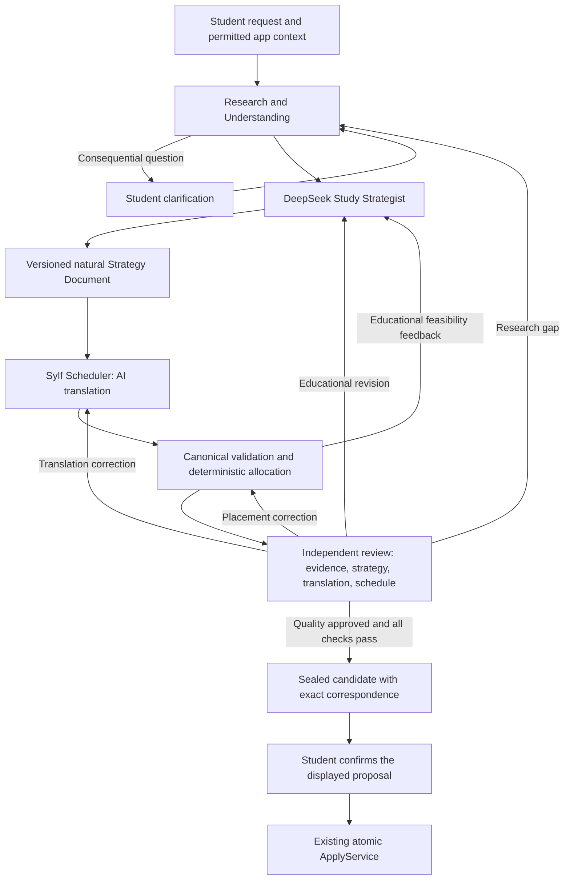

# Sylf Planner V2 AI-first redesign: implementation handoff

**Primary starting point for the next Codex conversation. Updated 25 October 2026, Asia/Karachi.**

**Status: architectural direction approved by the user; redesign implementation has not begun. Next: Phase A — foundational architecture and contracts.** This handoff is self-contained about the decisions and intended behavior. Inspect the linked owners before editing them; another broad architectural investigation or access to the originating conversation is not required.

## 1. Authority, approval and immediate scope

The user explicitly described this as the **newly approved Sylf Planner V2 AI-first architecture redesign** and requested this handoff for a fresh implementation conversation. That confirms approval of the direction below. The user's decisive priority update was: **prove exceptional, consistent educational quality first; optimize costs, tokens, latency, call count and efficiency later.**

The detailed [25 October architecture proposal](reports/2026-10-25-ai-first-architecture-proposal/README.md) preserves the investigation and complete proposed design. Its historical header says awaiting review because it predates this approval. Do not rewrite that report to invent earlier approval; this handoff records the subsequent approval and distinguishes its scope. Numeric evaluation thresholds and unresolved implementation details in the proposal are not silently promoted into agreed contracts.

Read sources in this order when resolving a conflict:

1. The current user's instructions and repository [AGENTS.md](../../AGENTS.md).
2. This approved-direction handoff, with its explicit decision-status distinctions.
3. The [detailed AI-first proposal](reports/2026-10-25-ai-first-architecture-proposal/README.md) for rationale and design detail, subject to the distinctions here.
4. The [original V2 architecture](PLANNER_TARGET_ARCHITECTURE.md), retained execution invariants and current implementations/tests. Its old intelligence pipeline and efficiency ceilings are superseded as target direction, but remain actual code until versioned changes are implemented.
5. Phase reports, audits and diagnostic receipts as evidence of their own runs. A historical report's COMPLETE status is not a current release claim; source and tests establish implemented behavior.

The present task was documentation only: no implementation, production configuration change, deployment or paid test. In a fresh conversation explicitly asked to implement, begin Phase A. Do not seek approval again for the already approved four-role design or restart the intelligence-interface investigation. Resolve the concrete Phase A decisions below as engineering work; seek review when a choice changes approved scope, execution semantics, permissions, provider policy or spending authority.

### Decision status

| Status | Meaning in this handoff |
| --- | --- |
| **Approved direction** | Four roles; natural strategy authoring; durable full strategy; faithful AI-assisted translation; deterministic scheduling; independent complete-plan review and substantive iteration; quality first; reuse the execution foundation |
| **Required implementation work** | Version the affected contracts, checkpoint/review metadata and resource admission; define calendar-capacity integration and old/new compatibility before building the new pipeline |
| **Recommendation, not a frozen decision** | Exact storage layout, version numbers, prompt text, role-specific effort/caps, specialist-review triggers and the proposed 4.5/5 exceptional-quality threshold |
| **Unresolved/separate approval** | Paid qualification budget; production routing changes or new providers/models; exact clock appointments; more than two mutation targets; broader execution semantics; deployment/cutover |

## 2. Product objective and non-negotiable priority

Sylf should be an excellent study strategist with minimal student effort: understand the actual need, investigate relevant evidence, ask intelligent necessary questions, design useful personalized education, schedule it realistically, explain the proposal, and adapt when circumstances change.

**Educational quality is the primary acceptance gate.** Research, strategy and review must receive sufficient freedom and resources to do the job. Do not optimize the new design around the old call limits, a short plan, a cheap configuration or a latency target before demonstrating quality. Observe usage now for safety and reproducibility; efficiency improvement is a later, separately scoped task after quality is established.

Quality does not mean maximum plan length, maximum research or maximum agent activity. It means accurate, complete, personalized, well-prioritized and practical education, with necessary workload, useful checks and honest uncertainty. A secure learner may need little or no additional work. A complex syllabus may require substantial investigation and detail. The model decides from the goal and evidence rather than filling available time or following a fixed pedagogical ceremony.

Preserve the core split:

- **AI:** interpretation, educational judgment, research reasoning, prioritization, methods, prerequisites, useful effort, sequencing, examples, criteria, contingencies, substantive review and revision.
- **Deterministic systems:** permissions, owned facts/registries, identity, provenance mechanics, validation, capacity arithmetic, dates/placement, lifecycle, currentness, persistence, execution and atomic apply.

Deterministic source verification can establish that an excerpt exists and applies to a source version. It does not by itself establish that an educational interpretation is true. Conversely, an AI approval never overrides a hard constraint or grants execution permission.

## 3. Where the project actually stands

### Completed foundations

| Existing work | What is available and should be reused |
| --- | --- |
| Architecture audit and Phase 0 | Canonical contracts, audit regressions, execution-writer inventory, migration/runtime specifications and disposable PostgreSQL evidence |
| Phase 1 durable core | Owned immutable intent versions; durable Attempts; worker/leases/fencing; idempotency; currentness; immutable revision/diff; atomic ApplyService; coordinated Quest/Focus/session/reward protections |
| Phase 2 Steps 1–5 | Context/provider infrastructure, conversation and research, document verification, LearningBlueprint generation, deterministic allocation/forecasting, independent quality/repair and compiler supervision |
| Phase 2 Step 6 technical integration | Existing API → admission → worker/compiler → candidate → canonical apply pathway, including maximum-envelope technical fixtures |
| Interface Changesets 1–3 | Compact output/deterministic assembly; literal evidence grounding and accountable rejected-response recovery; accepted-conversation handoff; targeted educational corrections and full-result verification |

**Not complete:** dependable live educational qualification, the independently accepted natural repair → verification → canonical apply witness, the new AI-first pipeline, the student-facing Phase 3 workspace, later adaptation journeys and release qualification. Technical service existence is not proof of deployment or hosted readiness.

Historical totals increased as changesets landed: the earlier Step 6 snapshot reported 551 unit/409 PostgreSQL tests; Changeset 1 reports 582/409, Changeset 2 reports 621/414, and Changeset 3 reports **651 unit tests in 46 files and 420 required PostgreSQL tests**. These are dated source-pinned run results, not tests rerun for this handoff. The allocator also has 500 independent oracle fixtures. Read the exact manifests before claiming a current gate passes. Historical isolated builds recorded an unrelated Acoustics export blocker; check the current checkout rather than assuming that historical failure still exists.

### What led to the redesign

The original V2 split was sound, and AI already owned educational judgment. However, generation still asked one model invocation to design the education and serialize the internal learning artifact. Review and recovery also carried complex correspondence work within small budgets. Earlier failures included unsupported resource assumptions, contradictory stopping criteria, unnecessary workload, malformed JSON, false reviewer objections and repairs whose named fix left other serious defects.

The [intelligence audit](reports/2026-10-09-step6-controlled-diagnostics/inputs/ASTRA_INTELLIGENCE_AUDIT.md) identified separate problems, not one universal cause:

- Dense model-facing serialization competing with educational design.
- A representation bug in literal quotation grounding.
- Validation fallback that previously did not receive the rejected response and could lose concerns.
- Reviewer educational reliability not established independently.
- Reasoning/output and reservation budgets that did not reliably fit the intended path.
- Full-proposal repair causing unnecessary reproduction of unaffected content.
- Repeated tuning against developmental cases instead of controlled diagnosis.

The [three-changeset revision plan](reports/2026-10-09-step6-controlled-diagnostics/inputs/ASTRA_REVISION_PLAN.md) addressed concrete interface defects without changing the original single-repair architecture. Those changes are implemented. Do not reintroduce their bugs or report them as still unfixed. The present redesign goes further: separate natural strategy from translation, retain full educational intent, and allow substantive iterative improvement rather than one narrowly bounded repair.

### Diagnostic findings and limits

| Evidence | What happened | Valid interpretation |
| --- | --- | --- |
| Historical 17-case development corpus | One source/configuration snapshot received 14/17 independent acceptance | Useful capability evidence; not current qualification, a production acceptance rate or parity with ChatGPT/Claude |
| Historical High subset | 1/3 acceptance, with output exhaustion | Some improved reasoning; inadequate reliable delivery under that configuration. Not a clean model/interface causal test |
| Disabled-thinking targeted trials | No truncation across 26 completed replies, but final-source targeted acceptance 0/3, including educational and JSON problems | Removing thinking did not solve overall quality/reliability; not justification to permanently disable it |
| Initial controlled block | Eight small reasoning answers completed: six confirmed passes, one evidence failure, one criterion judgment pending | Some educational capability, with evidence-use weakness; these were not comprehensive natural study plans |
| Same block's High review arm | Both attempted reviews used all 4,096 completion tokens as reasoning and returned no final verdict; ten other reviews skipped | Review delivery/budget fit failed. Semantic accuracy cannot be scored from absent verdicts |
| Low reviewer comparison | Sound case again exhausted 4,096 reasoning tokens; defective case delivered a correct grounded blocker with 2,531 reasoning + 317 final tokens | One valid correct judgment; Low did not establish reliable review. Do not call this 50% semantic accuracy |
| Natural-versus-compact experiment | First local request failed with fetch failed; zero provider responses; three requests skipped | No plan-quality or interface comparison occurred. Network restriction was plausible, not conclusively established |

Primary diagnostic records: [initial execution/evaluation](reports/2026-10-09-step6-controlled-diagnostics/initial-block/EXECUTION_REPORT.md), [Low comparison](reports/2026-10-09-step6-controlled-diagnostics/review-low/EXECUTION_REPORT.md), and [stopped free-plan comparison](reports/2026-10-10-step6-free-plan-experiment/EXECUTION_REPORT.md). Their independent reviewers were **AI agents, not human educational experts**. Scoring disagreements and limits to blinding are recorded rather than erased.

The High/Low review receipts finished before a later Codex usage interruption delayed reporting. That interruption does not explain their recorded length finishes. Separate older sleep investigations affected some research/database runs, but cannot invalidate the independently observed truncations. Distinguish transport, sleep, quota, structured-output, grounding, educational, review, repair, allocation and budget failures.

The stopped free-plan run retains **USD 0.0421074 as an unsettled reservation**, not an actual billed charge or proof of zero charge. Do not reset its journal or reuse any prior diagnostic approval. Historical credit balance statements are not current funding authority. Future paid testing needs a fresh protocol and approval.

The evidence does **not** prove that natural planning is better, all problems come from schemas, a multi-agent loop will solve them, or Flash lacks the necessary capability. The approved redesign is a deliberate separation of responsibilities whose quality remains to be established.

## 4. Approved target workflow



These are four logical roles within one compiler/worker/lifecycle, not four independently deployed systems. A role can make multiple calls or use relevant read tools. The role count is not the model-call count. The normal dependencies may be understood without turning them into an efficiency cap.

The coordinator is deterministic code in the current compiler. Agents identify problems, explain what needs investigation/revision and recommend a responsible role. The coordinator enforces authorized transitions, owned references, correspondence, budget admission and recovery. It neither invents a teaching approach nor needs an extra LLM manager call for every transition.

### Role 1: Research & Understanding

**Purpose:** understand the student's actual needs before committing to an educational strategy.

Read the exact request and accepted recommendations, selected goals, assessment/course/assignment identity, syllabus and exclusions, resources and actual contents, prior strategy decisions, recent mistakes/checks, learning history, deadlines, competing work, availability and preferences. Timers/completion indicate effort or work undertaken; they do not certify competence. Distinguish self-report from demonstrated performance, and preserve contradictory evidence.

Research resolves material gaps: applicable syllabus/component/cycle, required versus optional scope, assessment format or supported weighting, prerequisites, usable resources and missing assignment content. Reuse existing search/fetch/document/OCR/provenance owners. Search snippets and a resource title do not establish detailed contents. Verify issuer/applicability separately from excerpt existence. Retain unread sections, extraction gaps, source versions, anchors, hashes and uncertainty.

Clarification is intelligent and minimal. Ask when an answer changes scope, prioritization, feasibility or permissions: ambiguous assessment, fixed deadline, actual assignment text, contradictory availability or a priority conflict. Ask a useful question or coherent small group; do not require grade, learning-style labels, exhaustive topic ratings or a compulsory questionnaire. Do not ask known information again. Do not impose a numeric question limit that forces a consequential guess.

Ordinary uncertainty can be disclosed or handled through a useful conditional check. An optional tiny diagnostic can resolve a meaningful readiness ambiguity; it is not a mandatory testing platform. Research may revisit named gaps when needed within the authorized operational envelope. Neither one follow-up nor a low source count is a pedagogical rule.

Produce a context/research dossier and accurate accepted brief through existing services. Source text, model responses and uploads are untrusted data, never instructions granting consent. Research-only advice stays read-only. Research-and-plan authorization may permit supported adoption within scope; conflicts with explicit requirements or identity need a student decision.

### Role 2: DeepSeek Study Strategist

**Purpose:** design the best educational strategy for this student, without constructing Sylf schemas.

Receive complete decision-relevant evidence, resources, uncertainties and real capacity constraints. Choose educational priorities, methods, conceptual sequencing, examples, useful practice, prerequisites, effort/estimate uncertainty, completion and readiness criteria, spacing, checkpoints, stopping conditions, contingencies and trade-offs. There is no required phase count, method, practice quota, fixed plan length or internal field inventory.

Produce a comprehensive, natural Strategy Document. Organization and depth follow the task. It can contain integrated activities, explanations, self-contained worked material and checks, alternatives, conditional remediation, deferred scope and a full long-term strategy with a useful near-term segment. Zero new work is valid when justified. A longer horizon or more available time does not justify repetitive filler.

Freedom concerns reasoning and expression, not ignoring real needs. Preserve accepted outcomes, exclusions, deadlines, resources, permissions and protected work. Unknown assessment weighting remains unknown. Supplied worked examples are not evidence that the learner can already solve them. Do not assume the student possesses unavailable questions or invented course-note datasets.

The strategist does not emit Sylf durable IDs, database commands, rewards, exact executable date assignments or schema-perfect blueprint objects. It may explain relative timing and preferred learning intervals; deterministic scheduling owns actual placement. The student's brief and hard facts outrank the strategy if they conflict.

### Role 3: Sylf Scheduler

**Purpose:** preserve the complete educational intent while constructing realistic executable work.

This role has two operations inside the same compiler:

1. **AI-assisted translation:** interpret the complete Strategy Document and express actionable meaning through the existing compact response and canonical assembly. This is a real semantic responsibility, not deterministic parsing of arbitrary prose.
2. **Deterministic scheduling:** validate the whole learning graph, expand meaningful declared splits, allocate under actual capacity/deadlines/dependencies and produce explicit feasibility/quality feedback.

Translation preserves instructions, examples, numerical givens and answer checks, success versus timebox stopping, resources and availability conditions, estimates and uncertainty, priorities, hard versus advisory order, meaningful split boundaries, spacing and committed/contingent/optional distinctions. Future strategic work stays distinct from booked Quests.

Missing consequential educational decisions return to the strategist. Missing personal facts return to Research & Understanding. The translator cannot invent estimates, mastery credit, compulsory repetitions or completion criteria to satisfy fields. Deterministic code supplies constants, identities, arithmetic, registries and digests without adding education.

Maintain a translation receipt linking consequential strategy passages to canonical objects or explicitly retained non-executing guidance. Report additions, gaps and ambiguities. Every committed activity needs a strategy basis; every consequential strategy element needs representation or an honest gap. Keeping the raw document alone does not make a lossy schedule faithful. A mapping table is traceability, not proof of semantic equivalence; independent review must inspect both sides.

Example: two supplied problems plus a third only if a named error persists must not become three compulsory sessions. If a criterion means stop after correct method selection, do not replace it with compulsory use of all remaining time. A 90-minute activity needs educationally meaningful boundaries before splitting; arbitrary cutting into equal pieces is not faithful translation.

Retain the current canonical LearningBlueprint wherever sufficient. If a technical prose/count limit cannot represent necessary intent, record a representation failure and resolve it explicitly in contract work. Do not truncate, summarize away consequential detail, substitute generic criteria or bypass validation.

### Role 4: Independent Reviewer

**Purpose:** critically evaluate the complete educational and executable result, then approve or direct meaningful improvement.

Use a fresh invocation/context separate from authors. Read original/resolved goals and exact accepted instructions, raw learning evidence, adopted research/provenance, exclusions, full Strategy Document, translated blueprint/instructions/resources, allocation, workload and protected execution. Author rationale is a claim to inspect; author self-scores and private reasoning are not correctness evidence.

Assess educational correctness, personalization, coverage, prioritization, necessary workload, practical teaching/materials/checks, realistic timing, uncertainty and adaptation. Inspect fidelity between natural strategy and executable work. Validate consequential examples/claims against actual materials, available answer checks or safe reproducible calculations where possible. A valid self-contained check can suffice without an external answer key; model agreement alone cannot establish correctness.

Keep a small reliable response for verdict, specific findings and routing; do not make the reviewer serialize another complete plan or recite every passed micro-check. Supply enough reasoning/final capacity for the task. Focused source/domain checks or separate review passes may be justified by complexity, not added automatically as a ceremony.

Each material issue identifies actual offending content, affected references, accepted requirement/evidence, educational consequence, severity and the outcome a correction must achieve. Distinguish concrete violations from preference or reasonable uncertainty. More practice is not inherently better; unsupported objections must be reconsidered, corrected or explicitly withdrawn.

A separate call establishes procedural independence only. Using the same model across roles can retain correlated blind spots. A different reviewer model, specialist or additional assessor is a later explicit quality decision, not an already authorized model switch or paid call.

## 5. Artifacts, authority and version correspondence

Use existing Plan/IntentVersion/Attempt/Revision records and owned document infrastructure where appropriate. Extend the current compiler rather than adding another activity database, memory service, workflow queue or independent plan lifecycle. Exact storage layout is Phase A work.

| Artifact | Required meaning and durability |
| --- | --- |
| Accepted intent and instruction | Immutable accepted goal/facts/constraints and exact bounded authorized recommendation; conversation prose alone is not mutation authority |
| Context/research dossier | Relevant raw evidence, applicability, source identity/version/excerpts, uncertainty, omissions, capacity and protected facts; pinned to the candidate's actual inputs |
| Strategy Document | Complete natural final answer and rationale, immutable version, producing request/model metadata and input bindings; server anchors support references without imposing a model-authored template |
| Translation receipt | Exact strategy version/digest, canonical output digest and correspondence/gap/addition records; owned local references are validated |
| Canonical blueprint and allocation | Existing executable intermediate representation and deterministic placements/report; canonical validation remains authoritative |
| Issue history and review | Stable issue identities, evidence, revisions/dispositions, complete-result review and the exact candidate covered by approval |
| Sealed candidate/revision | Immutable linkage across strategy, translation, context/evidence, blueprint, allocation and quality, together with the current semantic diff and execution specs |

Strategy is the educational design authority for a particular draft. Accepted intent/permissions constrain it. After apply, the canonical execution specification is the sole authority for Quest/Focus execution; natural text never independently mutates tasks. A new strategy draft does not change an already active plan.

A student must see the strategy belonging to the displayed reviewed schedule, never the newest chat prose attached to an older candidate. Applied/historical revisions must retain full strategy and correspondence; mutable conversation or expiring worker payload alone is insufficient. Full educational meaning must not be squeezed into the blueprint's bounded explanation field.

Bind approval to the exact strategy, translation, evidence, constraints, blueprint and allocation. Consequential changes invalidate affected approvals. Distinguish cosmetic rationale changes from semantic educational changes explicitly; do not infer safety from equal titles/dates/minutes.

A Strategy Document revision under unchanged accepted goals is not necessarily a new intent. If new research changes canonical resolved facts, the current bind-once target cannot be overwritten. Phase A must specify linked continuation, immutable intent ancestry/CAS and aggregate accounting. Changed assessment identity, goals, exclusions, permissions or genuine conflicts require the appropriate student decision; valid original authorization need not be requested again for work it already covers.

## 6. Scheduling and calendar requirements

Preserve maximum capacity, recommended useful effort and existing committed workload as different quantities. Availability is a ceiling, not a target. Global daily/weekly ceilings cover all goals; per-goal limits never expand global capacity. Preserve owned civil dates/timezone, rest days, explicit exclusions, hard deadlines and exam-day policy. Disclose provisional availability rather than claiming it is confirmed.

Count actual study already done today and remaining commitments once. Completed past work consumes no future capacity. Started work uses its explicit remaining estimate; kept unstarted work retains approved time. Remove selected replacement work before charging replacements; keep unselected commitments. Surface pre-existing overload rather than silently trim it. A recovery margin is soft and disclosed, not an academic rule.

AI declares educational priority, dependencies, useful spacing and meaningful splits. The allocator chooses dates under those constraints and stable rules. It must not shrink timeboxes, drop scope, invent split points or convert advisory order into hard prerequisites. Report binding constraints, unscheduled work, learning-window compromises, intensity/context-switching concerns and finish/estimate consequences.

Retain the distinction between **FEASIBLE**, mathematically supported **CAPACITY_SHORTFALL**, and **ALLOCATION_UNRESOLVED**. A heuristic failure does not prove an impossible deadline. Consequential poor-but-feasible placement may warrant educational revision as well as genuine shortfall.

For long plans, retain full scope/strategy and detail a useful educational segment; forecast is not booked work. Do not turn a two-week detail default, 60-activity envelope or four-week horizon into a cap on the strategist's educational vision. Executable segmentation still needs honest bounds and continuation semantics.

### Calendar integration is necessary work, not an existing guarantee

Current Planner allocation is date/minutes-based. Its capacity snapshot includes study availability, rest days and study commitments. The [Calendar contract](../calendar/README.md) says personal events do not reserve Planner capacity. Its displayed free-time window is not student-approved study availability. Quests currently do not reserve exact clock appointments.

Build a read-only projection using existing personal/shared/external calendar services, recurrence/timezone helpers, permissions and provider freshness. Intersect approved study windows with applicable busy intervals. Do not mechanically subtract all events from a daily minute target, assume every hour is study-capable, or double-count study commitments. Decide treatment of transparent/tentative/all-day events, unavailable calendars and privacy-minimized metadata in Phase A.

Extend the existing allocator's interval-feasibility support where needed; do not build a competing scheduler. Multiple tasks must jointly fit usable windows: three disconnected ten-minute gaps do not fit an indivisible thirty-minute activity. A date-based plan may use an internal placement witness without publishing clock appointments. Exact persisted clock bookings are a separate execution-contract/product decision.

Include relevant calendar versions/freshness in context and revalidate before apply. External calendars cannot be transactionally locked; disclose freshness and handle subsequent conflicts honestly instead of promising permanent conflict freedom.

## 7. Review, refinement and stopping behavior

Replace the hard one-adaptation/one-repair target with meaningful iterative improvement. The strategist may revise a passage, connected education or the complete strategy within authorized scope. Existing targeted object assembly remains useful for suitable local fixes, but its issue-neighborhood authority is not a universal limit on educational reconsideration.

| Problem | Responsible route |
| --- | --- |
| Missing/conflicting source, syllabus identity or student fact | Research/clarification; invalidate dependent outputs as appropriate |
| Incorrect teaching, poor priorities, inadequate criteria, unnecessary work or flawed approach | Strategist; allow substantive revision |
| Omitted condition, altered example or invented task during conversion | Scheduler translation; retain sound strategy |
| Placement issue | Deterministic reallocation if existing education permits; strategist if an educational trade-off is needed |
| Unsupported reviewer finding | Grounded reviewer reconsideration and explicit correction/withdrawal |

After semantic changes, revalidate the **whole** blueprint and rerun actual allocation. Independent review must resolve every previous named material issue and inspect the complete result for previously missed or introduced serious defects. An edit is not proof of resolution; a successful named fix does not excuse a defective final plan.

Persist stable issue identities and append dispositions: open; addressed awaiting verification; verified resolved; withdrawn as unsupported with grounds. These are target metadata concepts, not a declaration that current canonical enums already support them. Do not call a withdrawn false objection a repaired educational defect or silently omit it. Retain Changeset 2's literal grounding and accountable malformed-review recovery; rejected claims remain untrusted and cannot certify themselves.

Approval requires excellent-enough education under the agreed rubric, faithful translation, feasible placement and strict technical checks for the exact bundle. A grounded hard violation or serious educational defect blocks publication. Acknowledgement cannot waive a blocker; reasonable uncertainty can be disclosed without fabricated certainty. No agent self-approves and majority agreement cannot override evidence.

Continue when a next action has credible educational benefit and authorized resources support completing and checking it. Do not replace one repair with another arbitrary small round cap. Also do not iterate indefinitely: detect repeated candidates/issues or oscillation, investigate disputed diagnoses and stop when progress is not credible.

Genuine boundaries include cancellation, spending authorization, provider/worker health, finite payload/output limits, uncertain billing, unavailable necessary evidence, unresolved permissions or student choices, and lack of credible progress. Reaching a boundary preserves the best assessed draft and issue history with an incomplete/needs-decision outcome; it never lowers quality standards or publishes an unreviewed plan. Useful natural strategy may remain readable as advice, clearly distinct from an executable approved proposal.

## 8. Operational safeguards retained during redesign

### One lifecycle and execution pathway

- Keep Plan identity, immutable IntentVersion ancestry, durable Attempt, immutable sealed Revision, PlanChangeSet and ordinary Quest/StudySession owners. Workspace remains a projection, not another state store.
- Keep existing Plan states and Attempt lifecycle. New role/stage checkpoint metadata does not automatically require new top-level lifecycle states. An active plan stays active while an update is prepared or fails.
- Public/client/model inputs cannot forge ownership, mastery, verified research, budget entitlement, quality approval or execution specifications. Cookie authentication and ownership checks remain server enforced.
- Advice and recommendations are not action authorization. Preparing an explicitly requested proposal is distinct from confirming the exact displayed proposal. Research-only advice retains zero mutation targets and cannot apply.
- Preserve per-user coordination, consistent lock order, serializable atomic apply and database backstops across all writers, including generic Quest/Goal/calendar tools and SQL/RPCs. Provider calls and fetching stay outside mutation transactions.
- Idempotent request replay returns the same operation/receipt; changed input with the same key conflicts. Stale intent/base/context cannot be relabelled as a current result.

### Worker and accounting

- Reuse worker claims, lease/fence, heartbeat, cancellation, deadline and shutdown owners. Takeover retains original counters, correspondence and applicable authorized deadline; it does not reset resources.
- Version checkpoints. Save pending call identity before dispatch and complete accepted response/digest before downstream work. Resume saved translation/revision/allocation without another paid invocation. A lost or uncertain dispatched response is not silently replayed.
- Retain one truthful accounting lineage across interpretation, research/OCR, all agent calls, corrections, review and continuations. Transfer foreground usage once; nested agents or linked attempts cannot manufacture fresh allowance.
- Reserve downstream translation/review capacity before generating more work; before a revision, retain resources to review its result. Exact policy values are Phase A decisions, not permission to reuse inadequate old caps.
- Settle actual provider usage, count reasoning within completion once, and distinguish conservative input reservation units from actual tokens. Unknown pricing/spend remains unknown, not zero. Preserve late-usage records without accepting late output mutations.
- Operational limits must be finite and explicitly authorized, but selected to support quality rather than premature cost targets. A truncated/blank output, missing receipt or uncertain charge cannot be treated as a valid completed artifact.

### Protected execution and joint work

- Zero-second Focus start establishes protection. Running work cannot be moved/redefined; started content/history remains protected. A server-acknowledged pause may permit reviewed remaining placement/estimate changes under existing rules.
- Completed activities, actual session dates/times and already-earned rewards remain history. Timer end, Quest completion and demonstrated readiness are separate facts.
- Preserve approved total timebox, remaining estimate and accepted actual time as distinct quantities. Do not overwrite sealed revisions as execution progresses.
- Kept execution must retain exact approved identity/content/specification. Changed instructions/criteria/resources are semantic changes even if title/date/minutes are equal.
- Withdrawal/continuation keeps lineage/tombstones, prevents resurrecting released work or double completion/rewards, and retains original history. Follow current restoration and continuation guards.
- A single-plan action cannot modify unselected work. Current joint changes cover one/two selected Plans, pin each intent/base/version, share global capacity and apply all or neither.
- Shared educational prerequisites have one owning activity/Quest and one charge of effort; benefits may span selected goals without duplicating work or competence claims. Reverse dependencies and unselected active Plans remain protected.
- Recheck publication and confirmation against concurrent edits, source/capacity changes and Focus start. Atomic apply verifies specs/diffs/quality/acknowledgements, materializes all targets and records one replayable receipt.

### Evidence, privacy and injection boundaries

Preserve owner-scoped document and resource access, URL/redirect/network protections, safe extraction/OCR, source hashes and applicability. Research/student/model text is untrusted content, not executable instructions. Do not log provider keys, raw private documents or private reasoning traces. Store useful final rationale and decision/usage metadata with appropriate ownership/retention. Context curation cannot drop consequential facts or protected history silently.

## 9. Retain, modify and replace: source map

Repository root at handoff creation: `/Users/aliumair/Desktop/sylf`. Links below are exact inspected paths. Existing legacy code also lives under `lib/planner/server/` and `lib/planner/contracts.ts`; it is not the V2 compiler. Extend the V2 owners and preserve adopted-work guards rather than reviving legacy materializers.

| Area | Exact owners | Target disposition |
| --- | --- | --- |
| Canonical contracts and envelopes | [contract index](../../lib/planner/v2/contracts/index.ts), [envelope](../../lib/planner/v2/contracts/envelope.ts), [operations](../../lib/planner/v2/contracts/operations.ts), [artifacts](../../lib/planner/v2/contracts/artifacts.ts), [blueprint](../../lib/planner/v2/contracts/blueprint.ts) | Retain execution/ownership meanings; version planning metadata, correspondence and reviewed resource policy where necessary |
| Intent and admission | [intents](../../lib/planner/v2/server/intents.ts), [generation](../../lib/planner/v2/server/generation.ts), [assistant service](../../lib/planner/v2/server/assistant.ts) | Retain accepted-intent CAS, exact accepted request and atomic admission; define later research/continuation binding |
| Context/capacity | [server context](../../lib/planner/v2/server/context.ts), [model context](../../lib/planner/v2/intelligence/context.ts), [capacity](../../lib/planner/v2/intelligence/capacity.ts) | Retain live protected facts and lossless consequential projections; add explicit calendar-derived availability/freshness |
| Research/document services | [research service](../../lib/planner/v2/server/research.ts), [documents](../../lib/planner/v2/server/documents.ts), [reader](../../lib/planner/v2/intelligence/research-reader.ts), [verification](../../lib/planner/v2/intelligence/research-verification.ts), [cache](../../lib/planner/v2/intelligence/research-cache.ts), [OCR](../../lib/planner/v2/intelligence/ocr.ts) | Reuse rather than duplicate; revise resource depth policy without weakening provenance/permissions |
| Current blueprint interface | [blueprint owner](../../lib/planner/v2/intelligence/blueprint.ts), [compact schema](../../lib/planner/v2/intelligence/schemas/blueprint-response.ts) | Move compact responsibility to translation; add natural strategy authoring without replacing canonical assembly |
| Allocation and forecasts | [allocator](../../lib/planner/v2/intelligence/allocator.ts), [scheduling schema](../../lib/planner/v2/intelligence/schemas/scheduling.ts), [forecast](../../lib/planner/v2/intelligence/forecast.ts), [planning schema](../../lib/planner/v2/intelligence/schemas/planning.ts) | Retain single allocator, split lineage and uncertainty; add calendar feasibility where needed |
| Learning orchestration | [learning service](../../lib/planner/v2/server/learning.ts), [compiler](../../lib/planner/v2/server/compiler.ts) | Extend into the four-role workflow and substantive loop; avoid another orchestration engine |
| Checkpoints | [checkpoint schema](../../lib/planner/v2/intelligence/schemas/checkpoint.ts), [checkpoint reader](../../lib/planner/v2/intelligence/checkpoints.ts) | New version/compatibility rules for strategy, translation, iterations and digests; never reinterpret saved old work |
| Independent quality | [quality owner](../../lib/planner/v2/intelligence/quality.ts), [quality support schema](../../lib/planner/v2/intelligence/schemas/quality.ts) | Retain literal grounding/recovery; extend full-bundle review and issue history |
| Targeted correction utility | [repair schema](../../lib/planner/v2/intelligence/schemas/repair-response.ts), blueprint/compiler owners above | Keep useful bounded assembly; replace universal one-repair/object-neighborhood limitation |
| Shared provider and accounting | [metered dispatcher](../../lib/planner/v2/intelligence/provider.ts), [policy/holdbacks](../../lib/planner/v2/intelligence/provider-policy.ts), [accounting](../../lib/planner/v2/server/accounting.ts), [attempts](../../lib/planner/v2/server/attempts.ts) | Expose role-appropriate text/JSON/effort through existing metering; revise resource counters/policies truthfully |
| Shared AI infrastructure | [router](../../lib/ai/agent-router.ts), [DeepSeek adapter](../../lib/ai/providers/deepseek.ts), [factory](../../lib/ai/providers/factory.ts), [pricing](../../lib/ai/usage-pricing.ts) | Reuse routing/configuration/usage authorities; no isolated production transport or hidden fallback chain |
| Candidate/execution compiler | [compilation](../../lib/planner/v2/server/compilation.ts), [revision service](../../lib/planner/v2/server/revisions.ts), [execution validation](../../lib/planner/v2/server/execution-validation.ts) | Extend validated bundle binding while retaining semantic equality, ownership and sealing |
| Canonical apply/lifecycle | [apply](../../lib/planner/v2/server/apply.ts), [worker](../../lib/planner/v2/server/worker.ts), [workspace](../../lib/planner/v2/server/workspace.ts), [database coordination](../../lib/planner/v2/server/database.ts) | Preserve guarantees and single execution pathway; no direct agent writes |
| Focus and adoption | [sessions](../../lib/planner/v2/server/sessions.ts), [settlement](../../lib/planner/v2/server/settlement.ts), [session client](../../lib/planner/v2/session-client.ts), [Quest read](../../lib/planner/v2/quest-read.ts), [adoption](../../lib/planner/v2/server/adoption.ts) | Retain started-work, replay, time/reward and legacy-baseline protections |
| Calendar authorities | [study schedule](../../lib/study-schedule-service.ts), [timezone](../../lib/timezone-service.ts), [personal/unified reads](../../lib/calendar/personal-service.ts), [shared service](../../lib/calendar/shared-service.ts), [external projection](../../lib/calendar/external/service.ts), [calendar scheduling helpers](../../lib/calendar/scheduling.ts), [calendar analysis](../../lib/calendar/intelligence.ts) | Reuse readers/math; free-time display is not capacity authority; no second event or scheduling store |
| Storage and worker build | [Prisma schema](../../prisma/schema.prisma), [Prisma owner](../../lib/prisma.ts), [worker entry](../../lib/planner/v2/main.ts), [worker build](../../scripts/build/build-planner-worker.mjs) | Add persistence only through reviewed version/migration decisions; generated worker output must match source |

### Existing API integration

Use [POST /api/planner/generate](../../app/api/planner/generate/route.ts), which selects V2 via `x-sylf-planner-contract: 2` or `contractVersion=2`, and [server web composition](../../lib/planner/v2/server/web.ts). Admission persists/enqueues; it does not perform long AI work in the HTTP request. The supervised worker executes handlers from the existing compiler.

Current owned routes include [assistant](../../app/api/planner/[id]/assistant/route.ts), [operation read/cancel](../../app/api/planner/[id]/operations/[key]/route.ts), [revisions](../../app/api/planner/[id]/revisions/route.ts), [commit](../../app/api/planner/[id]/commit/route.ts), and [check result](../../app/api/planner/[id]/check-result/route.ts). Confirmation reaches ApplyService. Reuse these owners, with explicit versioned API compatibility as necessary; do not invent a parallel generation or apply endpoint just for agents.

Current source reads `PLANNER_V2_DURABLE_CORE_ENABLED` in web admission and worker handler registration. An older Step 6 report mentions a different admission flag name; use source as truth and do not enable/change flags during documentation or offline contract work. The worker currently requires its configured Node 26 toolchain and separate database pool; inspect the build/runtime owner before altering runtime packaging.

## 10. Concrete current constraints that Phase A must revise deliberately

These are **implemented old limits**, not approved quality targets for the redesign:

| Current owner | Constraint |
| --- | --- |
| `contracts/envelope.ts` | EDUCATIONAL: 6 model calls, 180 seconds, 80,000 input units/24,000 output tokens; RESEARCH: 8 calls, 300 seconds, 160,000 input/32,000 output |
| `contracts/operations.ts`, `intelligence/provider-policy.ts` | Five planning-call sub-cap, research synthesis/follow-up counters and review/verification holdbacks |
| `intelligence/schemas/checkpoint.ts` | `compilerVersion: 1`; adaptation/repair counters each at most one |
| `intelligence/provider.ts` | Forced JSON output for metered requests; most educational purposes route to syllabus; current configured fallbacks remain real dispatches |
| `lib/ai/agent-router.ts` | Syllabus output cap 8,192; unspecified thinking invokes provider default; dispatcher does not expose role-specific effort even though adapter supports it |
| Current quality/compiler calls | Review/verification typically 4,096 output tokens; repair 8,192; reasoning shares completion capacity |
| Common envelope | 4 MiB serialized, 60 newly detailed activities jointly, 200 outstanding activities/500 scope nodes/100 milestones per Plan, two selected targets, bounded prose/resources |

Do not simply raise a numeric constant or remove checks and claim the redesign complete. Specify a versioned resource/representation policy with sufficient quality capacity and retained hard guarantees. Keep physical limits explicit. If an old envelope cannot represent full strategy, introduce appropriate retained strategy storage rather than trimming it or overloading a summary field.

The current metered input reservation uses a conservative UTF-8 upper bound; settlement uses actual usage. That admission pressure is different from actual billing. A better estimator is optional future work, not a prerequisite to natural reasoning or a reason to under-reserve spending now.

## 11. Implementation roadmap: Phase A → Phase B → Phase C

These names are the **new redesign sequence**, not renamings of original Phase 0/1/2. In particular **Phase C is educational quality qualification, not original Phase 3 UI**. Original Phase 3 student-facing workspace remains deferred. Efficiency optimization and broader release/cutover follow successful quality work as separately scoped tasks.

### Phase A — foundational architecture and contracts

**Goal:** make the approved design concrete, versioned and safe to implement using existing owners. Do not repeat model-capability experiments or the broad architecture investigation.

Required work:

1. Record the approved intelligence-pipeline amendment alongside retained execution invariants. Define role responsibilities, artifact authority, allowed transitions, semantic versus cosmetic changes and publication requirements.
2. Define Strategy Document retention/version/anchors, dossier bindings, translation correspondence/gaps, candidate bundle digest coverage and a persistent issue-history contract. Retain original natural text and historical candidate correspondence.
3. Define a new compiler/checkpoint interpretation with resumable research/strategy/translation/allocation/review/refinement. Specify old checkpoint readers, pending-call uncertainty, saved-response assembly, issue resolution/withdrawal, invalidation and no-progress handling.
4. Define role capabilities for text versus structured output, effective model/effort metadata, sufficient per-stage allowances, aggregate root accounting, downstream review holdbacks and explicit continuation admission. No exact cap values are already approved. Do not change production routing to calibrate them.
5. Specify calendar capacity projection, study-window source/acceptance, busy-event policy, freshness, joint interval feasibility and pre-apply revalidation. Retain date-based execution unless a separate clock-booking decision is made.
6. Resolve exact strategy/revision storage and additive migration needs; retain ExecutionTaskSpec and Phase 1 meanings. Define versioned API/artifact readers and cutover/rollback behavior before new writers.
7. Add meaningful offline schema/correspondence/recovery fixtures and checks for these contracts. Preserve old frozen evidence and tests; introduce explicit reviewed new versions rather than rewrite old hashes to make gates green.
8. Produce a Phase A completion report with changed contract decisions, source/test evidence, residual questions and a bounded Phase B scope.

**Completion criteria:** the whole target flow is representable without missing educational values or lossy strategy storage; every candidate approval binds exact corresponding artifacts; old/new checkpoint/API interpretations are explicit; resource policy cannot skip review/reset accounting; research/clarification/issue routing and calendar semantics are specified; required offline contract/invariant checks pass. Every unresolved foundational item in section 12 has a documented disposition sufficient for Phase B. No paid call or production activation is needed to complete Phase A.

### Phase B — working multi-agent pipeline

**Goal:** one functioning headless vertical path through existing services, with real substantive refinement and unchanged execution integrity.

Implement natural DeepSeek strategy generation, retained Strategy Documents, faithful translation through compact assembly, actual deterministic allocation/calendar projection and independent complete-bundle review. Replace the single-repair orchestration with versioned role-routed iteration. Support useful local correction and wider strategy revision without duplicating engines or allowing arbitrary patch paths/execution identities.

Exercise clarification and accepted recommendation handoff; zero/one/many useful activities; long-term strategy versus near-term execution; missing decision routing; false reviewer objections; named-issue resolution plus new-defect detection; substantive multi-round improvement; and explicit incomplete outcomes at genuine boundaries.

Test actual services and compiled worker with scripted adapters/disposable PostgreSQL before live qualification. Cover saved-response takeover, lost responses, cancellation, fence loss, source/calendar/intent changes, publication/apply races, joint planning, shared prerequisites, split families, protected/running work, semantic equality and atomic confirmation replay. Verify complete strategy/translation retention after apply and historical read.

**Completion criteria:** end-to-end pipeline reaches a sealed, correctly bound candidate and existing ApplyService with scripted/offline evidence; additional necessary refinement rounds work without weakening quality or resetting budget; defects and uncertain states cannot publish; required technical regressions pass with no integrity skips. This proves mechanics, not educational model quality. No Phase 3 UI, production switch or paid test is automatically included.

### Phase C — educational quality qualification

**Goal:** establish whether the complete Planner consistently produces exceptionally good personalized plans. Efficiency is observed but is not the acceptance objective.

Before paid calls, prepare a new reproducible protocol: fresh realistic inputs, independent labels/rubrics, sufficient approved resource profiles, pinned implementation/prompt/configuration, effective model metadata, reachability and accounting preflight, sleep prevention and explicit cost/stop authorization. Previous stopped approvals and journals are not reusable. Network access must be established through an approved unpaid arrangement rather than repeat the restricted-shell launch mistake.

Evaluate separately, then together:

1. Natural educational strategy: correctness, personalization, priorities, completeness, necessary workload, usability and uncertainty.
2. Translation fidelity: no lost conditions/resources/examples/criteria or invented mandatory education; strategic versus booked work remains truthful.
3. Deterministic schedule: actual availability/deadlines/spacing, competing goals and protected work; distinguish infeasibility from unresolved search.
4. Independent review: detect serious defects, avoid unsupported blockers, distinguish valid alternatives/preference/uncertainty, and reliably deliver a valid verdict.
5. Substantive refinement: genuine educational improvement, all named issues addressed, no regressions/new serious defects, and full downstream correspondence.
6. Repeated end-to-end journeys from conversation through reviewed candidate and appropriate confirmation/apply, including a naturally occurring, independently accepted revision → verification → canonical apply witness. Synthetic deliberately broken fixtures do not substitute for that live witness.

Freeze independently authored held-out cases before testing; hide labels/author scores from tested agents. Use realistic novice/secure/mixed/urgent/large/no-deadline/resource-gap/calendar/partial-execution/joint-goal cases and repeated samples. Do not tune against the 17 developmental cases or cherry-pick the best sample. Record failures by stage and preserve disagreements. Parsing success, internal reviewer approval and technical tests are separate from external educational assessment.

The retained original release benchmark calls for at least 100 stratified held-out cases, matched strong ChatGPT/Claude reference workflows, two independent human raters, per-category reporting, adjudication/inter-rater agreement and uncertainty. Its relative ambition is comparable to or better than the stronger reference on at least 90% of cases with a preregistered half-point tolerance, plus absolute quality floors and zero-tolerance serious integrity/applicability defects. This remains a release ambition, not a funded Phase C run specification. Reference-model calls and human evaluation need separate resources/approval.

The proposed stronger exceptional-quality threshold is **4.5/5 overall with no core dimension below 4/5 and no serious defect**. It was a recommendation, not an explicitly finalized numerical gate. Agree on anchored criteria, thresholds, sample/consistency standard and judging before paid execution. Do not relabel the original 4/5 floor or a few attractive examples as proven exceptional performance.

**Completion criteria:** an independently assessed, sufficiently repeated/representative evaluation supports the agreed exceptional-quality claim; no serious defect is averaged away; translation/review/refinement reliability is established; the live end-to-end revision witness and retained execution gates pass. If results or expert assessment are insufficient, leave qualification open and identify model/interface/review/research defects honestly. Only afterward scope cost/token/latency optimization and verify it does not reduce quality.

## 12. Decisions to settle in Phase A, and what is optional

The unresolved items below do not reopen the approved vision. They are concrete implementation decisions to resolve and record.

| Item | Decision needed / constraint |
| --- | --- |
| Strategy persistence | Full versioned text, ownership, retention and immutable revision linkage; exact embedded record versus owned artifact/reference and migration/version choice |
| Translation receipt | Anchor stability, fidelity coverage/gap representation, permitted mechanical derivations and handling of missing education; cannot assume mathematical losslessness |
| Approval binding | Exact digest domains for strategy, translation, raw/adopted evidence, calendar, canonical graph, allocation and quality; what invalidates which approvals |
| Review history | Canonical versus supporting issue metadata, stable identities, corrections/withdrawals and old report compatibility; invalid rejected concerns must not become factual blockers |
| Intent-changing research | Bind-once target/linked continuation, authorization/CAS, invalidation and non-resetting aggregate accounting; never silently overwrite resolved intent |
| Iteration/checkpoints | New compiler/version/stage interpretation, save points, uncertain dispatch, local versus broad revision authority and credible-progress/cycle handling |
| Resource policy | Role-specific output format/effort/caps, sufficient downstream review reserves, deadlines/call accounting and explicitly authorized continuation; no old small cap is an educational requirement |
| Model policy | DeepSeek remains the strategist; precise effective version and reviewer configuration must be explicit. No approved Pro/Max/Gemini switch or automatic paid fallback is inferred |
| Calendar | Accepted study windows, busy/tentative/all-day/transparent handling, freshness and unavailable-provider policy, privacy, interval feasibility and revalidation |
| Quality qualification | Anchored dimensions/thresholds, repeated sample standard, expert independence, reference workflow and paid protocol budget |

Optional/evidence-dependent recommendations: another reviewer model, focused specialist inspection, provider-enforced schema features, improved tokenizer-based admission estimates, extra domain-verification tools and safe research caching refinements. Add only when a concrete quality or correctness need justifies them. Multiple critics, voting, a general autonomous-agent framework, another scheduler, a permanent workload coordinator or a second memory database are not part of the approved baseline.

Separate scope/approval is required for exact clock appointments, more than two mutation targets, autonomous active-plan changes, relaxed validation/execution semantics, production provider/routing changes, hosted deployment/migrations and paid runs. Do not invent a spending ceiling from old balances or choose cheap settings merely to fit them.

## 13. Compatibility, migration and operational risks

Version readers before new writers. Existing active Plans, Quest IDs, session/reward ledgers, tombstones and immutable old revisions remain intact. Historical planning quality remains historical/legacy-unreviewed where appropriate; do not fabricate a new reviewer pass. A new strategy draft does not regenerate or reschedule old work automatically.

In-flight work must complete under its pinned compiler interpretation or be explicitly cancelled/restarted with visible accounting. Never parse a legacy full-proposal/targeted repair checkpoint as a new iterative strategy run. Old saved responses retain their original meanings. Temporary version dispatch/read compatibility is not permission to operate two permanent planning engines.

Specify any additive migration through current SQL/Prisma processes, generate the client and update the schema build marker when fields change. The shared Prisma schema and migration tree have unrelated ongoing Notes/Calendar work; preserve it. The [migration operations index](../../scripts/README.md#database-migrations) and [22 October migration audit](../infrastructure/reports/2026-10-22-database-migrations/report.md) supersede assumptions that historical bootstrap limitations describe today's hosted catalog. Do not rewrite old migrations to clean up historical reports.

Rollback must retain readers for already written new artifacts and cannot undo applied work by toggling a flag. No migration of past rewards/history is justified by intelligence redesign. Retire superseded compiler branches after drain/cutover rather than revive legacy writers for adopted Plans.

Principal risks: natural strategy may be eloquent but educationally weak; translation may lose conditional intent; one model across roles may share errors; review may overblock good plans or miss subtle defects; refinement may oscillate or add workload; new artifacts may not fit old envelopes; calendar freshness may be overstated; cross-goal changes may damage unselected dependencies; uncertain provider calls may be repeated; and quality evaluation may overfit or mistake AI-agent agreement for expert evidence. The boundaries and Phase A/B/C gates above address these risks without claiming they are already solved.

## 14. Verification and evidence discipline

Read [package.json](../../package.json) and current [scripts index](../../scripts/README.md) before commands. The repository was reorganized after older reports: scripts now live under build/test/verify subdirectories. Do not copy stale historical paths blindly.

Useful current commands for a later authorized implementation task:

```sh
npm run test -- --run __tests__/planner-v2/contracts
npm run test -- --run __tests__/planner-v2/intelligence
npx tsc --noEmit
npx eslint <changed-files>
npm run planner:worker:build
node scripts/test/test-planner-postgres.mjs <path-filter>
node scripts/verify/verify-planner-v2-phase2-step6.mjs
```

The last aggregate includes source pins and historical live-acceptance gates; it is not a generic green technical command for a redesigned compiler. Inspect before running and introduce explicit updated gate/evidence versions rather than force old frozen assertions to pass. Harnesses may overwrite historical evidence at their writer paths; use established isolated source copies/new run evidence as appropriate. Database suites need a disposable runtime and required integrity tests must not silently skip. Paid/live suites such as [compiler qualification](../../__tests__/planner-v2/postgres/compiler-qualification.live.ts) and [live runner](../../scripts/test/test-planner-v2-phase2-live.mjs) are not authorized by this handoff.

Use meaningful unit/contract tests plus real PostgreSQL service/process/concurrency tests for changed behavior. Regenerate ordinary Node worker output and verify no server-only/browser boundary breaks. Follow current AGENTS.md for typecheck/lint/build/mobile/UI requirements; read installed Next.js guidance before any Next code change. Recheck historical build failures rather than suppressing types or repairing unrelated features. Documentation-only verification here is link/content/diff checking, not a fresh technical gate.

Place future Phase A/B/C reports and evidence under appropriate `documentation/planner/reports/<task>/` folders. Preserve all old audits, protocols, frozen cases, labels, spend journals and failure evidence. Record actual source/config/prompt/model metadata for every run and distinguish technical fixtures from paid outputs, AI-agent assessment from human expert assessment, and reservations from charges.

## 15. Reading map for exact underlying evidence

The essential decisions are contained above. These references let the next agent independently inspect owners and detailed evidence without reconstructing the conversation.

| Material | Repository reference |
| --- | --- |
| Full approved-direction design rationale | [25 October detailed proposal](reports/2026-10-25-ai-first-architecture-proposal/README.md) |
| Original foundations and benchmark | [V2 target architecture](PLANNER_TARGET_ARCHITECTURE.md), especially sections 3–7, 10–19 and 24; the one-repair pipeline/resource settings are historical target policy now being revised |
| Original system failures and provenance | [2 October end-to-end audit](reports/2026-10-02-end-to-end-audit/AUDIT.md), [final original architecture review](reports/2026-10-02-final-architecture-review/REVIEW.md) |
| Frozen execution boundary/writer inventory | [Phase 0 index](reports/2026-10-02-phase-0/README.md), [contracts](reports/2026-10-02-phase-0/CONTRACTS.md), [execution writers](reports/2026-10-02-phase-0/EXECUTION_WRITERS.md) |
| Durable implementation and recovery | [Phase 1 report](reports/2026-10-02-phase-1/README.md), [worker/runtime](reports/2026-10-02-phase-1/WORKER_RUNTIME.md), [adoption](reports/2026-10-02-phase-1/MIGRATION_ADOPTION.md) |
| Intelligence/compiler implementation | [Phase 2 index](reports/2026-10-03-phase-2/README.md), [Step 2 context/provider](reports/2026-10-03-phase-2/STEP_2.md), [Step 3 conversation/research](reports/2026-10-03-phase-2/STEP_3.md), [Step 4 learning/allocation](reports/2026-10-03-phase-2/STEP_4.md), [Step 5 quality/compiler](reports/2026-10-03-phase-2/STEP_5.md), [Step 6 integration](reports/2026-10-03-phase-2/STEP_6.md) |
| Open historical qualification | [live qualification](reports/2026-10-03-phase-2/LIVE_QUALIFICATION.md), [completion remains incomplete](reports/2026-10-03-phase-2/COMPLETION.md), [High investigation](reports/2026-10-03-phase-2/HIGH_REASONING.md), [disabled-thinking evidence](reports/2026-10-03-phase-2/THINKING_DISABLED_QUALIFICATION.md), [sleep investigation](reports/2026-10-03-phase-2/SLEEP_INVESTIGATION.md) |
| Astra investigation and earlier narrower plan | [intelligence audit transcript](reports/2026-10-09-step6-controlled-diagnostics/inputs/ASTRA_INTELLIGENCE_AUDIT.md), [revision plan transcript](reports/2026-10-09-step6-controlled-diagnostics/inputs/ASTRA_REVISION_PLAN.md) |
| Implemented interface corrections | [Changeset 1](reports/2026-10-09-step6-interface-changeset1/README.md), [Changeset 2](reports/2026-10-09-step6-interface-changeset2/README.md), [Changeset 3](reports/2026-10-09-step6-interface-changeset3/README.md) and their adjacent verification/source manifests |
| Controlled diagnostics | [protocol/index](reports/2026-10-09-step6-controlled-diagnostics/README.md), [initial report](reports/2026-10-09-step6-controlled-diagnostics/initial-block/EXECUTION_REPORT.md), [Low report](reports/2026-10-09-step6-controlled-diagnostics/review-low/EXECUTION_REPORT.md) |
| Incomplete interface comparison | [frozen free-plan protocol](reports/2026-10-10-step6-free-plan-experiment/README.md), [stopped execution report](reports/2026-10-10-step6-free-plan-experiment/EXECUTION_REPORT.md), [independent stopped-run assessment](reports/2026-10-10-step6-free-plan-experiment/evaluator/independent-stopped-run-assessment.md) |
| Calendar and shared assistant context | [Calendar contract](../calendar/README.md), [Sylvie runtime](../sylvie/README.md); reuse existing permissions/tools rather than another assistant backend |
| Regression locations | [V2 contracts](../../__tests__/planner-v2/contracts/), [intelligence](../../__tests__/planner-v2/intelligence/), [PostgreSQL](../../__tests__/planner-v2/postgres/), including compact-blueprint, review-recovery, targeted-repair, compiler-quality, generation-integration, durable-core and worker-runtime cases |

Official provider metadata/pricing was inspected for the proposal on 25 October: Flash then resolved publicly to DeepSeek-V4.1-Flash-1017, with published peak USD 0.30/million uncached input, USD 0.006/million cached input and USD 1.20/million completion, including reasoning. These are dated observations, not a guarantee about a later run. Refresh [pricing/model metadata](https://api-docs.deepseek.com/quick_start/pricing/), [thinking controls](https://api-docs.deepseek.com/guides/thinking_mode/) and [completion API behavior](https://api-docs.deepseek.com/api/create-chat-completion/) before an authorized experiment. Do not pool changing aliases/fingerprints as a controlled comparison.

## 16. First actions for the new conversation

1. Read this handoff, current AGENTS.md and the linked detailed proposal. Accept the architectural direction as decided; keep proposed thresholds/configuration values distinct.
2. Inspect `git status` and relevant V2 contract/compiler/provider/calendar owners. Preserve unrelated concurrent work, especially current Notes/Calendar/Prisma changes. Do not enable flags or invoke provider/live suites.
3. Begin **Phase A**: turn section 12 into explicit contract decisions, define strategy/translation/review retention and binding, checkpoint/issue versions, sufficient resource admission, research-continuation semantics, calendar projection and compatibility/migration plan.
4. Implement only the Phase A foundations and meaningful offline checks authorized by that new task. Document changed contracts and their retained execution guarantees. Do not jump to UI or paid experimentation to answer an unresolved contract question.
5. Complete Phase A evidence/handoff, then proceed to Phase B according to the new task's scope. Phase C paid runs require their own protocol, independently prepared evaluation and spending approval. Optimize efficiency only after educational quality is demonstrated.

Suggested opening instruction for the fresh conversation:

> Read documentation/planner/AI_FIRST_PLANNER_HANDOFF.md and the linked AI-first proposal. The architectural direction is approved. Begin Phase A: foundational architecture and contracts for the four-role, quality-first redesign. Preserve existing execution guarantees and unrelated changes. Resolve the listed Phase A contract decisions without repeating the architectural investigation. Do not run paid tests, change production configuration, start Phase 3 UI or build the full Phase B pipeline yet. Produce the versioned foundation, relevant offline verification and Phase A completion report.

The next agent can start Phase A from this document. Remaining work is concrete contract design and implementation against the cited owners, not recovery of missing conversation decisions.

[Handoff verification](reports/2026-10-25-ai-first-architecture-proposal/evidence/handoff-verification.json) records local-reference/content checks and preservation of the inspected production sources and original proposal. It is documentation verification, not a new technical or educational qualification run.
