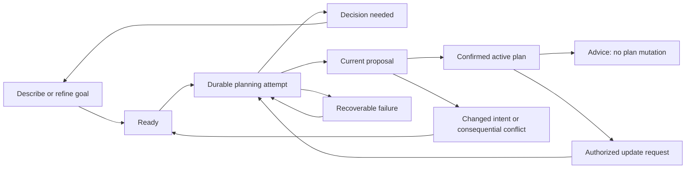

# Sylf Planner V2: target architecture

**Status: decision-complete target specification; application implementation has not begun.**

**Date: 2 October 2026.** This document consolidates the complete target plan and the required corrections from the pre-implementation review. It supersedes conflicting design proposals in older Planner reports; it does not describe capabilities already implemented.

Primary evidence: [end-to-end audit](reports/2026-10-02-end-to-end-audit/AUDIT.md). Final readiness assessment: [Final Planner V2 Architecture Review](reports/2026-10-02-final-architecture-review/REVIEW.md).

## 1. Product decision

Ship one conversational study strategist, one planning engine and one execution pathway. The student describes a need; Sylf uses relevant context, asks only consequential questions, researches material gaps when appropriate, recommends useful work, schedules it realistically, and presents a clear proposal for confirmation. The same assistant remains useful for advice and adaptation after confirmation.

The quality target is thoughtful planning comparable to a strong, carefully prompted general-purpose AI conversation, with substantially less student effort. Integrity is necessary but insufficient. Sylf must justify work by its contribution to the goal, use evidence cautiously, distinguish understanding from performance, and be willing to recommend less study.

AI owns educational judgment. Deterministic services own authoritative facts, capacity, scheduling, identity, lifecycle, validation and transactional execution. Scheduling feeds consequences back to the AI; it does not silently rewrite the pedagogy. Keep the audit's owned references, local model IDs, immutable revisions, atomic materialization, idempotent recovery, live availability checks, exclusions, execution protection and strategic Roadmap state.

Remove Classic's independent backend, Quick/Advanced input translation and separate Designer/Copilot workflows. Do not add event sourcing, a knowledge graph, a generic autonomous-agent framework, a second activity database, a permanent workload coordinator, or a separate Free engine.

## 2. Journey and information architecture

`/planner` shows active goals, recoverable drafts and a single entry: “What do you need to prepare for?” Existing subjects and upcoming deadlines can supply helpful shortcuts. The System Planner tab links to this workspace.

`/planner/[planId]` contains the interview, proposal, active strategy and history as views of the same Plan. The default journey is:

1. “I have a physics exam in three weeks and electricity is my weakest area.”
2. Sylf retrieves relevant app context and asks zero to three useful questions when adequately contextualized. A material ambiguity can require another question; three is a target, not permission to guess consequential facts.
3. Sylf explains its approach briefly, researches if requested or materially necessary, then builds a plan.
4. A compact review explains useful effort, finish date, priority, major trade-offs and important assumptions. Details are available on demand.
5. Confirm creates or updates ordinary Quests atomically. Today’s work and the strategy remain accessible in Planner.
6. Ask for advice or describe a change. Sylf can answer without changing anything, or prepare a small reviewed update.

There is no mode chooser or large form before the goal. An optional “Adjust details” drawer edits the same canonical intent: scope, deadline, study ceiling, pacing and strategy override. It cannot construct a separate engine input. Dates, warnings, uncertainty and provenance appear only when useful to a decision; lifecycle names and fingerprints remain internal.

Infer Exam, Roadmap, Mastery or General policy and briefly explain consequential choices. Advanced users may override. A strategy changes educational behavior, not the number of configuration fields. Future capability checks belong at command admission and capability discovery, outside educational algorithms and shared integrity services. No monetization work is required now.

## 3. Canonical model and sources of truth

Introduce only two durable entities: `PlannerIntentVersion` and `PlannerAttempt`. Evolve the existing Plan, Revision and QuestLink. A PlanChangeSet, LearningBlueprint, context snapshot, research evidence and quality report are versioned artifacts in those records, not additional workflow tables.

| Record/artifact | Authority and essential contents |
| --- | --- |
| `PlannerPlan` | Stable owned goal identity, current working intent pointer, active/candidate revision pointers, optimistic planning version, Goal/Subject references, lifecycle state. A bounded conversation has its own append version and does not advance the planning version. |
| `PlannerIntentVersion` | Immutable accepted working intent: goal/outcome, strategy selection, scope and dispositions, assessment profile, preparedness evidence, fixed/soft deadline, explicit constraints, desired intensity, pacing, accepted assumptions and research claims. Parent/version and change reason establish correspondence. |
| `PlannerAttempt` | One durable request and job: kind, idempotency key/hash, owner, one or two target Plans for planning, pinned intent/base/candidate identities, accepted request, context dependencies, budgets, checkpoints, queue/lease/fence state, provider accounting, error and resulting revision map. It also stores a write-once apply receipt. Read-only `RESEARCH_ADVICE` uses zero mutation targets and stores evidence/answer instead of revisions. |
| `PlannerRevision` | Immutable sealed proposal for one Plan: exact intent, attempt and base identities; educational blueprint; detailed executable segment and strategic forecast; effective context/evidence; quality result; semantic diff; schema version and digest. Confirmation metadata is write-once. |
| `PlannerQuestLink` | Stable activity key to one Quest, creation/applied revision, baseline execution specification, dispositions, continuation lineage and tombstones. Never reattach a released/removed activity silently. |
| `Quest` | Live execution specification, date, approved timebox, status and remaining-work disposition. Linked changes pass through the shared apply service. |
| `StudySession` | Actual execution ledger on actual session dates, with authoritative running/paused/ended state and execution version. Neither a moved Quest nor a new revision rewrites actual history. |
| Existing checks/preferences | Owned, dated evidence. Extend check/reflection records with optional bounded student notes and resource/problem references; do not create a diagnostic platform. |

One context builder composes accepted intent with live server facts. Its effective availability and committed workload are used by interview, preflight, allocation, review and confirmation. Eliminate brief-to-input translation; UI and model contexts are projections of this snapshot. Research findings adopted into an intent carry their evidence; the research candidate is never a second authoritative scope.

Conversation prose is not intent. AI suggests typed patches; the server validates references, scope, permissions and explicit user authorization before accepting them. Academic text can remain flexible; mutation envelopes and hard values remain strict. Owned server references are supplied through an allowlisted registry. Models return local IDs; the server issues durable IDs and verifies all references.

## 4. One lifecycle and truthful recovery

Persist Plan state as `DRAFT`, `ACTIVE`, `COMPLETED` or `ARCHIVED`. Persist Attempt state as `QUEUED`, `RUNNING`, `NEEDS_DECISION`, `SUCCEEDED`, `FAILED`, `CANCELLED` or `SUPERSEDED`. Completion of a Plan means the agreed work/outcome is closed; it is not proof of mastery.

Derive workspace state from these records: intake, ready, planning, decision needed, review, update needed or recovery. Derive revision presentation as current candidate, stale candidate, active or historical. Do not persist another competing state machine. An active revision stays active while an update is being prepared or fails.

Every revision pins the intent version, base active revision, exact context/evidence and producing attempt. A new goal or deadline never relabels an old revision. The UI may display the old proposal as historical while explaining that a new one is needed. An old result may remain inspectable; it cannot become the candidate for a newer intent.

An active plan continues to represent its confirmed intent while newer working intent is proposed. Display that distinction plainly when consequential: “Current plan” and “Preparing your updated deadline.” A change in live constraints can make the active schedule unhealthy without unconfirming its history. Show the conflict and propose an update; only still-live, permitted Quest work is executable. Withdrawn, completed, deleted or currently protected work is not offered as newly executable work.

Currentness uses consequential dependencies, not account-wide timestamps. Track relevant deadline/scope/evidence/preference values, scheduling envelope, selected Plan bases, and affected Quest content/execution generations. An unrelated conversation append, XP change or Focus heartbeat does not stale a proposal. A relevant source claim changing, a task starting, a deadline changing or another writer consuming capacity requires revalidation. Benign actual-time updates can pass a deterministic feasibility/protection recheck without regenerating education. Updated placement or educational content requires a new reviewed proposal; never edit a sealed revision in place.

Locally dirty consequential edits immediately disable old confirmation. Intake saves use optimistic local state, a 500 ms debounce, at most two seconds between background flushes, one coalesced in-flight write and versioned acknowledgments. Older acknowledgments cannot replace newer input. Persist only bounded unsynced account-specific input locally, clear it on logout, and expose a quiet save/recovery indicator. Actions flush accepted intent first; final intent acceptance and attempt enqueue are atomic. Other fields and typing remain usable during a save.

Plan creation, attempt creation and confirmation have separate idempotency keys. Identical network retries reuse their key/hash. Changed intent and deliberate regeneration get new attempt keys. A hash mismatch never falls back to an earlier successful operation. An explicit retry of a terminal attempt creates a linked attempt and reuses only validated compatible checkpoints. Repeat confirmation of the same applied change set returns its original receipt, including with a new transport key; an obsolete different proposal receives a specific conflict.

The server workspace read supplies current intent, active revision, candidate/attempt, freshness, next action, lineage and execution state. Refresh/re-entry reconstructs from it, never from a frontend guess. A blocked or failed checkpoint is readable but unconfirmable; only structurally valid, quality-cleared revisions are sealed.

## 5. Advice, clarification, research and action

Use one assistant service with a small response envelope: answer, optional consequential question, optional suggested change, and optional authorized proposal request. Answers can contain nuanced prose, alternatives, criticism and uncertainty; do not restrict reasoning to a command library or short canned explanation.

| User intent | Effect |
| --- | --- |
| Advice: “Should I do papers or theory?” / “Don’t change it yet” | Read context, reason and answer. May append conversation; ordinary advice creates no attempt, intent version, revision or Quest mutation and does not stale a candidate. Long requested research can use a strictly read-only attempt as specified below. |
| Clarification | Ask only the information gap that affects the next decision. An answer to an explicitly requested intake question may update working intent. |
| Research request | Retrieve and analyze evidence. Research-only advice stays read-only; a requested research-and-plan journey may adopt sufficiently applicable findings into working intent. |
| Suggested change | Describe what would change and why. Store a bounded recommendation reference with target/base/dependency digest; it has no execution effect. |
| “Okay, change it” / explicit action request | Resolve the referenced recommendation against current facts, validate the request and prepare a proposal. Approval to prepare is distinct from confirmation to apply. |
| Confirm | Apply the exact displayed proposal atomically. This is the only execution mutation path. |

If authorization or the referenced recommendation is ambiguous, ask a short question. Do not ask another permission question for an already explicit “make the plan lighter”; prepare the review. A material context change invalidates a recommendation’s assumptions and must be explained before a revised proposal.

Supply a compact initial context: relevant goals, deadlines, scope, evidence, current workload and preferences. Allow a bounded read-only lookup of relevant Subject information, recent StudySessions, checks/reflections, prior plan decisions, owned resources or competing Plans. Deterministic retrieval filters by subject/scope and summarizes raw histories. A normal assistant response has at most one supplemental lookup round and two model calls; it is not a general browsing agent. One user-visible question is preferable to unsupported certainty. Ordinary advice is never queued behind a long generation job.

Research-only questions that need long retrieval/OCR use the same worker and ledger through `RESEARCH_ADVICE`, with zero mutation targets. They may read owned Plans and carry a conversation destination, but database/service guards forbid intent/candidate/revision/apply publication. The result is durable evidence and an answer. Reading a Plan does not turn it into a change target. This exception makes research advice recoverable without changing the meaning of read-only.

## 6. Interview, evidence and personalization

Infer existing subjects, calendar/rest days/timezone, pending commitments, agreed preferences and previous accepted scope. Default subject board/level is a hint, not verified assessment identity. Quests and completion establish work undertaken. Timers establish effort and can inform cautiously estimated pace. XP, streaks, generated skill-tree progress and Quest completion do not establish competence.

Learning evidence has a source, date, scope and reliability: explicit self-report, recent check, observed completion/pace, or a bounded student note such as “I understand the theory but cannot choose the method in unfamiliar questions.” Optional resource/problem references make that note useful. Preserve such distinctions without requiring a diagnostic taxonomy. Estimates may use strong/weak topic evidence; they must retain uncertainty and contradictory evidence.

Ask when answers materially change scope, triage or scheduling: ambiguous assessment/component/cycle, a genuinely fixed deadline, unreliable availability, unclear priorities between exams, or whether weakness is conceptual or application-based. Do not repeatedly ask known data or require a desired grade, learning style, chapter-by-chapter ratings or session settings before generating.

Nonessential gaps become visible assumptions: unspecified grade means robust preparation without inventing a target score; unknown weighting stays unknown; moderate session lengths and comfortable early completion are defaults. Comfortable early completion means the earliest sensible finish at sustainable intensity while preserving useful learning intervals; later readiness checks remain distinct. Availability inferred from the existing daily goal is provisional when there is no saved availability; ask for a realistic ceiling if feasibility depends on it. Never assume a paper/year/programme, exact exam weights or missing prerequisite readiness when the choice would materially change preparation.

When uncertainty is consequential, offer one tiny diagnostic or capability question, ideally using an owned or sourced question. It can identify method-selection versus conceptual difficulty. It is optional when an uncertainty-aware plan can proceed. No automatic grading engine is required. Conditional checks let Sylf avoid assigning a full relearning sequence to a student who may already be ready.

The assistant can challenge the user's assumption, compare strategies and recommend sacrificing low-value scope. It should explain the consequence and prepare a change only when requested. Recommendations must remain grounded in the available evidence, not pretend to know the student better than their own report.

## 7. Assessment-aware research and import

Research resolves material gaps in scope, assessment structure, resources or prerequisites. Reuse bounded search adapters, safe fetching, extraction, caching and evidence primitives; merge them into this journey. Remove unconditional research for known small scopes and fabricated “official” fallback claims.

An optional `AssessmentProfile` inside intent describes institution/awarding body, qualification/course, syllabus code, component/paper, examination cycle/year, programme/variant and user-selected subset. Fields are optional; applicability determines which ones are consequential. This is a small flexible record, not a giant board registry or another entity.

The flow is: request → gap and identity → search/read → applicability and supported claims → candidate → resolution/adoption → canonical intent → educational blueprint. Findings include assessed topics, skills, format, weightings only when supported, course outcomes, prerequisite recommendations and useful resource/past-paper references. Distinguish assessed scope from AI-inferred preparation recommendations.

Each adopted consequential claim stores source ID, final fetched URL or owned document ID, title, issuer/authority basis, applicable assessment identity, retrieval date, document version/date when known, retained bounded excerpt, page/section anchor, content hash, claim and uncertainty. Historical revisions retain the evidence used even if the live source changes. Source presence, excerpt verification, claim support and applicability are separate checks. Student acceptance does not turn an unsupported claim into a verified one. Search snippets alone cannot establish detailed syllabus coverage.

Use actual retrieved pages and owned uploads. Source text is untrusted data; instructions in documents cannot authorize mutations or override exclusions. Enforce existing URL/redirect/network protections and owned resource checks. “Official” requires a verified issuer/domain relationship; unknown sources remain unknown. High-quality secondary sources can help, but do not silently replace an unavailable official assessment source.

For PDFs, read contents/identity pages, relevant syllabus sections, tables and page ranges. Build a deterministic page/heading index; select relevant pages rather than retaining only a prefix. OCR/vision is bounded and used for necessary unreadable pages. Record partial extraction and unread sections. A coverage-critical table beyond the extracted range requires another focused read or a disclosed gap; an outline is not sufficient evidence of full assessed scope.

For “Cambridge 9709 Paper 3,” preserve the exact code/component and resolve the applicable examination cycle if not reliably known. For “NUST NET Maths,” establish the relevant test/programme and applicability before declaring a complete syllabus. For an uploaded course PDF, determine course identity, required versus optional content, assessment sections and extraction completeness. These are processing requirements, not assertions about those examinations' actual syllabuses.

When the user requests research-and-planning, sufficiently applicable, supported findings may be adopted automatically into the working intent and disclosed during review. Ask before resolving a material identity ambiguity, replacing explicit scope/exclusions, choosing among conflicting authoritative documents, or claiming completeness despite a consequential extraction gap. Lesser uncertainties become assumptions/warnings. Research-only advice never updates Plan intent. Research discovered later creates a proposed intent/revision update; active execution stays intact until confirmation.

An Attempt preserves its original `requestedIntentVersionId` and request hash. Before blueprint generation, canonical adoption uses a compare-and-swap on that working intent/base: create the derived intent version, advance the working pointer, and bind `resolvedIntentVersionId` once in the same fenced transaction. For joint targets this is atomic across both Plans. Without research the resolved version is the requested version. Revisions use the resolved version and retain its ancestry. A concurrent student edit supersedes the attempt instead of rebinding it; a material question pauses it, and the accepted answer starts a linked attempt with new requested intent. Intent changes after this binding require another attempt. Research therefore refines an authorized request without silently attaching an old result to unrelated newer intent.

Use identity-based query templates when appropriate; query planning can be part of the assistant's existing interpretation call. One extraction/synthesis pass produces the candidate. At most one focused follow-up addresses a named high-impact gap. Do not crawl indefinitely or add a separate mandatory query-planner call. Cache fetched public content by source/version and research results by complete assessment identity, scope and evidence dependencies; private student analyses remain owner-scoped.

Initial research bounds: eight total queries, sixteen fetch attempts, nine retained sources, seventy-two thousand selected source characters, one focused follow-up. Read PDF metadata/bookmarks/contents to locate relevant sections, then deeply extract at most forty selected pages per bounded import, including pages late in a document. This is not a first-forty-page rule. Larger necessary sections require staged import and explicit incomplete coverage. At most six OCR pages, in batches of three pages per model call. Bounds are technical resource limits, disclosed when reached; they are not pedagogical rules. OCR, extraction, fallback and all planning calls consume the shared request budget in section 18.

## 8. AI boundary and LearningBlueprint

The model receives goal, scope/evidence, relevant resources, competing workload and a deterministic scheduling envelope before reasoning. The envelope contains civil dates/deadline, total and shaped capacity, viable timebox ranges, commitments, rest days, exclusions, preferences and protected execution. The model may reason about urgency and spacing without allocating exact dates or issuing mutations.

AI decides necessity, priorities, prerequisite reasoning, learning activities, contribution to the outcome, uncertainty, useful estimates, conceptual sequencing, triage, explanations and what can be skipped. Deterministic code decides identity, valid references, dates, hard constraints, allocation, conflicts, version correspondence, diffs, persistence and apply. Numeric pedagogical floors, activity-count rituals and lexical completion-criterion filters are removed.

The LearningBlueprint is a compact four-part contract. Required fields establish actionable learning intent; optional fields are sparse and only present when consequential.

| Part | Contents |
| --- | --- |
| Strategy | Goal/outcome, selected policy, a concise strategy explanation, meaningful phases/milestones, recommended effort range and completion/readiness checkpoints. No mandatory phase count. |
| Scope | Local scope IDs, importance/contribution and disposition: included, verify first, credited with evidence, deferred or excluded. Reasons/evidence for consequential skips and uncertainty. |
| Activities | Local ID; outcome/scope references; useful activity/purpose; specific instructions and completion criterion; likely effort estimate, with low/high bounds when uncertainty is consequential; approved timebox or meaningful chunk options; commitment category; relevant resources; hard dependencies and advisory order; relative timing or learning-window guidance only when needed. |
| Assumptions and decisions | Consequential assumptions, unresolved uncertainty, selected trade-offs, stopping conditions and contingency triggers. Reference evidence rather than copying every source. |

Priority is educational importance and expected contribution, not an arbitrary numeric score invented as a hard fact. The scheduler can order within the AI's declared constraints; it cannot invent educational importance. A hard prerequisite must genuinely be required; advisory sequence can move with an explained compromise. Cross-activity uncertainty and phase rationale need not be repeated on every item.

Work categories are `committed`, `contingent` and `optional`. Only committed work becomes Quests and counts in scheduled effort. A contingent branch has a concrete checkpoint trigger and bounded alternative, such as “If you cannot choose the method on these problems, propose this short remediation.” It remains unscheduled and creates no automatic Quest. Reporting a trigger records evidence and offers a recommendation; it does not authorize an update. “Add that practice” authorizes proposal preparation, and confirmation applies it. Optional enrichment is never automatically promoted merely because capacity exists.

Use a small readiness/check result plus optional notes, not an assessment platform. Useful stopping conditions specify demonstrated performance or a bounded timebox and next decision; spent minutes alone do not demonstrate mastery. Effort ranges are estimates, not calibrated probabilities; do not require fabricated interval precision for every routine micro-activity. Distinguish expected learning effort, the exact scheduled timebox and actual execution. Unfinished work at the timebox boundary needs reflection/re-estimation, not automatic completion.

No Quest IDs, durable IDs, XP/reward decisions, per-day minute allocation, provider commands or schema-perfect prose rituals belong in model output. Resource references and evidence IDs must resolve to the supplied registry. Deterministic validation rejects malformed structure with precise diagnostics, not generic educational substitutions.

## 9. Generation and quality pipeline

One compiler handles new plans, semantic updates, Roadmap expansion and joint changes.

1. Accept and pin requested intent/base targets; resolve authorized research adoption as specified above, then freeze effective intent/context before blueprint generation.
2. Run deterministic preflight before expensive generation: reference ownership, hard constraint consistency, empty capacity, technical bounds and immediate infeasibility. Research precedes scope-dependent preflight when necessary; early capacity checks can precede research.
3. Generate one educational blueprint using the scheduling envelope. Updates copy unaffected content and regenerate only the impact closure.
4. Validate structure, scope/dispositions, resources, dependency DAG and bounds. Return targeted diagnostics; do not turn specific content into generic fallbacks.
5. Allocate committed work deterministically. Produce feasibility and educational scheduling feedback.
6. If needed, allow one targeted AI adaptation for shortfall or a consequential feasible-but-poor schedule. Reschedule that result. Further unresolved material trade-offs require a student decision or an honest recoverable failure; do not iterate blindly.
7. Review semantically new education against original goal, raw learning evidence, adopted research, intent constraints and actual allocated schedule. The reviewer does not rely only on the generator's justification.
8. Permit at most one repair, then verify the named issues were resolved and run deterministic checks again. If budget cannot fund repair plus verification, preserve the checkpoint and offer a specific retry.
9. Seal immutable revisions and their joint diff only when required checks pass. Atomically publish candidate pointers only if pinned intent/base identities still correspond.

Calendar-only changes reuse an existing educational blueprint and passed educational quality result, rerun allocation and structural checks, and require no educational model/reviewer call. If the new calendar violates an educational window, changes committed work or needs triage, escalate explicitly to an educational update. Cosmetic rationale/formatting changes are not educational regeneration; an instruction/criterion, scope or consequential resource change is semantic.

## 10. Workload and scheduling

Keep three quantities separate: maximum capacity, recommended useful effort, and already committed workload. A twelve-hour window can justify five to six hours of study. More availability never increases recommended work without a stated educational reason. Legitimate reasons include restoring previously triaged valuable scope or a useful delayed retention check; filling a calendar is not one.

Global daily availability and optional weekly ceiling constrain all goals. A per-goal ceiling is an additional bound, never permission to exceed global capacity. Rest days, explicit exclusions and hard deadlines are binding. The existing daily goal is a preference until adopted as availability. Use owned civil dates in the student's timezone; exclude exam day unless explicitly safe and requested.

Capacity counts actual study already done today and remaining committed work, with no double counting. Completed past work does not consume future capacity. Unstarted work reserves its approved timebox; started work reserves an explicit remaining estimate. Selected Plans' replaced work is removed from the calculation before their proposed replacements are added. Kept work is counted once. Unselected Quests remain commitments, even when they came from another Planner Plan. Existing overload is surfaced rather than hidden by trimming unrelated work.

A default fifteen-percent recovery margin is soft and visibly reducible during triage; it is not a hard academic rule. Work duration and spacing reflect uncertainty, difficulty, student evidence and diminishing returns. Long horizons produce more opportunity for choice, not repeated generic work.

Use a deterministic day-level allocator: hard dependencies and windows first, deadline slack and declared priorities, then pacing, protected/kept placement, cognitive-demand guidance where supplied, and stable tie-breaking with bounded local improvement. Explicit user preferences and new educational needs precede minimum churn. Never silently shrink a timebox, invent a split boundary, drop scope or turn an advisory prerequisite into a hard one.

Return a scheduling report with unallocated work, binding constraints, learning-window compromises, density/intensity concerns, excessive context switching, finish-date implications and estimate-risk warnings. Soft concerns require AI judgment; they are not automatic rejection rules. The one adaptation opportunity applies to poor feasible schedules as well as infeasible ones. Distinguish proven infeasibility from failure of the heuristic to find a schedule; do not announce an impossible deadline without sufficient evidence.

Initial shared technical envelope: at most sixty newly materialized activities per proposal across its targets, two hundred outstanding linked activities per Plan, five hundred scope nodes and one hundred strategic milestones per Plan; timeboxes five to 240 minutes. Default timeboxes around thirty minutes are soft. One versioned envelope validates preflight, model output, persistence, editing, review and apply; serialization limits must accept the full permitted envelope at every stage.

Small plans can contain one activity, or no new work when the evidence supports readiness; explain that recommendation rather than inventing tasks. For long/large plans, preserve the full strategy and scope dispositions while scheduling a useful near-term segment, normally about two weeks. Short bounded plans can be detailed through roughly four weeks if within the activity envelope. Segment at educational checkpoints, not arbitrary date cuts. Forecast remaining phases with the same capacity rules and effort uncertainty; distinguish forecast from booked Quests. Completing a segment offers the next focused expansion with an updated snapshot, not a separate period-management workflow.

## 11. Planning policies

| Policy | Educational behavior and review emphasis |
| --- | --- |
| Exam | Work backwards from the applicable assessment and deadline. Weight priorities by assessed importance when known, weaknesses, prerequisites, confidence and recent evidence. Distinguish conceptual relearning, method selection, deliberate problem practice, timed technique and past-paper/error analysis. Retrieve and space only where useful. Secure topics may receive one verification or nothing. Impossible scope gets explicit sacrifice/triage and consequences, never inflated daily workloads. Review priority/coverage and primary preparation versus later readiness checks. |
| Roadmap | Define concrete course/project outcomes and prerequisite milestones; avoid spreading small work to occupy a long horizon. Maintain strategic state separately from committed near-term work within the same revision. Use feedback at checkpoints to expand only useful next work. Review milestones, dependencies and realistic forecast uncertainty. |
| Mastery | Pursue demonstrated capability with checkpoints and conditional remediation, optionally without a deadline. Separate explanation/understanding from transfer/application and retained competence. Practice/spacing follows evidence, not a fixed six-stage ceremony. Review capability progression and current evidence; self-report remains self-report. |
| General | Apply the same reasoning to homework, catch-up, broad study or exploration without forcing an exam/mastery label. Propose a bounded useful outcome and stopping point; no-deadline work uses a next checkpoint and honest forecast rather than an invented deadline. |

Finish-early preference schedules necessary learning promptly; later readiness/retrieval remains separate when justified. Spreading is a preference, not permission to extend work unnecessarily. More practice is not always better than learning the missing concept; theory is not always better than diagnosing errors in questions. The model decides from evidence and may offer a comparison before acting.

Classic is retired as a backend and product mode. General is the simple presentation of the modern engine. Existing Classic Quests remain ordinary execution records and may be adopted into an owned Plan baseline without regenerating them.

## 12. Review and active-plan UX

Above the fold, show one calm summary: interpreted goal, recommended effort range and scheduled amount, primary finish date, highest-value approach and the main trade-off/assumption. If a later readiness check matters, distinguish it from the date core preparation finishes. Confirmation states its concrete effect: for example, “Add eight Quests” or “Move four and replace two.” A blocking decision receives a focused question, not a wall of warnings.

The next layer contains the policy-specific phase/priority/capability visualization and a compact workload chart including existing commitments. Then “Why this plan,” consequential assumptions, omitted/deferred work, optional contingencies and uncertainty. Individual activities, resources and provenance are expandable. Show important omissions and consequential uncertainties before confirmation without requiring all source metadata or forty rows above the fold.

Replan review leads with the meaningful changes and reasons. “Kept” is truthful and expandable. Moved/shortened/expanded/content-changed can be combined for one activity. Removing important scope names the consequence. Joint updates show both exams and the aggregate workload in one review.

After confirmation, Planner shows today's recommended priority and why, next work, remaining estimated effort, upcoming milestones, schedule health and a simple “Tell Sylf what changed” input. Mark work progress separately from readiness evidence. Strategic guidance uses the existing blueprint/context; do not run a model on every page load. Offer lightweight advice or a check-in only for meaningful signals, never automatically alter the calendar. Return from Focus opens the relevant goal and next decision rather than a mode picker.

## 13. Replanning, semantic equality and partial execution

One change service accepts natural-language actions, structured edits, linked Quest edits and Roadmap expansion. Pin the active revision and current execution snapshot. Classify calendar-only versus educational change, identify affected scope/dependencies, and preserve unaffected work. Expand the impact closure when an changed prerequisite/outcome makes dependent work inappropriate; explain necessary changes beyond the named topic. Never preserve a bad priority merely to minimize movement.

Semantic equality compares three canonical specifications:

- Content: title, instructions, completion criterion, outcomes/scope, activity purpose, consequential resource/version references, hard dependencies and learning stage.
- Effort: approved timebox and remaining estimate when applicable.
- Placement: scheduled civil date and meaningful timing commitments.

Explanation-only changes do not change task identity. All three specifications matching means kept. Changed instructions with identical title/date/minutes are content-changed. Durable activity keys persist for the same educational purpose; a replacement purpose gets a new key and explicit lineage. Existing references are allowlisted and server-verified. No-op updates return a truthful no-change result without a fabricated revision.

Completed activities and actual sessions are immutable execution history. For a started, paused activity, preserve its Quest ID and content while allowing reviewed rescheduling/re-estimation of remaining work. A currently running Quest cannot move or change until paused; starting between review and apply is a specific protected-execution conflict. Original session dates never move with the Quest.

Pause is a server-acknowledged `StudySession` transition, not a local timer snapshot. Add `RUNNING`, `PAUSED`, `ENDED` and an execution version to the existing session record. Start/pause/resume/finalize share writer coordination and return the authoritative version. Apply verifies all sessions for an affected Quest are non-running; resume rechecks current disposition/specification. Stale clients cannot resume or settle structural state using an obsolete version. Progress flushes are idempotent and can settle only validated elapsed intervals; late flushes cannot resurrect running state. A disconnected running session can be explicitly stopped from another device through the same acknowledged transition, preserving accepted time and invalidating the old writer. No new timer subsystem or session entity is needed.

`plannedMinutes` is the approved total timebox, replacing conflicting target/required aliases. `remainingMinutesEstimate` is a distinct remaining-work forecast, not another total-duration alias. For unstarted activities it equals the reserved timebox. For started activities use explicit updated estimates when provided, otherwise a conservative residual estimate. If actual time reaches/exceeds the original timebox while incomplete, retain a positive bounded remaining estimate or require a decision; never infer zero work or completion. Actual seconds and remaining future minutes are displayed and counted separately.

When the remaining educational purpose genuinely changes, do not rewrite the started Quest's instructions. A reviewed proposal may withdraw its remaining commitment and add a continuation activity with `continuesActivityKey`. Keep the original record as partially studied, not completed or mastered. A terminal remaining-work disposition on the original Quest/link prevents Focus from restarting or claiming its completion until an explicit supported restoration; restoration is not implicit during regeneration. The continuation owns its own criterion and future time. Withdrawal preserves already earned session rewards and awards no original Quest-completion reward. Existing completion/settlement guards must prevent a withdrawn original from also claiming completion; continuation/session reward settlement remains idempotent. This is an execution disposition, not a duplicate task ledger.

Restoring the original is allowed only through a reviewed change that withdraws any unstarted replacement. Once its continuation starts, the original remains historical and cannot also claim completion. Remaining-work updates are part of the revision's approved execution overlay; actual elapsed time/status remain live facts. Do not mutate a sealed revision as Focus advances.

Missed work is reconsidered, not stacked onto tomorrow. Faster work adjusts estimates cautiously and can reduce unnecessary future work. Increased confidence is evidence, not automatic mastery; optional readiness checks may avoid waste. Reduced availability first reallocates; if educational compromises are needed, AI proposes triage. “Make it lighter” changes desired intensity and useful workload, not just dates. Moving a deadline preserves successful work and reconsiders useful spacing, without filling the extra week.

## 14. Bounded multi-goal planning

Keep one Plan per goal. Advisory context can compare all relevant goals and fixed workload. A single-goal proposal cannot silently move or delete another Plan's commitments.

For an explicit “balance these two exams,” use a `PlanChangeSet`: a typed artifact on one Attempt with one or two selected targets, each pinned intent/base/version, shared accepted trade-off request, proposed revision map, aggregate capacity report/diff and apply receipt. Single-plan changes use the same shape with one target. Joint requests that create two new goals create two owned draft Plan identities atomically. Each Plan retains its own canonical intent; cross-goal priorities and authorization are in the pinned attempt request and revision context, not another permanent intent system.

Generate one joint educational response, allocate once against global capacity, review once, and confirm all target revisions in one transaction. Atomically publish candidates; superseding one target invalidates the whole change set. Failure of one target applies neither. Unselected goals are protected commitments. Two selected goals is an initial deliberate bound; more goals can receive advice/segmentation without a global optimization engine.

An activity and Quest have one primary owning Plan. The joint blueprint may annotate benefits to the other selected goal and reference the shared activity as a hard dependency within that change set. Do not duplicate its Quest, minutes, evidence of completion or mastery. The dependent Plan's revision records the owned activity dependency; withdrawal/change requires currentness/impact review there. Actual performance can later inform both goals with the same evidence ID and explicit scope applicability. This preserves unique Quest lineage while allowing useful overlap.

The compiler records reverse dependency references in revision artifacts and inspects them before a linked activity changes. A single-goal update cannot remove or materially alter work required by another active Plan: include that Plan in the explicitly authorized joint change, or retain the prerequisite. Changing the goal's soft advisory benefit alone does not force a joint replan. No unselected Plan is silently left with a broken hard dependency; the two-target bound can require segmentation/a decision for a larger affected set.

## 15. Apply transaction and coordination

All linked execution writes use one apply pathway. The approved linked Quest editor produces a bounded proposal and confirmation through it. Ordinary calendar/Quest tools and chat tools cannot directly rewrite linked content or evade execution protection.

Within a short per-user advisory lock and serializable transaction: check ownership; exact change-set/revision digests; pinned intent/base versions; candidate correspondence; required quality and warning acknowledgment; current global capacity; protected execution; and reference membership. Revalidate benign context differences. Create/reuse mandatory owned Goals, apply reviewed Quest specifications, retain exact kept IDs/content, write links/dispositions/tombstones, verify semantic correspondence, advance all active pointers and write a single receipt atomically. External providers and resource fetching stay outside the transaction. Serialization retries are bounded and idempotent.

Every Quest has a truthful owned Goal/Subject association where applicable. Do not create “Unknown Goal” execution as an optional materialization setting. Strategic-only revisions can confirm a Goal and strategy with no Quests; expansion later uses the same apply service.

Coordinate Planner apply, ordinary Quest/calendar writes, Focus start/pause/settlement and existing SQL RPC writers under the same user lock order. Starting even a zero-second session establishes protection. Heartbeats do not all need the lock, but cannot change structural execution state. SQL constraints/triggers enforce ownership, membership, immutable sealed content, write-once receipts and allowed linked/withdrawn Quest mutations; a Planner-only TypeScript convention is insufficient. Phase 0 inventories all writers before any lifecycle cutover.

## 16. Planner → Quest → Focus

Owned Quest reads return canonical execution instructions, criterion, planned/remaining time, resources, Plan/phase context and a return route. Focus uses server context, not subject/title query parameters as truth. Preserve ordinary standalone Quests and current timer accounting.

Focus starts with “what to do” and “what done means.” Ending a timer, completing a Quest and demonstrating readiness are distinct. Offer a small optional reflection such as “finished / need more time / got stuck,” with a note when helpful. Updates to evidence/remaining estimates are explicit; no hidden educational or schedule mutation follows a timer alone. After an interrupted or completed session, return to the relevant Planner view with next work or a useful decision.

When a linked Quest is edited outside Planner, explain the effect, preview the bounded change and apply through the same service. Started content remains protected. StudySession history and already earned rewards survive migration and replanning.

## 17. Quality control and recovery

Quality reports are durable bounded artifacts, not another service hierarchy. Each issue has category, severity, affected scope/activity/source IDs, concrete evidence, consequence, resolution and verified status. Categories: structural violation, pedagogical concern, unrealistic workload, missing prerequisite, weak completion criterion, advisory suggestion and unresolved uncertainty.

| Issue | Treatment |
| --- | --- |
| Ownership, invalid dates/references, hard capacity/deadline/exclusion, dependency cycle, lifecycle mismatch | Deterministic block; repair only through valid output/proposal. Never bypass because a model approves. |
| Clearly material missing prerequisite, useless/excessive required work, wrong assessed priority, unusable activity/criterion, unsupported consequential certainty | Grounded semantic finding; targeted repair and verification, or a student decision when the trade-off is real. Unresolved severe issues block sealing. |
| Moderate pedagogical concern or schedule compromise | Explain concrete consequence; warn when appropriate. Do not block on vague preference or add tasks automatically. |
| Advisory suggestion | Optional; cannot increase committed work without educational justification and reviewed allocation. |
| Reasonable uncertainty | Retain as assumption, range or checkpoint. Unknown is not an error to fill with invented certainty. |

The reviewer sees the original goal, student evidence, adopted source claims, exclusions, explicit trade-offs and actual schedule. It checks necessity, priority, prerequisites, useful practice/retrieval, completion criteria, excessive repetition and misleading confidence. It is a fresh model context/prompt, not an assertion of independent correctness. False positives are checked against evidence and accepted trade-offs; a generic “more practice” or “all topics need review” does not justify a blocker or added workload. Repairs may remove work. Hard pedagogical blockers require a specific violated goal/claim or concrete consequence, not taste.

After repair, verify the exact issue IDs and resulting schedule, not the number of attempted edits. No lexical English verb allowlists, number bans, generic criterion replacement or pretend `UNREPAIRED` approval. A quality-provider failure preserves the useful blueprint and schedule as an unconfirmable checkpoint with “Finish checking this plan”; retry resumes that stage. Provider fallback consumes budget and uses the same evidence. Schedule-only changes reuse educational quality only if educational windows and semantics remain valid.

Failures return structured code, stage, retryability, relevant fields/dates, required next action and trace ID. Show specific recovery: changed calendar → refresh placement; changed intent → create a current proposal; provider timeout → retry retained stage; uncertain scope → answer one question; offline save → keep local input; duplicate confirmation → open the active plan. Failed update never displaces an active plan. A user can cancel durable planning; disconnect/refresh is not cancellation.

## 18. Runtime, exact call paths and performance budgets

Use a small Node worker backed by PostgreSQL, sharing application services. `PlannerAttempt` is the queue; no Redis queue is required. Next routes authenticate, save/enqueue and return quickly. SSE/polling exposes persisted stages and outputs; it is not the owner of the job. Ordinary advice runs in a bounded foreground request; long research advice uses a zero-target read-only attempt. PostgreSQL is already required; moving generation out of platform-bounded request execution is justified by research/repair and crash recovery, not hypothetical scale.

Claim jobs with `SKIP LOCKED`, use database-time leases (initially 45 seconds, heartbeat every ten), and a monotonically increasing fence. Lease renewal cannot revive an expired owner. Checkpoint writes, accounting and result/candidate publication require the current unexpired fence. Reclaim expired jobs with an independent periodic worker sweep; health checks detect a stalled queue. Checkpoints are schema/digest validated before reuse.

Record a provider-call reservation before sending it. A crash after a response but before checkpoint may require repeating the external call; exactly-once provider execution is not promised. Reconcile unknown spend conservatively and settle quota once. Propagate cancellation and stage deadlines into provider aborts; reject late fenced results. Graceful shutdown stops claims, aborts/checkpoints in-flight work and permits takeover. Bound retries/backoff; provider retries, repairs and fallback all count as calls. Start with two worker jobs concurrently and at most one planning job and one read-only research job per user. Fair claiming avoids starving research behind repeated generation; global capacity can still cause an honestly displayed queue wait. Ordinary advice uses neither worker slot.

Deploy one supervised worker alongside the hosted web app against the same PostgreSQL database, with small connection pools and secrets supplied independently. Local development runs app and worker together through one documented command. A web deployment alone is incomplete. Do not rely on Next `after` or a process-local abort map for durable recovery. Deployment, shutdown, lease takeover and cancellation are required integration checks.

### Call paths

Counts below include the initial natural-language interpretation when required. A previously accepted ready intent does not reinterpret the conversation. Tool fetches are not model calls but have their own bounds; all model invocations, including OCR and provider fallback, count.

| Request | Normal model path | Normal count | Exceptions |
| --- | --- | --- | --- |
| Simple known-scope quiz | Interpret goal if needed → blueprint → grounded quality review | 3; 2 from ready intent | No research, mandatory query planning, separate critic pre-stage or separate explanation call. |
| Large research-backed plan | Interpret identity/gaps → targeted search/fetch → extraction/adoption → blueprint → quality review | 4; 3 from accepted identity | One follow-up extraction if a named material gap remains; bounded OCR if needed; scheduler adaptation/repair only when justified. |
| Advice-only tonight | Reason from compact context | 1 | One supplemental read round and answer call if needed: at most 2. Requested research advice uses the research profile but never creates a plan revision. |
| Natural-language calendar update | Interpret a validated calendar change → deterministic reallocation/checks | 1; 0 for a structured edit | If educational compromise is required, switch to the educational profile before further calls and show why. |
| Educational replan | Interpret change if needed → targeted blueprint over affected closure → quality review | 3; 2 for a structured accepted change | Reuse unaffected content; one schedule-feedback adaptation and one verified repair at most. |

No extra model call merely to explain the schedule; use grounded blueprint rationale and deterministic consequences. No mandatory model call for every lifecycle transition.

Long research-only advice follows interpretation → search/read → evidence synthesis → grounded answer, normally three model calls, or two with already accepted identity. It does not generate a LearningBlueprint or run a plan-quality reviewer. Source/claim/applicability checks still apply before answering; focused follow-up and OCR share the research cap.

### Shared request budget

One root request ledger covers interpretation, lookup follow-up, research, OCR, blueprint, adaptation, review, repair, verification and provider retries. Earlier separate interview turns are metered and measured as part of the student journey, but do not secretly expand one generation request's limits. Escalation changes the request profile explicitly in the same ledger, rather than nesting fresh budgets.

Reuse existing quota/AI usage records for foreground call reservations and request IDs; durable planning/research adds checkpoints/budget state on Attempt. Ordinary advice has no PlannerAttempt; long research advice has a zero-target attempt. Neither advances any Plan pointer. When interpretation becomes an authorized queued request, transfer its already consumed counters/reservations into the same request ledger on the new Attempt; do not reset or charge them twice. The processing budget includes foreground interpretation already consumed and wall time from the first worker claim onward, including provider waits, persistence and takeover downtime; it excludes the initial queue wait between interpretation and that claim. At first claim, persist an absolute deadline using the remaining budget. Lease takeover cannot reset it. Explicit later interview answers/retries are new requests and remain visible in journey-level cost/effort metrics.

| Profile | Hard total model-call cap | Processing budget, including persistence | Provider token ceiling |
| --- | --- | --- | --- |
| Advice | 2 | 30 seconds | 16k total input / 4k output |
| Calendar-only | 2; normally 0–1 | 30 seconds | 16k input / 4k output |
| Known-scope / educational update | 6 | 180 seconds | 80k input / 24k output |
| Research/import plus planning or research advice | 8 | 300 seconds; research sub-budget at most 120 seconds | 160k input / 32k output |

Within planning, at most five calls after interpretation: blueprint, optional one feedback adaptation, initial review, optional repair and verification. Structural correction or fallback uses these same five slots; it can displace adaptation/repair, not add another loop. A simple structural normalization that preserves semantics is deterministic; substantive repair must be validated. Research has at most two synthesis/extraction calls. OCR uses remaining root-call slots and may displace optional follow-up/repair; never start a planning stage without reserved capacity for mandatory initial quality review. If the remaining budget cannot finish safely, save a resumable checkpoint rather than skip review. Token ceilings are technical protections to tune from evidence, not target token usage. Preserve explicit partial results when limits are reached.

Queue wait is measured separately and included in user-visible latency; jobs waiting over sixty seconds surface a specific queue warning/cancellation option. Expire an unclaimed request after ten minutes rather than start forgotten work. Absolute worker deadlines deduct prior foreground processing as described above and are not extended on lease takeover. A terminal-stage retry is a new explicitly requested attempt with a new budget, linked to the prior checkpoint.

Targets, to be measured rather than assumed: typing p95 under 100 ms; background save acknowledgment p95 under two seconds; normal warm known-scope generation median under thirty seconds and p95 under sixty; structured calendar reallocation p95 under three seconds, natural-language calendar update median under eight/p95 under fifteen; research-backed useful proposal median under sixty/p95 under 120; sixty-activity confirmation p95 under three seconds. Tail research/OCR/repair may reach hard deadlines; present honest stage progress instead of claiming every case takes thirty seconds.

Stream useful stages and early grounded strategy only; never fake percentages or expose private reasoning. Compact contexts, relevant evidence lookup, parallel independent source fetches, deterministic preflight, selective updates and safely cached source analysis supply efficiency. Do not weaken correctness to meet latency.

## 19. Observability and privacy

Trace Plan, intent, attempt, change set, revision and Quest lineage. Record request class, queue/stage latency, context/source digest, model/provider/version, usage, finish reason, retry/repair/verification results, conflict reason, transaction retries, estimated-versus-actual effort and selective-replan churn. Unknown model pricing is unknown, never zero. Validate input before quota reservation and settle consumed/unused reservations once across failure/cancellation/retry.

Measure question count and time, not just generation time. Keep sensitive student notes and full model content out of routine logs; use owner-scoped bounded retained artifacts and existing account deletion policies. Evidence retention must preserve reproducibility for a revision without indiscriminate copying of copyrighted/private documents. Do not infer diagnoses or personal traits from workload patterns. Show and allow correction of consequential personalization assumptions.

## 20. Code consolidation

| Existing area | Target action |
| --- | --- |
| `app/components/AiPlannerPanel.tsx`, `AiPlannerModal.tsx`, `app/api/ai-planner/route.ts`, legacy Planner orchestration | Retire Planner generation/materialization. Retain unrelated shared chat/calendar capabilities. Old execution remains readable. |
| `app/components/planner/quick-plan/`, mode setup forms, `lib/planner/intake/to-input.ts`, `smart-setup.ts`, `exam-fields.ts`, `roadmap-fields.ts`, `mastery-fields.ts` | Replace duplicate input paths with one interview, canonical intent projection and optional controls. |
| `lib/planner/copilot/`, intake Designer routes and separate post-generation assistance | Merge into the shared conversation/change service; no separate lifecycle. |
| `lib/ai/planner/{exam,roadmap,mastery,rebalance,expansion,pipeline,critic,repair}.ts` | Rewrite around one blueprint compiler, compact policy modules, scheduler feedback and grounded review. Retain provider adapters/accounting where useful. |
| `lib/planner/server/{generation,operations,running,revisions,rebalance,expansion,materialize}.ts` | Consolidate attempt/worker orchestration and shared apply. Preserve tested transaction/ownership protections while moving operation state out of revisions. |
| `lib/planner/capacity.ts`, policies, constraints and draft rules | Retain sound hard constraints; centralize effective availability and allocator; remove pedagogical quotas, duplicate bounds and lexical rules. |
| Research/import services | Retain adapters, safe fetching, caching and evidence primitives; add applicability, targeted document reads and canonical adoption. Remove shallow-prefix completeness and fabricated fallback authority. |
| Stretch/reoffer/promotion paths | Replace separate optional-work promotion with the normal requested change/review/apply pathway. Preserve release tombstones and explicit re-adoption protection. |
| `prisma/schema.prisma` and Planner SQL migrations | Evolve existing records, add two entities, replace duration aliases, add fenced queue and started-remaining guards. SQL guarantees are part of the migration. |
| Quest APIs, chat/calendar writers, Focus, settlement RPCs and mobile screens | Route linked changes through shared coordination; consume canonical owned context and one duration contract. Leave unrelated behavior untouched. |

Names above identify seams in the audited working tree, not instructions to delete entire files containing shared functionality. Phase 0 verifies the inventory against concurrent changes before committing scope.

## 21. Migration and staged implementation

Preserve existing Plan/Quest/session IDs, reward history and immutable old revisions. Quiesce old in-flight writes and settle reservations before cutover. Build each active imported baseline from actual live Quest specifications and execution, not from an audited divergent revision. Mark historical planning quality as legacy/unreviewed; do not fabricate a passed reviewer report. Old history remains inspectable.

Adopt legacy Classic work through an owned Goal and baseline without rescheduling started work. Import drafts to canonical intent; regeneration/review is required rather than treating old proposals as V2 candidates. Resolve target/required conflicts using the audited live Focus contract as the execution baseline, retain the original values in migration evidence, flag conflicts and do not rewrite past rewards. All Quest writers, SQL functions, calendar reads, web and mobile must adopt the single timebox/remaining semantics before dropping aliases.

Use expand → backfill/verify → cutover → contract migrations. Temporary old-client transport mapping may preserve the same underlying semantics, but it cannot keep a second Planner engine alive. Old generation endpoints become explicit upgrade/retirement responses once supported mobile clients have moved; no silent Classic fallback. Rollback can disable planning writes while preserving Quest/Focus execution and recovery reads; do not revive the unsafe legacy engine.

| Phase | Work | Required gate before proceeding |
| --- | --- | --- |
| 0. Contracts and evidence | Inventory all execution writers, SQL/RPC guards, mobile/client versions and concurrent ownership. Freeze canonical intent/blueprint/diff/remaining-work/change-set contracts and root budgets. Extract audit fixtures; provision real test PostgreSQL and document worker hosting. | Invariants and migration mapping reviewed; baseline fixtures reproduce systemic failures; real database concurrency harness runs with no required suites skipped. No product cutover. |
| 1. Durable core | Intent versions/attempts, worker/fencing/recovery, currentness, shared context, apply and coordinated execution/duration contracts. Add migration backfills and read adapters behind a flag. | Crash/takeover/cancel/idempotency/atomic joint apply and Focus-start races pass in PostgreSQL; existing execution/rewards protected. |
| 2. Intelligence/compiler | Policies, rich evidence, bounded research/import, blueprint, allocator, feedback, grounded quality and recovery. | Tiny/secure/triage/large/no-deadline/multi-goal corpus passes; no capacity inflation; evidence/currentness/budget tests pass. |
| 3. Student workspace | Conversation/advice distinction, optimistic intake, review, active guidance and canonical optional controls. | Web/mobile acceptance journey works with zero to three useful questions where contextualized; no stale association or blind Roadmap review. |
| 4. Adaptation and continuity | Selective educational/calendar updates, meaningful diffs, partial remaining work, joint exams, linked edits and Quest/Focus handoff. | Protected/unaffected work and actual history remain stable; advice creates no mutations; real browser races/recovery pass. |
| 5. Migration and release | Rehearse cutover, verify live correspondence, retire duplicate paths/client endpoints, held-out quality benchmark and performance qualification. | All release/Definition of Done gates pass; rollback and supported-client plan demonstrated. |

Contracts, writer coordination and migration evidence precede UI replacement. Worker and apply are not left to the end. Do not begin each policy as a separate engine. Staging flags gate entry into the shared V2 path, not mixed execution of old/new planners for one goal.

## 22. Automated verification

Use focused contract/unit tests for canonical projections, references, semantic diffs, evidence applicability and allocation. Use seeded properties for hard dates/rest/capacity, no double counting, dependencies, stable no-op, jointly scheduled goals and lack of unjustified workload expansion. For bounded small fixtures compare allocation against an exhaustive feasibility oracle to detect false impossibility.

Real PostgreSQL tests cover ownership/membership/immutability, exact correspondence after apply, all-or-nothing multi-goal changes, duplicate confirmation, intent/base races, generic Quest writer and zero-second Focus-start races, rollback, tombstones, withdrawn continuation completion/rewards, lease expiry/fencing, late results and crash recovery. Mock database tests cannot establish these guarantees. Provider contract tests cover malformed/truncated output, unknown pricing, fallback/budget consumption, missing sources, partial PDFs and false repair success. No required database suite may be silently skipped.

Client tests focus on consequential dirty state, out-of-order save acknowledgments, offline recovery, advice immutability, recommendation authorization, truthful restored active/candidate state and unified manual controls. Use deterministic provider fixtures for repeatable browser lifecycle tests and a smaller live-provider suite for real intelligence/research/latency qualification. Do not mirror implementation with trivial tests or assert exact AI prose.

## 23. Real browser acceptance matrix

Run against real persistence on desktop and supported mobile layouts; exercise refresh/back navigation and inspect owned Quest correspondence. Keep audit cases as regressions. The table specifies product acceptance, not HTTP-only success. Fixtures define outcome expectations, not universal hour counts.

| Scenario | Expected user-visible behavior and planning quality |
| --- | --- |
| Tiny/easy scope | One useful short activity or a small check can suffice; no ritual multi-week plan. |
| Known/high-confidence topic | Credit evidence, verify only when useful and explain any remaining work; never fifteen hours by default. |
| Completely new topic | Explain a sensible foundation/prerequisite path and uncertainty; realistic effort and practice. |
| Mixed strengths/weaknesses | Spend more attention where it helps, visibly reduce secure-topic work. |
| Concepts understood, problems weak | Prioritize method selection, worked-example fading/error analysis and deliberate solving rather than generic rereading. |
| Large syllabus | Show complete strategic scope/dispositions, a usable segment and honest forecast; no giant opaque task list. |
| Short deadline | Prioritize high contribution and practice with explicit sacrifices and recovery. |
| Impossible deadline | Identify binding limits and offer triage/goal changes before absurd scheduling; no false certainty about heuristic failure. |
| Generous deadline | Finish necessary work early when preferred; later useful checks are distinct, not filler. |
| Low weekly availability | Fit useful work to the real ceiling; explain reduced scope/longer forecast. |
| Very high available capacity | Recommend necessary effort below capacity; no automatic enrichment promotion. |
| Existing Quests | Count commitments once and adapt around them; do not alter another goal silently. |
| Rest days | No new work on excluded days; review and generation use identical availability. |
| Goal changes after generation | Old candidate becomes historical/unconfirmable immediately; new intent produces a new attempt. |
| Deadline changes | Preserve successful work and recompute affected timing/strategy; old proposal never relabeled. |
| Availability changes | Fast calendar-only proposal where education remains valid; explain/escalate compromises. |
| Missed one/three days | Triage remaining work and realistic capacity; no unreviewed pile-up. |
| Completed early | Reflect progress, release future capacity and propose useful reductions without assuming mastery. |
| Improved confidence | Use dated self-report, optionally check readiness, preserve unrelated work. |
| Slower work/exhaustion | Accept evidence, reduce intensity/low-value work, explain preparation trade-off without shaming. |
| Partial replan | Only affected closure changes; preserved work/IDs/instructions match exactly. |
| Unchanged tasks | Truthful kept label, same content/effort/date and Quest identity; no fake revision for no-op. |
| Semantic task edits | Changed instructions/criterion count as changed and match the applied Quest. |
| Partially started work | Remaining work can move after pause; actual dates/content/history stay intact and incomplete overrun stays incomplete. |
| Pause/resume across devices | Apply requires a server-acknowledged pause; a stale client cannot continue the old specification or resurrect a withdrawn Quest. |
| Started purpose changes | Review withdrawal/continuation explicitly; no false completion, lost history or duplicate original completion reward. |
| Calendar conflict during confirmation | Specific conflict; retain useful blueprint, offer refreshed reviewed placement, no partial writes. |
| Return to draft | Restore exact intent/attempt/candidate and truthful next action, not a mode form. |
| Return to active plan | Show actual confirmed strategy/today/next; no duplicate confirmation button. |
| Generation/provider failure | Preserve input/checkpoint and active plan, name failed stage and offer correct retry. |
| Quality-provider failure | Useful candidate checkpoint remains readable but cannot confirm until required review finishes. |
| Retry/refresh | Reuse identical operation safely; never retrieve an old different-intent result. |
| Duplicate confirmation | Open the same active plan/receipt with no duplicate Quests. |
| Roadmap expansion | Only confirmed strategic plans expand; visible milestones and a useful next segment through shared review/apply. |
| Planner → Quest | Owned Goal, exact instructions/criterion/minutes/resources and correct lineage are visible. |
| Quest → Focus | Correct server-owned context and remaining time; start protects execution even before time accrues. |
| Focus → Planner/navigation back | Relevant active goal, progress and next decision restore without losing working intent. |
| Advice / “do not change yet” | Nuanced answer using relevant evidence; no intent/revision/Quest mutation or candidate staleness. |
| Research-only advice | Durable research survives refresh/crash, delivers sourced advice, and cannot publish Plan intent/candidates or Quests. |
| Recommendation → “okay” | Resolve current recommendation, prepare exact proposal, apply only after confirmation. |
| Two competing exams | Compare trade-offs; explicit joint proposal schedules both within global capacity, atomic confirmation and meaningful combined diff. |
| Wrong assessment year/paper/variant | Ask only consequential identity question; do not silently adopt an inapplicable syllabus. |
| Official source unavailable | Honest provenance/uncertainty and focused fallback choice; no fabricated official claims. |
| Uploaded PDF with late table/OCR gap | Target relevant pages; incomplete extraction is visible and cannot imply complete syllabus coverage. |
| Later research conflicts with plan | Show evidence-based scope update and affected work; active plan remains until confirmation. |
| Benign context change | Conversation/XP/heartbeat does not stale a candidate; consequential execution/capacity changes do. |
| Worker crash/cancel/takeover | Truthful recoverable stage, one published result, rejected late worker, no duplicate execution. |
| False-positive critic | Grounded useful plan is not padded or blocked by vague advice; unresolved concrete severe concern cannot silently pass. |
| No-deadline goal | Useful next checkpoint and forecast; no forced date or eighty-four-day ceiling. |

## 24. Quality benchmark and definition of done

Maintain the original thirty-six development scenarios as regression fixtures, then qualify release with at least one hundred held-out, stratified cases across all policies, secure/tiny/new/mixed scopes, research identities/documents, unusual advice, partial execution, competing goals and multi-turn adaptation. Freeze cases before tuning; report results by category and avoid one easy category masking another. Enlarge the sample if uncertainty makes the result inconclusive.

Compare matched-context quality against pinned strong ChatGPT and Claude reference setups with competent three-to-five-turn iterative prompting, equivalent source/tool access and the same relevant app facts. Define the stronger reference per case through blind judging, not retrospective favorable selection. Two independent human raters score anchored dimensions: necessity/efficiency, personalization/evidence, prioritization/pedagogy, feasibility, handling of uncertainty, adaptation/preservation and clarity. Resolve meaningful disagreements and report inter-rater agreement, confidence intervals and representative failures.

Keep the ambition: Sylf is comparable to or better than the stronger reference on at least ninety percent of cases, using a preregistered comparable tolerance of half a point on a five-point overall quality scale. Also require an absolute overall score at least four and category means at least four; hard safety/correspondence/applicability violations are zero-tolerance failures, not offset by attractive explanations. An interval too wide to support the quality conclusion requires more evaluation, not a premature superiority claim. Test negative controls such as polished overwork, wrong-syllabus plans and false mastery to ensure scoring can reject them.

Measure student effort separately in novice, counterbalanced end-to-end trials: finding information, uploads/copying, composing answers, reading/reviewing, correcting and confirming, including research and adaptation. Target at least fifty-percent lower active effort than the competent manual workflow while meeting matched quality. Question count alone is not effort; passive waiting and abandonment are reported separately. Model versions/reference procedures and all exclusions are recorded.

V2 is done when the lifecycle/diff/currentness/ownership/atomicity guarantees pass real database and browser tests; all strategies produce useful workload without calendar filling; sourced claims are applicable and traceable; advice remains read-only; partial/joint replans preserve execution; supported mobile clients and migrations agree on time semantics; worker recovery is demonstrated; release benchmark and latency gates pass; and duplicate legacy planning paths are retired. No critical audit-class regression, skipped integrity suite or unverified severe quality issue may be waived as schema validity.

Architecture readiness is not a claim that these output-quality/performance gates have already been achieved. Achieving them depends on model selection and prompting, source retrieval quality, estimate calibration, humane UX and repeated evaluation against real student situations.
