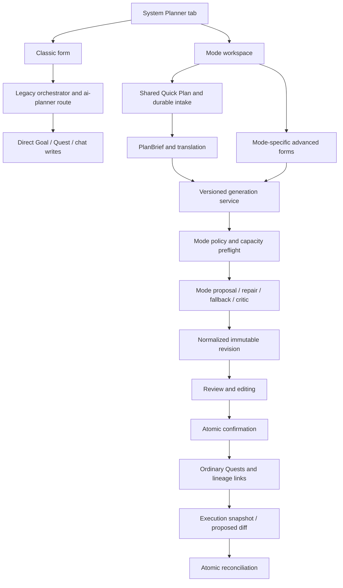

# Sylf AI Planner: end-to-end audit

**Audited 2 October 2026. Investigation only; no application fixes implemented.**

## Assessment

The Planner's failures are systemic. Sylf has two different planning backends, several representations of the same input, and a frontend that does not reliably preserve the relationship between a brief, a generation operation, a reviewed revision and its live Quests. Adding more prompt instructions will not repair that relationship.

The most consequential observations were:

- Changing availability in the shared replan UI sends an invalid request. The server expects a complete input; the client sends only an availability fragment and suppresses the type error with `as never`.
- A successful replan called all 20 Exam tasks **unchanged**, although it changed their descriptions and completion conditions. Confirmation kept the original Quests. All 20 stored revision criteria differ from the corresponding Quest descriptions.
- After changing a brief, generation returned `IDEMPOTENCY_MISMATCH`. The client recovered the earlier operation anyway and displayed its old draft under the new brief, without explaining that the new request failed.
- Quick Plan displayed an availability distribution that was different from the distribution sent to generation. Relevant scheduling facts disappear during brief-to-input translation.
- Classic generated 6 hours of new work on a day whose normal target was 2 hours, ignored existing work, wrote execution immediately, and persisted inconsistent duration fields.
- An Exam plan for one already-covered topic, confidence 4, produced 20 sessions and 15 hours of work. Its saved critic record says `UNREPAIRED`, with seven issues.
- Roadmap Quick Plan offered confirmation without displaying any actual milestones. Mastery's successful confirmation led to `/planner`, which is a real 404.

These are reproducible contract and lifecycle failures, alongside substantial planning-quality and UX problems. The modern server has useful integrity machinery, but the product does not present or consistently use it.

## 1. Audit scope, method and limits

The audit traced entry points, all four modes, prompts, providers, schemas, deterministic rules, scope/preparedness translation, research/import, generation operations, editing, confirmation, reconciliation, coverage/preferences, ordinary Quests and persistence. It compared current source with the requirements and historical reports in `documentation/planner/`.

The application ran locally with Next **16.2.9**, React **19.2.4**, Prisma **7.8**, and the existing configured hosted database and AI providers. Browser actions used the real application, native accessibility state and screenshots. A transparent **localhost-only** observer recorded Planner request bodies, responses and SSE events between browser port 3101 and application port 3100. It did not change application requests or record authentication headers/bodies. Database evidence was queried only for synthetic audit user **1133**.

The synthetic account had Asia/Karachi timezone, Sunday as a rest day, a 120-minute daily goal, and initially no subjects or study history. Later tests deliberately encountered work created by earlier tests, which exposed interactions between modes. A process-local unlimited entitlement for that account allowed repeated scenarios. Consequently, real quota exhaustion was not browser-tested. Synthetic test records were retained for review; no existing user's records were modified by the audit's direct database operations.

The working tree already contained extensive tracked and untracked changes, including Planner code. No changes were reverted, cleaned, committed or attributed to another agent. This report describes the observed working tree, not an immutable release. Repository files authored by this audit are confined to this report directory; private synthetic credentials were kept in a temporary file outside the repository. Next's bundled route/CLI/testing documentation was read before the diagnostic work.

Evidence levels used below:

| Label | Meaning |
| --- | --- |
| **LIVE** | Reproduced through the real browser, with request/persistence evidence where applicable. |
| **REPRO** | A focused executable reproduction using current pure functions or saved synthetic input. |
| **SOURCE** | A directly traceable code defect not exercised through that complete browser path. |
| **RISK** | An architectural or deployment consequence whose occurrence remains unverified. |

Limitations are material:

- Raw provider request/response recording was blocked by automatic approval review because the proposed external recorder would forward provider credentials. That approach was abandoned. Evidence includes application SSE, normalized persisted AI output, token/provider usage and traced transforms; it **does not include raw provider JSON or every actual provider prompt**. Do not infer precisely which model output caused the failed Exam generation.
- PostgreSQL integration and opt-in provider suites were skipped by the existing test configuration. Docker/local PostgreSQL were unavailable. Browser persistence used the existing hosted database; it is not a substitute for concurrency, rollback and ownership integration suites.
- Default development Turbopack worked. A temporary Webpack run experienced bundle/HMR problems and stale initial rendering; those are not established production defects. Cold authentication/database timeouts and cold compilation are separated from warm timings.
- Roadmap confirmation was attempted twice and correctly refused after intervening calendar changes. Editing and attempted expansion were exercised, but **successful strategic confirmation and successful expansion were not verified in this run**. Import upload/OCR, modern external research, mobile layout, quota exhaustion and every execution-protection race were reviewed in source/tests rather than fully exercised live.
- Educational usefulness is assessed from the actual output and stated inputs, not an assertion that a particular number of hours guarantees learning.

## 2. Current architecture

### Entry and frontend

[app/system/components/PlannerTab.tsx](/Users/aliumair/Desktop/sylf/app/system/components/PlannerTab.tsx) defaults to Classic. `PlannerWorkspace.tsx` adds an in-page mode chooser and Quick/Advanced navigation. Modern setup has a shared `QuickPlan` and `useIntake` hook, plus separate `ExamPlanner`, `RoadmapPlanner` and `MasteryPlanner` advanced surfaces. The same user can reach quite different representations of the same mode.

Classic is not a lightweight front door to the modern service. It is a separate backend with separate research, duration scaling, scheduling, quota/error handling and persistence semantics.

### Modern input and scope

`PlanBriefV1` stores goal, optional subject, target, budget, scope tree, provenance, preparedness, constraints, unresolved questions and assumptions. Intake sessions persist versioned briefs, expiry and an optional bound plan ID. Actions are serialized and version checked. Research/import produces a candidate; user confirmation is required to adopt that candidate as scope.

`to-input.ts` translates the brief into `UserInputV1`. This translation is a decisive boundary: it selects mode defaults, flattens units, derives dates and availability, and maps personal preparedness to mode-specific fields. Advanced forms construct input through a different path. Readiness is a presence test and is not the final mode feasibility test.

### Generation and model boundary

`server/generation.ts` selects a mode driver, creates/reuses a plan shell, checks capacity/feasibility, reserves quota and starts a durable operation. `lib/ai/planner/{exam,roadmap,mastery}.ts` constructs distinct structured prompts. The bounded pipeline attempts the primary DeepSeek proposal, a structural repair after validation failure, then a Gemini fallback. A semantic critic and targeted repair can add two further calls. Modern generation uses a 90-second mode budget and the route declares 120 seconds.

The model speaks local references; the server issues durable keys. Strict Zod contracts, scope matching, date/reference checks, hard constraints, mode-specific completeness, reserve and capacity checks run before execution. Completion criteria/outcomes can be replaced with defaults. The server persists normalized output and a bounded critic summary, not a detailed explanation of failed validation.

### Persistence and execution

`PlannerPlan` identifies a mode and points to active/latest draft revisions. `PlannerRevision` carries input, availability and output snapshots, digests, operation/lease/quota state and confirmation receipts. `PlannerQuestLink` binds revision item identities to ordinary Quests, including tombstones and dispositions. `PlannerIntakeSession` is a separate durable setup state. Classic instead writes ordinary Goals/Quests/chat messages directly, without modern revision lineage.

Modern services use a per-user advisory lock and serializable transactions, with bounded retry. Confirmation checks ownership, version, digest, current availability and scope/exclusions, then creates Quests and links atomically. Replanning snapshots execution, freezes started/completed work, produces a sealed diff, and separately reconciles approved changes. A strategic Roadmap creates zero Quests; a period expansion creates executable work.

### Research, assistance and adaptation

Classic uses a Google-grounded tool path with a synthetic fallback. Modern research has a DeepSeek query planner, configured search adapters, bounded fetching, provenance/excerpt verification, official-source checks, caching, follow-up research and candidate confirmation. Import includes outline/PDF parsing and vision fallback. The Designer and Copilot share intake actions but add distinct interpretation/model workflows before and after generation. Coverage and user-reported Mastery Check results intentionally distinguish execution from academic mastery. Friction/preferences are additional bounded soft inputs; they are not a demonstrated learning model.

## 3. What each mode currently does

| Mode | Intended job | Current behavior and observed usefulness |
| --- | --- | --- |
| **Classic** | Adaptive syllabus breakdown into study Quests, optionally using history and a deadline. | Researches even an explicitly supplied small scope, scales durations to the offered effort, distributes by item index, immediately writes Goals/Quests and returns to conversation. The three-topic result stayed in scope, but had broad tasks and no planned retrieval cycle. The ten-topic emergency result overloaded two days and ignored the account schedule. No draft/confirmation lifecycle. |
| **Exam** | Work backwards from an exam with coverage, recall, practice and final readiness. | Uses topic coverage/confidence/difficulty, a reserve, exam-day exclusion, workload/practice floors and sequence/spacing rules. Quick generation failed after three proposal attempts. Advanced generation succeeded but made 20 sessions for one covered, confident topic. Editing and initial confirmation worked. Availability replanning failed; a no-change replan succeeded and created revision/Quest content divergence. |
| **Roadmap** | Strategic course progress across periods, then expand a period when studying. | Distinct strategic output, zero items and milestone effort. Six Python units became seven milestones across six months, 630 minutes total. Prerequisite order was sensible, but four outcomes were generic defaults, no urgency/finish-earlier choice was offered, and Quick review showed none of the milestones. Calendar changes safely blocked confirmation, but recovery did not help the user refresh the draft. |
| **Mastery** | Bounded progression through understanding, learning, retrieval, practice, mistake review and a final check. | One chain-rule unit became 13 sessions, 537 minutes, with coherent stage progression, later retrieval and a terminal 57-minute check. This was stronger than the Exam output. Quick requires a deadline despite the advanced mode's optional derived horizon. Confirmation created 13 Quests; Open the plan was a 404. Return/regeneration after a valid changed deadline recovered the already-confirmed old draft and offered confirmation again. |

The modes are genuinely different in the backend. The shared Quick surface erases much of that distinction and presents all outputs as sessions plus a common calendar confirmation flow. The strongest mode-specific behavior is most visible only in Advanced.

## 4. Browser scenarios and evidence

All HTTP IDs below refer to records in [http.jsonl](/Users/aliumair/Desktop/sylf/documentation/planner/reports/2026-10-02-end-to-end-audit/evidence/http.jsonl). Screenshots have matching accessibility `.txt` files. Times are full local HTTP/SSE durations, including relevant application/database/provider work, not production percentiles.

| Scenario | Actions and result | Evidence |
| --- | --- | --- |
| C0: incomplete Classic | Generate with empty goal: helpful “Please enter a subject or goal title.” Client guard worked. | Observed browser validation; source `AiPlannerPanel`. |
| C1: small scope and unequal difficulty | GCSE algebra, only quadratics/simultaneous/rearranging; quadratics difficult, rearranging easy; 2h/week. Four Quests, 120 required minutes. Calendar-facing target fields totaled 180 minutes. All difficulty tiers were EASY. | HTTP **560**, 51.651s; [Classic result](/Users/aliumair/Desktop/sylf/documentation/planner/reports/2026-10-02-end-to-end-audit/evidence/classic-generated.png), [saved state](/Users/aliumair/Desktop/sylf/documentation/planner/reports/2026-10-02-end-to-end-audit/evidence/classic-state.json). |
| C1: research failure | Gemini grounding returned 503; UI still described live/official findings. Synthetic “Academic Curriculum Knowledge Engine” fallback substituted for research. | [Progress](/Users/aliumair/Desktop/sylf/documentation/planner/reports/2026-10-02-end-to-end-audit/evidence/classic-scope-fallback-progress.png), `server.log`, HTTP 560 SSE. |
| C2: many topics, short deadline, extreme effort | Ten Biology topics, 40h/week, deadline Sunday Oct 4, existing C1 work. Ten Quests, 686 required minutes: 360 Friday + 326 Saturday. With C1, 390 and 356 required minutes. Normal daily goal 120. No work after deadline occurred in this case. | HTTP **780**, 71.840s; [result](/Users/aliumair/Desktop/sylf/documentation/planner/reports/2026-10-02-end-to-end-audit/evidence/classic-deadline-generated.png), [state](/Users/aliumair/Desktop/sylf/documentation/planner/reports/2026-10-02-end-to-end-audit/evidence/classic-deadline-state.json). |
| E0: ambiguous recommendation | “biology exam tomorrow can study two hours” recommended Exam and recognized tomorrow in explanation. Quick date remained blank, written “two” was not translated to budget; normal 12h/week appeared. | Chooser source and intake/action payloads; the early date-loss screenshot contains a transient dev rendering and is not relied on as sole proof. |
| E1: simple Quick Exam | Biology, Cells/Enzymes/Transport, Oct 16, 5h/week. UI spread `[0,53,77,53,77,21,19]`; sent `[0,50,50,50,50,50,50]`. Three generation/validation attempts failed. Revision FAILED, quota RELEASED, shell version 0. | HTTP **818**, 45.608s; [failure](/Users/aliumair/Desktop/sylf/documentation/planner/reports/2026-10-02-end-to-end-audit/evidence/exam-no-draft.png), final state. |
| E1: recovery/handoff | “Change the brief” opened Advanced; a new exam form did not inherit the populated Quick brief. Failed operation was described as a plan created without a reviewable draft. | [Handoff](/Users/aliumair/Desktop/sylf/documentation/planner/reports/2026-10-02-end-to-end-audit/evidence/exam-advanced-loses-brief.png). |
| E2: known, confident topic | Advanced Biology/Enzymes quiz, one topic, covered=true/confidence=4, Oct 30; 60m Mon–Sat, 15% reserve. Twenty 45m sessions, 900 minutes. Critic UNREPAIRED, seven issues. | HTTP **915**, 42.507s; [review](/Users/aliumair/Desktop/sylf/documentation/planner/reports/2026-10-02-end-to-end-audit/evidence/exam-advanced-bloated-review.png), revision `44a1ab75…`. |
| E2: edit/confirm | Changed first title and minutes 45→30. Immutable EDIT revision saved; total 885 minutes. Confirm created 20 Quests. Detail needed reload to reflect live linkage consistently. | Edit **1008**, 7.767s; commit **1026**, 5.775s; [confirmed](/Users/aliumair/Desktop/sylf/documentation/planner/reports/2026-10-02-end-to-end-audit/evidence/exam-confirmed.png). |
| E3: changed availability | Friday 60→30 in Review plan. Request sent partial proposedInput; server returned 400 INVALID_REQUEST. No live plan mutation. | HTTP **1085**, 9.265s; [rejection](/Users/aliumair/Desktop/sylf/documentation/planner/reports/2026-10-02-end-to-end-audit/evidence/exam-replan-request-rejected.png). |
| E4: replan without changed availability | Reset Friday to 60. Generated a proposal: 20 unchanged, zero other changes. Descriptions/criteria changed. Confirm succeeded and retained all Quest IDs. | Replan **1247**, 26.865s; confirm **1307**, 7.612s; [preview](/Users/aliumair/Desktop/sylf/documentation/planner/reports/2026-10-02-end-to-end-audit/evidence/exam-replan-unchanged-but-content-changed.png), [comparison](/Users/aliumair/Desktop/sylf/documentation/planner/reports/2026-10-02-end-to-end-audit/evidence/result-summary.json). |
| R1: long course horizon | Six Python units, Mar 31 2027, 3h/week. Seven milestones/630 minutes/zero sessions. Quick rendered only counts and a confirmation button. | HTTP **1011**, 17.876s; [blind confirmation](/Users/aliumair/Desktop/sylf/documentation/planner/reports/2026-10-02-end-to-end-audit/evidence/roadmap-blind-confirmation.png). |
| R2: input change after generation | Changed goal to Learn Python for automation. New brief saved; old seven-milestone review remained confirmable. | [Stale review](/Users/aliumair/Desktop/sylf/documentation/planner/reports/2026-10-02-end-to-end-audit/evidence/roadmap-brief-changed-old-review.png). |
| R2: concurrent calendar change | Confirm after Exam had been materialized: 409 SCHEDULE_CHANGED. Second Advanced confirmation also refused. Correct server protection; generic client error hid cause. | **1097**, 2.386s; **1372**, 2.330s; [error](/Users/aliumair/Desktop/sylf/documentation/planner/reports/2026-10-02-end-to-end-audit/evidence/roadmap-confirm-conflict.png). |
| R3: Advanced editing | Saved Roadmap was accessible after choosing it from the list. Outcome-only edits got generic 422 INVALID_DRAFT; a later multi-outcome edit got 409 with a blocker. The latter rejected “Build and run…” because the English action allowlist did not recognize it. No edit revision was saved. | **1313**, **1329**, **1399**; [editing](/Users/aliumair/Desktop/sylf/documentation/planner/reports/2026-10-02-end-to-end-audit/evidence/roadmap-edit-rejected.png), [diagnosis](/Users/aliumair/Desktop/sylf/documentation/planner/reports/2026-10-02-end-to-end-audit/evidence/roadmap-edit-diagnosis.json). |
| R4: return and regenerate | Back to Quick restored changed goal and offered Generate. Generation returned 409 IDEMPOTENCY_MISMATCH, then frontend recovered the old draft and displayed seven milestones as if a draft was available for the new brief. | **1434**, 0.772s; [replayed draft](/Users/aliumair/Desktop/sylf/documentation/planner/reports/2026-10-02-end-to-end-audit/evidence/roadmap-regeneration-replays-old-draft.png). |
| R5: attempted expansion | Advanced showed enabled Plan October on unconfirmed draft. Click made a request, waited, then generic error; server returned ROADMAP_NOT_CONFIRMED. | **1545**, 8.846s; [error](/Users/aliumair/Desktop/sylf/documentation/planner/reports/2026-10-02-end-to-end-audit/evidence/roadmap-expansion-unconfirmed-error.png). |
| M0: no deadline | One chain-rule unit, normal schedule, no deadline: Generate disabled for one essential missing detail. | [Required date](/Users/aliumair/Desktop/sylf/documentation/planner/reports/2026-10-02-end-to-end-audit/evidence/mastery-mandatory-date.png). |
| M1: generate/confirm | Set Oct 20, normal 12h/week. Thirteen sessions/537 minutes. Only eight shown in Quick; criteria and remaining tasks absent. Confirm created 13 Quests. | Generate **1075**, 20.221s; commit **1239**, 3.618s; [review](/Users/aliumair/Desktop/sylf/documentation/planner/reports/2026-10-02-end-to-end-audit/evidence/mastery-quick-review.png), [confirmed](/Users/aliumair/Desktop/sylf/documentation/planner/reports/2026-10-02-end-to-end-audit/evidence/mastery-confirmed.png). |
| M2: navigation and return | Open the plan → 404. Returning to System reset entry to conversation/Classic; manually choosing Mastery restored brief but offered Generate despite an active plan. | [404](/Users/aliumair/Desktop/sylf/documentation/planner/reports/2026-10-02-end-to-end-audit/evidence/mastery-open-plan-404.png), [restored state](/Users/aliumair/Desktop/sylf/documentation/planner/reports/2026-10-02-end-to-end-audit/evidence/mastery-return-forgets-active-plan.png). |
| M3: extreme then valid date | Jan 31 2027 (>84-day Mastery bound): action 422 INVALID_DRAFT, message claimed inability to reach planner; field kept new date while summary retained Oct 20. Set valid Nov 20: new brief saved but old review remained. | **1353**, 2.207s; [long date](/Users/aliumair/Desktop/sylf/documentation/planner/reports/2026-10-02-end-to-end-audit/evidence/mastery-long-date-generic-error.png), [stale review](/Users/aliumair/Desktop/sylf/documentation/planner/reports/2026-10-02-end-to-end-audit/evidence/mastery-edited-brief-stale-review.png). |
| M4: regenerate/confirm returned plan | Regenerate Nov 20: 409 IDEMPOTENCY_MISMATCH; recovered old Oct 20 draft. Confirm again: 409 REVISION_ALREADY_CONFIRMED, generic “Nothing was created; draft saved.” No duplicate Quests. | **1456**, 1.270s; **1478**, 1.318s; [replay](/Users/aliumair/Desktop/sylf/documentation/planner/reports/2026-10-02-end-to-end-audit/evidence/mastery-regeneration-replays-old-plan.png), [repeat rejection](/Users/aliumair/Desktop/sylf/documentation/planner/reports/2026-10-02-end-to-end-audit/evidence/mastery-repeat-confirm-rejected.png). |
| X1: use confirmed work | View Quests navigated to normal Quest Log. All 33 modern tasks displayed “Unknown Goal”. Exam task opened in Focus with correct edited title/30m; synthetic session was paused and ended, without completing the Quest. | [Quest Log](/Users/aliumair/Desktop/sylf/documentation/planner/reports/2026-10-02-end-to-end-audit/evidence/confirmed-quests-unknown-goal.png), [Focus](/Users/aliumair/Desktop/sylf/documentation/planner/reports/2026-10-02-end-to-end-audit/evidence/exam-focus-handoff.png). |

Cold C1 attempts also experienced a 97.483-second 401 caused by an authentication database timeout, and an interrupted provider request during dev reloads. Neither was counted as a successful generation or as a warm latency sample.

## 5. Finding register: severity and user impact

**P1:** blocks a core user journey, breaks plan/execution integrity, or silently contradicts a consequential input. **P2:** substantial quality/usability/reliability defect or a bounded edge case. **P3:** maintenance/clarity issue. No P0 security incident was established.

| ID | Severity / evidence | Finding and user impact |
| --- | --- | --- |
| A01 | **P1 LIVE** | Availability replanning sends a partial object into a full-input schema. A central advertised adaptation action cannot work. |
| A02 | **P1 LIVE** | Replan retention ignores descriptions, completion criteria and other semantic metadata. “Unchanged” tasks can have different saved plan and live execution instructions. |
| A03 | **P1 LIVE** | Changed-brief generation reuses a session-wide key; a rejection is followed by recovery of an older operation. The user sees an old draft under new intent. |
| A04 | **P1 LIVE** | Quick generation/confirmation state is not restored with durable intake. Already-confirmed work is offered as a new draft and fails when confirmed again. |
| A05 | **P1 LIVE** | Availability presented in Quick is not the availability used for generation, because scheduling context is dropped. The brief is not a truthful preview of model input. |
| A06 | **P1 LIVE** | Classic requiredMinutes differs from default targetMinutes; small plan was 120m in preview but 180m in downstream capacity. Calendar/planning consumers disagree about duration. |
| A07 | **P1 LIVE** | Classic ignores normal daily capacity and existing scheduled workload. An apparently valid emergency plan adds 360m/326m to two days without explaining conflict or triage. |
| A08 | **P1 SOURCE** | Classic writes Goal, Quests and chat separately, with no operation identity. Failure between writes can leave partial execution; retries can duplicate it. No partial-write fault injection performed. |
| A09 | **P1 LIVE** | Roadmap Quick confirmation displays no milestone content. Review-before-commit exists as a button order, not an informed review. |
| A10 | **P1 LIVE + REPRO** | Unrepaired critic concerns can become a confirmable plan; final fatal check uses deterministic findings only. The model review stage is not the quality guarantee its progress copy suggests. |
| A11 | **P1 REPRO** | Exam preflight uses the 200 stored-item bound while proposals allow 90. Thirty-one unknown/new topics require at least 125 items yet pass POTENTIAL_FIT. Generation cannot satisfy both contracts. |
| A12 | **P1 REPRO** | Roadmap input accepts 49KiB at generation but later readers use 32KiB. Valid larger scope can be generated but cannot reliably be edited, confirmed or replanned. |
| A13 | **P1 LIVE** | Quick's success link points to nonexistent `/planner`. The successful journey immediately becomes a 404. |
| A14 | **P1 LIVE** | Classic substitutes synthetic curriculum fallback after research 503 but continues to claim live/official research progress. Users cannot assess source reliability. |
| A15 | **P2 LIVE** | One covered/confident Exam topic expands into 20 sessions and 15h. Budget/date opportunity is mistaken for necessary study work; repetitive sessions burden the learner. |
| A16 | **P2 LIVE** | Quick→Advanced does not carry current setup or target the generated revision. Users re-enter information or find a saved plan manually. |
| A17 | **P2 LIVE + SOURCE** | Mastery Quick requires a date although the mode supports a derived horizon. Longer date fails with a connectivity message, and local field/summary diverge. |
| A18 | **P2 LIVE + SOURCE** | Failure codes, actionable validator details and recovery paths are suppressed. E1's real failed generation becomes “plan created without draft”; Roadmap stale calendar looks like a generic inability to finish. |
| A19 | **P2 LIVE** | Every on-blur save disables the shared form. Twenty-seven observed intake actions had median 2.865s, p90 5.118s, maximum 14.042s. Ordinary typing becomes a sequence of waits. |
| A20 | **P2 LIVE + SOURCE** | Brief changes do not invalidate visible REVIEW. Date, goal and budget can refer to one brief while Confirm refers to another revision. |
| A21 | **P2 LIVE** | Four of seven Roadmap outcomes are identical generic defaults; short scope is spread across six months without an earlier-finish choice. Useful checkpoint detail is present in stored data but not fully exposed in review. |
| A22 | **P2 SOURCE + LIVE** | Completion/outcome filtering is an English substring/regex gate, then silent fallback. “Build and run” was rejected as unobservable; arbitrary question counts written as words survived while digit counts are rejected. Pedagogical specificity is not consistently preserved. |
| A23 | **P2 SOURCE** | Classic reserves quota before parsing/validating. Early missing-field return and malformed-body exception do not release the reserved unit. Quota failure behavior was not live-tested under limited entitlement. |
| A24 | **P2 SOURCE** | Capacity/readiness/preparedness defaults disagree across surfaces. Completed work is counted at full planned duration in capacity while intake weighting uses open work; incomplete confidence becomes different assumptions in Quick and Advanced. |
| A25 | **P2 LIVE** | Advanced confirmation does not refresh detail immediately. After successful commit the old draft UI remained until reload; copy still said reconciliation was a future flow while Review plan was available. |
| A26 | **P2 LIVE** | Modern confirmation defaults createGoal=false, and ordinary Quest Log renders null goals as “Unknown Goal”. Plan/subject context is lost at the execution surface. |
| A27 | **P2 SOURCE** | Shared selection helpers include STRETCH items, whereas confirmation requires separate stretch promotion. A proposal containing stretch can fail normal confirmation. No live stretch proposal was generated. |
| A28 | **P2 SOURCE** | Failed acceptance flow replaces REVIEW with FAILED, then offers “Accept this and continue”; confirm immediately returns unless phase is REVIEW. That recovery button cannot complete the advertised action. |
| A29 | **P2 LIVE + SOURCE** | Usage telemetry prices unknown model IDs at zero. All 18 recorded calls/79,048 total tokens logged $0; active `deepseek-flash` is absent from the rate table, and Classic logs a display name. This is not evidence that generation was free. |
| A30 | **P2 SOURCE / RISK** | Classic's rest-day rolling is not bounded by the deadline; floating-rest lookup fails open; app timeout is 180s while route maxDuration is 120s. Deadline and deployment failures remain possible. Late scheduling was not reproduced in C2. |
| A31 | **P2 LIVE** | Unconfirmed Roadmap shows enabled period expansion. The action waits 8.846s only to receive ROADMAP_NOT_CONFIRMED and a generic message. |
| A32 | **P2 SOURCE / RISK** | Research/import/Designer budgets and route ceilings are not one shared end-to-end deadline. DEEP research can require multiple long calls through an action route without an explicit maxDuration. Hosted truncation was not tested. |
| A33 | **P3 LIVE + SOURCE** | “Ask Sylf” mode recommendation is a regex heuristic with incomplete extraction. It recognized tomorrow but did not configure the date or written-number hours. The wording overpromises assistance. |
| A34 | **P3 SOURCE + TEST** | Obsolete chooser/modal code, older rollout reports and eight stale chooser tests coexist with the current workspace. There is no single verified current prose specification. |

## 6. Critical defects and their actual mechanisms

### A01: the replan request contract is broken at the frontend boundary

In `RebalancePanel.tsx`, availabilityChanged assembles `proposedInput: { availability: ... } as never`. `RebalanceRequest.proposedInput` and `server/rebalance.ts`'s `RebalanceRequestSchema` require a complete `UserInputV1`. The browser's Friday change proves the mismatch; it fails before model execution. Resetting Friday made proposedInput absent and the no-change path succeeded. This isolates request shape, rather than the provider or database, as the cause.

The same panel serves all three modern modes. It also hardcodes 15% reserve and clears blockedDates in the fragment, which would discard existing choices if partial merging were later added naively. Redesign the command as a typed patch with explicit fields, or send a complete authoritative input assembled server-side. Do not merely relax the schema until the submitted fragment happens to parse.

### A02: retained identity is being mistaken for retained content

`server/rebalance.ts` retains an item key when title, date, minutes and type match. It ignores description, completionCriteria, stage/intent metadata, scope relationships, dependencies and rationale. The reconciliation path returns a receipt for RETAIN items but does not rewrite their Quest content. The active revision, however, includes the new model content.

For Quest **2572**, the active replan criterion is “Active site structure and specificity explained from memory with no notes, then checked against notes.” The live Quest still contains the previous criterion requiring a labelled recall sheet and five correct statements. The same mismatch appears for all 20 retained items. The diff's zero changes is therefore false as a content claim, even though date/title/minutes really were retained.

Use one definition of execution equality, and make the approved diff include semantic edits. Preserve truly unchanged content verbatim; classify and explicitly reconcile legitimate content edits. A revision should not describe a different executable task under an unchanged Quest identity.

### A03/A04/A20: durable intake and durable generation are not one lifecycle

The generation key is `intake-${session.id}`, independent of brief version. `createPlanShell` correctly rejects reuse with a different creation hash. `useIntake.generate` then catches that rejection, calls requestGeneration again and settles the previous key. `settle` chooses latestDraft or activeRevision and sets REVIEW even when the recovered operation is for an older brief or has a confirmation receipt.

Thus the server's fail-closed protection is effectively turned into silent stale success at the presentation layer. This happened independently for Roadmap's changed goal and Mastery's changed date. Repeating Mastery confirmation correctly returned REVISION_ALREADY_CONFIRMED; the UI reported an unspecific failure rather than opening the active plan. Brief restoration alone is insufficient.

A generation must bind to a brief version/input digest, with separate retry identity. Restore its actual durable lifecycle: new brief, running operation, failed operation, reviewable draft, stale draft, active plan, proposed replan. A recovered artifact must state which brief it belongs to. The user needs explicit regenerate/refresh/replan actions, not one Generate button for every state.

### A05/A06: the displayed plan and consumed plan do not share time semantics

Intake enrichment uses existingLoadByDate, floating rests and scheduling context to display the budget distribution. `briefInputFor` and `analysisInputFor` pass only today, restWeekdays and dailyGoalMinutes into inputFromBrief. Generation recomputes a different grid. The concrete Exam vectors above prove this is data loss, not a subjective preference about scheduling.

Classic adds another mismatch: the route writes requiredMinutes but omits targetMinutes, which defaults to 45. Modern availability loading uses the maximum of those fields. The four-task algebra plan becomes 180 minutes of blocked capacity after being presented as 120. The emergency plan has 686 required minutes but only 450 target minutes; taking the maximum makes downstream behavior depend on each task's accidental default.

One duration contract should govern preview, Quest timer target, workload estimation, capacity and remaining work. Every setup surface must use one availability calculation and declare whether a number means total daily capacity, additional capacity, a soft weekly target or a hard maximum.

## 7. Plan quality, prioritisation and scheduling

### Capacity is not a study objective

Classic scales the entire output to `(effortHours / 7) * days * 60`, then clamps each duration to 15–240 minutes. Its final clamping also means the comment claiming exact distribution is not generally true. Topic count/index determines dates; neither task complexity nor existing workload determines placement. In C2, an EXTREME label substituted for a useful feasibility discussion.

Modern capacity is primarily a validator. The LLM receives usable dates, capacities and coarse topic floors and must invent a complete schedule satisfying many rules. There is no robust shared allocator producing a sensible schedule before/after the model. Exam's many mandatory learning/practice/spacing/readiness rules create pressure for more sessions, while the model can use every available day. E2's 900 minutes for a confident covered topic demonstrates that passing all hard rules does not establish necessity, efficiency or pleasant pacing.

Roadmap has the complementary problem: every period is expected to carry work, so six small units consume six calendar months and reinforcement is inserted to populate the final period. The stored warning says the scope minimum was 630m and usable time 3775m. The product should offer completion earlier than a distant deadline, deliberate idle periods and maintenance review, rather than treating the entire supplied horizon as mandatory course length.

Mastery's chain-rule result had a plausible learning progression and concrete written outputs. Its 537 minutes may be reasonable for a new learner; the available input cannot establish that it was necessary. Unknown prior exposure mapped to NEW, and the user was never asked a cheap diagnostic question that could materially shorten it. This is a calibration gap, not proof that every Mastery plan is repetitive or too long.

### Scope and priority

Modern scope labels are authoritative and strict matching prevents invented extra syllabus units. That is valuable. However, a label is not a measured workload. Unknown/new topic estimates use a common 105-minute floor, secure topics 45, weak covered topics 75, with difficulty/priority/size adjustments. Practice floors and required item counts operate alongside those estimates. A tiny topic and a whole chapter can be similar input nodes unless a size signal is supplied; Quick and Advanced do not collect/map all signals consistently.

The 31-topic reproduction is especially important: user scope limits, preflight segmentation policy and the model envelope disagree. It should not require an AI call to discover that a structurally mandatory 125-item plan cannot fit a 90-item proposal. Preflight needs to check the exact output contract and offer bounded segments or explicit triage before generation.

### Deadlines, rest days and completed work

Modern local date keys and canonical UTC-noon execution dates are more disciplined than Classic's instant-based date difference and UTC-midnight goal deadline. Classic rolls off rest days without rechecking the end boundary and swallows floating-rest read failures. These are source defects; the emergency browser case did finish before its deadline.

Modern capacity counts every non-FAILED existing task, including COMPLETED, at its full planned duration. That may be intentional if the budget is total daily effort and the completed work actually consumed that duration. It is misleading if the time was shorter, the budget means additional availability, or intake excluded that work when calculating the visible distribution. Define this policy explicitly and account for actual elapsed/remaining time where relevant. The reproduction shows a completed 90-minute planned task removing all 90 minutes; it does not establish that completed study should consume zero capacity.

## 8. Prompt/model/semantic-quality problems

The modern mode prompts do communicate different jobs and prohibit invented scope, IDs, execution and mastery claims. The issue is the distribution of responsibilities and insufficient verification of useful output.

Classic's Master Planner prompt asks for an “exquisitely structured, 100% accurate” gamified quest list. Accuracy cannot be achieved by that instruction, especially when research has degraded to generic knowledge. The prompt mixes curriculum fidelity, attractive titles, durations and rewards, while deterministic scaling later overwrites duration decisions. A separate history-based session estimate does not become the final timing contract. Gamified wording is not a learning plan objective.

Modern prompts expose a large set of hard constraints, mode metadata, scope references, available dates, optional learned preferences and JSON syntax. The pipeline reacts to validation failures with another full answer, then a fallback. This can consume three costly calls trying to satisfy rules that preflight could have known were incompatible. The failed E1 case made three calls and still produced no usable draft. Its exact validation reasons were not saved.

The semantic pipeline merges deterministic and AI critic findings but, after a patch, rechecks only deterministic findings. `repaired = targets.length` counts targeted items rather than verified resolved issues. The saved Roadmap record says seven repaired with one remaining deterministic issue; it does not prove seven educational problems were corrected. A focused reproduction supplied a HIGH critic issue and a rejected repair with no deterministic issue: the proposal still returned with UNREPAIRED. E2's seven unrepaired issues were hidden from review.

Treat critic findings as evidence with a defined policy, not a decorative stage. Structural rejection, optional advisory concern, verified repair and unavailable review should be distinct. Do not blanket-fail every subjective critic finding; give the user an honest review state and fail/repair only where the defined severity justifies it. Verify targeted repair outcomes and preserve useful content.

Completion criteria illustrate the current tension. `done.ts` rejects digit counts, broad “mark/official” expressions and text without an English substring from its action list. It silently substitutes generic defaults. Written-number counts bypass the digits regex; legitimate “mark your answers” wording can be interpreted as an invented requirement; “Build and run a program” is observable but failed Roadmap editing. The fallback “Complete the planned topics for this period and note what remains” meets the gate while saying little about the milestone's outcome. This is lexically compliant prose, not semantic quality.

The DeepSeek adapter also does not propagate finishReason, while the pipeline expects `MAX_TOKENS` to identify truncation. Large answers can therefore fall into generic structural repair instead of a precise truncation path. This is a source finding; raw provider finish reasons were not recorded in this audit.

## 9. UX through the complete journey

Opening Planner presents Classic as the default; modern modes are one more navigation layer. Historical coexistence work intended Classic availability, so this is not automatically a violation. It does mean the default experience lacks the constraints/review guarantees that other Planner copy implies.

The modern chooser asks users to distinguish exam sprint, course roadmap and unit mastery before they have a clear preview of their outputs. The shared Quick form then repeats similar Goal/Timeline, Scope, Budget and optional-background sections. Four alternative scope-entry paths, long board/level menus, duplicated editing affordances and a plan brief occupy substantial space before the primary generation action. This is a form-led experience, despite documentation advocating a short conversational setup.

Inputs save on blur and the whole form disables during each request. This was a repeated practical interruption, not merely a loading-state implementation detail. A date rejected by the mode limit stayed in the field while the saved brief summary showed an older date. The notice claimed network trouble. Readiness still claimed enough information, and previously generated content remained available.

Review is the weakest shared surface: at most eight title/date/minute rows, no full total effort, no completion criteria, no editable timeline, no complete list or useful critic state. Roadmap has zero rows. “Edit it in the full planner” opens an Advanced list/workspace instead of the specific revision. Quick errors replace the review and leave only a Change the brief escape. The user cannot tell whether they should retry generation, refresh capacity, edit scope or simply open their already active plan.

Advanced is more informative but cumbersome. Exam has six steps, many fields and defaults that imply uncovered/low-confidence topics. Its review exposes detail, but 20 similarly sized tasks for one topic are hard to assess. Roadmap's periods expose effort/outcomes; checkpoint detail is not equally apparent. Draft edits are rejected with broad explanations that name several possible requirement classes and no offending field.

At confirmation, Roadmap should communicate a strategic commitment and the next expansion action, not claim calendar Quests. Quick instead uses the common “plan and its Quests” and “Your Quests are on your calendar” language, including zero-session cases. Modern work then appears in ordinary Quest Log without its plan identity and with Unknown Goal. The Focus handoff used the correct Quest title and edited 30-minute target, but showed generic subject “Focus Session” because the plan had no linked subject. The work exists; its purpose becomes harder to find.

## 10. Data, state and backend integrity

The strongest current backend practices should be preserved: owned references, model-local IDs, immutable revisions, atomic materialization, idempotent operation recovery, live availability fingerprinting, explicit exclusions, protected execution, and separate strategic/period Roadmap state. The tested SCHEDULE_CHANGED and REVISION_ALREADY_CONFIRMED refusals did prevent unsafe or duplicate execution.

Those practices do not cover all paths. Classic bypasses modern lineage and commits independently. Chat-driven mutations are another route into ordinary Quest data. Generic Quest lifecycle/mutation guards need to remain coherent with Planner lineage, including user release/tombstones and reoffer; the code implements substantial guard machinery, but this audit did not run every live race.

The main data failure is not corruption of UUIDs or transaction rollback. It is inconsistent meaning across snapshots and views: brief version versus generation key, displayed versus generated availability, revision task versus retained Quest, required versus target duration, optional goal versus Unknown Goal rendering. A normalized output can be valid in storage yet wrong for the user's current intent.

Input bounds also drift across lifecycle stages. Roadmap's 49,152-byte guarantee is not respected by generic 32,768-byte reads in materialization, editing, rebalancing and related services. A test with 60 legal labels and 175 blocked dates passes the generation-sized envelope and fails the later envelope. One mode-specific parser/limit function should be used at every read; stored data accepted once must remain usable throughout its lifecycle.

Empty shells are created before a generation fails feasibility or model validation. E1 left a plan with no output revision and version 0, then recovery referred to it as a created plan. Empty shells may be useful internal operation anchors, but they should not look like saved user plans. Keep incomplete attempts as attempts, with an actionable terminal status and an explicit fresh-generation route.

## 11. Performance, reliability and observability

Warm completed generation routes measured **17.876–71.840 seconds** across these small cases. This is not a representative production sample. It nevertheless shows that a one-topic or six-topic plan can involve multiple calls and waits, and that generation is only one part of perceived latency: scope saves, brief enrichment, detail reads, binding and confirmation add more hosted database round trips.

The observed 27 intake action requests had median 2.865s, p90 5.118s and maximum 14.042s. This count includes the actions captured during the audit, not an application-wide benchmark. Their effect is amplified because the form disables. A failed replan request needed 9.265s; an unconfirmed expansion needed 8.846s before refusing. Validate known frontend state and request shape before asking the user to wait.

There were **18 logged provider calls**, 38,761 prompt tokens and 40,287 completion tokens. Classic research calls are not necessarily represented in this usage count, and failed/aborted calls may be absent. All logged cost estimates were zero. Source confirms that active `deepseek-flash` and Classic's display-name model string do not match configured rate keys. Actual financial cost was not measured; zero is a telemetry defect, not a cost conclusion.

Modern content privacy is sensible, but it has become under-observability. The HTTP wrapper collapses most validation failures to INVALID_DRAFT and database/runtime errors to PLANNER_UNAVAILABLE. Generation saves FAILED without the exact bounded validation cause. Internal codes can be logged and mapped to user remedies without logging full study content or provider secrets. E1 cannot be accurately diagnosed down to the individual rejected rule from current retained evidence.

Timeout policy is fragmented. Classic's route allows 120s but its internal abort is 180s. Generation/critic/repair budgets, import/vision, Designer/Copilot and deeper research have separate caps and route ceilings. Production hosting behavior remains untested. Propagate one request deadline, reserve persistence time, and record each stage's elapsed time/outcome so retriable provider problems are distinguishable from structural impossibility.

The serializable/user-lock strategy and batched initial materialization are appropriate. Replanning still has per-item supersede/delete work and expensive full execution/fingerprint reads. This is a scaling risk requiring transaction-duration evidence, not a claim that the old batched-confirmation timeout remains unfixed. Large-plan concurrency and rollback tests were skipped in this environment.

## 12. Duplication, obsolete code and intent versus implementation

| Documentation/design intent | Current implementation/live result | Interpretation |
| --- | --- | --- |
| Modes PRD and Intelligence Addendum: distinct outputs, authority of scope, deterministic feasibility, review before commit and protected execution. | Mode contracts are distinct; hard constraints/ownership checks exist. Quick Roadmap is not reviewable; preflight/model limits conflict; retained execution content diverges. | Backend structure follows much of the intent, but user-visible guarantees are incomplete. |
| Experience & Research Addendum: few essential follow-ups, helpful conservative draft, inheritance into Advanced, scope handling including large chapter ranges. | A shared multi-section form, on-blur network waits, no Advanced inheritance in E1, 31-topic preflight can exceed model bounds. | Clear mismatch with the intended low-friction setup and meaningful large-scope support. |
| Research provenance: candidates remain separate, official status verified, user acceptance required. | Modern code supports this; Classic has an independent synthetic fallback with misleading official/live copy. | Two research architectures provide incompatible provenance guarantees. Modern live external research was not verified here. |
| Classic/Modes coexistence report restores Classic default and independent fallback. | Classic default remains. Older chooser dialog/quick-modal components are no longer the live entry. | Do not treat older Quick-first rollout descriptions as current behavior. |
| Historical closure/final reports describe passed phase gates. | Current test run has skipped database/provider suites, eight failing old-entry expectations, and live lifecycle failures. | “FINAL” is task history, not release-level verification of the current working tree. |
| [documentation/planner/README.md](/Users/aliumair/Desktop/sylf/documentation/planner/README.md) says no single verified current prose specification. | Consistent with multiple phase reports, untracked work and current source drift. | Establish a reconciled living contract rather than choosing one historical report as authority. |

Important duplication/obsolescence:

- Classic research, planning, timing, scheduling and persistence are independent from the modern engine. Keeping both live means fixing many guarantees twice.
- Quick brief-to-input/default/readiness logic overlaps Advanced form construction, mode preflight, constraints and Smart Setup analysis. The overlap already produces actual data loss and different defaults.
- `PlannerModesChooser` and `ExamPlannerQuickModal` remain in the repository but the active System flow uses `PlannerWorkspace`. They are not proof of a functioning current modal flow.
- Designer and Copilot add multiple interpretation and model stages around a shared command vocabulary. They are not all dead: they serve different setup/revision moments. Their complexity should be justified against actual user actions and latency rather than preserved by phase name.
- Reports, prompt behavior, feature labels, constraints and tests do not all describe the same current surface. The eight entry-test failures are evidence of that mismatch, not a reason to restore obsolete UI blindly.

## 13. Tests and evidence status

The existing Planner-oriented test run completed:

| Result | Count |
| --- | ---: |
| Test files | 114 |
| Passed files | 83 |
| Failed files | 2 |
| Skipped files | 29 |
| Tests passed | 1,207 |
| Tests failed | 8 |
| Tests skipped | 255 |
| Total tests | 1,470 |
| Duration | 79.34s |

The eight failures are four in `classic-modes-coexistence.test.tsx` and four in `exam-entry.test.tsx`, whose assertions expect the earlier chooser/dialog entry. The current workspace differs. Logs are in [tests.log](/Users/aliumair/Desktop/sylf/documentation/planner/reports/2026-10-02-end-to-end-audit/evidence/tests.log). A high unit-test pass count does not cover the observed request/response/persistence sequence; skipped provider/transaction suites especially limit claims.

Six audit-only focused tests pass in [diagnostics.log](/Users/aliumair/Desktop/sylf/documentation/planner/reports/2026-10-02-end-to-end-audit/evidence/diagnostics.log), with source in [diagnostics.test.ts](/Users/aliumair/Desktop/sylf/documentation/planner/reports/2026-10-02-end-to-end-audit/evidence/diagnostics.test.ts):

1. Thirty-one unknown/new Exam topics pass POTENTIAL_FIT with minimumItems=125 despite the 90-item proposal envelope.
2. An explicit zero weekly budget is considered ready when a positive normal schedule exists.
3. A completed 90-minute planned task is still deducted at full duration from capacity.
4. A rejected repair of a HIGH AI critic issue returns the original usable proposal with UNREPAIRED.
5. A larger legal Roadmap input passes its generation envelope and fails the later generic envelope.
6. The saved Roadmap outcome edit containing “Build and run” is rejected by current assessment; other outcome-only edits pass assessment against the original snapshot, indicating their live rejection occurs later against current state. Their exact live later-validator code was collapsed, so it is not invented here.

Final retained synthetic data: **2 Goals, 47 Quests, 4 Planner plans, 3 intake sessions, 6 revisions and 33 live Planner Quest links**. Fourteen Quests came from Classic, 20 from Exam, 13 from Mastery. Roadmap remained a draft; failed Exam remained an empty shell. The final snapshot also records the short synthetic Focus session. No application fix was made to make these cases pass.

The audit's localhost observer and Next development server were stopped, and its three in-app browser tabs were closed. Existing user browser tabs and other development work were left alone. Evidence files were checked against loaded credential values; none were found in the saved text evidence.

Key evidence files:

- [HTTP/SSE records](/Users/aliumair/Desktop/sylf/documentation/planner/reports/2026-10-02-end-to-end-audit/evidence/http.jsonl), [server log](/Users/aliumair/Desktop/sylf/documentation/planner/reports/2026-10-02-end-to-end-audit/evidence/server.log).
- [Final database snapshot](/Users/aliumair/Desktop/sylf/documentation/planner/reports/2026-10-02-end-to-end-audit/evidence/final-state.json), [compact results and all retained-task comparisons](/Users/aliumair/Desktop/sylf/documentation/planner/reports/2026-10-02-end-to-end-audit/evidence/result-summary.json).
- Matching screenshots/AX text for all named browser evidence above.
- [Local observer](/Users/aliumair/Desktop/sylf/documentation/planner/reports/2026-10-02-end-to-end-audit/evidence/observe.mjs) and [restricted snapshot helper](/Users/aliumair/Desktop/sylf/documentation/planner/reports/2026-10-02-end-to-end-audit/evidence/snapshot.mjs) document collection mechanisms.

Early `classic-state.json` snapshots used the pg driver's Date conversion for timestamp-without-timezone values. Use final-state's raw JSON timestamp strings for timestamp interpretation. Date keys and duration fields used in the Classic comparisons were independently verified from requests/output. Do not derive timezone conclusions from those early converted timestamps.

## 14. Root causes and areas to redesign

**One intent has too many representations and no enforced correspondence.** Brief, translated input, model proposal, normalized revision, summary, diff and Quest are individually validated, but the links between them are weaker. This caused the real data loss, stale recovery, false unchanged diff and duration mismatch. Redesign the lifecycle around explicit input/revision/execution digests and one read model, not ad hoc local states.

**The model is solving allocation and syntax instead of primarily helping with learning decisions.** It must produce exact dates, references, rule-complete stages and workload distribution in one large answer. Deterministic code then rejects or silently rewrites that answer. Move schedule allocation, bounds and identity to deterministic services; let the model propose bounded learning activities, prerequisite rationale and workload uncertainty within those services' feasible envelope.

**Capacity limits and educational recommendations are conflated.** A weekly target behaves like a ceiling in generation, a tradeoff in flexible editing, and a quantity to fill in Classic. Spaced retrieval, topic floors and period coverage sometimes become structural requirements. Keep non-negotiable constraints separate from preferences and pedagogical advice, with a transparent triage/coverage tradeoff when impossible.

**Setup, review and execution are separate products sharing labels.** Quick captures one view, Advanced starts another, ordinary Quest Log has no plan identity, and success navigation is broken. Rebuild these as views of one durable plan. Modes should configure policies and distinct output presentations, while preserving a single user journey.

**Quality and provenance are asserted through copy rather than demonstrated.** “Official/live,” “reviewing,” “repaired,” and “ready” have different meanings from what actually happened. Generic criteria satisfy lexical gates; unresolved critic issues stay invisible. Redesign evidence and explanation states so the user can assess what was inferred, substituted, incomplete or reviewed.

**Verification optimizes isolated contracts rather than complete lifecycle invariants.** Many tests pass while the browser submits the wrong type and a retained revision diverges from its Quest. Add end-to-end assertions over semantic equality and user intent, and reconcile outdated UI tests. Keep integration/provider tests explicit about skipped conditions.

## 15. Recommended direction and ordering

### First: restore lifecycle truth and core usability

Resolve A01/A02/A03/A04/A05/A06/A09/A13 before new intelligence features. Their acceptance criteria should include:

- A changed availability command validates and preserves unchanged reserve/blocked-date choices.
- A reviewed revision's executable content matches its live Quests after every RETAIN/MOVE/REPLACE/content-edit operation.
- Regeneration binds to the new brief version. Retry recovers only that attempt; a mismatch never displays an old draft as the new result.
- Return restores an active plan or its actual draft/failed state. It does not offer to reconfirm committed work.
- The budget shown in the brief is the budget used for generation; all duration fields have consistent declared semantics.
- Every mode's review shows its actual output, full scope/workload, completion outcomes and meaningful warnings.
- Success opens the correct plan, with plan/subject context visible in Quests and Focus.

### Second: unify execution guarantees across Classic and modern modes

Preserve any useful Classic ease of entry as a presentation choice. Route its planning into the shared input/operation/revision/confirmation services, or deliberately retire its direct-write backend. Do not keep an unreviewed, non-atomic path under the same broad Planner promises. Make research provenance, quotas, deadlines, duration and execution guards shared services.

### Third: rebuild scheduling around a feasible deterministic envelope

Calculate topic workload ranges and required proposal/item bounds before asking a model. Allow early completion, idle periods, bounded segments and explicit triage. Give the model a small feasible set of slots or ask for activities without dates, then allocate them deterministically. Preserve prerequisite relationships and later retrieval intentionally. Treat uncertain workload as uncertain; do not fill all available time merely because it exists.

Exam should expose coverage versus time tradeoffs and reserve, with an efficient plan for secure topics. Roadmap should optimize course progression and offer expand-next-period only when its strategic state allows it. Mastery should support optional deadlines, diagnostic prior knowledge and a useful final self-check, without equating study completion with mastery.

### Fourth: simplify interaction and make failure actionable

Offer a small common setup, optional refinement and one editable plan review. Carry the same brief/revision into Advanced. Save without freezing the whole form, and clearly distinguish local unsaved input from saved input. Map bounds and conflicts to concrete remedies: shorter unit horizon, split scope, refresh changed calendar, adjust workload, or open already active plan. Preserve the review on failed confirmation and support a working acceptance path.

### Fifth: improve quality evaluation, provenance and operational evidence

Replace fragile lexical completion checks with bounded structural requirements plus context-sensitive review. Preserve specificity; record and disclose generic fallback substitution. Verify repairs against their findings. Make unavailable/unrepaired review states honest. Unify provider response fields, token truncation handling, model IDs/pricing and deadline propagation. Log safe bounded failure codes and stage timings. Run the skipped PostgreSQL concurrency/rollback/ownership suites and opt-in provider tests in a configured environment.

The release bar should be complete user journeys and usefulness, not successful schema parsing: small known topic, broad scope, impossible deadline, changed brief, calendar conflict, retained task, cancelled/recovered operation, confirmation retry, and return to active execution. Include deterministic assertions for workload bounds, intent identity, semantic revision/Quest equality and source status. Have humans review sampled plans for necessary work, sensible ordering and readable outcomes.

The recommended outcome is one trustworthy planning lifecycle with mode-specific policies and review displays. Prompt tuning comes after that foundation is coherent.

## Source navigation

These are the principal diagnosis entry points in the audited workspace, not an exhaustive file inventory.

| Area | Source |
| --- | --- |
| Runtime entry/default | [app/system/components/PlannerTab.tsx](/Users/aliumair/Desktop/sylf/app/system/components/PlannerTab.tsx), [app/components/planner/PlannerWorkspace.tsx](/Users/aliumair/Desktop/sylf/app/components/planner/PlannerWorkspace.tsx) |
| Classic direct writes/scheduling | [app/api/ai-planner/route.ts:24](/Users/aliumair/Desktop/sylf/app/api/ai-planner/route.ts:24), `:151`, `:181`; [lib/ai/orchestrator.ts:406](/Users/aliumair/Desktop/sylf/lib/ai/orchestrator.ts:406), `:571` |
| Quick lifecycle/recovery | [app/components/planner/quick-plan/useIntake.ts:335](/Users/aliumair/Desktop/sylf/app/components/planner/quick-plan/useIntake.ts:335), `:393`, `:425` |
| Quick review/success link | [app/components/planner/quick-plan/GenerationPanel.tsx:170](/Users/aliumair/Desktop/sylf/app/components/planner/quick-plan/GenerationPanel.tsx:170), `:218` |
| Replan request mismatch | [app/components/planner/RebalancePanel.tsx:220](/Users/aliumair/Desktop/sylf/app/components/planner/RebalancePanel.tsx:220); [lib/planner/rebalance-client.ts:33](/Users/aliumair/Desktop/sylf/lib/planner/rebalance-client.ts:33); [lib/planner/server/rebalance.ts:90](/Users/aliumair/Desktop/sylf/lib/planner/server/rebalance.ts:90) |
| Retention/reconciliation mismatch | [lib/planner/server/rebalance.ts:558](/Users/aliumair/Desktop/sylf/lib/planner/server/rebalance.ts:558), `:1139` |
| Dropped translation context | [lib/planner/server/intake.ts:321](/Users/aliumair/Desktop/sylf/lib/planner/server/intake.ts:321), `:337`; [lib/planner/intake/to-input.ts](/Users/aliumair/Desktop/sylf/lib/planner/intake/to-input.ts) |
| Readiness and budget | [lib/planner/intake/readiness.ts:75](/Users/aliumair/Desktop/sylf/lib/planner/intake/readiness.ts:75); [lib/planner/intake/distribution.ts](/Users/aliumair/Desktop/sylf/lib/planner/intake/distribution.ts) |
| Contracts/limits | [lib/planner/contracts.ts:50](/Users/aliumair/Desktop/sylf/lib/planner/contracts.ts:50), `:280`; [lib/planner/exam-policy.ts:179](/Users/aliumair/Desktop/sylf/lib/planner/exam-policy.ts:179); [lib/planner/roadmap-fields.ts:25](/Users/aliumair/Desktop/sylf/lib/planner/roadmap-fields.ts:25); [lib/planner/mastery-fields.ts:52](/Users/aliumair/Desktop/sylf/lib/planner/mastery-fields.ts:52) |
| Later input reads | [lib/planner/server/materialize.ts:123](/Users/aliumair/Desktop/sylf/lib/planner/server/materialize.ts:123); [lib/planner/server/revisions.ts:106](/Users/aliumair/Desktop/sylf/lib/planner/server/revisions.ts:106); [lib/planner/server/rebalance.ts](/Users/aliumair/Desktop/sylf/lib/planner/server/rebalance.ts) |
| Semantic review/repair | [lib/ai/planner/pipeline.ts:306](/Users/aliumair/Desktop/sylf/lib/ai/planner/pipeline.ts:306), `:390`; [lib/ai/planner/critic.ts](/Users/aliumair/Desktop/sylf/lib/ai/planner/critic.ts), `repair.ts`; [lib/planner/semantic.ts](/Users/aliumair/Desktop/sylf/lib/planner/semantic.ts) |
| Completion/outcome substitution | [lib/planner/done.ts:51](/Users/aliumair/Desktop/sylf/lib/planner/done.ts:51), `:78`, `:132`; [lib/planner/server/core.ts:146](/Users/aliumair/Desktop/sylf/lib/planner/server/core.ts:146) |
| Mode prompts | [lib/ai/planner/exam.ts:67](/Users/aliumair/Desktop/sylf/lib/ai/planner/exam.ts:67); `roadmap.ts:63`; `mastery.ts:83` |
| Capacity and execution snapshot | [lib/planner/capacity.ts:21](/Users/aliumair/Desktop/sylf/lib/planner/capacity.ts:21); [lib/planner/server/core.ts](/Users/aliumair/Desktop/sylf/lib/planner/server/core.ts); `server/rebalance.ts` |
| Failure visibility | [lib/planner/server/http.ts:35](/Users/aliumair/Desktop/sylf/lib/planner/server/http.ts:35); `server/generation.ts`; `server/operations.ts` |
| Ordinary Quest context | [app/goals/components/QuestsTab.tsx:423](/Users/aliumair/Desktop/sylf/app/goals/components/QuestsTab.tsx:423) |
| Pricing/model adapter | [lib/ai/config.ts:133](/Users/aliumair/Desktop/sylf/lib/ai/config.ts:133); [lib/ai/usage-logger.ts:44](/Users/aliumair/Desktop/sylf/lib/ai/usage-logger.ts:44); [lib/ai/providers/deepseek.ts](/Users/aliumair/Desktop/sylf/lib/ai/providers/deepseek.ts) |
| Research/import | `lib/planner/research/`, `lib/planner/import/`; Classic [lib/ai/chat-tool-executor.ts](/Users/aliumair/Desktop/sylf/lib/ai/chat-tool-executor.ts) |
| Documentation reconciliation | [documentation/planner/README.md](/Users/aliumair/Desktop/sylf/documentation/planner/README.md), versioned specifications and phase reports linked there |
