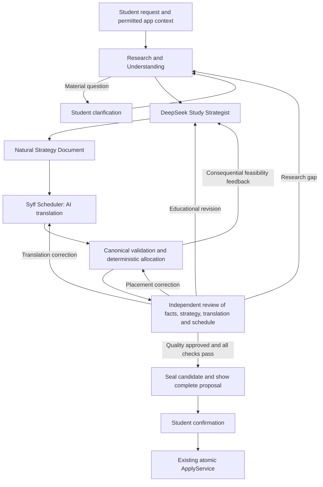

# Proposed AI-first Planner intelligence architecture

**25 October 2026 — proposal for review, not an approved contract or implemented behavior.** This incorporates the user's update: establish exceptional, consistent educational quality first; optimize cost, speed, token use and call count only after that quality is independently demonstrated. No production configuration, implementation or paid test was changed or run during this investigation.

The proposed change is to make a complete, natural educational strategy a durable artifact, then translate and schedule it through Sylf's existing compiler. An independent reviewer evaluates the strategy, its translation and the actual schedule. Substantive revision can revisit research, strategy, translation or placement as needed. Existing worker, revision and apply services remain the single execution pathway.

More agents and longer responses do not establish better education. This design removes an avoidable responsibility from the strategist and creates a clearer opportunity for improvement; its effectiveness still needs qualification.

## 1. What the evidence supports

The [original intelligence audit](../2026-10-09-step6-controlled-diagnostics/inputs/ASTRA_INTELLIGENCE_AUDIT.md) identified excessive serialization work, ineffective validation recovery, unreliable reviewer judgment and expensive full-proposal repair. [Changesets 1](../2026-10-09-step6-interface-changeset1/README.md), [2](../2026-10-09-step6-interface-changeset2/README.md) and [3](../2026-10-09-step6-interface-changeset3/README.md) implemented a compact response, deterministic assembly, literal grounding, accountable correction/withdrawal and targeted repair. Those fixes are useful and should not be discarded or described as still missing.

The current [generator](../../../../lib/planner/v2/intelligence/blueprint.ts) still combines educational design with the compact blueprint response. The [compiler](../../../../lib/planner/v2/server/compiler.ts) and [checkpoint schema](../../../../lib/planner/v2/intelligence/schemas/checkpoint.ts) still enforce one adaptation and one repair. The current [provider boundary](../../../../lib/planner/v2/intelligence/provider.ts) always requests JSON output and dispatches most planning stages through the same syllabus route.

The [initial controlled diagnostics](../2026-10-09-step6-controlled-diagnostics/initial-block/EXECUTION_REPORT.md) delivered eight small prose-reasoning answers: six confirmed passes, one evidence failure and one unresolved criterion judgment. Both High review requests spent all 4,096 completion tokens on reasoning without a verdict. The [Low comparison](../2026-10-09-step6-controlled-diagnostics/review-low/EXECUTION_REPORT.md) delivered one correct defective-plan review; the sound-plan review again exhausted its cap. These observations demonstrate delivery/budget-fit problems and some educational mistakes, not reliable or unreliable performance on comprehensive natural plans.

The [natural-versus-compact experiment](../2026-10-10-step6-free-plan-experiment/EXECUTION_REPORT.md) stopped on a transport exception with no model response. It provides no comparative educational evidence. Neither that failure nor the technical regression totals justify attributing all remaining problems to schemas, or claiming that Flash is incapable of excellent planning.

Public metadata also changes: on 25 October the [official pricing page](https://api-docs.deepseek.com/quick_start/pricing/) identifies the Flash alias as DeepSeek-V4.1-Flash-1017. Future evaluation must record effective model metadata and fingerprints rather than treating an alias as immutable or pooling new results with older runs without qualification.

## 2. Responsibilities and authority

Use four logical agent roles under the existing durable compiler. Roles may make multiple calls, use existing read tools and revisit their work. They do not require four services, independent databases, a general agent framework or an LLM manager invocation at every transition.

| Role | Owns | Produces | Authority boundary |
| --- | --- | --- | --- |
| Research & Understanding | Understand actual outcomes, syllabus identity, supplied resources, learning evidence, preferences, constraints and gaps; investigate and clarify consequential uncertainties | A research/context dossier, verified claims with provenance, unresolved questions and an accurate accepted brief | Read permitted sources; propose fact/intent adoption through existing services. Cannot invent verified facts, infer consent from source text or silently change accepted requirements |
| Study Strategist — DeepSeek | Educational priorities, methods, examples, conceptual sequencing, useful effort, prerequisites, assessment preparation, stopping criteria, contingencies and trade-offs | A complete natural-language strategy, with whatever organization and detail the situation warrants | No Sylf schema, durable IDs, reward decisions, database commands or required serialization inventory. Must respect actual facts and permissions |
| Sylf Scheduler | Faithfully interpret actionable strategy, identify ambiguity, construct the existing executable learning graph, distribute it through real availability | A translation with correspondence evidence, canonical blueprint, deterministic schedule and feasibility feedback | Its AI translation step expresses the strategy; deterministic allocation owns dates and hard constraints. It cannot silently invent educational work, discard strategy or weaken requirements to fit |
| Independent Reviewer | Judge educational quality, factual grounding, translation fidelity and the complete schedule; verify revisions and investigate material objections | An explicit verdict, grounded findings, useful improvements and dispositions for previous issues | Fresh review context; no reliance on author self-ratings. Can request reconsideration or investigation, but cannot mutate execution or approve unsupported facts |

The coordinator is code in the existing compiler/worker. Agents identify what needs attention and recommend a responsible role; the coordinator validates references, permissions, budget admission and dependencies before routing. It does not choose a pedagogy or mechanically overrule educational judgment.

Use a separate reviewer invocation/context from strategy and translation. Initially the same eligible provider may fill different roles; this is procedural independence, not evidence that correlated model mistakes disappear. A different reviewer model or a domain specialist is an explicit later quality decision, not a prerequisite to this proposal and not permission to call another provider now.

## 3. Information flow and artifacts

Preserve only the additional artifacts necessary to recover and audit this flow:

- **Research/context dossier:** references accepted intent and exact accepted conversation instructions, raw learning evidence, source excerpts/applicability, relevant calendar facts, uncertainty and omissions. Reuse current intent/context/research owners. Source-supported facts, student self-report, observed performance and AI assumptions remain distinct. A verified quotation alone does not verify the model's interpretation.
- **Strategy Document:** immutable versions of the strategist's complete final answer and rationale, bound to accepted intent, evidence and capacity snapshots. Server-assigned paragraph/span anchors support references without requiring a model-written template. Retain the original content rather than shortening it to fit blueprint prose fields. It is the educational design authority for that proposal; it never directly executes.
- **Translation receipt:** binds the exact strategy version to its canonical blueprint. It maps consequential strategy passages to activities, dependencies, criteria, resources, scope dispositions, uncertainty, contingencies or retained guidance. It also records additions, gaps and ambiguities. Reuse compact blueprint assembly rather than invent a second executable graph.
- **Candidate bundle and issue history:** the existing blueprint, allocation and quality artifacts plus references to the strategy/translation and grounded issue dispositions. Extend existing checkpoint/quality metadata; do not create a second plan lifecycle or task system.

The canonical execution specification remains the sole execution authority after apply. The student sees the strategy version that belongs to the reviewed candidate, not a newer chat draft attached to an older schedule. Candidate publication seals all corresponding digests, including full strategy, translation, evidence, constraints and allocation. Any consequential change invalidates affected approvals.

This needs a versioned planning-artifact/revision metadata extension. A strategy stored only in mutable conversation or expiring Attempt payload is insufficient: historical applied plans must retain their full educational intent and the review that covered it.

## 4. Research and minimal clarification

Start with the student's exact request and existing owned context, not a questionnaire. Look at goals, supplied syllabus/assignment, recent learning evidence and mistakes, usable resources, competing plans, deadlines, availability and preferences. Reuse the existing intake, conversation handoff, research reader, safe fetch, document selection/OCR, caching and source verification services.

Ask when an answer changes the plan materially: which assessment or assignment, which deadline is fixed, missing actual assignment content, contradictory availability, or a consequential priority conflict. Prefer one useful question or a small coherent group; do not impose a numeric question limit. Known facts are not asked again. Ordinary uncertainty can be disclosed or handled with conditional checks rather than requiring the student to complete a diagnostic survey.

Research can revisit a named gap as often as genuinely needed within an approved operational envelope. Do not force one follow-up or an arbitrary source count if necessary evidence remains missing; equally, do not browse for ceremony when supplied context is sufficient. Preserve permission checks, source applicability, extraction coverage and network protections. Never infer mastery from time spent, completion, XP or the mere presence of a worked example.

Agents can request focused access to relevant retained evidence; they need not ingest every historical record. Any context selection must retain consequential facts and disclose critical unread sections. Full relevant context means complete decision-relevant evidence, not a lossy summary presented as the whole course. Research that is unavailable stays unavailable; an assumption is not promoted to a verified fact because a student accepts the plan.

The original requested intent and each adopted intent version remain immutable. Initial authorized research adoption can use the existing fenced resolution path. If later research changes resolved intent, the current bind-once target cannot simply be overwritten: use the existing linked-attempt/currentness mechanism with explicit version correspondence. Reuse original authorization only where it actually covers the change; changed goals, exclusions, identity conflicts or permissions require a student decision. Continuations must retain aggregate spending/accounting rather than reset the allowance invisibly. This boundary must be specified in the contract revision before implementation.

## 5. Educational freedom and faithful translation

The strategist receives real constraints and capacity before designing education. Freedom concerns reasoning and expression, not permission to ignore deadlines. It may use integrated activities, different methods, self-contained examples, conditional branches, zero additional work, full-course strategy or long-term milestones. No required phase count, pedagogy, fixed study duration, artificial practice volume, plan length or canonical field order applies. Educational completeness and usefulness are judged from the actual student's goal.

The Sylf Scheduler has two distinct operations inside one existing compiler:

1. **AI translation:** read the full strategy and express its actionable meaning through the compact contract. Preserve instructions, worked material, answer checks, success/stop criteria, dependencies, effort estimates, spacing needs, resource conditions and committed/conditional/optional distinctions. Keep strategic future work distinct from the detailed executable portion. Local aliases and server identities are assembled deterministically.
2. **Deterministic scheduling:** validate the entire canonical blueprint, expand only meaningful authorized splits, assign dates and check capacity, deadlines, hard dependencies, rest days, protected work and shared commitments. Preserve the existing FEASIBLE / CAPACITY_SHORTFALL / ALLOCATION_UNRESOLVED distinction: search failure is not proof of impossibility.

Natural language cannot in general be compiled by deterministic code alone. This proposal deliberately adds an AI translation responsibility. Nor can a correspondence table prove semantic equivalence. The independent review must compare the actual strategy with the executable plan; the receipt makes that examination traceable, not automatically correct.

Translation cannot invent estimates, mandatory repetitions, evidence credit or success criteria because a schema requires them. Missing consequential education goes back to the strategist for an educational clarification/amendment; missing personal facts go to Research & Understanding. Exact arithmetic and identity assignment remain deterministic. Technical field limitations that cannot represent important intent become explicit representation failures, not silent truncation or generic substitutions. Keep the existing canonical blueprint wherever it is sufficient; any necessary schema extension needs specific evidence and review.

Every consequential part of the strategy must be represented either in execution, in clearly retained non-executing guidance, or as an explicit unresolved gap. Conversely, every committed activity must have a strategy basis. Conditional remediation must not become compulsory work during translation. A long strategy can coexist with a short schedule; a long deadline never justifies filling it.

For example, if the strategy says to solve two supplied problems, stop after demonstrating correct method selection, and use another example only if a named error persists, the compiler must not schedule all three. If the available sessions cannot accommodate the work or a useful interval, the scheduler returns the real constraint; the strategist decides whether to integrate, reprioritize or propose a changed approach. It cannot silently erase retention checks or lower success standards.

### Actual calendar awareness

Current Planner placement is by **civil date and minutes**, not reserved clock appointments. Its capacity digest covers study availability, rest days and Quest/session commitments. The [Calendar contract](../../../calendar/README.md) explicitly says personal events do not reserve Planner capacity; the existing calendar free-time display is not a study-availability promise.

The target therefore needs a read-only capacity projection using existing calendar services, recurrence/timezone helpers, connection permissions and provider freshness metadata. Intersect student-approved study windows with applicable busy intervals; do not subtract every calendar event from a daily budget or treat an arbitrary 08:00–20:00 display window as availability. Distinguish transparent, tentative, all-day and unavailable-provider data according to an explicit student-visible policy. Avoid counting existing study commitments twice.

Extend the existing allocator with any required interval-feasibility checking rather than create a second scheduling engine. An indivisible 30-minute task cannot be justified by three disconnected 10-minute gaps. A date-based schedule can use an internal joint placement witness within free windows without publishing clock appointments. Revalidate calendar versions/freshness before apply; external calendars cannot be transactionally locked, so disclose that later changes can create conflicts. Exact persisted clock-time booking is a separate execution-contract change and is not proposed as an implicit prerequisite here.

## 6. Independent review and substantive refinement

Review the complete dossier, original accepted request, natural strategy, translated blueprint, final learner instructions/resources, actual schedule and existing protected work. Treat author explanations as claims to inspect, not evidence that the plan is good. Do not transmit hidden reasoning traces or author self-scores as an authority signal.

The reviewer asks whether the plan is educationally correct and excellent for this student: meets the actual goal; uses the right evidence; chooses worthwhile learning and priorities; gives usable materials and achievable checks; preserves the strategy through translation; handles workload, spacing and deadlines realistically; and provides sensible responses to uncertainty or changed performance. Correctness, personalization and necessity matter more than polished length or technical validity.

Check consequential domain claims and examples against actual materials, available answer checks or reproducible calculations where possible. Model agreement is not a substitute for that evidence. Unverified consequential correctness remains a gap; lack of an external answer key alone is not a defect when a valid self-contained check is possible.

Keep a small reliable control response for verdict, grounded findings and routing. Do not force the reviewer to serialize a second complete plan or narrate every passed micro-check. Give it enough reasoning and final-answer capacity; the observed 4,096-token exhaustion must not be carried forward as an unexamined quality boundary. Complex cases may justify separate focused inspection, a source check or specialist assessment within this role. These are quality decisions, not automatic extra stages for every request.

Each material finding records the problem, affected strategy/translation/activity/schedule references, the accepted requirement or evidence, actual offending content, educational consequence, severity and an outcome the correction must achieve. A reviewer may suggest an alternative method, but preference alone is not a blocker. Unsupported objections must be investigated and explicitly corrected or withdrawn, not blindly obeyed. Literal grounding and accountable recovery from Changeset 2 remain necessary; they do not prove educational correctness.

Route feedback to its actual owner:

| Finding | Action |
| --- | --- |
| Missing or conflicting evidence | Research/clarification, then invalidate dependent strategy/review as needed |
| Poor priorities, incorrect teaching, weak criterion, overwork or a flawed overall approach | Strategist can revise a passage, several connected activities or the whole strategy within authorized scope |
| Translation omitted a condition, changed an example or invented work | Correct translation; retain good strategy |
| Placement violates a declared educational window or usable capacity | Reallocate if the existing strategy permits it; otherwise ask strategist to resolve the educational trade-off |
| Unsupported reviewer objection | Reviewer reconsiders against actual evidence; retain a grounded correction or withdrawal |

After semantic changes, revalidate the **whole** executable plan and rerun deterministic allocation. The reviewer must verify every previously open material issue and inspect the complete revised result for missed or newly introduced defects. A fixed named issue is insufficient if the rest of the plan remains poor. Substantial revisions are allowed; the current object-neighborhood repair authority is an optimization for suitable local corrections, not a limit on educational redesign.

Maintain stable issue identities and append dispositions: open, addressed awaiting verification, verified resolved, or withdrawn as unsupported with grounds. Do not mislabel a withdrawn false objection as a successful educational repair. Existing quality-report metadata needs a versioned extension where it cannot express that history.

Approval means independently satisfactory education, faithful translation, feasible allocation and strict technical checks on the exact candidate. Warnings disclose meaningful residual uncertainty. A deadline violation, unsupported mastery claim or serious defect cannot be waived by a preference acknowledgement. No agent approves itself and no majority vote overrides concrete evidence.

## 7. Quality-first orchestration and genuine boundaries

Replace the one-adaptation/one-repair policy with a recoverable review/refinement loop. Do not replace it with another arbitrary small iteration count. Continue when the next action has a credible educational benefit and the authorized operational resources can support it. Review may approve immediately; unnecessary iteration can introduce regressions as well as cost.

Persist each accepted strategy version, translation, allocation, issue disposition and provider receipt through a new compiler checkpoint version. Bind all artifacts to the same requested intent lineage, selected owners, relevant evidence/calendar snapshot and protected execution. Record the pending call before dispatch and the complete response before advancing. Takeover resumes saved work; it does not silently replay an uncertain dispatched call. Existing leases, fencing, cancellation, stale-result rejection and accounting remain in force.

No revision cycle changes the active plan before confirmation. Unselected work remains a real commitment; started/protected execution keeps its exact approved identity and specification. A broad educational rethink can restructure authorized unstarted work, but cannot repurpose running Quests or erase rewards/history. Joint plans share one owned prerequisite where appropriate and continue to publish/apply atomically. Candidate/currentness checks must be repeated at publication and confirmation, including concurrent edits and a Focus start.

Operational boundaries remain essential: explicit user/product spending authorization, finite provider/token/payload limits, rate and worker health, cancellation, unresolved billing, unavailable required evidence, material student decisions and lack of credible progress. Detect repeated identical candidates and issue cycles; route a genuinely disputed diagnosis for reconsideration rather than polishing forever. A useful next revision must not be rejected merely because an old single-repair counter reached one.

When a boundary is reached, preserve the best assessed draft and issue history, explain what remains, and return a recoverable incomplete/needs-decision outcome. No unreviewed draft becomes an active plan. An excellent natural strategy may still be shown as advice when execution is blocked, explicitly distinguished from an approved executable proposal. Do not reset budgets through nested agents, retries or linked attempts. Later continuation is explicit and visible.

Root reservations must fund downstream translation and review, and revision admission must retain capacity to review the resulting candidate. Set stage allowances large enough for the actual task and supported provider behavior. If a finite approved allowance is insufficient, report incomplete quality; never shorten evidence, inflate certainty, weaken rubrics or silently lower the standard to fit.

DeepSeek documents enabled/High as its default, distinct reasoning controls, and separate reasoning/final content. The existing adapter already supports text output and reasoning effort; the Planner dispatcher currently forces JSON and does not expose role-specific effort. Extend that shared boundary during implementation rather than bypass accounting with a diagnostic transport. Record effective model, prompt, effort, caps, actual reasoning/final tokens and stop reason. Do not assume Low fixes review or that an enlarged cap establishes quality. [Official thinking controls](https://api-docs.deepseek.com/guides/thinking_mode/) and [completion API](https://api-docs.deepseek.com/api/create-chat-completion/).

## 8. Retain, replace and simplify

| Existing component | Target treatment |
| --- | --- |
| Intent, accepted conversation handoff, context/evidence provenance and protected facts | Retain; add version correspondence to the full strategy and any later authorized research continuation |
| Research verification, document reader/OCR, safe network access and owned-resource checks | Retain; allow needs-driven research depth through reviewed operational profiles rather than a fixed educational ceiling |
| Compact response and deterministic blueprint assembly | Retain as the Scheduler's translation boundary; remove from the Study Strategist |
| Canonical LearningBlueprint, reference/DAG/scope validators | Retain as executable intermediate representation, not the only store of educational meaning; never relax validation to accept a lost strategy |
| Allocator, capacity arithmetic, split receipts, forecasts and shared-dependency handling | Retain; add explicit calendar-derived availability and placement feasibility where needed |
| Grounding, rejected-output diagnostics and accountable concern recovery | Retain; extend to natural strategy/translation and evolving issue history |
| One adaptation, one targeted repair, separate terminal repair verification | Replace with role-routed revision cycles and complete independent review on changed candidates; reuse local correction assembly where appropriate |
| Single syllabus route, forced JSON for every stage and static five-planning-call accounting | Replace with explicit role capabilities and versioned, authorized resource policy; preserve shared provider adapters and truthful ledgers |
| Attempt lifecycle, worker, leases, fencing, idempotency, cancellation and recoverable checkpoints | Retain the same owners and guarantees; extend compiler checkpoint interpretation, not a second lifecycle |
| Compilation, immutable revisions/diff, RevisionService, ApplyService, Quest/Focus protection and rewards | Retain; add validated strategy/translation/review linkage to candidate metadata without giving agents execution authority |

Do not add permanent worker services per role, a competing scheduler, an LLM supervisor for every routing edge, always-on critic committees, a second memory database, automatic model fallback chains or automatic optional-work promotion. Their quality benefit is not established by this proposal. Focused additional investigation remains available when a particular educational problem warrants it.

## 9. Cost and migration implications

Quality has priority. Observe resource usage now to make runs safe and reproducible; do not use these observations to choose a shorter or less capable plan prematurely. There is no proposed smallest token budget, shortest plan, fastest path or production cost target at this stage.

From a ready accepted context, a first candidate normally requires strategy, translation and independent review: **three calls rather than today's blueprint plus review**. Research, clarification, focused checks and refinement add calls as needed. A strategy revision normally entails renewed translation and review; a translation-only correction need not regenerate good education. These are dependency descriptions, not call-count caps or quality goals.

At 25 October published peak/cache-miss Flash rates, model cost is `(uncached input × $0.30 + cached input × $0.006 + completion × $1.20) / 1,000,000`; completion includes reasoning. Illustrative totals for a whole run, assuming all input is uncached:

| Hypothetical measured run totals | Model charge at peak rates |
| --- | ---: |
| 30,000 input; 10,000 combined completion | $0.0210 |
| 60,000 input; 24,000 combined completion | $0.0468 |
| 150,000 input; 60,000 combined completion | $0.1170 |

These are arithmetic illustrations, not usage forecasts, approved allowances or current production-compatible profiles. Research providers, paid tools/OCR, reference models and human evaluation add costs; rates must be refreshed before authorized execution. Repeated full-plan review may dominate context and latency. Changing model role or using expert assessment changes these estimates. Prior $0.20/$0.02 diagnostic authorizations and unsettled spend do not fund this redesign. [Official rates](https://api-docs.deepseek.com/quick_start/pricing/).

The change is architectural, not a prompt-only patch. In the [approved V2 architecture](../../PLANNER_TARGET_ARCHITECTURE.md), it revises the model boundary/pipeline and root budgets, while preserving execution invariants and the release-quality benchmark. Current EDUCATIONAL limits are six total calls, five planning calls, 80,000 input units and 24,000 output tokens over 180 seconds; RESEARCH is eight total calls and 32,000 output tokens over 300 seconds. Checkpoints constrain both adaptation and repair to one. These contracts cannot truthfully remain frozen while promising resource-sufficient substantive iteration.

An approval to implement must therefore include: natural strategy retention and digest binding; the translation role; versioned checkpoint/issue metadata; reviewed resource profiles/accounting; and calendar capacity integration. Keep ExecutionTaskSpec/time accounting, ownership, protected work and atomic apply semantics intact. Exact clock appointments, broader than two jointly selected Plans, autonomous changes to active work, model/provider policy changes and any required extension to executable semantics are separate decisions, not implied additions.

Use a short dependency sequence after architecture approval:

1. **Specify changed contracts and evidence gates.** Define strategy/translation/review bindings, versioned checkpoints, permission and issue dispositions, budget admission/holdbacks, calendar semantics and readers. Prove retained execution boundaries offline before changing live orchestration.
2. **Implement one complete vertical path.** Extend the existing compiler for research/context → natural strategy → translation/assembly → allocation → independent review → meaningful refinement → sealed candidate → current apply pathway. Include crash/takeover, uncertain calls, stale facts, joint planning, started work and false-review-objection handling in that path. Do not build a parallel prototype as another production engine.
3. **Qualify educational quality before efficiency work.** Independently inspect natural strategies, faithful translations, reviewer accuracy and revisions, then repeated end-to-end fresh student journeys. Establish where a failure occurs instead of tuning all stages together. Paid execution needs a separate reviewed protocol and spending approval. Cost/latency optimization is a later task after the quality gate passes.

At cutover, retain old immutable revisions, evidence and apply receipts. Version readers before writers. Existing in-flight work is either completed under its pinned compiler version or explicitly cancelled/restarted with visible accounting; never reinterpret an old repair checkpoint as a new multi-round run. Old active work remains active without automatic regeneration. New metadata may need a versioned revision wrapper and additive persistence migration, but should not migrate Quest/reward history. Rollback must leave readers able to inspect newly written versions; it cannot undo already applied work. Retire superseded compiler branches after drain rather than operate two planning engines indefinitely.

## 10. How exceptional quality will be established

Preserve the existing architecture's held-out, stratified release benchmark and independent human judging requirements. In particular, at least 100 held-out cases and matched strong reference workflows remain release ambitions; this proposal does not claim those evaluations occurred or authorize their costs. Earlier AI-agent signoff is useful independent evidence, not human expert validation.

Before evaluation, agree on anchored educational criteria: correctness, personalization/evidence use, coverage/completeness, prioritization and learning methods, workload necessity, practical scheduling, uncertainty, adaptation and preservation. Judge length only through usefulness and cognitive burden, not a short-answer target. Keep educational quality separate from schema/transport success and translation fidelity. An elegant valid schedule of mediocre education fails; an excellent natural strategy with a lossy executable translation also fails the complete Planner.

Use independently authored fresh scenarios and realistic multi-turn student journeys. Include partial/contradictory evidence, genuinely secure students, urgent triage, large syllabuses, unavailable resources, no deadlines, multiple goals, calendar conflicts, conditional remediation and already-started work. Review sound and defective fixed plans separately to measure false objections and missed defects. Evaluate repeated runs and revised candidates for regressions, not only a single best outcome. Hide evaluation labels and author scores from tested agents and judges where feasible; disclose limits to independence.

For the user's stronger exceptional-quality objective, propose an anchored overall score of at least **4.5/5**, no core dimension below **4/5**, and no serious factual, educational, permission or correspondence defect for an individually accepted output. This is a proposed external-evaluation threshold to agree before testing, not an internal self-scoring loop. Retain the existing matched-reference target and statistical/per-category reporting; its older absolute floor alone should not be relabelled exceptional performance. Consistency needs a sufficiently sized repeated held-out evaluation, not a few attractive examples.

Retain the release benchmark's absolute and matched-reference standards, severe-defect exclusions, per-category reporting and uncertainty. Add explicit strategy-to-execution preservation judgments. A runtime reviewer approval, schema pass or internally generated quality score is not external proof of excellence. If expert judging or the sample is insufficient, state that quality remains unverified. Efficiency objectives must not compensate for a failed educational-quality gate.

The architectural recommendation is **a natural strategist, a faithful AI-assisted compiler, deterministic placement and independent iterative quality control**, supported by the execution system already built. The unresolved empirical question remains whether the chosen model and review setup can consistently meet that standard. Greater freedom and meaningful iteration create a better separation of responsibilities; they cannot guarantee model competence.

## Review decision

Approve or amend the architectural direction and its changed contracts before implementation: strategist free of internal schemas; durable full strategy plus traceable translation; independent complete-plan review with substantive iteration; quality-first authorized resource profiles; calendar-aware capacity while retaining date-based execution; one protected execution pathway. No implementation, production configuration change or paid test is authorized by this document.
