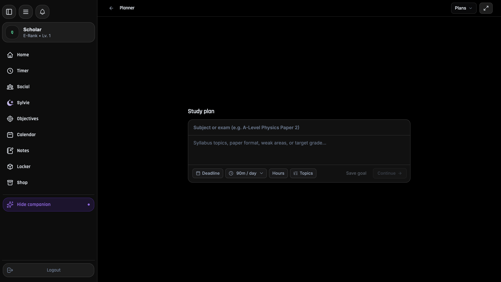
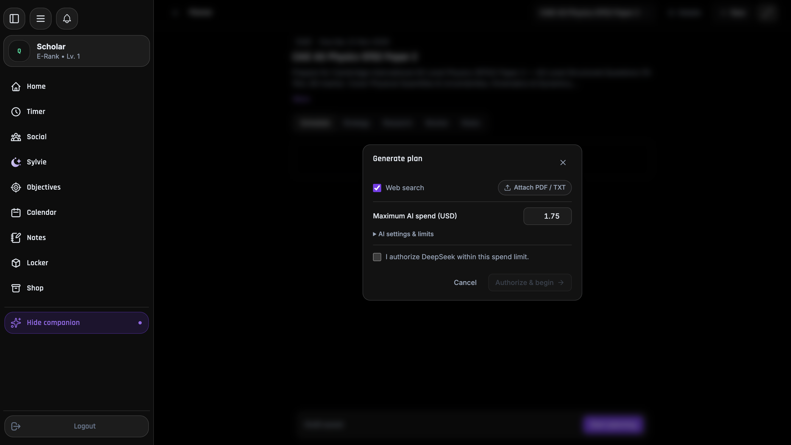
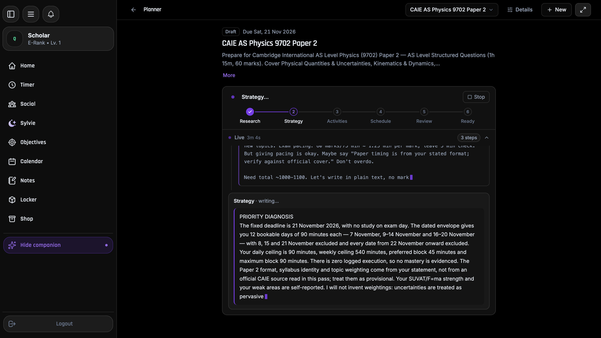
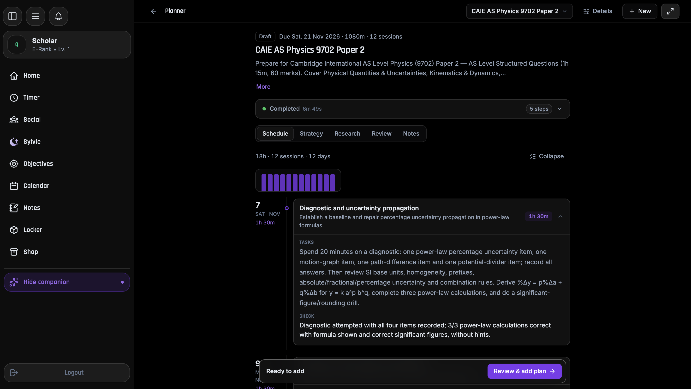
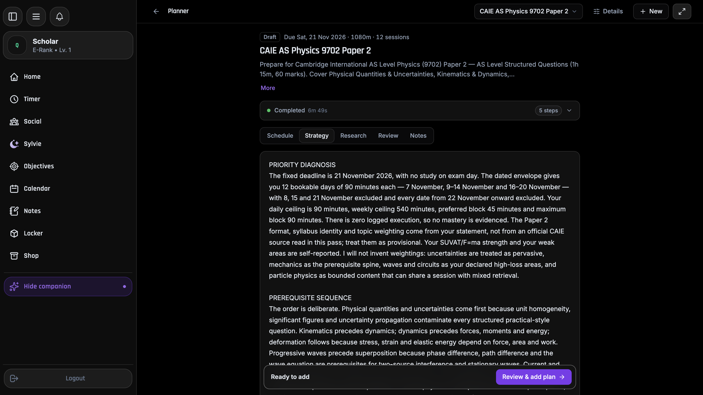
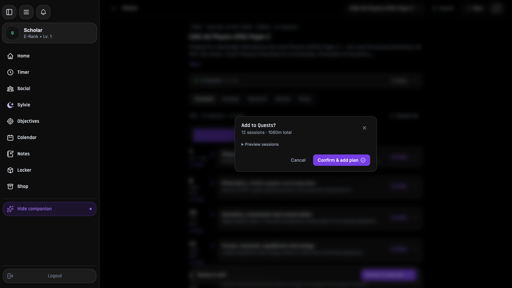
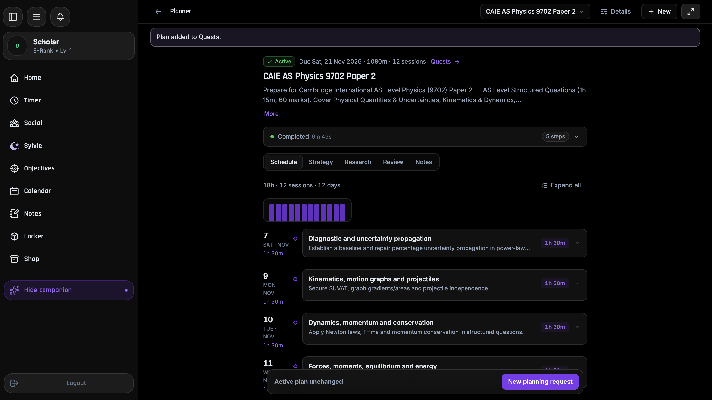
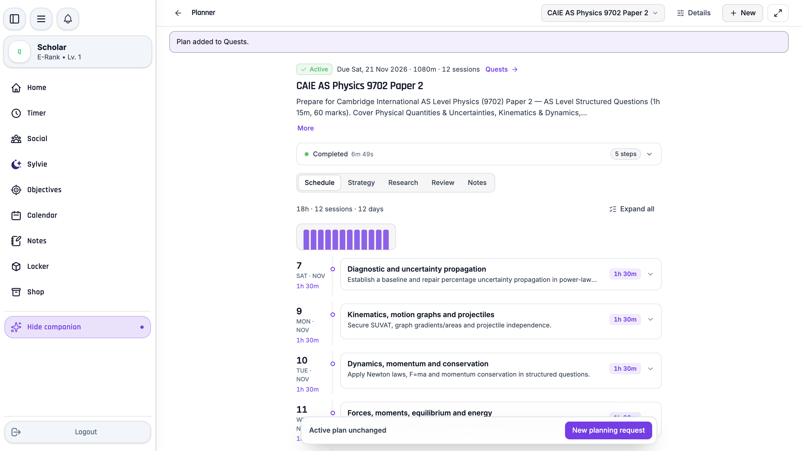
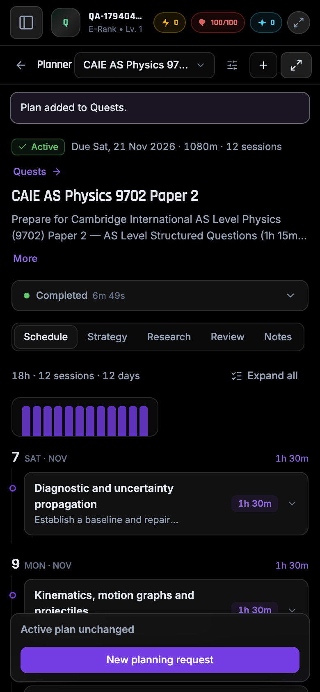

# Planner v2 overhaul — 2026-11-07

Scope: Planner v2 generation reliability and latency, student workspace UI, and one real end-to-end run (CAIE AS Physics 9702 Paper 2) in a visible Chrome window. Evidence describes this run only; source and tests remain authoritative.

## Fixes

| Area | Change |
| --- | --- |
| DeepSeek transport (`lib/ai/providers/deepseek.ts`) | `max_tokens` clamped to 8192 when thinking is disabled (65536 caused HTTP 500). Pre-stream 429/500/502/503/504 retried (700/1500/3000 ms, abortable). Half-open SSE streams now fail after 30 s idle (`readEventStream`/`collectHttpTextStream` `idleTimeoutMs`) and retry, instead of blocking until the 4 h lease. |
| Accounting (`provider.ts`) | Explicit upstream HTTP rejections settle at \$0 so they no longer leave `UNKNOWN_SPEND`. |
| Database (`server/database.ts`) | Per-transaction setup collapsed to one round trip; read-only repeated `SELECT`s inside a transaction are served from a statement cache that is cleared on any write/lock/clock query. |
| Calendar capacity | Local snapshot freshness 5 min → 6 h; replay window checks no longer spuriously mark capacity stale. |
| Research (`schemas/understanding.ts`) | Skips web search when the student already supplied concrete scope for a GENERAL plan; EXAM plans still read one governing source; no loops on failed/secondary sources. |
| Translator | Concise reasoning budget, exact `meaning`/`disposition` enums, COMMITTED vs CONTINGENT rule, and `outcomeRefs` must be phase IDs (empty if no phases) — the first-pass rejection seen in the earlier run. A rejected translator now self-repairs through the reviewed-learning stage instead of failing `INVALID_OUTPUT`. |
| Live activity | Steps with no recorded reasoning render flat (no empty chevron); finished Strategy collapses to "done"; Strategy preview can be reopened manually. |
| UI | Intake, Generate-plan modal, progress card + stage rail, schedule/strategy/research/review/notes tabs, Details drawer, confirm modal and dock rewritten for minimal copy. Dock after adding now reads "In Quests". |

## Live run (visible Chrome, 1440×812 and 390×844)

CAIE AS Physics 9702 Paper 2, 14-day window (7–21 Nov), 90 min/day, 10 topics supplied, three stated weaknesses.

| Metric | Before fixes | Final run |
| --- | --- | --- |
| Outcome | stopped at research / hung in translator | SUCCEEDED, applied to Quests |
| Provider calls | 9 (incl. one rejected translation) | 5, none rejected |
| Wall clock | > 11 min | 6 m 49 s |
| Cost | \$0.089 | \$0.056 |

Per call (start→start): Research 26 s, Strategist 78 s, Translator 107 s, Reviewer 121 s, tail 93 s. The remaining time is DeepSeek reasoning latency on the Strategist/Translator/Reviewer calls, not planner overhead.

## Pedagogical audit

Plan: 12 × 90 min sessions on the 12 bookable days (7, 9–14, 16–20 Nov); 8, 15 and exam day 21 Nov correctly empty; 1,080/1,080 min used; weekly ceiling respected.

What an expert tutor would do, and whether the plan does it:

- **Diagnose first** — yes: 20-min four-item diagnostic on the weak areas in session 1.
- **Prerequisite order** — yes: uncertainties → kinematics → dynamics → forces/energy → deformation → progressive waves → superposition → current → circuits; particle physics last, paired with mixed retrieval.
- **Weak areas get dedicated, derivation-level work** — yes: power-law %Δ derivation, x = λD/a path-difference derivation with a four-mark maxima/minima explanation, Kirchhoff two-loop and potential-divider/sensor-shift.
- **Observable mastery criteria and timed practice** — yes: every session has a checkable criterion, mixed retrieval ≥ 70 %, a 75-min timed paper with self-mark, then an error-log session.
- **Honesty about evidence** — yes: strategy states the syllabus fetch returned only a file listing, so the 9702 structure is treated as student-reported.

Weaknesses (comparable to, not better than, a good tutor): the official syllabus was not actually read (aggregator listing only), so weightings are not syllabus-derived; strategy is long prose where a tutor would hand over a one-page table; and one session per topic leaves little spaced revisiting outside the retrieval/error-log sessions. Verdict: the generated plan is comparable to what I would write by hand for this brief; the remaining gap is source verification, not education quality.

## Verification

Full Vitest run: 4,518 passed, 4 failed, 300 skipped (Postgres/provider suites are opt-in and were not run in this pass). The 4 failures are localStorage-failure tests in Notes, Settings and Timer (`notes/auth-boundary`, `notes/ink`, `settings/main-pages`, `timer/focus-lifecycle`); the timer one also fails on the untouched tree, and none touch Planner code. `tsc --noEmit`, ESLint on changed Planner/AI files, worker build, `next build`, `mobile:build` and `mobile:verify` passed (the last two before the one-word dock copy change).

## Known limits

- 7 min per plan is bounded by three sequential reasoning-model calls; further cuts need lowering reasoning effort (quality trade-off) or skipping independent review (not done).
- Official-board retrieval still depends on what the search/fetch returns.

## Evidence

Custom palette: `evidence/15-schedule-custom-palette.png`.
