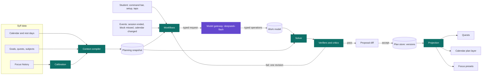
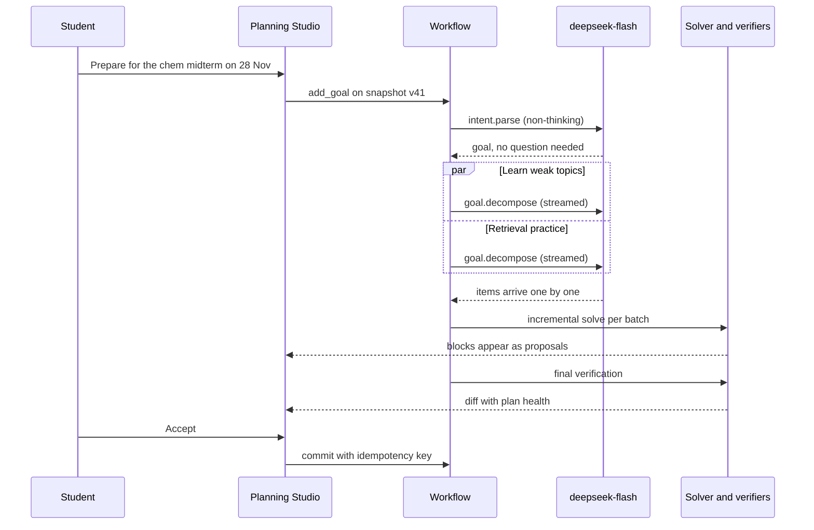
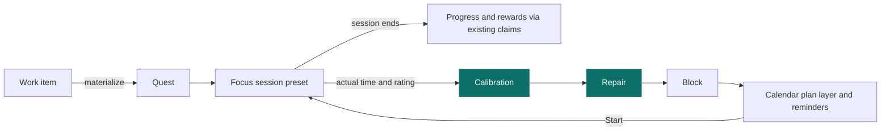
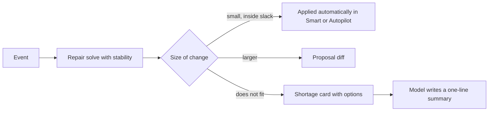

# Sylf Planner Blueprint — 13 November 2026

Status: **proposal from a research and planning phase. Nothing here is implemented or approved.** It is a design input, not a description of current behaviour; source, tests, schema and configuration remain authoritative. Each roadmap stage needs the owner's approval before work starts.

How it was produced: DeepSeek's official documentation and the planning literature were researched first, and the architecture was settled before Sylf's code was opened. The code was read afterwards only to map integration points ([§6](#6-from-plan-to-action-across-sylf)) and the migration path ([§10](#10-what-this-means-for-the-current-planner)). Latency and cost figures are targets derived from documented prices and independent speed measurements; Stage 0 measures them on Sylf's own prompts.

A designed version of this document was also published as a private claude.ai artifact for reading: <https://claude.ai/artifact/MXp4dMM2q1eui64YpBkqB3>. This file is the repository copy.

## The recommendation

Build the planner as a **planning kernel** instead of a chatbot that writes schedules. DeepSeek V4.1 Flash reads a compact snapshot of the student's Sylf data and emits typed operations on a **work model**: goals, the work they break into, calibrated time estimates and the study method for each piece. A deterministic TypeScript **solver** fits that work into real free time in milliseconds. **Verifiers** check every result before the student sees it. An event-driven **adaptation loop** repairs the plan as sessions finish, slip or move, and calls the model only when the meaning of the plan changes.

Three decisions carry the design:

- **One planning mind, many parallel calls.** No agents talk to each other. Independent goals are broken down in parallel, stateless calls; everything that shares the week's time goes through one solver.
- **The model never does time arithmetic.** It decides what to do and why. Code decides when, proves that it fits, and explains each placement.
- **Most interactions never wait for the model.** Drags, what-ifs, missed sessions and repairs re-solve on the device in milliseconds. Model calls are kept for understanding new intent.

| Target | Value |
| --- | --- |
| Drag, what-if and reflow (device solver) | under 50 ms |
| Natural-language edit to a reviewable diff | about 2 s p50 |
| New goal to first sessions on the timeline | about 2 s p50 |
| Model cost for a heavy user per month, at peak prices | about $0.14 |

## 1. What the research established

### 1.1 DeepSeek V4.1 Flash, as documented

Read from DeepSeek's API documentation, news posts and change log on 13 November 2026. Speed figures come from independent measurement because DeepSeek does not publish them.

| Topic | What DeepSeek documents | Consequence for Sylf |
| --- | --- | --- |
| Model and version | API name `deepseek-flash`, now serving DeepSeek-V4.1-Flash-1017 (17 Oct 2026), an update to V4.1 Flash (10 Sep 2026). Legacy names such as `deepseek-v4-flash` route to it at Flash prices. | Sylf already calls `deepseek-flash` ([config](../../../../lib/ai/config.ts)). Record the served model version on every plan version. |
| Architecture | 552B-parameter mixture of experts with a causal encoder–decoder: 8B active parameters for input, 16B for output. KV cache needs 1/4 the HBM and 1/8 the SSD of V4 Flash. Native image input. | Long prompts and cache hits are cheap. Photos of syllabi and timetables can be read directly. |
| Context and output | 1M-token context. Output up to 384K tokens; defaults are 8K without thinking and 64K with thinking. | Context size never limits planning. Output length drives latency. |
| Thinking mode | On by default at effort `high`. Efforts are `low`, `high`, `max`; `thinking: {type: "disabled"}` or `reasoning_effort: "none"` turns it off. Temperature has no effect while thinking. | Mode and effort must be chosen per call. Interactive calls run without thinking. |
| Structured output | JSON mode is `json_object` only: valid JSON with no schema, and content can come back blank. Strict tool calling (beta, `/beta` base URL) enforces a function's JSON schema in both modes; every property must be required, `additionalProperties: false`, and length or item-count limits are unsupported. The Responses API lists `text.format` as fully supported. | Use strict tools for schema-guaranteed output. Stage 0 checks whether Responses `json_schema` is enforced, especially with thinking on. |
| Tool choice | `required` and named tool choice return HTTP 400 in thinking mode on Chat Completions. When tools are present, earlier turns' `reasoning_content` must be sent back. | Forced, schema-locked calls run in non-thinking mode. The one agent loop must carry reasoning forward. |
| Context caching | Automatic disk cache. A hit needs a full match of a persisted prefix unit (request boundaries, detected common prefixes, fixed intervals). Building takes seconds; entries clear within hours to days. `user_id` isolates the cache per end user. | Prompts are laid out in byte-stable tiers, and the planner warms a student's prefix when it opens. |
| Price per 1M tokens | Cache hit $0.006 peak / $0.003 off-peak. Cache miss $0.30 / $0.15. Output $1.20 / $0.60. Peak is 01:00–04:00 and 06:00–10:00 UTC, Monday to Friday. | Cost does not constrain the design. Batch work runs off-peak at half price. |
| Concurrency | 2,500 concurrent requests per account for `deepseek-flash`; HTTP 429 above that. | Parallel fan-out has plenty of headroom at Sylf's scale. |
| Speed (independent) | About 210–270 output tokens per second and about 1.2 s to first token without thinking on DeepSeek's API (Artificial Analysis, DeepInfra). At max reasoning the first answer token has measured near 10 s. | Every 1,000 output tokens costs about 4 s. Short outputs and parallel calls matter most. |
| Other APIs | Vision (at most 1,024 tokens per image), a Files API for images, and Search and Fetch APIs at $0.75 per 1,000 calls. | Syllabus and timetable intake from photos; optional course lookups. |

### 1.2 Language models plan badly alone and well beside a solver

- **NATURAL PLAN** (Google DeepMind, 2024): the best model reached about 50% exact match on calendar scheduling and under 5% on ten-city trip planning. Self-correction did not help.
- **TravelPlanner**: direct prompting with o1-preview passed 10% of tasks and LLM-Modulo critique loops 20–65%. A model that formalizes the problem for an SMT solver passed 93.9% (Hao et al., NAACL 2025).
- **LLM-Modulo** (Kambhampati et al., ICML 2024): treat the model as a generator and knowledge source and surround it with sound verifiers.
- **MeetMate** (Microsoft Research, ACM TiiS 2024): the model turns stated preferences into weighted constraints, a constraint solver produces the times, and people refine the result conversationally.

**Conclusion.** Separate understanding from fitting. Every result that reached high reliability did so.

### 1.3 Single agent, multi-agent, or neither

- **Google Research** (Kim et al., 2025, 180 configurations): on sequential planning every multi-agent variant lost 39–70% against a single agent. On parallelizable work a centralized design gained up to 81%. Independent agents amplified errors up to 17×.
- **MAST** (Cemri et al., NeurIPS 2025): 14 failure modes across 1,642 multi-agent traces, concentrated in specification, inter-agent misalignment and missing verification.
- **Anthropic's research system**: multi-agent wins on breadth-first research at about 15× the tokens of chat, and fits poorly when agents share context or depend on each other.
- **Skeleton-of-Thought** (up to 2.39× faster) and **LLMCompiler** (up to 3.7× faster): parallel decomposition and parallel calls cut latency without any agent conversation.

**Conclusion.** A student's week is one shared, tightly coupled time budget, which is the textbook case for a single planning mind. Breaking several independent goals into work is parallel, so those calls fan out. Nothing in planning gains from agents debating each other.

### 1.4 What makes a study plan good

- Practice testing and distributed practice have high utility; interleaving, self-explanation and elaborative interrogation moderate; rereading, highlighting and summarizing low (Dunlosky et al., 2013).
- People underestimate durations. Breaking a task into parts raises estimates toward reality (Kruger and Evans, 2004), with weaker effects for few or easy parts and distant tasks. A student's own history is the stronger correction.
- If-then plans ("after lunch, I open past paper Q4") improved goal attainment with d = 0.65 across 94 tests (Gollwitzer and Sheeran, 2006). Later bias-corrected estimates are smaller, about 0.15–0.35. They are cheap to include and should not be oversold.
- FSRS is the open, well-validated spaced-repetition scheduler, with a maintained TypeScript implementation (ts-fsrs).

### 1.5 What the product landscape teaches

- 2026 comparisons describe Motion as filling the calendar until it is full and Sunsama as warning when the workload does not add up, through a guided daily ritual. Trust follows honesty about capacity.
- Agent interfaces in 2026 have converged on plan previews, diffs before applying, approval friction scaled to risk, activity logs and undo.

**Conclusion.** Honest capacity and reviewable diffs are core product features.

## 2. The architecture: a planning kernel

Sylf's data flows into one compact snapshot. Requests and events enter through typed workflows. The model edits the work model, the solver turns it into a schedule, verifiers gate it, and the student accepts a diff that is projected into quests, the calendar and focus sessions.



Violet is the only model call; teal parts are deterministic code.

### Principles

| | Principle |
| --- | --- |
| P1 | The model decides what to do and why. Code decides when, and whether it fits. |
| P2 | Code answers whatever code can answer. The model is called to understand new meaning. |
| P3 | Every model output is a typed operation on real IDs, schema-enforced and verified before anyone sees it. |
| P4 | A plan is living, versioned state that the system maintains. It is never a one-off generated document. |
| P5 | Ask little. Assume visibly, and let the student change any assumption with one tap. |
| P6 | Replanning moves as little as possible and never moves what the student pinned. |
| P7 | Every change arrives as a diff the student can accept, adjust or undo. |

### The planning loop

Sense → **Understand** → Fit → Check → Propose → Commit → Observe → Learn → (repeat)

Only *Understand* needs the model. Sensing reads Sylf data and events; fitting and checking are the solver and verifiers; observing and learning compare plans with what actually happened and recalibrate estimates.

### Why the alternatives lose

| Approach | What goes wrong |
| --- | --- |
| Chatbot writes the schedule | Fails at constraint arithmetic (NATURAL PLAN), produces long and slow outputs, and nothing proves the result fits. |
| Sequential multi-role pipeline | Research, strategy, translation and review each add a model round trip and a failure surface. Errors compound across hand-offs, and the sequential-planning penalty applies. |
| Free-running tool agent | Unbounded steps and latency, hard to verify, hard to test. |
| Solver without a model | Fast and exact, but cannot turn "ace the organic chemistry midterm" into the right work, order and study method. |
| **Chosen: kernel with workflows** | The model does the semantic work in one or two short calls. The solver and verifiers make the result exact. Workflows keep latency and behaviour predictable. One bounded agent loop handles open-ended questions. |

## 3. How each part works

### 3.1 Planning snapshot

The context compiler turns Sylf's data into a compact, deterministic snapshot that both the model and the solver read. It is the only way planning reads the world.

- **Availability:** calendar events including recurring and connected calendars, fixed and floating rest days, the sleep window, the timezone.
- **Commitments:** classes, exams, deadlines.
- **Work:** goals, quests, subjects and syllabus nodes with progress and mastery.
- **History:** four weeks of focus time aggregated by subject, weekday and hour; calibration factors.
- **Current plan:** blocks, their states and pins.

Encoding rules: short local IDs (`G2`, `S1`, `Q14`, `N3_2`) mapped back on the server; integer minutes; local `YYYY-MM-DD` dates; a stable sort order; no timestamps or random values inside cached tiers; no names, emails or note text unless the student attaches them.

```text
tier  content                                        size        changes
0     rules, strategy library, operation schemas     ~4k tokens  never between releases
1     student profile: preferences, subjects, goals  ~1–3k       about weekly
2     this fortnight: availability, progress, plan   ~2–4k       about daily
3     the request and its slice of context           ~0.2–1k     every call
```

Tiers are ordered from most to least stable so that consecutive calls share the longest possible cached prefix. A hashed `user_id` isolates each student's cache, so each student warms tier 0 once per cache lifetime, about $0.001. The privacy isolation is worth that.

### 3.2 Work model

The work model sits between a student's goals and the calendar. It is the only thing the model edits, and it is stored as a versioned artifact.

| Entity | Key fields | Sylf counterpart |
| --- | --- | --- |
| Goal | title, target date, priority, subject, status | Goal |
| Work item | title (≤ 60 chars), kind (learn, practice, review, produce, admin), subject, topic refs, estimate p50/p80 minutes, chunk min/ideal/max, earliest, due, after (dependencies), load 1–3, method, source, confidence | Quest, once materialized |
| Practice | recurring cadence such as "Spanish, 20 minutes on weekdays", protected minimum | Recurring quests |
| Constraint | kind from a closed list (no-study window, daily cap, preferred window, subject cap, buffer before exam…), parameters, hard or soft with weight, provenance (student, inferred, default) | Study schedule, PlannerPreference |
| Assumption | statement, what it affects, confidence, whether it is worth asking about | Shown as editable tags |

The model writes compact operations, one per line:

```json
{"op":"add_item","id":"w4","goal":"G2","title":"Retrieval: Unit 3 mechanisms, past paper Q4–Q7","kind":"practice","subject":"S1","topics":["N3_2","N3_4"],"est":[45,60],"chunk":[30,60],"due":"2026-11-27","after":["w2"],"load":3,"method":"retrieval"}
```

Operations: `add_goal`, `add_item`, `update_item`, `remove_item`, `set_constraint`, `drop_constraint`, `note_assumption`, `ask`. The server applies them to a working copy and rejects unknown references or out-of-range values with a precise error that the gateway can return to the model once.

**Lazy enrichment.** First steps, resource suggestions and session notes are written only for the next 48 hours, during the daily brief, or when the student opens a block. Planning outputs stay short.

### 3.3 Solver

A pure, deterministic TypeScript module with no I/O. The same code runs on the server when a plan is committed and on the device for instant re-solves. It lives in `lib/` and reaches Sylf Native through [`@sylf/shared`](../../../../native/packages/shared/src/index.ts), under the V8 and Hermes parity tests Sylf already runs for shared modules.

- **Phase A · Allocation.** Decides how many minutes of each item happen on which day, as a min-cost flow. Items supply their remaining minutes; days absorb up to their capacity (free time, daily caps and sustainable capacity); arc costs encode urgency, buffers before deadlines, subject preferences and spacing. An overflow arc prices unplaced minutes, so infeasibility comes out as an exact shortage: "Before Thu 27 Nov you need 11 h 40 m and have 8 h 15 m free." Integer costs keep results identical on every engine. If constraints outgrow flow, the same interface can call HiGHS compiled to WebAssembly.
- **Phase B · Placement.** Turns each day's minutes into timed blocks: greedy construction, then a seeded local search. Demanding work goes into the student's best hours, subjects interleave where the method calls for it, long blocks get breaks, fixed events get transition buffers, and blocks respect minimum lengths. A stability term keeps blocks near their previous positions. Pinned and in-progress blocks never move.
- **Phase C · Diagnostics.** Records why each block landed where it did, slack per deadline, load per day against sustainable capacity, and a risk list. "Why is this here?" is answered from this trace, not from the model's recollection.
- **Phase D · Forecast (later).** Re-runs allocation a few hundred times across the estimate ranges to turn deadlines into probabilities: "About 80% likely to finish the essay by Thursday at this pace."

**Horizon.** Detailed blocks for the next 7–14 days and weekly budgets beyond that, so distant weeks do not churn. **Performance.** Under 30 ms for 60 items over 14 days on a mid-range tablet; under 5 ms for a warm-started re-solve during a drag. Stage 1 benchmarks this on the Galaxy Tab S9 FE.

### 3.4 Verifiers and critics

**Hard verifiers** (a failing proposal never reaches the student): schema and reference integrity; no overlap with commitments or other blocks; inside availability; rest days honoured; dependencies in order; daily caps respected; every deadline met, or reported as a shortage with numbers; block totals consistent with estimates.

**Quality critics** (scored; a low score triggers at most one revision): realism, meaning planned minutes per day against sustainable capacity (p75 of the last four weeks plus a small allowance); exam preparation, meaning two or more retrieval sessions per topic at least two days apart and light review the day before; deadline front-loading using p80 estimates; interleaving, fragmentation and neglected goals.

**Semantic critic.** A short non-thinking model call, run in parallel and off the critical path, only for new decompositions. It checks coverage against syllabus topics, granularity and method fit, and returns typed findings. The orchestrator applies at most one revision.

### 3.5 Model gateway

One owner for every `deepseek-flash` call, built by extending Sylf's existing [DeepSeek provider](../../../../lib/ai/providers/deepseek.ts). It owns mode and effort, schema enforcement, streaming, retries, prompt tiers, privacy, metering and tracing. It has exactly one model. Its fallbacks are a lower effort and the deterministic path, never a different model.

| Profile | Mode | Output | Budget (tokens) | Target |
| --- | --- | --- | --- | --- |
| `intent.parse` | non-thinking, strict named tool | operations | ≤ 300 | p50 ≤ 1.5 s |
| `goal.decompose` | non-thinking; thinking `low` for large or unfamiliar goals where evals show a gain | streamed items | ≤ 1,200 per goal | first item ≤ 1.5 s |
| `plan.critique` | non-thinking, strict tool | findings | ≤ 400 | off the critical path |
| `copy.explain`, `copy.brief` | non-thinking, streamed text | 1–3 sentences | ≤ 200 | first words ≤ 1.3 s |
| `ingest.document` | non-thinking, vision when needed, strict tool | commitments, topics | ≤ 2,000 | background, with progress |
| `review.weekly` | thinking `high` | proposals, notes | ≤ 8,000 incl. reasoning | precomputed off-peak |
| `assistant.loop` | thinking `low`, tools, ≤ 4 steps | answer or proposal | ≤ 3,000 | first words ≤ 2.5 s |

- **Structured output, in order of preference:** (1) strict function with named tool choice in non-thinking mode, where the API guarantees the schema; (2) the Responses API with a JSON schema, if Stage 0 shows it is enforced with thinking on; (3) `json_object` with Zod validation and one targeted repair turn. Every path handles blank content, `finish_reason: "length"` and invalid references.
- **Streaming:** tool-argument deltas pass through an incremental JSON parser that emits each array element as it closes, so the solver starts on item one while item six is still being written.
- **Resilience:** per-profile deadlines; up to two jittered retries on 429, 5xx and `insufficient_system_resource`; a hedged duplicate when an interactive call has no first token after 2.5 s; a circuit breaker that switches to templates plus the solver and says so plainly.
- **Privacy:** `user_id` is an HMAC of the Sylf user id; the snapshot is minimal; syllabus and note text are sent only when the student attaches them.
- **Metering:** every call goes through Sylf's existing [quota accounting](../../../../lib/ai/quota-accounting.ts), [entitlements](../../../../lib/ai/entitlements.ts) and [usage limiter](../../../../lib/ai/usage-limiter.ts).

### 3.6 Workflows

Planning runs as named, typed workflows with fixed steps. Only open-ended questions use an agent loop, and it is bounded.

| Workflow | Trigger | Steps | Model calls |
| --- | --- | --- | --- |
| Term setup | onboarding, "plan my semester" | read pasted text or photos → extract commitments, in parallel per document → confirm card → decompose each goal in parallel → solve → verify → proposal | 1 + N parallel |
| Add goal | command bar, Home | parse → at most two questions if they change the plan → decompose (streamed) → incremental solve → diff | 1–2 |
| Edit by command | "move chemistry to evenings this week" | deterministic fast path for common phrasings, otherwise `intent.parse` → operations → solve → diff | 0–1 |
| Repair | session ended, block missed, calendar changed, quest finished early | solve with stability → apply or propose according to the autonomy setting | 0, or 1 short explanation |
| Daily brief and shutdown | morning; end of day | facts from the solver; a 1–3 sentence brief; shutdown asks one tap: how did today go? | 1 short |
| Weekly review | Sunday, precomputed off-peak | progress, calibration changes and risks → proposals | 1 thinking |
| Explain | "why is this here?" | solver trace → one-sentence phrasing | 0–1 |
| Open question | "am I on track for finals?" | bounded loop over planner tools | ≤ 4 steps |

Sylvie and the [daily briefing](../../../../lib/ai/daily-briefing-service.ts) call the same planner tools, so Home, Sylvie and notifications share one planning brain.



### 3.7 Plan store and revisions

- Every change is an operation set with a source (student, model, repair, system), a base version and an idempotency key. Applying it creates a new plan version with a stored diff. A proposal is an unapplied version. Undo applies the inverse.
- **Reuse:** the PlannerPlan and PlannerRevision idempotency and confirmation receipts; PlannerIntentVersion's versioned artifact lineage as the work-model store; PlannerQuestLink with its [mutation guards](../../../../lib/planner/server/mutation-guards.ts) and SQL triggers (see [`prisma/schema.prisma`](../../../../prisma/schema.prisma)).
- **New:** a planner-owned `PlanBlock` table for timed blocks (plan, item, quest, start, end, local date, state, pinned, created and removed version). States are proposed, committed, done, missed and skipped. Quests remain the unit of work and reward.
- **Autonomy setting:** *Ask me* proposes everything. *Smart*, the default, applies small same-day shifts inside slack and proposes the rest. *Autopilot* applies every non-destructive repair and logs it.

### 3.8 Calibration

- Inputs: planned minutes against actual focus time for linked sessions, completion, time of day, and a one-tap rating at session end.
- An estimate factor per student, subject and kind of work, modelled as a log-normal ratio and shrunk toward the all-student prior until enough sessions accumulate. Estimates carry p50 and p80.
- An energy curve: completion rate by weekday and hour, smoothed, used by placement.
- Sustainable capacity: the rolling p75 of daily focus minutes, with an optional capped weekly growth allowance.
- Shown in plain words: "You usually take 1.3× your estimate on Chemistry problem sets, so this one is planned at 65 minutes."
- Follows the conservative rule in [planner preferences](../../../../lib/planner/server/preferences.ts): learn from repeated evidence, let the student confirm, never store academic text.

### 3.9 Proactive signals

Deterministic monitors run on events and nightly: deadline risk (slack below 20% of remaining work), overload (planned above capacity three days running), a goal untouched for seven days, exam checkpoints at 14, 7 and 2 days out, and a block about to be missed. Each signal carries one to three pre-solved actions and appears where the student already is: Home's next-block card, the calendar, the focus end screen, and notifications they allowed.

## 4. Speed

Output tokens dominate model latency. At about 250 tokens per second, every 1,000 tokens the model writes costs about four seconds. The design removes the model from most interactions, keeps the remaining outputs short, runs independent calls in parallel, and shows work as it arrives.

| Interaction | Model call | p50 target | p95 target |
| --- | --- | --- | --- |
| Drag, what-if, reflow | no (device solver) | 0.05 s | 0.1 s |
| Missed block, sick day | no (repair) | 0.3 s | 0.8 s |
| Edit by command | `intent.parse` | 2 s to diff | 3.5 s |
| Add a goal, first blocks | streamed decomposition | 2 s | 3 s |
| Add a goal, complete | verified diff | 5 s | 9 s |
| Term setup, usable plan | parallel extraction and decomposition | 8 s | 15 s |

Targets, not measurements. Weekly reviews are precomputed and open instantly. Term setup shows the known commitments as a skeleton within a second, before any model output.

Techniques:

1. **Model-free paths.** Drags, what-ifs, repairs, explanations from the solver trace and common commands never wait on the model.
2. **Thinking only where it pays.** Interactive profiles run without thinking. A profile gets thinking only when the evaluation suite shows a quality gain worth the delay.
3. **Compact outputs.** Short IDs, integers, enums, no prose inside structured fields, and lazy enrichment for descriptive text. A 12-item decomposition fits in about 500 tokens, about two seconds.
4. **Parallel fan-out.** Independent goals and documents run as parallel calls, so a five-goal term setup takes about as long as its largest goal.
5. **Progressive solve.** The solver re-runs on each batch of streamed items (debounced about 150 ms), so blocks appear on the timeline while the model is still writing.
6. **Prefix caching.** Byte-stable tiers maximize cache hits. Opening the planner warms the student's prefix, because a cache entry takes seconds to build.
7. **Speculation.** The intent parse for a short command starts after a 400 ms typing pause and is discarded if the text changes.
8. **Hedging.** An interactive call with no first token after 2.5 s gets a duplicate; the first answer wins.
9. **Strategy templates.** Common goal types start from a deterministic scaffold that the model fills in, which cuts tokens and variance.
10. **Off-peak precompute.** Weekly reviews and next-week drafts run in DeepSeek's off-peak windows at half price and are ready when the student opens the app.

### Cost check

| Interaction | Cached / new / output tokens | Cost at peak |
| --- | ---: | ---: |
| Edit by command | 7,000 / 800 / 250 | $0.0006 |
| Add a goal | 9,000 / 1,500 / 600 | $0.0012 |
| Daily brief | 6,000 / 300 / 150 | $0.0003 |
| Weekly review, thinking high | 12,000 / 1,000 / 7,000 | $0.0088 |
| Heavy month: 150 edits, 4 goals, 30 briefs, 4 reviews | — | ≈ $0.14 |

Computed from DeepSeek's published peak prices. Off-peak batch work halves the review cost. Cost is a monitoring concern here, not a design constraint.

## 5. Quality

"Good" is defined as seven properties, and each one has a component that guarantees or measures it.

| Property | Meaning | Guaranteed or measured by |
| --- | --- | --- |
| Feasible | Fits real free time and honours every hard rule | Solver and hard verifiers |
| Realistic | Within the student's demonstrated capacity, with calibrated estimates | Calibration and the realism critic |
| Effective | Uses methods that work: retrieval, spacing, interleaving where it fits | Strategy library and critics |
| Personal | Reflects this student's courses, topics, hours and preferences | Snapshot and work model |
| Coherent | Work is ordered, complete and sensibly sized | Decomposition prompt and semantic critic |
| Stable | Replanning changes little | Stability term and pins |
| Explainable | Every block has a reason the student can read | Solver trace |

### Strategy library

Versioned data that both the prompts and the solver read, so the method a plan claims to use is the method the solver enforces.

| Goal type | Default structure | Solver rules |
| --- | --- | --- |
| Exam | Short diagnostic on weak areas first; map topics from syllabus nodes and mastery; prerequisite order; learn weak topics first; a checkable mastery criterion per session; retrieval sessions on widening gaps; at least one timed past paper followed by an error-log session; light review the day before | Retrieval on the same topic at least two days apart; no new topics in the final 24 hours |
| Essay or project | Research → outline → draft in chunks → revise → final check | Draft complete with at least 20% of the window left |
| Problem set | Early first attempt, then a second pass | Start at least two days before it is due |
| Reading | Pages per hour calibrated per student and subject | Split by chapter; lower-energy hours allowed |
| Long-term skill | Weekly practice cadence with milestones | Recurring practice with a protected minimum |
| Review | FSRS schedules topic reviews | Short blocks placed in gaps |

### Questions, assumptions and honesty

- **Ask only what changes the plan.** A question is asked only when its answer would move more than an hour of the plan or change a hard rule, with at most two per workflow, as tappable choices. Everything else becomes a visible assumption. A plan built on assumptions is labelled a draft.
- **No invention.** The model can reference only IDs present in the snapshot, so it cannot invent events, exams or deadlines.
- **Plain shortages.** When the work does not fit, the student sees the numbers and concrete options.

### Evaluation

- A scenario bank of 60 or more students and situations: finals overload, a sparse first week, conflicting preferences, a part-time job, a non-English syllabus, and injected instructions hidden in a syllabus. Each scenario lists the properties a correct plan must have.
- Deterministic scores from the verifiers and critics on every scenario, plus latency, tokens and cache-hit ratio per profile.
- A model-graded rubric (`deepseek-flash` at max effort, pairwise against the previous version) for coherence and method fit, spot-checked by a person.
- Release gates on every prompt, strategy-library and solver change. Versions are recorded on each plan.
- Live metrics: proposal acceptance, edits after acceptance, planned-session completion, replan churn, time to first plan, weekly active planners.

## 6. From plan to action across Sylf

A plan is useful only if it turns into things the student does. Work items become quests, blocks become a calendar layer and focus sessions, and finished sessions feed progress, rewards and calibration through the systems Sylf already has.



| Sylf system | Existing owner | Role in planning |
| --- | --- | --- |
| Calendar | [`lib/calendar/planning.ts`](../../../../lib/calendar/planning.ts) (`readPlanningCalendar`, `lockPlanningCalendar`), personal and connected calendars | Availability. Blocks appear as a separate Plan layer and never as rows in the personal or external calendar; export is optional. Moving a block in the calendar pins it. |
| Study schedule and time | [`StudyScheduleService`](../../../../lib/study-schedule-service.ts), [`TimezoneService`](../../../../lib/timezone-service.ts) | Fixed and floating rest days; local dates. |
| Goals and quests | Goal, Quest, PlannerQuestLink, [`mutation-guards.ts`](../../../../lib/planner/server/mutation-guards.ts) | Goals map one to one. Each scheduled work item materializes as a Quest, which stays the unit of execution and reward. `requiredMinutes` comes from the calibrated estimate; `scheduledFor` is the date of its next block. |
| Subjects and syllabus | [`subject-service`](../../../../lib/subject-service.ts), SubjectNode | Topics for decomposition. Node progress and mastery checks set topic priority. |
| Focus sessions | [`timer-engine`](../../../../lib/timer-engine.ts), StudySession, the Native timer dock | Start on a block opens a session with its quest, length and first step. Session end reports actual time and the rating. Tab leadership and focus/break accounting stay untouched. |
| Progression | [`game-engine`](../../../../lib/game-engine.ts), [`difficulty-engine`](../../../../lib/difficulty-engine.ts), reward RPCs | The planner never grants rewards. Completion flows through the existing claims; difficulty derives from the estimate. |
| AI infrastructure | [`lib/ai/providers/deepseek.ts`](../../../../lib/ai/providers/deepseek.ts), quota accounting, entitlements, usage limiter, telemetry | The gateway extends the provider and meters through the existing quota system. |
| Notes and Workspace | Notes library, Workspace windows | Attach notes or PDFs to work items; ingest a syllabus from a note; a focus session opens the linked note. |
| Home and Sylvie | Native [HomeSpace](../../../../native/apps/sylf/src/spaces/home/HomeSpace.tsx) and plan views, [CommandPalette](../../../../native/apps/sylf/src/shell/palette/CommandPalette.tsx), Sylvie, daily briefing | Today agenda and next-block card. The command palette gains planner intents. Sylvie calls planner tools instead of planning on its own. |
| Analytics | Detailed stats | Planned against actual, estimate accuracy, adherence by subject. |
| Native sharing | [`@sylf/shared`](../../../../native/packages/shared/src/index.ts) with boundary and parity checks | The solver and work-model contracts are exported to Native so drags and what-ifs re-solve on the device. |

## 7. The Planning Studio

The plan is the interface. Conversation is one input among several, alongside direct manipulation and one-tap choices. Sylf Native on tablet and desktop is the primary target; the web app reuses the same kernel and API. The published artifact includes an illustrative week mock-up.

**Layout**

- **Plan health strip:** planned hours against sustainable capacity, deadlines at risk, the next exam.
- **Goal map:** goals and their work items with progress, estimate ranges and risk badges.
- **Timeline:** Day, Week and Term zoom. Fixed commitments hatched; blocks in subject colours; proposals dashed; done blocks checked; missed blocks carry a repair chip; rest days shaded.
- **Inspector:** why the block is here, its first step, linked notes, estimate and calibration note, history. Start, Move, Split, Skip.
- **Command bar:** natural language with suggestion chips and a live interpretation chip ("Move · Essay · Wed → this week") before anything runs.
- **Activity line:** truthful stages with real counts: "Reading your week · 14 commitments", "Breaking down 3 goals", "Fitting 22 sessions", "9 checks passed".

**Interactions**

- **Materialization:** items appear in the goal map as they stream and settle onto the timeline as the solver places them. One orchestrated motion; reduced motion falls back to a fade.
- **Diff review:** before and after in place, a summary such as "4 sessions added · 3 moved · Thursday evening freed", accept all or per change, and undo.
- **Drag and reflow:** other blocks reflow live using the device solver, conflicts show inline, and dropping pins the block.
- **What-if:** controls like "weekday study limit" or "start revision earlier" re-solve instantly and preview before committing.
- **Shortage negotiation:** "You are 3 h 25 m short before Friday", with options: add Saturday morning, compress review, move a low-priority item, or extend a soft deadline.
- **Questions as chips,** assumptions as editable tags.
- **Reasoning:** no raw chain of thought. The student sees short decision notes from the model and facts from the solver, with "How this was planned" for detail. DeepSeek's reasoning text is long, unedited and not written for students.
- **Phone:** a Today agenda with the next-block card; swipe to start or to push later, which triggers a repair; the command bar as a sheet.
- **Appearance and access:** Sylf's semantic tokens with light, dark and custom accents; subject colours checked for contrast against their surface; full keyboard control; a screen-reader summary per day; 44-point targets.
- **First run:** "Set up your term": paste or photograph the syllabus and timetable, confirm what was found, and see a first week within a minute.

## 8. When things change

Every change becomes an operation on the work model or its constraints, followed by a re-solve with the stability term and a diff. Most changes need no model call.

| Situation | Behaviour |
| --- | --- |
| A block is missed | Repair re-places it inside slack. If nothing fits, a trade-off card offers options. |
| An exam is announced | The commitment is added; the exam strategy inserts spaced retrieval sessions; a diff is proposed. |
| "Physics matters more now" | A constraint weight changes, the plan re-solves, and a diff is proposed. |
| Sick or away | An availability override covers those days, then repair. |
| Work runs faster or slower | Calibration and `Quest.remainingMinutesEstimate` update, then repair. |
| A goal is dropped | Its items are released and can be offered back later; the freed time is shown. |
| A vague goal ("get better at calculus") | A template, visible assumptions and at most one question; the plan is labelled a draft. |
| Distant weeks keep changing | The rolling horizon keeps them as weekly budgets instead of blocks. |
| Instructions conflict | Hard rules win, and a conflict card names both sides. |



The repair objective minimizes moved blocks, weighted so changes in the next 48 hours cost most; pinned and in-progress blocks are fixed.

## 9. Reliability, safety and consistency

- **Determinism:** integer costs and seeded tie-breaks give identical plans for identical inputs, on the server and on the device.
- **Concurrency:** operations carry a base version and an idempotency key. Stale proposals are re-solved, never applied blindly. Commits use the existing planner transaction and calendar lock.
- **Authorization:** every operation is checked on the server with `getSession` from [`lib/auth-server.ts`](../../../../lib/auth-server.ts) and resource ownership. The model can reference only the student's own IDs. Destructive operations always need the student.
- **Prompt injection:** syllabus, note and web text travel as delimited data. The model can only emit operations, operations are validated, and nothing the model writes is executed as an instruction.
- **Reproducibility:** each plan version records the prompt, strategy-library, solver and model versions.
- **Observability:** a trace per workflow with stage timings, tokens, cache-hit ratio, verifier results and acceptance. Alerts on p95 latency, verifier failures and blank responses.

| Failure | Response |
| --- | --- |
| Model timeout or outage | A plan from templates and the solver; model details fill in when the model returns. |
| Blank or invalid output | One retry, one targeted repair turn, then the deterministic path. |
| Rate limit or overload | Jittered retries and hedging. |
| Work does not fit | Shortage card with numbers and options. |
| Snapshot too large | Older history tiers are summarized. |
| Calendar changed during planning | Re-read and re-solve before commit. |

## 10. What this means for the current planner

After settling the architecture, Sylf's code was read to place it. The current planner is large: about 67,000 lines of planner-specific source (49,200 in `lib/planner`, 15,800 in planner components, the rest in routes and panels), about 15,200 lines in `lib/ai` shared with other AI features, about 39,500 lines of planner tests, and 2,564 files under `documentation/planner` (counts taken on 13 November 2026). Its generation path is a multi-role pipeline (research, strategy documents, translation into a compiler, independent review, publication, confirmation). It calls `deepseek-flash` through Chat Completions with plain `json_object` mode, and Quests are scheduled by day only.

The [7 November overhaul report](../2026-11-07-planner-overhaul/README.md) records one successful end-to-end real-model run: five sequential model calls, 6 min 49 s and $0.056, with the time attributed to the sequential reasoning calls (Strategist 78 s, Translator 107 s, Reviewer 121 s). Its audit judged the plan comparable to a good tutor's: diagnosis first, prerequisite order, checkable mastery criteria and timed practice, with weaker syllabus grounding, long prose and little spaced revisiting. That run sets the bar. The kernel has to match its teaching quality, add spacing, and bring the wait from minutes to seconds.

**Keep**

- Durable revision core, idempotency and confirmation receipts
- PlannerQuestLink with mutation guards and SQL triggers
- `readPlanningCalendar` and the calendar lock
- PlannerIntentVersion lineage as the work-model store
- Quota, entitlements and metering
- PlannerPreference's learning rules
- The DeepSeek provider as the gateway's base
- Native's plan views and command palette as entry points

**Replace**

- The multi-role generation pipeline: strategy documents, translation and compiler review loops
- The backtracking [allocator](../../../../lib/planner/v2/intelligence/allocator.ts), replaced by the two-phase solver
- Parallel planner surfaces (Classic, Modes, Quick Plan) once the Studio reaches parity

**Migrate:** import each existing plan's live quests as work items with pins, so no student loses a plan.

Approach: a strangler migration behind a feature flag. The new kernel runs beside the old path until it wins on the evaluation suite and on live metrics, then the replaced code is deleted.

## 11. Roadmap

Six stages after a measurement stage. Durations assume one developer working with coding agents. Each stage ends at an exit check and an approval.

| Stage | Duration | Build | Exit |
| --- | --- | --- | --- |
| 0 · Measure before building | 1–2 weeks | DeepSeek probe suite: strict tools in both modes, Responses `json_schema` enforcement, tool-argument streaming, cache hits with `user_id`, latency per profile and effort at peak and off-peak. The scenario bank and scoring harness. A baseline of the current planner on the same bank, starting from the 7 November run. Trace and metric definitions. | A measured latency and cost table per profile; the structured-output path decided; baseline scores recorded. |
| 1 · Planning kernel | 2–3 weeks | Work-model contracts in Zod; solver phases A–C; verifiers and critics; property-based tests over random instances; device benchmarks; export through `@sylf/shared` with parity tests. | No hard-verifier failures across 10,000 generated instances; under 30 ms p95 on the Tab S9 FE for 60 items over 14 days; identical results on V8 and Hermes. |
| 2 · Intelligence | 2–3 weeks | Context compiler and tiers; gateway profiles; the deterministic fast path and intent parser; the strategy library; streamed, parallel decomposition; the semantic critic. | Beats the Stage 0 baseline on the rubric with no hard-verifier failures; first blocks for a new goal at or under 2 s p50; cache-hit ratio of 60% or more on repeat calls. |
| 3 · Plan store and action | 2 weeks | Operations and plan versions on the durable core; `PlanBlock` with its migration; apply, undo and autonomy levels; projection to quests, the calendar plan layer and focus presets. | The PostgreSQL integration suite passes for idempotent apply, concurrent edits, undo and guarded quests. |
| 4 · Planning Studio | 3–4 weeks | Native first: timeline, goal map, inspector, command bar, activity line, diff review, drag and what-if on the device solver, streamed materialization, health strip. Web parity afterwards. | Interaction targets met on the tablet; visual checks across themes, custom colours and sizes; a usability session with five students. |
| 5 · Adaptive loop | 2–3 weeks | Event-driven repair; calibration; signals; daily brief and shutdown; the precomputed weekly review. | Repair under 300 ms p50; estimate error falls over two weeks of internal use. |
| 6 · Intake, rollout, retirement | 2–3 weeks | Syllabus and timetable photos through vision; import of existing plans; a staged rollout behind a flag; removal of replaced paths. | Live metrics at or above target for two weeks; the old generation code deleted. |

Stage 2's context compiler and Stage 4's interface (built against kernel contracts and recorded fixtures) can start as soon as Stage 1's contracts land. The full roadmap takes roughly 14–20 weeks.

## 12. Risks and the calls I would make

| Risk | Call |
| --- | --- |
| Responses API schema enforcement is documented but not yet observed | Probe it in Stage 0. Strict tools in non-thinking mode are the safe default either way. |
| Non-thinking decomposition may be too shallow for unfamiliar subjects | Let the evaluation decide per goal type whether thinking `low` is worth its extra seconds. |
| Timed blocks change a day-based product | Offer a day-only lens for students who do not want times, and test both in Stage 4. |
| Student data is sent to DeepSeek | Minimal snapshots, a hashed `user_id`, no notes unless attached, clear disclosure in the privacy policy, and a review of how data from under-18 students is handled. |
| DeepSeek outage | The deterministic path keeps planning usable. The same open weights (DeepSeek-V4.1-Flash-1017) can be served by other hosts as a version-pinned failover that keeps the required model; that needs a data-handling review first. |
| Peak-hour pricing and load | Interactive calls ignore it. Batch work runs off-peak. |

## Sources

- DeepSeek API docs: [Models and pricing](https://api-docs.deepseek.com/quick_start/pricing), [Thinking mode](https://api-docs.deepseek.com/guides/thinking_mode), [JSON output](https://api-docs.deepseek.com/guides/json_mode), [Tool calls](https://api-docs.deepseek.com/guides/tool_calls), [Context caching](https://api-docs.deepseek.com/guides/kv_cache), [Rate limit and isolation](https://api-docs.deepseek.com/quick_start/rate_limit), [Chat Completions reference](https://api-docs.deepseek.com/api/create-chat-completion), [Responses API](https://api-docs.deepseek.com/guides/responses_api), [Vision](https://api-docs.deepseek.com/guides/vision), [Search and Fetch](https://api-docs.deepseek.com/guides/search)
- DeepSeek news: [V4.1 Flash release (10 Sep 2026)](https://api-docs.deepseek.com/news/news260910), [V4.1-Flash-1017 (17 Oct 2026)](https://api-docs.deepseek.com/news/news261017), [Change log](https://api-docs.deepseek.com/updates)
- Speed: [Artificial Analysis provider benchmarks](https://artificialanalysis.ai/models/deepseek-v4-1-flash-non-reasoning/providers), [Artificial Analysis, max effort](https://artificialanalysis.ai/models/deepseek-v4-1-flash), [DeepInfra benchmarks](https://deepinfra.com/blog/deepseek-v4-1-flash-api-benchmarks)
- Zheng et al., [NATURAL PLAN](https://arxiv.org/abs/2406.04520) (2024)
- Hao et al., [LLMs can solve real-world planning rigorously with formal verification tools](https://arxiv.org/abs/2404.11891) (NAACL 2025)
- Kambhampati et al., [LLMs can't plan, but can help planning in LLM-Modulo frameworks](https://arxiv.org/abs/2402.01817) (ICML 2024)
- Lawless et al., ["I Want It That Way": interactive decision support with LLMs and constraint programming](https://arxiv.org/abs/2312.06908) (ACM TiiS 2024)
- Kim et al., [Towards a science of scaling agent systems](https://arxiv.org/abs/2512.08296) and the [Google Research summary](https://research.google/blog/towards-a-science-of-scaling-agent-systems-when-and-why-agent-systems-work/)
- Cemri et al., [Why do multi-agent LLM systems fail?](https://arxiv.org/abs/2503.13657) (NeurIPS 2025)
- Coverage of Anthropic's multi-agent research system: [ZenML summary](https://www.zenml.io/llmops-database/building-production-multi-agent-research-systems-with-claude)
- Ning et al., [Skeleton-of-Thought](https://arxiv.org/abs/2307.15337); Kim et al., [LLMCompiler](https://arxiv.org/abs/2312.04511)
- Dunlosky et al. (2013), [Improving students' learning with effective learning techniques](https://www.psychologicalscience.org/news/releases/which-study-strategies-make-the-grade.html)
- Kruger and Evans (2004) on unpacking and the planning fallacy, via [Judgment and Decision Making](https://dlab.sauder.ubc.ca/sjdm/journal/16/16101/jdm16101.html) and [Moher (2012)](https://uwspace.uwaterloo.ca/handle/10012/6863)
- Gollwitzer and Sheeran (2006), [Implementation intentions and goal achievement](https://kops.uni-konstanz.de/entities/publication/2e749bfb-8533-437c-8203-7e788c910c5f)
- [ts-fsrs](https://github.com/open-spaced-repetition/ts-fsrs) (FSRS in TypeScript)
- Solvers in JavaScript: [highs (HiGHS in WebAssembly)](https://www.npmjs.com/package/highs), [cpsat-js](https://www.pkgstats.com/pkg:cpsat-js)
- Product and agent UX: [Reclaim on Motion alternatives](https://reclaim.ai/blog/motion-alternatives), [Morgen: Motion vs Reclaim](https://morgen.so/blog-posts/motion-vs-reclaim), [Hatchworks agent UX patterns](https://hatchworks.com/blog/ai-agents/agent-ux-patterns/)
