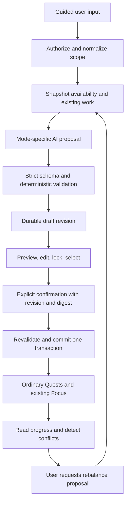

# Sylf AI Planner Modes: Phase 0 architecture report

**Date:** 24 September 2026

**Status:** Architecture proposal for review. Phase 0 complete; implementation is not authorized by this report.

**Audited checkout:** `/Users/aliumair/Desktop/sylf`, HEAD `6d795ad57ac33113ddd9c8475daaf0e87c08dba5`, including the existing dirty working tree.

**Product source:** *Sylf AI Planner Modes PRD*, draft v1.0, 24 September 2026, 24 pages. Page/section references below refer to that PDF.

## Executive recommendation

Extend the existing planner, provider adapters, Quest execution system, Focus settlement, and calendar. Introduce a small durable planning layer around them. The essential change is **generation produces a validated draft; a separate, explicit, idempotent confirmation creates ordinary Quests in one transaction**.

The current planner is already useful infrastructure, but its end-to-end behavior is incompatible with the PRD: it automatically researches externally, fills a calculated workload, and immediately writes a Goal and Quests. It has no durable proposal, mode, item identity, revision, lock, or confirmation boundary. Adding three prompt variants to that endpoint would preserve its most consequential defects.

Recommend three new domain tables conceptually: **PlannerPlan, PlannerRevision, and PlannerQuestLink**. Keep bounded topics, hierarchy, milestones, constraints, and actionable items inside versioned revision payloads initially. Reuse Subject/SubjectNode as optional references, Goal as an optional objective integration, and Quest/StudySession as execution truth. Do not add a second task table, a planner timer, separate AI credentials, or planner-specific columns across Quest.

The biggest architectural risk is **multiple writers with different rules changing the same Quests**: planner generation, manual edits, chat tools, Goal adjustment, floating-rest-day cascade, deadline processing, and Focus settlement. Stable lineage, explicit conflict detection, and protections at those existing boundaries matter more than sophisticated prompts.

## 0. Authority, evidence, and limits

The pasted Phase 0 request governs this task. The PDF is the product source of truth, not authorization to implement its roadmap or create its suggested test fixtures. This work adds only this report. No application code, schema, migration, prompt, UI, API, or quest-generation behavior was implemented.

Evidence is classified as:

- **Observed:** current source/schema/migrations or an executed existing test.
- **Consequence:** a source-supported failure path, not a claim that it occurred in production.
- **Proposed:** future design requiring architecture review.

The audit read the PRD text across all 24 pages and visually checked its exam-mode specification. It inspected planner UI and endpoint, orchestration and provider contracts, Quest/Goal APIs, schedule/calendar services, Focus entry and settlement, relevant SQL migrations, auth/quota/security code, cache behavior, and the mobile shell/transport boundary. Installed Next.js route-handler and server/client guides were read; this repository uses root `app/` and `lib/`, not `src/`.

Nine existing targeted test files passed, **83 tests total**, with mocked external dependencies (Appendix B). These establish the current regression baseline, not PRD compliance. No live AI calls, database queries, migration commands, or authenticated production UI mutations were performed. Applied database state, deployed runtime limits, provider availability, and real cross-device behavior remain unverified. Historical security reports are evidence of the intended verified architecture, not a fresh live certification.

## 1. Current Planner architecture

### Entry points, state, and UX

| Surface | Current responsibility | Reuse assessment |
| --- | --- | --- |
| [AiPlannerPanel](/Users/aliumair/Desktop/sylf/app/components/AiPlannerPanel.tsx:47) | Shared client form, SSE reader, quota, loading/error/success state | Reuse component boundary and styling; replace state contract and add draft review |
| [AiPlannerModal](/Users/aliumair/Desktop/sylf/app/components/AiPlannerModal.tsx:25) | Global quick-action modal wrapping the panel | Retain thin wrapper; share the same draft with workspace |
| [PlannerTab](/Users/aliumair/Desktop/sylf/app/system/components/PlannerTab.tsx:20) | Planner in System workspace | Primary guided creation/review surface |
| [SystemScreen](/Users/aliumair/Desktop/sylf/app/system/components/SystemScreen.tsx:77) | `/system`, conversation/planner tabs, `?tab=planner`, `?session=` | Retain navigation and conversation context |
| [SystemAIProvider](/Users/aliumair/Desktop/sylf/app/components/system/SystemAIProvider.tsx:181) | Global modal, overlay context, quota refresh | Retain entry; add plan identity and mutation invalidation |

The panel uses local React state: topic, syllabus text, optional date, hours/week (default 10, UI range 1–40), generating flag, progress strings, error, success result, and quota. There is no reducer/store for a durable draft, no mode selector, no topic confirmation, and no preview/edit/lock/confirm stage. Unmount loses form state. The panel fetches `/api/ai-usage` on mount and also accepts quota from its parent.

Current flow: four-field form → Generate → progress terminal → already-created Goal/Quests → conversation. The modal closes on success; the embedded panel offers “View Conversation” and “Create Another.” Neither is a plan detail/history view. Labels in the form are visually present but do not consistently use input IDs/`htmlFor`; the progress terminal has no explicit live-region contract. Quota copy mixes weekly limits with “today” and “Daily Quota Reset.” There is no dedicated cancel button in the generating panel; closing/unmounting triggers abort.

### API, orchestration, and persistence

[POST `/api/ai-planner`](/Users/aliumair/Desktop/sylf/app/api/ai-planner/route.ts:16) performs:

1. `getSession(req)` authenticates the cookie and checks current `tokenVersion`.
2. Reserves a weekly planner quota unit **before** parsing and validating the body.
3. Reads `{ topic, syllabus, effortHours, targetDate, sessionId }`; validation checks only truthiness of topic/effort.
4. Reuses an owned ChatSession or creates one; an invalid/foreign session reference falls back to a new session.
5. Reads the latest 20 StudySessions, including subject names and focus rates.
6. Runs `AiStudyOrchestrator.generatePlan` with progress callbacks and abort signal.
7. Creates an ACTIVE Goal with effort tier, target weeks, optional deadline.
8. Distributes generated Quests evenly by array index across the date horizon, rolling forward over fixed/floating rest days.
9. Bulk-creates PENDING Quests with `createdByAi: true`, then writes two SystemMessages containing the input and result summary.
10. Sends SSE result `{ goal, sessionId, modelUsed, quota }`, records usage, closes stream.

**Generated work is durable immediately**, as Goal + Quest rows and chat messages. The full typed planning proposal is temporary: no PlannerPlan record or saved structured revision exists. Chat prose is not a recoverable system of record. The response returns a Goal, not a typed list of committed quest IDs/plan items.

The Goal create, Quest createMany, and chat writes are separate operations, without an encompassing transaction. A failure after Goal creation can leave a Goal without Quests; a failure after Quest creation can leave live Quests despite the UI showing an error. Retrying has no idempotency key or lineage constraint.

### SSE, cancellation, retry, and errors

Events are `data: { type: "thought" | "result" | "error", ... }` frames. These are code-authored stage messages, not model reasoning, though some include private topic/syllabus text. The client buffers chunks and parses double-newline-delimited JSON. It does not persist an operation ID, reconnect/replay events, or recover an interrupted result through GET. EOF without a terminal event can leave `isGenerating` true; malformed events are logged and skipped. No client automatic generation retry exists.

The route joins client disconnect and a configured timeout into an AbortController. Important limits:

- Route `maxDuration` is **120 seconds**, while `AI_LIMITS.plannerTimeoutMs` is **180 seconds**. Actual deployment enforcement was not measured.
- `executeGoogleSearch` has no signal parameter; the initial grounded search does not participate in the abort chain.
- Some nested fallback catches do not immediately rethrow aborts.
- The abort listener/timer is removed after AI generation, before persistence. A late disconnect cannot roll back writes and can make result delivery fail after commit-like effects.
- Stream errors release quota even if some database writes already occurred. Invalid body/early 400/wrapper errors after reservation can bypass release.

Future retries must distinguish generation retry, draft retrieval, and confirmation retry. Replaying Generate is not a safe recovery strategy today.

## 2. Current Quest architecture

### Persistence and meaning

[Quest](/Users/aliumair/Desktop/sylf/prisma/schema.prisma:354) already contains user ownership, optional Goal/Subject/SubjectNode references, title/description, `targetMinutes`, `requiredMinutes`, `elapsedSeconds`, `scopeWeight`, status, difficulty, date-only `scheduledFor`, AI provenance, canonical rewards, item modifiers, and completion timestamp. StudySession optionally references Quest. Goal/Subject/SubjectNode deletion sets their Quest foreign keys null; deleting Quest sets StudySession.questId null.

**Yes: use existing Quest directly for actionable planner work.** Learn, Recall, Practice, etc. describe educational intent; they do not require separate execution engines. Store intent/stage/topic references/locks on planning items in the revision, accessible through the sidecar link. `createdByAi` alone cannot identify a plan or protect against duplicate materialization.

There is no priority column, pedagogical quest-type column, recurrence rule, per-quest timer implementation, plan reference, edit version, or `updatedAt` on Quest. Do not mislabel `difficulty` as priority, or the weekly aggregate mission as recurring Quest records.

### Mutation paths

| Path | Current behavior and integration concern |
| --- | --- |
| [GET/POST `/api/quests`](/Users/aliumair/Desktop/sylf/app/api/quests/route.ts) | Lists today's date or all rows; create clamps 15–240 minutes, checks rest days, Goal ownership, and node ownership; sets both minute fields, ACTIVE status, deterministic rewards |
| [PATCH `/api/quests/[id]`](/Users/aliumair/Desktop/sylf/app/api/quests/[id]/route.ts) | Zod validation, owned lookup, Goal ownership/rest-day guard; completion calls atomic `claim_quest_reward` before field update |
| Quest duration update | PATCH allows any positive `requiredMinutes`, but does not synchronize `targetMinutes` or recalculate reward fields; planner edits must not copy this inconsistency |
| Quest failure/delete | Failure status write precedes penalty transaction; individual and bulk deletion exist. Preserve intended user deletion in lineage; do not silently recreate it |
| Dedicated AI planner | Bulk writes bypass the manual creation path and its subject/scope normalization |
| Chat tool executor | Creates/updates/deletes/moves/swaps/clears Quests directly, with different limits and status conventions |
| Deadline route | Cron checks only PENDING/IN_PROGRESS overdue rows, marks FAILED, applies existing penalties |

Creation authorization gap: POST validates a supplied SubjectNode through its owning Subject, but a **bare `subjectId` without a node is assigned without an owned Subject lookup**. Future materialization must independently verify every referenced Subject, node, Goal, plan, and revision. This is a scoped observed gap; no auth architecture change was made.

### Status and duration incompatibilities

Quest.status is a **String defaulting to ACTIVE**; the separate Prisma `QuestStatus` enum is not its column type. Manual creation uses ACTIVE, planner/chat use PENDING, PATCH accepts PENDING/IN_PROGRESS/COMPLETED/FAILED, and session settlement accepts all three open states. Chat move/swap and deadline checks exclude ACTIVE. A shared planner adapter must treat legacy ACTIVE/PENDING/IN_PROGRESS as open while selecting one approved creation convention; do not migrate every old status in this feature.

The dedicated planner sets `requiredMinutes` but omits `targetMinutes`, leaving the schema default **45**. Focus's UI countdown uses `requiredMinutes`, while settlement SQL prefers `targetMinutes`. Thus a generated 90-minute quest can be evaluated against 45 minutes by the server. Future creation must set both to the same validated duration and compute difficulty/rewards once. Existing rows should not be rewritten automatically, especially completed rows; remediation is a separate reviewed decision.

### Rewards, progress, and clients

Reuse [difficulty-engine](/Users/aliumair/Desktop/sylf/lib/difficulty-engine.ts) and existing reward RPCs. AI-supplied XP/Sylph are already overwritten by the orchestrator. Never award progress/rewards during plan confirmation. Quests earn them through ordinary completion/Focus flows, including existing streak/item/early-completion modifiers.

Client data uses a custom [memory/SWR cache](/Users/aliumair/Desktop/sylf/lib/client-data-cache.ts), not React Query. Goals/Quests components also hold local arrays; some mutations update locally or refetch through a still-fresh cache, and some delete handlers do not check HTTP success before removing local rows. There is no universal optimistic-update rollback/invalidation protocol. Planner success currently refreshes quotas/chat sessions, not every affected Goal/Quest/calendar/dashboard cache. Future confirmation must invalidate all affected prefixes after success and return authoritative IDs; draft edits may be optimistic, production creation must not appear successful until confirmed.

## 3. Goals, Schedule, and Calendar integration

**Goals are existing objectives, not versioned plans.** [Goal](/Users/aliumair/Desktop/sylf/prisma/schema.prisma:281) has title, description, targetWeeks, effort tier, ACTIVE/COMPLETED/FAILED status, color, targetDate, and linked Quests. It lacks mode, revisions, topic hierarchy, or draft/archived states. Its existing deadline banner (`GoalMilestone`) is a computed calendar DTO, not a reusable multi-period milestone table.

Use an optional owned Goal relation for objective/color/deadline integration. A new Goal can be created in the confirmation transaction; generation must not create a live objective. Do not create one Goal for every month/milestone. Keep planner status separate from Goal status and define any mirrored deadline change explicitly in the commit diff.

Two existing Goal behaviors cannot serve as rebalancing:

- [Goal adjust](/Users/aliumair/Desktop/sylf/app/api/goals/[id]/adjust/route.ts) is described in comments as a preview but actually updates targetWeeks/effort, deletes PENDING Quests, and tells the user to regenerate in chat. It has no encompassing transaction and does not update targetDate.
- Single Goal deletion relies on SetNull for Quest links, whereas bulk Goal deletion explicitly deletes associated Quests first, including completed ones. Planner archival must not delegate to either deletion flow.

**Existing availability:** User.dailyGoalMinutes (default 120), User.restDays (default Sunday), User.timezone, enableHpPenalty, and FloatingRestDay (one designation per ISO week). `/api/user/study-schedule` permits 10–1440 daily goal minutes and up to six fixed rest days. A daily goal is an activity target, not confirmed study capacity. Present it as an editable prefill; do not silently interpret it as capacity or change penalty settings.

[StudyScheduleService](/Users/aliumair/Desktop/sylf/lib/study-schedule-service.ts:49) provides fixed/floating rest resolution, date utilities, calendar aggregation, and automatic rest-day shifting. Reuse its data and date primitives, while changing planner use to fail closed if required availability cannot be loaded. Current catches return “not a rest day” on lookup failure. The dedicated planner separately loads/rolls over rest days rather than calling this resolver.

[planning-engine](/Users/aliumair/Desktop/sylf/lib/ai/planning-engine.ts) contains capacity calculation used by chat move/swap/clear-day. It uses EFFORT_CONFIG and the latest active Goal, counts full scheduled durations regardless of status, and reduces capacity based on HP-derived “burnout”/overload flags. That is not the PRD's explicit availability model; HP must not be interpreted as medical/psychological capacity. Its exported deterministic scheduler is imported by chat but has no observed call site in `app/`/`lib/`; its overflow branch schedules anyway, even when no day has enough capacity. Rest-day negative sentinels can also become zero during subtraction. Reuse concepts and extract corrected pure policies, not these fallback behaviors wholesale.

**Floating rest conflict:** `cascadeQuestShifts` changes all non-COMPLETED/non-FAILED quests on the date to the next active day, without capacity, deadline, or planner-lock checks. Before planner-linked quests ship, route this case to a visible proposed change (or include a reviewed diff in the explicit rest-day action). Preserve existing non-planner behavior unless separately approved. Existing tests intentionally assert automatic shifting; new planner protection requires new cases, not deleting those tests.

**Dates:** Quest.scheduledFor is a date-only string; Goal.targetDate is representational UTC midnight. Calendar converts the latter through user timezone, which can display the previous day in negative offsets even though Goal labels format in UTC. `targetDateToUtc` checks shape but permits JS calendar normalization of impossible dates. Future planner dates must be real `YYYY-MM-DD` values, use calendar arithmetic and canonical user timezone, and preserve chosen dates across timezone changes. Do not convert planner date-only keys into midnight instants and then localize them. No external-calendar/time-slot recurrence abstraction was found to reuse.

## 4. Focus integration and available observation signals

Dashboard quest actions navigate to `/focus?questId=...` (with subject context where available). [FocusScreen](/Users/aliumair/Desktop/sylf/app/focus/components/FocusScreen.tsx:591) loads the Quest and derives remaining time. Existing timer-engine snapshots, leadership between tabs, lazy start after real focus time, serialized flushes, and retained local state on failure should remain intact.

[POST/PATCH `/api/sessions`](/Users/aliumair/Desktop/sylf/app/api/sessions/route.ts) delegates to `start_study_session` and `settle_study_session_atomic`. Settlement owns duration deltas, separate breakSeconds, Quest elapsed time/completion, SubjectNode progress/mastery, progression and ledgers in a database operation. The timer trust-boundary lineage includes `20260826110000_t3_settle_insert_wall_clamp`, S2 security wrappers, and later cognitive/progression changes; the latest inspected settlement definition is `20260827050000_sp_stipend_level_rank_ups`. Session/quest ownership checks, wall-time clamps, monotonic durations, and open-Quest guards are existing protections to preserve. Weekly streak handling additionally occurs in the API after settlement; do not describe that whole route as one transaction.

**Settlement verification caveat:** the latest SQL reads `rewardsClaimed` and reports `alreadyClaimed`, but does not use that flag as an unconditional early-return guard. Session award eligibility uses final/insert plus a positive time delta (or zero previous time). Identical final payloads normally have zero delta, but a later larger final payload can enter the award branch again. This is a source-derived existing risk, not a live reproduction. Before relying on once-only rewards for planner integration, extend the regression proof for final replay with increased duration; route any required timer correction through its existing owner/review, not a new planner settlement engine.

| Future planner signal | Available truth | Limitation / correct interpretation |
| --- | --- | --- |
| Completed work | Quest.status, completedAt | Completion is authoritative execution state; it is not proof of academic mastery |
| Time spent | Quest.elapsedSeconds and StudySession.durationSeconds; breakSeconds separate | Use one canonical measure per metric; do not sum Quest cumulative time and sessions together |
| Partial work | Open Quest with elapsedSeconds > 0 | ACTIVE may remain ACTIVE; IN_PROGRESS alone is not a reliable signal |
| Missed work | Scheduled date before user's local today + unfinished state | “Overdue” is derived; distinguish existing FAILED/penalized records |
| Skipped work | No explicit skip field/event today | Never infer intent from zero sessions; add a planner item disposition if needed |
| Topic progress | Optional SubjectNode.progress/isMastered; linked item coverage | SubjectNode is gamified, weighted progress; repeated review must not count as repeated new syllabus coverage |
| Active session | StudySession.endedAt null with Quest link | Protect the quest from schedule/duration/content replacement during commit |
| Replan eligibility | Changed constraints, elapsed/remaining work, missed dates, explicit request | Start with manual action; observation does not authorize mutation |

FocusSession/FocusSessionMember in current untracked Focus Party work are distinct social session models. Individual credited study time still uses StudySession. Do not bind planner execution to a second party timer or assume party attendance completes a planner topic.

Initial planner materialization should support Subject linkage without requiring SubjectNode linkage. Where a topic references a node, keep that reference in scope metadata. Enable reward-bearing `Quest.subjectNodeId` binding only with an approved coverage-weight policy and reconciliation tests; applying default 0.25 to every Learn/Recall/Review item could inflate node progress. Do not automatically set node mastery from a planner “Mastery Check” title.

## 5. AI / System architecture

### Existing infrastructure

- [LLMFactory and adapters](/Users/aliumair/Desktop/sylf/lib/ai/providers/factory.ts) share normalized messages, tool calls, response usage, abort signal, JSON mode and temperature for DeepSeek/Gemini/Groq. The shared options include maxTokens; DeepSeek/Gemini forward it, but the inspected Groq request does not, so output-budget parity needs a compatibility fix. Keep this infrastructure server-side.
- [AiStudyOrchestrator](/Users/aliumair/Desktop/sylf/lib/ai/orchestrator.ts:552) concurrently runs researcher and study-history analyst, then a master planner, then duration/reward post-processing. This is application orchestration, not a requirement for more independent services or deployed agents.
- Research first always invokes grounded Google search, including when syllabus was supplied. Fallback may synthesize from model knowledge; `executeGoogleSearch` can return a generic “Knowledge Engine” summary without live findings. This conflicts with PRD §§4,20,31: user-confirmed scope authoritative, no automatic external syllabus lookup in MVP.
- Analyst receives up to 20 raw recent sessions and subject labels; defaults to 45 minutes without history. Future minimum should be aggregate timing statistics, and only if useful.
- Master output is `{ goalTitle, goalDescription, quests }`; Zod bounds array size to 1–60, titles/descriptions, and initial minute values to 1–600 with coercion/defaults. Post-processing clamps durations to 15–240 and overwrites AI rewards.
- Proportional duration adjustment attempts to consume the whole hours/week-derived budget. It cannot guarantee its documented exact total when min/max clamps bind (two quests cannot represent 1,000 minutes under a 240-minute cap). It is not feasibility validation.
- Fallback tries configured DeepSeek, Gemini variants, then Groq. Adapters also perform their own model fallback, multiplying possible provider attempts beyond the orchestrator-level cascade. Some JSON recovery/defaulting is permissive, no mode schema/version or date/topic-reference validation exists, and planner calls omit explicit maxTokens. A future attempt budget must account for adapter-level retries as well.

Model strings in [config](/Users/aliumair/Desktop/sylf/lib/ai/config.ts) are repository configuration, not a verification of current provider products. This report makes no recommendation to buy or switch models. Verify configured model capability/availability during the implementation provider smoke gate.

### System chat is a separate current mutation entry point

[/api/system-messages/chat](/Users/aliumair/Desktop/sylf/app/api/system-messages/chat/route.ts) uses agent routing, role prompts, context slices, deterministic/cheap answers, quotas, tools, bounded iterations/handoffs, provider fallbacks, and per-attempt cancellation. It returns chat JSON rather than the dedicated planner's stage SSE contract. “Planner agent” in chat does not automatically call `AiStudyOrchestrator`.

[chat-tool-executor](/Users/aliumair/Desktop/sylf/lib/ai/chat-tool-executor.ts:455) creates Quests directly, with a three-AI-quests-created-per-day guard and non-atomic duplicate title/date checks. Dedicated planner bypasses this cap. `createMultipleQuests` loops, skips failed items, and returns success with a partial count. Update can fall back to the most recent PENDING quest when exact matching fails. Existing HMAC confirmation tokens protect some destructive bulk actions, but bind only action/user/expiry, not exact plan contents or revision. They are not sufficient plan-confirmation receipts.

Future System commands should invoke the same proposal service and open the same exact draft/diff for confirmation. The model must not call arbitrary Prisma operations, pick a user ID, or approve its own proposed changes. Existing generic chat writers need planner-link guards before planner-linked quests exist.

The separate root `ai-agent/` folder contains CLI/MCP experiments. No production import from `app/` or `lib/` was found. Do not adopt it as parallel Planner Modes infrastructure.

### Quota and usage

[UserQuota limiter](/Users/aliumair/Desktop/sylf/lib/ai/usage-limiter.ts) atomically reserves with a guarded PostgreSQL upsert, using local Monday-based week keys for planner (one/week), daily chat/compile/scope buckets otherwise. Preserve the distinction between `charged` and `allowed`: a successful last reservation has charged=true and allowed=false.

The planner has no separate endpoint burst limiter despite an existing [rate-limit service](/Users/aliumair/Desktop/sylf/lib/rate-limit.ts). Quota refund recomputes the current date/week bucket; it is not bound to the original reservation or request. A boundary-crossing refund can debit the wrong bucket, and a nonnegative counter alone does not guarantee once-only settlement. Reuse and extend this service with original-bucket reservation receipts and compare-and-set settlement; do not build a second quota system.

AiUsageLog stores counts/provider/model/cost without raw content, which is reusable. Current planner telemetry sums different engines into one entry labeled `provider: deepseek`; display-formatted model names do not match cost-map keys, and grounded search/failed attempts are not fully counted. Provider-cost reporting is therefore approximate and can undercount. Record actual provider/model per attempt and failed/aborted spend separately from the product quota charge.

## 6. Existing database models relevant to Planner Modes

| Existing model/concept | Reuse | Why it does not replace the planning layer |
| --- | --- | --- |
| User | Owner, timezone, schedule settings | No plan lifecycle or availability snapshot |
| Goal | Optional objective, color, deadline | No draft, revision, mode, locks, structured milestones |
| Subject | Owned course context and source syllabusNote | Plans may cover subsets or free-text subjects |
| SubjectNode | Optional existing topic reference/progress | Fixed 48-node, tiered skill-tree compilation; no arbitrary syllabus hierarchy or plan-relative state |
| Quest | Sole executable study task | No lineage, item lock, revision, or roadmap-only milestone |
| StudySession | Credited study time and Quest execution | No academic assessment result/skip intent |
| ChatSession/SystemMessage | Optional conversation link/summary | Free text cannot be committed/rebalanced as a validated plan |
| FloatingRestDay/User.restDays | Existing blocked-day source | No detailed per-day availability or plan history |
| UserQuota/AiUsageLog | Quota and provider-cost infrastructure | No durable operation key/commit receipt |
| Xp/Sylph/Hp ledgers, UserStats | Existing progression truth | Do not duplicate in a planner progress ledger |
| AuthSession/User.tokenVersion | Existing account/session architecture | Planner must use `getSession`, not invent a token flow |

Relevant migrations include init/AI models, goal color/linking and irregular-rest-day additions (both `20260823000000_*` directories), quota/usage logging, subject syllabusNote, timer lifecycle/trust-boundary migrations, and S2 security hardening/JWT-policy fixes. Current untracked Focus Party/background migrations are concurrent work, not proof those schemas are deployed. No PlannerPlan/Milestone/Topic/Revision models currently exist.

## 7. Reusable components and services

| Keep | Extend behind a reviewed interface | Do not reuse as-is |
| --- | --- | --- |
| Panel/modal/tab entry composition; System shell | Guided local state + durable revision loading | “Generate means create live quests” |
| LLMFactory/adapters, model config | Shared planner orchestration with mode strategies | Always-on research chain; arbitrary chat mutations |
| Zod and JSON error classification | Strict versioned plan schema + semantic validators | Prose extraction/defaulting as acceptance contract |
| Quota atomic upsert, rate-limit helper | Request-bound settlement, idempotency, original bucket | Refund-current-bucket / repeated release |
| Quest, Focus, session RPCs, reward functions | Common transaction-aware creation normalization | Planner omission of targetMinutes; repeated node scope credit |
| Rest-day data, timezone utilities, calendar view | Strict snapshot-based capacity calculation | Overbook-anyway scheduler / fail-open rest lookup |
| Goal color/deadline UI | Optional plan-to-Goal integration | Goal adjust deletion path as rebalance |
| Client cache and user tags | Central post-commit invalidation | Quota-only refresh after new quests |
| Mobile screen reuse and navigation shim | Shared pure DTOs and resolved stream transport | Relative planner fetch treated as verified native networking |

Keep changes in the current root `app/`/`lib/` layout. A narrow `lib/planner/` domain folder and `lib/ai/planner/` prompt/strategy files are sufficient; no broad source restructure is justified.

## 8. Architectural gaps and priority

| Priority | Observed gap | Required treatment before Modes launch |
| --- | --- | --- |
| Blocking | Generation mutates Quests without preview/transaction/idempotency | Split proposal and confirmation; durable validated draft |
| Blocking | Different writers can overwrite/move/delete planner work | Link-aware guards, exact identity, revision/quest conflict checks |
| Blocking | requiredMinutes/targetMinutes mismatch and mixed statuses | Normalize new writes; preserve legacy reads and rewards |
| Blocking | External research can replace supplied scope | Default to confirmed scope; enrichment explicit and deferred |
| Blocking | No capacity/deadline validation after rest-day rolling | Shared deterministic feasibility validation, no overflow allocation |
| Blocking | No stable lineage, locks, tombstones, immutable accepted history | Minimal planning persistence described below |
| High | Weak request validation, bare-subject ownership gap | Validate input/references before quota/provider calls |
| High | Quota leakage, wrong-bucket/double refunds, timeout mismatch | Owned operation lifecycle and consistent bounded cancellation |
| High | Date-only/UTC deadline conversions differ | Canonical date-key policy and timezone regression cases |
| High | Current Goal-adjust/bulk-delete/cascade bypass revision intent | Explicit handling for linked work before materialization ships |
| Medium | SSE EOF recovery, stale caches, quota copy, a11y gaps | Typed terminal events, operation retrieval, invalidation and UI states |
| Medium | Misattributed costs/error payload logging | Content-free event/usage telemetry and error redaction |

These are findings and future prerequisites, not changes made in Phase 0.

## 9. Proposed domain architecture

### Responsibilities and flow



| Boundary | Owner and contract |
| --- | --- |
| A. User input | Client collects mode, owned references or free text, dates, scope, capacity, optional confidence. No DB identities are inferred by the model |
| B. Normalized input | Server validates, preserves wording/provenance, deduplicates with visible material changes, resolves owned references, assigns stable topic keys and date horizon |
| C. AI generation | Existing adapters receive bounded normalized scope and capacity. No DB mutation tools; mode builder controls educational structure |
| D. Validated output | Strict Zod plus semantic checks produce either a typed proposal or classified errors. Nothing partially parsed reaches commit |
| E. Preview/edit | Client edits a draft. Server validates saved edits; accepted draft content gets a digest/version. Production Quests remain unchanged |
| F. Plan persistence | Owns plan identity, immutable revision payloads, operation/confirmation receipts, active pointer and optimistic version |
| G. Quest materialization | Transaction-aware server service maps approved actionable items into existing Quest fields and creates sidecar links |
| H. Progress observation | Read-only joins to Quest/StudySession plus explicit user topic signals. Does not maintain an independent execution percentage |
| I. Future rebalance | Computes changes against a specific revision and observed state; creates a new draft and diff; explicit confirmation uses G |

Keep normalized-input/output/date utilities and Zod contracts free of Prisma, provider SDKs, and Next server imports so both web/mobile can use them. Server-only modules should explicitly enforce their import boundary. The existing mobile build guard is useful but is not the sole defense.

Recommended responsibility locations (proposed names, no files created):

- `lib/planner/contracts.ts`, `dates.ts`, `validation.ts`: versioned discriminated unions and pure validation.
- `lib/planner/service.ts`, `repository.ts`: authorization, persistence, operation lifecycle and revisions.
- `lib/planner/capacity.ts`: normalized capacity policy over a server-loaded schedule snapshot; reuse established timezone/rest-day primitives.
- `lib/planner/materialize.ts`: safe Quest mapping, links, conflict checks and confirmation transaction.
- `lib/planner/progress.ts`: derived execution state and attention reasons.
- `lib/ai/planner/`: shared prompt envelope plus Exam/Roadmap/Mastery builders/validators; existing orchestrator delegates here when the reviewed path is enabled.
- Extract a narrow transaction-aware Quest creation helper from existing behavior where shared use is justified; do not have a server confirmation handler issue N HTTP calls to `/api/quests` or perform per-quest AI scope requests.

## 10. Proposed minimum data model

### Three durable entities, not a generalized planning framework

These are conceptual responsibilities/constraints to review, not finalized Prisma definitions.

| Entity | Minimum data and invariants | Reason |
| --- | --- | --- |
| **PlannerPlan** | Application ID; userId; mode; title; optional owned subjectId/goalId; DRAFT/ACTIVE/COMPLETED/ARCHIVED lifecycle; activeRevisionId and latestDraftRevisionId; monotonically increasing version; creation request key/hash; timestamps | Stable identity/owner and retrieval across changes. Unique owner + creation key prevents duplicate initial plans |
| **PlannerRevision** | Plan FK; sequence; source GENERATE/EDIT/EXPAND/REBALANCE; base revision/version; schemaVersion; immutable validated input/availability/output snapshot; digest; operation key/hash, state, bounded lease/expiry, quota reservation receipt and settlement marker; confirmation key/digest/receipt/timestamp | Required durable history and retries. An operation envelope exists before AI; a successful validated payload is sealed. Failed/cancelled operation has no committable payload |
| **PlannerQuestLink** | Plan FK + stable application item key; nullable unique Quest FK; created/applied revision references; live/detached/deleted disposition; materialized Quest-field baseline; optional removal timestamp | One execution identity across revisions, deletion tombstone, conflict detection without putting planner columns on Quest |

Use unique `(planId, sequence)`, `(planId, operationKey)`, `(planId, itemKey)`, and non-null Quest linkage uniqueness. Revision confirmation is a single logical operation: one exact selected set/content digest per revision. Retrying that confirmation returns its recorded result, regardless of a different transport attempt. Reusing a key with a different body returns 409. A later selection/addition is a new revision, not a second ambiguous commit against the old one.

A preparing revision/plan shell is operation state, not a partially active plan. Keep failed drafts retryable/visible or expire them under a retention policy; never create Goal/Quest rows while it is preparing. Combining request receipt with the revision avoids an additional job/request table for the bounded synchronous MVP. If durable background jobs become necessary, extract an operation table then; do not add a queue or orchestrator platform now.

Revision **content** is immutable once validated. Operational state and a write-once confirmation receipt may transition through guarded states. User editing a saved validated proposal creates an EDIT revision; coalesce local keystrokes before saving rather than writing one revision per keystroke. Store parent/base IDs and reason, but derive display diffs from snapshots initially. Do not retain raw model responses or hidden reasoning.

On Quest deletion, the link remains with `questId = null` and a deleted disposition (or a detectable formerly-materialized null reference). Never interpret it as “not yet materialized.” Keep enough approved item metadata in revision history to show what was removed. Enforce plan/revision/link membership server-side and through relational constraints where possible; JSON references still require semantic validation.

### What lives in versioned snapshots

| Shared content | Mode-specific extension |
| --- | --- |
| Subject/course display snapshot, source kind and owned references, objective/title, local start/end keys and timezone | **Exam:** required exam date, optional format, exam stages, assessment-specific constraints |
| Confirmed topics with stable keys, optional parent key, original label, optional SubjectNode reference, explicit completion/confidence signals | **Roadmap:** week/month period boundaries, ordered milestones, effort bands/checkpoints, expansion lineage |
| Availability snapshot: explicit daily/weekly capacity, fixed/floating/extra blocked dates, session bound, recovery reserve, schedule fingerprint | **Mastery:** root topic/subtopics, initial understanding, six-stage sequence and final mastery-check criteria |
| Assumptions, warnings, feasibility, topic inclusions/exclusions and user decisions | Each mode has its own valid stage/type combinations and invariants |
| Items: stable key, kind, topic references, title/description, date or period, minutes/effort band, intent, stage, ordering/dependencies, lock, concise rationale | Exam actionable day entries; roadmap milestone entries; mastery sequence entries |

Do not persist a second Quest completion percentage or planner copy of session totals. Read live state through links. Preserve user-reported confidence/progress as a distinct signal, with its origin, rather than overwriting SubjectNode.progress. Snapshotting user constraints is necessary history, not a competing global schedule.

**PlannerTopic/PlannerMilestone tables are not required initially.** Existing SubjectNodes are unsuitable as arbitrary plan scope, but bounded JSON supports hierarchy and roadmap periods without a new relational table per concept. Add relational topics/milestones only when observed requirements demand independent multi-plan topic identity, cross-plan querying, or high-volume partial updates. The 12-month/52-week bounded roadmap is small enough for snapshot validation.

**Core Quest schema:** no new scalar fields required for mode, stage, lock, topic lists, or revision. A Prisma reverse relation may be added for the sidecar FK; that is not a duplicate Quest system. An index such as `(userId, scheduledFor)` is a likely performance addition, subject to query-plan measurement, not a feature-field requirement. Quest-wide version/updatedAt could simplify generic concurrency later, but is not required if narrow compare-and-set checks and row locks cover planner writes.

**Goal link decision:** prefer optional one plan → one objective association, with no automatic Goal creation until confirmation. If the user selects an existing Goal, do not silently claim ownership of its manually created quests or change its deadline/effort. Deleting/archiving a plan must preserve Goal and Quest history unless a separate explicit user action requests deletion.

## 11. Proposed API surface and transactional confirmation

### Routes

Use root `app/api/` route handlers and the existing `getSession` boundary. Names below are proposals. Keep legacy `/api/ai-planner` behavior isolated behind rollout until clients switch together; do not return a draft in a response old clients interpret as “Quests created.”

| Operation | Proposed route | Contract / side effects |
| --- | --- | --- |
| Generate | `POST /api/planner/generate` | Required request key; input validation/ownership → quota → bounded generation → validated durable draft. SSE stage events plus terminal plan/revision IDs; no Quest/Goal creation |
| Recover initial request | `GET /api/planner/operations?requestKey=...` | Owned lookup of current operation/result if network failed before client received planId; never starts a second generation |
| List/detail | `GET /api/planner`, `GET /api/planner/[id]` | Bounded summaries/detail with current revision, linked live state, operation status and attention reasons |
| Save draft edits | `POST /api/planner/[id]/revisions` | Base version/revision + proposed changes; validate and append EDIT revision. No Quest mutation |
| Confirm | `POST /api/planner/[id]/commit` | revisionId, expected plan version, approved digest/selection, idempotency key; atomic materialization and receipt |
| Expand period | `POST /api/planner/[id]/milestones/[itemKey]/expand` | Roadmap Phase 3; base revision and selected scope/period; returns new draft/diff, no live mutation |
| Rebalance | `POST /api/planner/[id]/rebalance` | Phase 5; approved inputs + progress snapshot; new draft, same parent plan |
| History | `GET /api/planner/[id]/revisions` | Cursor-paginated metadata; fetch a selected snapshot on demand |
| Archive | `POST /api/planner/[id]/archive` | Explicit plan lifecycle change, preserves execution/history; future unfinished-quest disposition must be shown |

Draft save/commit/archive should work independently of exhausted AI quota. A cancel endpoint is unnecessary for the first synchronous implementation if abort is reliable and operation recovery exists; introduce an owned operation-cancel action only if generation is detached/backgrounded. Cancellation before the draft is saved prevents delivery/settles quota; cancellation after draft completion does not erase a durable result or imply Quest writes.

Use consistent errors: 400 invalid input, 401 invalid/revoked session, 404 unknown/foreign resource, 409 stale revision/idempotency-body mismatch/changed execution, 422 infeasible or invalid proposal, 429 burst/quota with Retry-After, 503 provider/dependency unavailable. SSE must send one terminal complete/error/cancelled event after stream acceptance; transport EOF without terminal status is recoverable through the owned operation lookup. No raw provider errors to clients.

### Safe confirmation transaction

Do **not** call the existing chat bulk-create tool. Do **not** generate AI output or evaluate per-item scope inside the transaction.

1. Reauthenticate using `getSession`; resolve owner-scoped plan/revision and idempotency receipt. Validate bounded request size and exact approved digest. A retry of an already committed revision returns the same receipt.
2. Validate proposed content and canonical Quest fields outside the transaction. Re-read current schedule, related ownership, and linked state for the candidate diff.
3. Start a short Prisma interactive transaction. Lock the plan/revision, then relevant existing Quests in deterministic order. Follow existing settlement lock order when including other rows; avoid introducing User→Quest locks that invert Focus's Quest→User order. No network calls inside.
4. Atomically check expected plan version, sealed revision digest, base revision, applicable links, and current Quest facts. Recheck status, elapsedSeconds, active StudySessions, schedule, title/duration and deletion state. Changes since preview yield 409 and a refreshed diff, not a best-effort partial commit.
5. Revalidate date/capacity constraints against current DB reads. Use serializable conflict detection with bounded retry (or an equivalent proven common schedule lock) to prevent two concurrent planner confirms allocating the same capacity. Plan-level locking alone is insufficient across two plans. When a retry discovers changed capacity, return conflict for review.
6. Create an optional new Goal and all approved actionable Quests with explicit equal targetMinutes/requiredMinutes, server-derived rewards/difficulty, approved status, correct local date, owned optional Subject, and approved optional node scope. Generate IDs in the application/DB. Preserve milestone-only items without Quest rows.
7. Insert/update stable item links, link applied revision, save confirmation receipt, advance activeRevision/version and lifecycle in the **same transaction**. Use returned IDs or preassigned supported IDs; never rediscover rows by title/date or rely on bulk insert order.
8. Commit. If any write fails, roll back Goal, Quests, links, pointer, receipt together. The existing validated draft remains retryable. A lost response after successful commit is resolved by the receipt, never by another insert.
9. After commit, invalidate affected client caches/server tags and emit content-free telemetry. A failed chat-summary write, cache refresh, or analytics call must not report that materialization rolled back or refund a successful generation.

Current transaction patterns worth reusing are the rest-day creation/cascade interactive transaction, chat quest swap/clear-day batch transactions, syllabus-node batch updates, and atomic Focus/reward SQL functions (with the replay caveat in §4). They demonstrate transaction use, but none supplies a reusable generic planner commit service today. Prefer Prisma transactions for relational creation; a new SECURITY DEFINER RPC is not justified unless measured contention or a proven invariant requires it.

Serializable planner transactions cannot prevent an unrelated manual writer from intentionally overbooking **after** confirmation. That later edit must be observed as changed schedule state. To promise global capacity enforcement, all scheduling writers would need a shared invariant; that broader behavior change needs review. The MVP promise should be: validate against authoritative state at commit, serialize competing planner allocations, never silently fix later manual changes.

## 12. Proposed AI orchestration and output contract

### One engine, mode-specific strategies

Extend the existing orchestration entry point with a typed mode. Share auth-independent generation coordination, scope handling, capacity snapshot, provider adapters, quotas, progress/error events, strict parsing, validation, and output normalization. Mode-specific builders supply educational constraints and output shape; mode-specific deterministic validators prove those constraints. Avoid three routes each owning their own provider/fallback/quota implementation.

The PRD pipeline fits existing server-owned route orchestration, but moves persistence after validation into a draft, and moves Quest creation to confirmation. Researcher becomes optional normalization over user-confirmed scope; external search remains disabled by default. If later enabled, source results are untrusted content and scope additions require user confirmation. Session-history analysis should be optional aggregate context, not a mandatory extra model call.

### Three distinct typed contracts

1. **UserInputV1:** mode-discriminated required fields, explicit source choices, future exam date, bounded text and availability, optional progress/confidence. Client validation assists; server repeats it before quota reservation.
2. **ModelProposalV1:** schema version, mode, bounded title/summary/assumptions/warnings, feasibility, scope references, mode-shaped milestones/items, supported pedagogical intent, proposed dates/periods, integer duration/effort estimate and short rationale. Exclude userId, persisted IDs, reward/currency fields, auth, quota, arbitrary database operations, or raw reasoning.
3. **ValidatedDraftV1:** server-generated topic/milestone/item IDs, canonical date keys, verified references/ownership, normalized feasible totals, warnings/exclusions, base version and digest, operation/revision metadata. This is the only shape eligible for persistence/confirmation.

The AI may refer to **server-issued input topic tokens** or proposal-local temporary labels to connect output items. Treat these as bounded references, not database IDs. After validation, the application assigns identities and resolves the complete graph; reject duplicates, unknown refs, cycles, cross-plan refs, and fabricated “existing quest” identities. Persisted item identity is never derived from title text or array position. For regeneration/rebalance, provide only eligible existing item tokens; server controls which identities may be preserved.

### Validation sequence

- Request-level Zod in route/shared contract: strict allowed fields, valid mode, finite bounded numbers, genuine calendar dates, horizon, text and byte limits. Owned lookups before AI.
- Normalization review: preserve syllabus wording; deduplicate without silently dropping distinct chapters; mark missing/ambiguous source details; confirm material restructuring.
- Provider structured JSON where supported. Extend the adapter capability contract if needed; do not assume `json_object` guarantees a schema. The current generic adapter supports JSON mode, not a provider-independent strict JSON Schema guarantee.
- Parse one JSON value and validate a strict versioned Zod discriminated union. Reject unknown types/fields that affect persistence and invalid values. Do not silently fill missing educational stages, dates or durations with invented defaults. Existing `extractJson` may remain a fallback recovery aid, never the authoritative free-text contract.
- Semantic pass: real dates within horizon; no blocked day; capacity including existing work/reserve; bounded duration/item count; full confirmed scope represented or explicitly excluded; topic references/dependencies/order; stage/type compatibility; roadmap granularity; mastery check; lock/completed-item protection; no duplicate logical work introduced by a move.
- Compute workload/capacity totals and rewards in code. The model's feasibility declaration cannot override a deterministic violation.
- Validate edited drafts again on save **and** confirmation. An old successfully generated proposal is not permission to skip current validation.

Suggested action intent vocabulary includes Exam's eight PRD types: LEARN, REVIEW, RECALL, PRACTICE, TIMED_PRACTICE, MISTAKE_REVIEW, MOCK_EXAM, FINAL_REVIEW. Mastery can add UNDERSTAND and MASTERY_CHECK (or model UNDERSTAND as a stage with LEARN intent); make this explicit in the shared union. ROADMAP_MILESTONE is an item kind, not a Quest status/type. Unknown types are rejected rather than treated as generic Learn.

### Repair, cancellation, and truthful progress

Bound repair to at most one schema/semantic repair plus one configured provider fallback within a single end-to-end budget; every accepted candidate passes the same validators. Repairs receive error codes/paths and the same authorized scope, not new mutation capabilities. A capacity deficit is a product tradeoff, not something to conceal by automatic compression. If still invalid, preserve input and return a recoverable error without Quest writes.

Progress events should carry `schemaVersion`, operationId, sequence, stage, status, and safe counts. Stages: validating → normalizing → calculating capacity → generating → validating proposal → saving draft → ready. Display completed stages, not fabricated percentages or chain-of-thought. Emit an acknowledged operation ID early, and support recovery if the final frame is lost.

Propagate one overall abort/deadline through every provider, normalization/search call, and repair, checking abort before saving a draft. Provider retry must not reset the total time budget. Quota reservation is settled once based on operation outcome, with original bucket identity. A successfully saved retrievable draft remains a successful generation even if the response is lost; user rejection does not erase actual provider cost. The product policy for charging edited/expanded/rebalanced proposals remains an approval item.

## 13. Proposed UX flow

Use the existing System Planner tab and quick modal, with one shared form/draft state keyed by plan/revision once saved. Keep the flow to four or five lightweight steps:

1. **Planning goal:** Prepare for an exam / Map a course / Master a chapter. Describe the output granularity in one sentence each.
2. **Subject and scope:** Select an existing owned Subject or type one; paste scope. Exam asks exam name/date here; Roadmap asks target month/date or horizon; Mastery asks topic/subtopics and an optional deadline. No file parsing in MVP.
3. **Study time:** Prefill existing rest days and daily goal as a suggestion; confirm actual weekly/per-day availability. Show one compact weekly view, session maximum, and blocked dates. Overrides apply to the plan unless the user explicitly changes their global schedule.
4. **Starting point and assumptions:** One coarse progress/confidence choice, optional topic exceptions. Collapsed advanced details for exam format, hard dates, difficult units, and preferences. Show material normalization decisions and capacity assumptions before generation.
5. **Generate → review → confirm:** Exam day timeline; Roadmap month/week milestones; Mastery ordered sequence. Editable title/date/duration/order, lock/remove, bounded regenerate-segment. Show feasibility, recovery capacity, selected Quest count and effects before “Create plan.”

Prefer native inputs/date-picker editing and Move earlier/later controls initially. Drag/drop is optional, not required for editing. “Create plan” confirms the visible sealed version/selection; an edited or stale version must be revalidated. Roadmap confirmation may create zero Quests and must label that outcome clearly. Offer a single next action: start next Quest, view roadmap period, or address an infeasible plan.

Required states: empty scope, normalization needs confirmation, generating with explicit Cancel, quota exhausted, provider failure/retry, invalid output, infeasible scope, valid draft with warnings, saving edits, stale draft/conflict, confirmation pending, lost-response recovery, committed plan, archived plan, deleted linked item, partial execution, and plan needs attention. Preserve user input on recoverable errors and do not display production success optimistically.

Accessibility: programmatic labels/error associations; stable focus after step transitions; keyboard date entry; non-color stage/status cues; focus-contained modal with accessible title and Escape behavior; restrained `aria-live` stage announcements; reduced-motion support; adequate mobile touch targets. Reuse theme and motion primitives but explicitly test these behaviors; existing styling is not evidence of accessibility compliance.

## 14. Exam Planner design

Required: confirmed subject/syllabus and a future local exam date. Optional exam format, topic progress/confidence, difficulty and preferences affect allocation, not official scope. Default scheduling ends before the exam date; exam-day revision is an explicit product choice, especially without an exam time.

Design the future calculation in this order:

1. Normalize topic hierarchy and any confirmed prerequisites. Separate user-completed coverage from confidence; a covered weak topic still needs recall/practice.
2. Enumerate real available local dates and capacity from explicit availability, rest/blocked dates, already scheduled work and any active-session constraint. Count all owned plans/manual quests as commitments, without assuming this plan can move them.
3. Estimate coarse topic effort using breadth, difficulty, familiarity and selected assessment format. Show assumptions rather than claiming precise learning speed.
4. Reserve recovery and assessment/readiness opportunities before allocating remaining coverage. Keep the reserve visible; do not scale work to fill every minute.
5. Allocate **Coverage → Consolidation → Practice → Exam Readiness** as conceptual stages, allowing overlap. Pair early Learn blocks with recall and practice; interleave weak topics and mixed questions; include mistake review after practice and mocks.
6. Place bounded sessions against the capacity matrix and prerequisite/spacing constraints. The AI can suggest order and coarse emphasis; deterministic code enforces dates/capacity and signals infeasibility.
7. Validate coverage/exclusions, nonzero appropriate recall/consolidation/practice, weak-topic attention, mock/final-review timing, buffers and all daily limits. Never roll a task beyond the deadline to make a full plan appear feasible.

Spacing should be explicit in item dependencies/date gaps where applicable, adjustable to the short horizon. Do not hard-code one global stage-percentage split. Mocks depend on exam format/time; do not force a 180-minute mock into a 45-minute day. A split mock must be labeled as split/untimed if that changes assessment meaning. Difficulty is an educational input; Quest reward difficulty remains the existing canonical mapping unless product approves another policy.

For tomorrow's exam or excessive scope, return a feasibility warning with capacity vs estimated need. Offer user-selected reduced scope, more availability, a movable deadline, or a clearly labeled triage/coverage-only plan. Never silently drop chapters, remove all practice, or override daily caps. Compressed recovery reserve requires explicit approval and a revised preview.

Detailed plans must fit the item cap. If the requested horizon requires more than the bounded day-level output, ask for an explicit segment/scope choice or use an approved rolling detailed window with visible future stage commitments. That long-exam policy is an open product decision; do not silently ship Roadmap output under Exam mode.

## 15. Course / Syllabus Roadmap design

Default structure is **Course → calendar months or weeks → milestones → topics/checkpoints**. A six-month roadmap stores roughly six monthly groups (or a bounded weekly view), not 180 pre-created daily Quests. Each milestone has stable identity, period, included topics, effort band, prerequisites, completion/checkpoint criteria, and expansion references. Include consolidation throughout the roadmap.

If no target date is supplied, offer an estimated horizon from scope/availability and ask the user to accept the assumption. Calendar periods are date ranges, not recurring scheduling rules. Reuse the existing calendar for execution and optional milestone display, but do not invent a second calendar backend or persist each milestone as a Goal.

**“Plan this month” / “Break this milestone into quests”:**

1. Select exact planId, base revision and milestone key; load only its confirmed scope plus necessary prerequisites and completed/locked neighboring work.
2. Recompute actual capacity for that period, excluding already materialized work from duplication and counting its remaining commitment correctly.
3. Generate a bounded detailed proposal for the selected segment using shared generation/validation. Unselected milestone content/IDs remain unchanged.
4. Append an EXPAND revision under the same Plan, with parent milestone reference and diff. If expansion cannot fit, show options; do not reshuffle other months invisibly.
5. User reviews/edits/confirms. Transaction materializes only selected new actionable items and links them to the stable milestone/item identities.
6. Repeated expansion checks existing links and tombstones, so it reopens the current draft/detail or proposes changes rather than duplicating Quests. Different request keys still cannot duplicate the same materialized item.

Progress must distinguish “milestone not expanded” from “zero completed quests.” Report topic/checkpoint coverage and linked execution separately; a milestone with no Quests is not automatically 100% complete. User-confirmed course progress is a separate explicit signal. Do not treat every month as complete merely because its time budget was consumed.

## 16. Chapter / Unit Mastery design

Use the same Plan/Revision/Link entities and a MASTERY mode payload. No specialized mastery database model is justified.

Represent the chosen root topic, optional subtopic hierarchy, starting understanding/confidence, and **Understand → Learn Subtopics → Active Recall → Practice → Review Mistakes → Mastery Check**. Stages can contain one or more bounded actionable items. Existing competence can shorten coverage or skip it through a visible user decision, but deadline pressure alone must not silently remove practice/verification.

The final Mastery Check is a task with explicit success criteria or user self-assessment, not an AI guarantee and not a new grading engine. Record any user-reported result separately from Quest completion. Time spent or a completed Quest cannot establish academic mastery by itself. Mistake-review descriptions may identify the activity without requiring private mistakes/notes to be stored in telemetry.

Subtopic keys support future weak-area recovery without copying an entire SubjectNode tree. Optional references to existing nodes can display their current progress, while existing node-reward semantics remain authoritative. With no deadline, use an explicit small planning horizon inferred from accepted availability; keep it editable before generation/commit.

## 17. Adaptive replanning architecture (design only)

Rebalancing is a revision operation on the same Plan. Start with **manual Rebalance**, then add content-free “Plan needs attention” reasons. Do not add an autonomous background rescheduler or infer consent from a missed day.

| Trigger | Proposed handling |
| --- | --- |
| Missed quest | Read current status/date/credited time. Redistribute only eligible remaining work; preserve original failed/completed history |
| Partial completion | Keep same Quest identity and credited seconds. Protect an active session. Show remaining effort; do not reset progress or blindly replace the Quest |
| Availability changes | New constraints snapshot; compare old/new capacity, protect locked items, flag conflicts |
| Exam date changes | New explicit target; show affected stage/practice/buffer changes; no silent Goal deadline update |
| Newly weak topic | New user signal; propose extra/reallocated practice with provenance, not false negative mastery |
| Manual edits | Compare live Quest planning fields with last materialized baseline. Treat user changes as authoritative constraints until reconciled |
| User deletion | Preserve tombstone; exclude item from automatic recreation. Explicit recovery is a new reviewed item |
| Ahead of schedule | Preserve completions and remaining buffer; offer earlier completion or more practice, never manufacture work to fill time |
| Locked work falls on new blocked day | Show an unsatisfied constraint requiring a user choice; do not override either lock or block silently |

**History and mutation rules:**

- Each proposal binds to base plan version/revision and observed Quest state. Another draft edit, schedule change, or completion before commit invalidates the relevant comparison.
- A simple move retains item/Quest identity. Completed Quest title, date, duration, rewards, sessions and completedAt are immutable to planner rebalance. Other existing product actions may still edit/delete them; planner must not claim a database-wide immutability guarantee until those paths are protected.
- Partially studied or active-session items default to protected. A duration reduction cannot go below credited work or silently change reward entitlement. Prefer redistribution of future untouched items; more complex splitting/merging of started work is deferred.
- An already FAILED quest is not reopened to erase its penalty/history. If the user chooses recovery, create a new explicitly linked recovery item with remaining scope and an approved reward policy, not a duplicate automatic copy.
- Remove an unstarted materialized quest only through an explicit diff and transaction, leaving a tombstone. Removing/detaching started work preserves its Quest/session records; communicate that remaining execution still exists.
- Preserve accepted revisions. “Undo” before confirmation means discard a draft. After confirmation, reversal is a new proposal validated against current execution, never a destructive rollback of earned work.

Diffs should show moved, shortened, added, removed, merged/split (when supported), preserved completed, locked/conflicted, recovery capacity consumed, and omitted scope. Content equality is insufficient: compare stable identities. Observation can derive completion metrics on read; no per-second planner writes or duplicate timer listeners are required. Later event-based observation should reuse existing settlement/mutation boundaries and emit metadata only after successful commits.

## 18. Security, privacy, and telemetry

### Auth and ownership invariants

[getSession](/Users/aliumair/Desktop/sylf/lib/auth-server.ts) uses the existing `hunter_token` HttpOnly cookie, JWT signature/issuer/audience/expiry checks, then DB `tokenVersion` validation, failing closed. Proxy validation is navigation assistance; it does not substitute for the API check. AuthSession is device/session metadata; the inspected route boundary does not independently validate tokenHash against every AuthSession row. Preserve the verified tokenVersion revocation mechanism rather than describing or implementing a different one.

Every future planner operation must:

- Use the same Web session helper, including reads, recovery, cancellation if added, expansion, history, archive and commit. Revalidate before sensitive final persistence after long-running AI work if revocation could have occurred.
- Derive userId only from the session; require ownership through Plan for Revision/Link access; validate every selected Goal/Subject/SubjectNode relationship.
- Enforce request schema/body bounds, rate/quota limits for expensive operations, exact revision/digest matching for confirmation, and fail closed on unavailable required schedule/ownership data.
- Keep credentials, Prisma and service-role access server-side. Do not add mobile Bearer auth or reuse provider credentials in a browser.
- Keep existing browser cookie/CSRF posture and server origin policy; review a same-origin mutation guard for the new surface within that architecture rather than adding a new auth mechanism. SameSite cookies do not replace ownership or confirmation checks.

Use existing [S2 database security conventions](/Users/aliumair/Desktop/sylf/security/audit/SECURITY-S2-REPORT.md): migration-managed tables with RLS/access defaults, explicit ownership policy semantics if needed, and no new public/service-role RPC execution grants. Avoid real-time publishing private planner payloads merely to refresh a local preview. No RLS policies, grants, credentials or auth code were changed in this audit.

### Privacy findings and design

Current planner explicitly persists raw topic/syllabus in a USER SystemMessage. That is user-facing product content, distinct from telemetry, but duplicates private academic scope in chat and affects deletion/retention. Future default should store only necessary plan input/snapshot and a linked concise conversation summary, not repeat the full syllabus in every revision or chat message. Source preservation and revision history still require an explicit retention policy.

AiUsageLog is content-free and reusable. Raw error objects/messages are currently logged at route/orchestrator/provider boundaries; the panel logs malformed SSE payload text. These can expose syllabus/provider response content, even though no intentional JWT logging was observed. Future planner logging must use allowlisted codes/stages/provider IDs, not raw Error objects, request bodies, SSE payloads, prompts or generated academic content.

The client cache excludes some private AI endpoints from persistence, but has no blanket planner exclusion. Use memory-only draft caching by default, owner-scoped cache keys, and existing logout cleanup; do not persist syllabi/drafts to localStorage automatically. Retain only retry-safe operation identifiers where necessary. Ordinary timer restore behavior does not imply permission for offline planner storage.

Recommended safe events: planner_mode_selected; generation_started/completed/failed; proposal_edited/confirmed; milestone_expansion_requested/completed; replan_requested/applied; feasibility_warning; abandoned_step; planner_quest_completion. Use mode, schema version, opaque operation/plan IDs as appropriate, stage/error category, item/topic counts, latency, retry count, provider/model token counts, and coarse constraint categories. Exclude titles, raw prompts/syllabi, notes, rationales, generated text, JWTs, cookies and session credentials. Avoid hashing syllabus text into externally logged identifiers; an internal request digest is for integrity/idempotency, not analytics.

Add telemetry from the start of each phase, not only at closure. A successful draft rejected by the user is a product outcome, not a provider failure. An AI failure can still incur provider cost; record spend while refunding the product allowance according to policy.

## 19. Performance and scale

The following are **proposed pilot bounds with rationale**, not measured SLOs or final product limits. Confirm them through representative fixtures and staged provider/load tests before raising them.

| Area | Starting recommendation | Basis / validation gate |
| --- | --- | --- |
| Scope input | 20,000 characters for syllabus; 32 KiB total request body | Fits common pasted outlines while bounding prompt/privacy exposure; multi-byte body cap enforced separately. Oversized scope goes through explicit chunk/selection flow, never truncation |
| Normalized topics | 50 schedulable leaves per generation; bounded hierarchy depth (e.g. 4) | About 400 characters per leaf fits that scope envelope. This is a calibration assumption, not curriculum research; larger courses normalize/plan segments |
| Actionable output/confirmation | At most 60 new Quests per revision/commit | Preserves current output-array ceiling and bounds transaction/UI work. Duration, mode and capacity checks usually impose tighter limits; do not target 60 as a quota to fill |
| Quest duration | 15–240 minutes initially, further limited by user session/day capacity | Existing manual/AI reward-driving guardrail. Short recall can be grouped meaningfully; permitting sub-15-minute tasks requires reviewed economy/UX compatibility |
| Roadmap horizon | Up to 52 weeks / 12 calendar months per bounded view | Existing Goal APIs accept up to 52 weeks, and monthly planning avoids daily explosion. Longer qualifications can use successive roadmap horizons |
| Detailed horizon | Bound by item count and actual available dates; no automatic full-year daily plan | PRD requires appropriate granularity. Long exam treatment needs approval rather than a hidden arbitrary cutoff |
| Revision payload | Initially cap serialized validated payload near 256 KiB | 60 bounded descriptions + topic/milestone structure fit comfortably; enforce actual bytes and measure real outputs |
| AI timing | Provider/repair budget around 90s, overall draft operation ≤105s under current declared 120s route window | Leaves persistence/error-response headroom. Verify actual hosting limit; stop before it. Do not retain current 180s-vs-120s mismatch |
| Confirmation | Target short transaction around 10s with bounded serialization/deadlock retry | Current DB statement timeout is 30s. No AI/network inside; measure commit latency with maximum payload |
| Repair/fallback | One repair + one fallback at most within same budget | Predictable latency/cost; prevents unbounded cascades |
| Concurrency | One expensive operation per user at a time, in durable operation state | Quota alone does not prevent repeated failed/released requests; lease recovery required for crashed workers |
| Burst limit | Start with three new generation attempts/minute/user, excluding same-key replay from new spend | Accommodates a correction/retry without request flooding; calibrate against abandonment/retry metrics; reuse existing rate limiter |
| List/history | Cursor pages of 20–50 summaries; lazy selected revision/period details | Existing `all=true` Quest/Goal payloads are unbounded; avoid copying that approach into plan list/history |
| Idempotency | Keep committed revision receipts and link uniqueness for plan lifetime; failed-operation expiry must be explicit | Network retry safety must outlast a transient cache. Expired failure keys return expired/conflict, never silently regenerate |

A roadmap milestone's estimated hours are not a reward-bearing Quest duration and need a different bounded effort-band schema. Exam mocks exceeding one-session bounds need explicit treatment rather than clamping that misrepresents the task.

Load availability, blocked dates, linked Quests, and relevant sessions in batches per horizon, then validate in memory. Avoid N+1 rest-day/ownership calls and per-item LLM scope evaluation. Use bounded batch inserts/returned mappings inside the transaction, and measure whether `(userId, scheduledFor)` index is warranted. Do not pre-generate hundreds of distant Quests, retain every model retry payload, or re-read all historical revisions on each progress refresh.

The PRD's first-progress-within-500ms is a suggested target, not proven here. Measure acknowledgement → first real stage, provider time, validation time, commit time, failure reasons and cost per mode. If interactive bounded generation is inadequate, reconsider durable background jobs as a separate architecture decision; adding them now would be premature.

## 20. Migration, backward compatibility, and cross-platform risks

### Migration workflow

[prisma.config.ts](/Users/aliumair/Desktop/sylf/prisma.config.ts) uses DIRECT_URL for CLI migrations; [lib/prisma.ts](/Users/aliumair/Desktop/sylf/lib/prisma.ts) uses DATABASE_POOL_URL/DATABASE_URL with the pg adapter at runtime and a schema-build version for dev-client invalidation. Security documentation records `prisma migrate deploy`, no `db push`, with SQL review and verification. The [manual SQL applier](/Users/aliumair/Desktop/sylf/scripts/apply-migration.mjs) exists, but is not justification to bypass Prisma migration history.

After architecture approval, use additive reviewed migrations through the verified workflow. Do not edit old migrations, infer live deployment from directory presence, reset the DB, use db push, or change RLS defaults. Verify schema/client versions and migration ledger in the approved implementation environment; regenerate the client and update the existing schema-build convention only when a schema change is actually approved. No migration was created or run here.

### Compatibility policy

- Keep existing Goals, manually created Quests, planner-created legacy Quests, rewards, Focus sessions, and all three open Quest status values readable. Do not infer precise plan lineage retrospectively from Goal titles, createdByAi or chat prose.
- New planner paths use an explicit version/capability. Roll out UI/API together; feature-flag new generation while preserving legacy behavior until cutover. No need to keep an unsafe parallel mutation path enabled indefinitely once the new flow is accepted.
- Protect linked quests in manual PATCH/delete, chat actions, Goal adjust/bulk deletion and rest-day shifting before exposing materialization. Ordinary explicit user edits remain possible; record conflicts/lineage rather than silently preventing all editing.
- Avoid rewriting completed/started legacy duration/reward records to fix targetMinutes. If a data repair is approved, classify untouched/open rows and verify consequences separately.
- Plan archive preserves history. Default is to hide/stop planning suggestions, not delete Quests; show whether future live quests remain. A bulk cleanup choice must be a separate previewed action.
- Deployment rollback disables new generation/commit UI and leaves additive records/history intact. Never “rollback” by deleting completed Quest rows or dropping plan tables with live links.

### Mobile/cross-platform

Current mobile work uses Vite/Capacitor, shared client screens, navigation aliases and a canonical shell. [MobileRouteOutlet](/Users/aliumair/Desktop/sylf/mobile/src/components/MobileRouteOutlet.tsx) already loads SystemScreen, FocusScreen and QuestsScreen; `/system/*` dynamic routes are currently deferred placeholders. Prefer a compatible `/system?tab=planner&plan=...` entry initially or explicitly add/test route resolution later.

[ApiTransport](/Users/aliumair/Desktop/sylf/lib/api-transport.ts) supports base-URL resolution, used by fetchCachedJSON, while AiPlannerPanel still uses direct relative fetch for quota/generation. The mobile mock interceptor and initial mock user can make screens appear functional without proving live native authentication/streaming. Shared screen compilation is not an end-to-end mobile planner integration.

Share mode contracts, date validation, local editing state, stage rendering, API error semantics and plan views. Keep DB/provider/ownership code exclusively server-side and preserve mobile bundle guards. Future client calls must use the established platform URL transport, including streaming; do not activate its optional auth-header hook as an excuse to introduce Bearer auth in this feature.

Generation/confirmation require connectivity. On disconnect, show recovery and retrieve by operation/revision; do not queue unaudited offline Quest commits. Optional offline draft reading/editing is a separate privacy/sync decision, not part of Phase 0 or offline AI generation. Test native WebView streaming/abort/resume only once the separately owned mobile auth boundary is ready.

## 21. Explicit decisions requiring architecture/product approval

These are review decisions, not permission requests made before completing this report.

| Decision | Recommended default | Why approval matters |
| --- | --- | --- |
| Minimal persistence | Three entities with bounded JSON snapshots and relational Quest sidecar links | Balances durable lineage against premature topic/milestone tables |
| Goal integration | Optional existing Goal or create one at confirmation | Avoids duplicate objectives and implicit edits to manually managed Goals |
| Confirmation scope | User can choose an actionable subset; one exact selected set per committed revision | PRD open question; affects receipts, progress and later expansion |
| Availability | Reuse rest-day profile, explicitly confirm capacity; weekly shortcut with per-day overrides | Daily activity target is not automatically maximum capacity |
| Recovery reserve | Visible unallocated time, pilot default around 15%, editable | Percentage is a product assumption to validate, not a universal learning rule; no automatic catch-up Quest rewards |
| Infeasible plans | Require explicit opt-in to triage/compression | Preserves scope and avoids invisible overload |
| Confidence | Weak / okay / strong, optional per-topic exceptions | Lower onboarding burden; PRD five-point example remains representable through mapping |
| Roadmap period | Calendar months for long horizons, weeks for shorter scope, user-selectable | Determines boundary/expansion UX without implying day precision |
| Draft editing | Title/date/duration/order/lock/remove and segment regeneration; no initial drag/drop requirement | Meets review intent with keyboard/mobile-accessible controls |
| New Quest open status | Recommend PENDING for planner materialization with compatibility handling | Existing ACTIVE paths and penalty semantics differ; document/test before choosing |
| Pedagogical intent | Plan-item metadata; add Mastery Check explicitly to allowed intents | No core Quest type migration needed, but UI vocabulary must be agreed |
| Node linkage | Subject-only execution initially; source node reference retained, reward-bearing binding gated | Repeated review/practice otherwise risks unearned syllabus mastery |
| Rest-day conflict | For linked work, attention + diff before moves; preserve non-planner behavior | Existing automatic cascade conflicts directly with PRD consent/locks |
| Legacy Goal/chat mutations | Guard linked work and open exact planner diff instead of bulk silent alteration | Required to make revisions trustworthy across surfaces |
| Quotas | Reuse engine; commit/read/edit free of AI quota; decide expansion/rebalance pricing separately | Current one plan/week and chat three quests/day are incompatible without an explicit feature policy |
| Long Exam plans | Explicit segmented/rolling strategy when day-level output exceeds cap | Must not silently weaken Exam acceptance criteria |
| Exam day | No study scheduled on exam day by default | Date-only exam input cannot establish available time before the exam |
| Retention/archive | Bounded draft retention; accepted history retained with plan; archive does not delete execution | Privacy, deletion and recovery expectations must be clear |
| Launch scope | Implement sequentially behind a flag; public launch after all three modes and manual rebalance | PRD recommended MVP includes all modes, expansion and manual rebalance |
| Proactive suggestions | Manual Rebalance first; passive attention indicators, no autonomous mutation | Timing/notification policy is product work, not a hidden backend heuristic |

The architecture does not require approval to preserve already-stated invariants: no duplicate Quests, no client Prisma/secrets, no auth/RLS redesign, no mobile Bearer auth, no hidden schedule rewrite, and no AI-authorized DB mutations.

## 22. Exact implementation sequence and stop gates

Retain the user's six-phase sequence. The PDF's broader roadmap groups these differently; the split below is an engineering sequence, not permission to launch an incomplete MVP. Security, privacy, transactional safety, accessibility and telemetry are continuous acceptance conditions. Phase 6 verifies closure; it does not defer those foundations.

### Phase 1 — Shared planner foundation

**Scope:** First pin the proposal/confirmation and legacy-Quest compatibility contracts with representative fixtures and tests. Then add the approved minimal persistence, strict contracts, pure dates/capacity validation, durable operation/idempotency and original-bucket quota settlement, owned retrieval/draft editing, and transactional materialization exercised through deterministic test proposals. Define all three mode shapes without implementing their AI strategies yet. Add planner-link guards to existing mutation paths before the first linked Quest can be created. Keep the feature gated and legacy public generation unchanged until the next phase's reviewed cutover.

**Likely files/systems:** new narrow `lib/planner/` modules; `prisma/schema.prisma` and additive migrations; `lib/prisma.ts` schema-build convention; `lib/ai/usage-limiter.ts`; `/api/planner` foundation routes; Quest mutation helper; relevant `app/api/quests`, Goal adjust/delete, `lib/ai/chat-tool-executor.ts`, and floating-rest-day boundary; client cache invalidation contract. Do not restructure screens globally.

**DB impact:** approved three entities, ownership/uniqueness/index/security rules; no legacy quest backfill. Reservation operation data must support atomic once-only settlement. **API impact:** owned list/detail/operation recovery, draft-save, confirm, archive foundation; versioned DTOs. **UI impact:** shared draft state/review primitives and state contract, gated; no public three-mode generation promise yet.

**Tests required:** cross-user and revoked-token denial for every new route; malformed dates/modes/counts; equal minute fields and canonical rewards; mixed legacy statuses; all-or-nothing rollback after each write boundary; double-click/concurrent commit, same-key/different-body, lost response; two-plan capacity race; manual edit/deletion/Focus completion between preview and commit; tombstones; quota last-unit/bucket-boundary/crash-recovery; RLS/grants and migration dry run in approved test environment; client/server import isolation.

**Stop gate:** architecture decisions resolved; deterministic end-to-end draft → confirm → ordinary Quest flow passes rollback/idempotency/conflict tests, and existing auth/Focus/calendar regressions remain intact. Review schema/API/side-effect protections before enabling AI generation. No production content or auth migration bundled incidentally.

### Phase 2 — Exam Planner

**Scope:** Shared bounded generation/SSE/recovery pipeline, Exam prompt strategy/semantic validators, guided exam input, day-level draft editing, feasibility/spacing/practice/buffer rules, confirm and plan progress. Replace legacy auto-commit behavior for the reviewed UI path with an explicit compatibility rollout. Add only the minimal Subject/node integration approved in Phase 1.

**Likely files/systems:** existing `lib/ai/orchestrator.ts`, adapters/options if required, `lib/ai/config.ts`, proposed `lib/ai/planner/exam.ts`; generation handler; shared panel/modal/tab and new focused planner components; SystemScreen navigation; Dashboard/Quests/Calendar invalidation and Focus launch.

**DB impact:** use Phase 1 entities; no per-mode tables. **API impact:** generate Exam V1, real stage events, owned operation recovery, shared confirm. **UI impact:** exam wizard/timeline/draft/diff/next action and quota/error/cancel states.

**Tests required:** PRD 18-day physics example; exam tomorrow infeasible/triage opt-in; already-covered and weak topics; early/interleaved practice; blocked/all-full dates; deadline boundaries, leap dates, DST/negative UTC offset; malformed/unknown AI items; provider timeout/abort/fallback and EOF recovery; input scope preserved/no default external search; reward/Focus duration consistency and larger-payload final replay; keyboard/reduced-motion/mobile-width review; edited drafts revalidated and caches refreshed.

**Stop gate:** a bounded exam plan can be generated, reviewed, edited, confirmed and executed through existing Focus without overbooking, duplicates, partial writes or altered history. Validate actual provider/deployment timeout behavior in staging. Keep broader launch flag restricted until remaining modes are ready.

### Phase 3 — Course / Syllabus Roadmap

**Scope:** Roadmap input/strategy/validators, week/month milestone view, explicit confirmation that may create zero Quests, and selected-period expansion. Implement “Plan this month” here rather than leaving a roadmap with no execution path.

**Likely files/systems:** shared contracts/revision payload version, `lib/ai/planner/roadmap.ts`, expansion service/route, milestone preview UI, selected calendar milestone integration, progress projection.

**DB impact:** same tables and snapshot structure; no milestone table absent demonstrated need. **API impact:** Roadmap generate and `/milestones/[itemKey]/expand`; shared edit/commit. **UI impact:** month/week milestones, effort bands, expansion preview and mixed expanded/unexpanded states.

**Tests required:** six-/twelve-month roadmaps without distant daily Quest rows; correct period boundaries and topic coverage; expansion bounded to selected milestone; retry/double-expand; later date/availability changes; already completed/removed items preserved; unchanged neighboring milestones; zero-quest roadmap progress; partial subset confirmation and subsequent expansion.

**Stop gate:** long-range structure stays compact; one period becomes ordinary Quests without rebuilding unrelated periods or duplicating execution. Validate contract size and bounded queries at maximum horizon.

### Phase 4 — Chapter / Unit Mastery

**Scope:** Mastery guided flow/strategy, topic hierarchy, six-stage sequence, final check and explicit self-report separate from earned node mastery. Use the shared foundation rather than a specialized mastery service/database.

**Likely files/systems:** `lib/ai/planner/mastery.ts`, mode validators/contracts, mastery sequence review UI, scope/progress adapters.

**DB impact:** same entities; new payload version only if necessary. **API impact:** MASTERY discriminant in shared generation/edit/confirm; no parallel route family. **UI impact:** compact sequence with subtopics, optional date and final check criteria.

**Tests required:** no-deadline and short-deadline modes, optional subtopics, existing understanding, user-approved stage changes, practice/mistake review/final check retained, no automatic node mastery or double-counted scope, unchanged Quest/Focus reward behavior.

**Stop gate:** all three modes share persistence/security/confirmation and express materially different outputs. Mastery completion is not presented as an academic guarantee; mode-specific acceptance criteria pass.

### Phase 5 — Manual adaptive replanning

**Scope:** derived attention reasons, manual rebalance request, progress/availability snapshot, stable-identity revision diff, completed/locked/active-session protection, eligible future Quest updates and explicit recovery items. No autonomous adaptation or performance-based grading.

**Likely files/systems:** `lib/planner/progress.ts`, revision/diff service, shared mode strategies, rebalance route/UI; linked Quest manual/chat/rest-day/Goal integration already guarded in Phase 1; optional System action opening the same preview.

**DB impact:** use existing revision/link operation lifecycle; no new plan clones or timer/event ledger. **API impact:** rebalance and paginated history/diff retrieval; same commit with stricter live-state compare. **UI impact:** needs-attention banner, explicit Rebalance, clear diff, conflict refresh, user-approved recovery.

**Tests required:** missed/partial/failed/deleted/locked/active/completed quests; timezone/availability/exam-date changes; finish ahead; manual edit after preview; two devices/rebalances; unchanged rewards/elapsed/session history; no resurrection of tombstones; stale base 409; pre-commit discard and post-commit compensating proposal.

**Stop gate:** adversarial concurrent completion and replan commits cannot overwrite completed work or duplicate rewards/Quests. All changes are visible and confirmed; no silent cascade affects linked work.

### Phase 6 — Integration, UX, observability, and closure

**Scope:** cross-surface review, accessibility/mobile resilience, measured performance/cost, telemetry privacy, archive/deletion handling, documentation and gradual release. Resolve any remaining legacy auto-commit entry points. Manual rebalance remains the MVP adaptation boundary; more autonomous suggestions/performance inference are future work.

**Likely files/systems:** System/Goals/Quests/Calendar/Dashboard/Focus entry components; mobile transport/navigation/screens; cache/event invalidation; usage logger; tests/runbooks and release flags. Preserve concurrent dashboard/motion/landing/mobile changes.

**DB impact:** only measured indexes or approved corrections, no speculative additional planning entities. **API impact:** stabilize versioned contracts/errors; retire legacy entry only after consumer verification. **UI impact:** consistent plan links and progress, accessible states, responsive views, explicit offline messaging.

**Tests required:** full PRD FR-01–FR-14 traceability; three-mode end-to-end staging smoke with actual configured providers; authenticated Web and separately supported mobile paths; latency/payload/query measurements; privacy-log checks; quota/cost accounting; plan archive/account deletion; auth revocation/RLS/Prisma workflow regressions; release rollback rehearsal without losing history.

**Stop gate:** architecture/product acceptance and measured staged rollout criteria satisfied; all three modes + milestone expansion + manual rebalance usable. Document deferred scope and operational recovery. Public enablement is a separate reviewed release step.

### Acceptance traceability

| PRD requirement | Primary phase / proof |
| --- | --- |
| FR-01–02 mode choice and different semantics | Phases 2–4, shared discriminant and separate mode fixtures |
| FR-03 deadline-driven Exam | Phase 2 date/capacity/stage tests |
| FR-04 roadmap granularity/expansion | Phase 3 zero distant daily writes and selected-period diff |
| FR-05 mastery sequence | Phase 4 sequence/verification tests |
| FR-06–08 validated review/edit/lock/commit to Quests | Phase 1 transaction/contract foundation; mode UI tests in 2–4 |
| FR-09–10 completed/locked preservation and diff | Phase 1 guards; Phase 5 concurrent replan tests |
| FR-11 lineage/revisions | Phase 1 persistence/tombstones; Phase 5 history |
| FR-12 authorization/idempotency | Phase 1 hostile/reference/retry tests, repeated for new operations |
| FR-13 existing Focus/Quests/themes/auth | All phases; integrated closure in Phase 6 |
| FR-14 explicit infeasibility | Shared validator Phase 1; mode examples Phases 2–4 |

## Appendix A. Repository baseline and evidence map

The audit targets the working tree, not only HEAD. The initial status includes extensive modified, staged rename/delete, and untracked work. In particular, the planner route/panel/wrappers, study-schedule service, Prisma schema/client wrapper, System screens, cache, package/config and many other UI files were already changed. Android/mobile, shared extracted screens, Focus Party/background features and migrations also exist as untracked work. Treat these as pre-existing changes whose ownership must be preserved.

Before implementation, compare the hashes below and current diff to this baseline. A changed hash means re-read and reconcile; it does not mean revert to this report. Commit HEAD alone is insufficient provenance for this checkout. SHA-256 fingerprints identify source bytes, not deployed database state.

Additional evidence anchors:

| Area | Source |
| --- | --- |
| Current plan persistence and late failure/refund | [planner route](/Users/aliumair/Desktop/sylf/app/api/ai-planner/route.ts:145) |
| Model output normalization/reward override | [orchestrator](/Users/aliumair/Desktop/sylf/lib/ai/orchestrator.ts:593) |
| Chat mutation policy divergence | [tool executor](/Users/aliumair/Desktop/sylf/lib/ai/chat-tool-executor.ts:455) |
| Deadline/penalty coupling | [deadline route](/Users/aliumair/Desktop/sylf/app/api/quests/check-deadlines/route.ts) |
| Atomic session/Quest behavior | [latest inspected settlement migration](/Users/aliumair/Desktop/sylf/prisma/migrations/20260827050000_sp_stipend_level_rank_ups/migration.sql) |
| RLS/RPC hardening | [S2 migration](/Users/aliumair/Desktop/sylf/prisma/migrations/20260827000000_s2_security_hardening/migration.sql) and [JWT policy migration](/Users/aliumair/Desktop/sylf/prisma/migrations/20260827010000_s2_policy_jwt_semantics/migration.sql) |
| Verified Web auth intent | [S3 report](/Users/aliumair/Desktop/sylf/security/audit/SECURITY-S3-REPORT.md) and [auth-server](/Users/aliumair/Desktop/sylf/lib/auth-server.ts) |
| Pure cross-platform calendar contracts | [study-schedule-types](/Users/aliumair/Desktop/sylf/lib/study-schedule-types.ts) |
| Client/server mobile boundary | [mobile Vite guard](/Users/aliumair/Desktop/sylf/mobile/vite.config.ts) and [bundle verifier](/Users/aliumair/Desktop/sylf/scripts/verify-mobile-bundle.mjs) |
| PRD review/validation/revisions | PDF §§10,13,16–20 (pp.11–18) |
| PRD acceptance/launch scope | PDF §§26–31 (pp.20–23) |

Initial `git status --short` contained **285 entries** (untracked directories are grouped by Git): ` M` = 107, `??` = 128, `D ` = 40, `R ` = 10.

Baseline content fingerprints were captured for 1,337 tracked/nonignored files before authoring this report. Relevant selections follow; ` M` means pre-existing working-tree modification and `??` means pre-existing untracked content.

| Repository-relative path | Initial state | SHA-256 |
| --- | --- | --- |
| `app/api/ai-planner/route.ts` | ` M` | `b7f49aca8c43e90bf2d8d31419080e620714e7ea85b10117bb4abb7d4d66c07f` |
| `app/components/AiPlannerPanel.tsx` | ` M` | `176c08f3b77ac525d68d92bbe4c68d618d0eab8d5c55ff1b0a745f6a91fe4e3c` |
| `app/components/AiPlannerModal.tsx` | ` M` | `c9054706299d06702d2697463a27bf441496292915ca3346fcbef9c95aafeba6` |
| `app/system/components/PlannerTab.tsx` | ` M` | `0b38a6bce1c688a3ef780e87e96950b7c370fec05d165cea6f2b6189a96d2dd8` |
| `app/system/components/SystemScreen.tsx` | `??` | `719e07be90f5f02f03dece2fab930549cbf17f606e3f5e790292847fc46de41c` |
| `app/components/system/SystemAIProvider.tsx` | ` M` | `4d40d37b3e53e1efae7ae45e698e852a0832655ead0954d774e68168c33ec3c0` |
| `lib/ai/orchestrator.ts` | `clean` | `83ceb58a9c540bcf75c71e6f6d3709de72c44b693b9d1434d287544309c7e6bd` |
| `lib/ai/planning-engine.ts` | `clean` | `cbd73cc7180a1b031e08e1ee1eae29e873b010029126b7d9b69d9c674fc72977` |
| `lib/ai/chat-tool-executor.ts` | `clean` | `5d3ffa3f2fbba17f8c20eed4f3f82d9b284383ee987a9ccc10a3070fe4b2280c` |
| `lib/ai/providers/types.ts` | `clean` | `858537753d3e74068d1fda6adc0314b8e24549320b7e974bf822720c3cd76fb2` |
| `lib/ai/config.ts` | `clean` | `c1e99b3863d668735e080104be3a1444898e5919f71a4df74ad9f3c934bf0da1` |
| `lib/ai/usage-limiter.ts` | `clean` | `7a080902594535a03fd9afe0d9a59660833102e2659bda83be257df8577d74d9` |
| `app/api/quests/route.ts` | `clean` | `7145e22172721aecc44f106dc8eb82e4740e54fb1576e6ca05de8acc1f543da2` |
| `app/api/quests/[id]/route.ts` | `clean` | `78321642e26a8a85ccdfefc61a78002cd58376170c2f45fa5b17182dd3e1c79c` |
| `app/api/goals/[id]/adjust/route.ts` | `clean` | `77339773235e3a393cf0f17f6a40241ef1f31048f8359ab919a22fad0a7004f4` |
| `app/api/sessions/route.ts` | `clean` | `1d5cc76ac313f07864435d68134de97cf1beeeabe79e28956236796e3f8cd8f7` |
| `app/focus/components/FocusScreen.tsx` | `??` | `79fd9800b208e42bfb1bc1d14807e6163e968f235ac1e79585804aca85159c2c` |
| `lib/study-schedule-service.ts` | ` M` | `ab7d6248de95bb7296ded5b328cb46b8fb18e3148fa5110ac5bf5b21ab5e183a` |
| `lib/study-schedule-types.ts` | `??` | `2402e787590d3a4ae60a90f0b62124ab176415020ac39f3506548a59fa727ddf` |
| `lib/client-data-cache.ts` | ` M` | `f6ed49416467ed85b674e9cea107d93fb0138f8e6aad40ce4aab57cc1503e66c` |
| `lib/auth-server.ts` | `clean` | `f38b580620c248211462f165f651283ae7dc3fc8031c33907b53ca1ae00e800f` |
| `lib/auth.ts` | `clean` | `6bbfcdb626c7bc60d875ade85d46f35b780b70e954045aecbec39fd2d5a04dfd` |
| `lib/prisma.ts` | ` M` | `ff2f76c8b710da0f26316b41c9e6918bae55e2196399a682c727a110be051586` |
| `prisma/schema.prisma` | ` M` | `43c8dd8f51a3f78befd126b629b9998407e4fc1b2907b6c7068c713a6bebe4cf` |
| `prisma.config.ts` | `clean` | `74f0ecff89deed290302669b1ea1d8d4a2f9bd7ce43cdd64c219c619549baaed` |
| `lib/api-transport.ts` | `??` | `af9786b2cb9d830762406820e2b616eaf7a5cc1c62b5e55feb0af5049d7e1043` |
| `mobile/vite.config.ts` | `??` | `dc8061fdcbc47de3a590335c69a9461c052edb61a0af641a338f258b8d458d5b` |
| `mobile/src/MobileApp.tsx` | `??` | `66340ac41f59c6a4771b40d89f319f0133530af32b91053771c272bc083aa1c1` |
| `mobile/src/main.tsx` | `??` | `5d4f068193df17c2947513a0ef76484cb23e6ff6679e1dfd3bd3f1fb8f0f5e21` |
| `mobile/src/components/MobileRouteOutlet.tsx` | `??` | `e1880c9a23bd678ee2488092ab0488c87c35e90fbaed679d7894e07141f231df` |
| `package.json` | ` M` | `bf36c700e25035ea5a0b2469644d27ac596a48906e04e5d46ff26127a245929d` |
| `package-lock.json` | ` M` | `dae7cfc94708f7a0b7a5a224271c00d0ae5463e0f7278ac535156e4098f716eb` |
| `next.config.ts` | ` M` | `d12909711136a0c6062095d039a96f73d5e36ce82ad013d0ec6ae7fc001170fc` |
| `vitest.config.ts` | ` M` | `898bb966c561a0003e20908633c17910a4589383fb729b763833fe7ff2555857` |

## Appendix B. Verification performed

Executed from the audited checkout, without adding tests or invoking live provider/database operations:

```text
./node_modules/.bin/vitest run
  __tests__/ai/planner-api.test.ts
  __tests__/quests/quest-completion-atomicity.test.ts
  __tests__/calendar/calendar-milestones.test.ts
  __tests__/calendar/floating-rest-day.test.ts
  __tests__/calendar/floating-rest-day-api.test.ts
  __tests__/calendar/study-schedule.test.ts
  __tests__/subjects/quest-progress-reconciliation.test.ts
  __tests__/security/s4-quota-upload-rate.test.ts
  __tests__/mobile/mobile-boundary.test.ts
```

**Result: 9 files passed, 83 tests passed; 7.14 seconds reported by Vitest.** The runner emitted Vite config-loader and Node localStorage experimental warnings, with no test failures. This is a targeted baseline, not a full repository build/test pass. No build was needed for a documentation-only deliverable.

Coverage limitations: the planner test asserts the existing immediate Goal/Quest creation path with mocked orchestration; it does not prove preview/transaction/idempotency, malformed-output safety, targetMinutes parity, real provider cancellation, or production migration state. Current rest-day tests explicitly permit fail-open lookup behavior. Existing passing tests therefore do not close the architectural findings above. The future phase test lists are requirements to implement later, not tests claimed to exist now.

This audit authored only [AI_PLANNER_MODES_PHASE_0_ARCHITECTURE_REPORT.md](AI_PLANNER_MODES_PHASE_0_ARCHITECTURE_REPORT.md). All original Git-status entries remain present. A final SHA-256 comparison of 1,337 pre-existing files detected the following concurrent edits, which this audit did not make or revert. These are outside the planner source baseline and should be attributed to the concurrent work, not to this report.

| Concurrently changed file | Earlier SHA-256 | SHA-256 at final check |
| --- | --- | --- |
| `app/components/CustomAudioContext.tsx` | `4957f3b196593411fbfb0dcf54dda37b063393ef81482acb3b982ba14386034e` | `ab91606e9c11b6c9c4b0d2495ab05003bec5c73fd1e1ba7c9ec9bc7f8322ca96` |
| `__tests__/focus/focus-tools.test.tsx` | `a64234545ff6433570840b73f23769aba4f0222b55a00110c4905fe664d9539b` | `9af805c1e3bd0ce5fe5cb108d83898844d1d0ce2b503308f820422a0ffa28ae1` |
| `app/focus/components/tools/AudioMixerTool.tsx` | `08f27d94591687e74a639cca9c64d589743d1857cbd3dee9827e34d48ec1a93b` | `0fb1b4e2c25c52c99276b43a8131ab11bd85a07d775a4f6506b8c88fc301c01f` |

Git-status additions since the initial capture: `?? AI_PLANNER_MODES_PHASE_0_ARCHITECTURE_REPORT.md`. No initial status entries disappeared. Git can group untracked directories, so content fingerprints provide the more precise comparison. The nine executed test files are not among these concurrently changed files.

## 23. Stop-gate answers

1. **How much can reuse the current planner?** Most surrounding infrastructure: entry surfaces, provider adapters/config, quota primitives, stage-stream transport concept, rewards, Quest/Focus/calendar and auth. Reuse the orchestrator boundary but substantially change its scope policy, schema, scheduling validation and persistence flow. A defensible line-count percentage cannot be estimated without implementation; “three new prompts” would materially understate the work.
2. **Can existing Quest models support generated quests?** Yes. Normalize both duration fields, status/rewards/date/ownership consistently and add relational planner links. Educational type/stage metadata belongs on planner items, not a second Quest system.
3. **What schema changes are genuinely required?** Durable plan ownership/lifecycle, versioned proposals/history and stable Quest-item lineage with deletion tombstones/idempotency. Recommended realization: PlannerPlan + PlannerRevision + PlannerQuestLink, with bounded topic/milestone/availability JSON. No mandatory PlannerTopic/PlannerMilestone tables or planner scalar columns on Quest; measured indexing may follow.
4. **What should be shared?** Normalization/contracts, date/capacity validation, AI adapters and orchestration lifecycle, auth/quota/operation recovery, draft editing, revisions, confirmation/materialization, lineage and progress observation.
5. **What stays mode-specific?** Required questions, horizon/granularity, stage/intent vocabulary subsets, educational ordering, feasibility rules, review layout, and roadmap segment expansion versus mastery verification.
6. **How is AI output validated before persistence?** Provider JSON mode plus strict versioned Zod and deterministic scope/reference/date/duration/capacity/mode checks; server-issued identities; bounded repair; no committable partial/free-text parsing. Revalidate edits and current state at confirmation.
7. **How does confirmation safely become Quests?** Bind explicit approval to an exact revision/digest/selection, check ownership/version/live state, and transactionally create optional Goal + ordinary Quests + links + active revision + receipt. Unique lineage and durable receipt make retries safe; any write failure rolls back the entire materialization.
8. **How does replanning preserve completed work?** Immutable accepted snapshots, stable item/Quest IDs, live completion/session checks, locks, deletion tombstones, and compare-and-set commit. Never rewrite completed execution/history; propose changes only to eligible remaining work and require user confirmation.
9. **Biggest architectural risk?** Conflicting existing mutation paths undermining plan lineage and user control, compounded by duration/status inconsistencies. A safe planner commit alone cannot prevent Goal/chat/rest-day operations from bypassing its guarantees.
10. **What should Phase 1 implement first?** The shared versioned proposal/confirmation contract, canonical Quest mapping and conflict/rollback/idempotency tests using deterministic fixtures. Then the approved minimal persistence and transaction service, with linked-Quest guards before AI mode UI is enabled.

**Stop here. Phase 1 has not been implemented. Review this architecture and its explicit decisions before any production-code or database work.**
